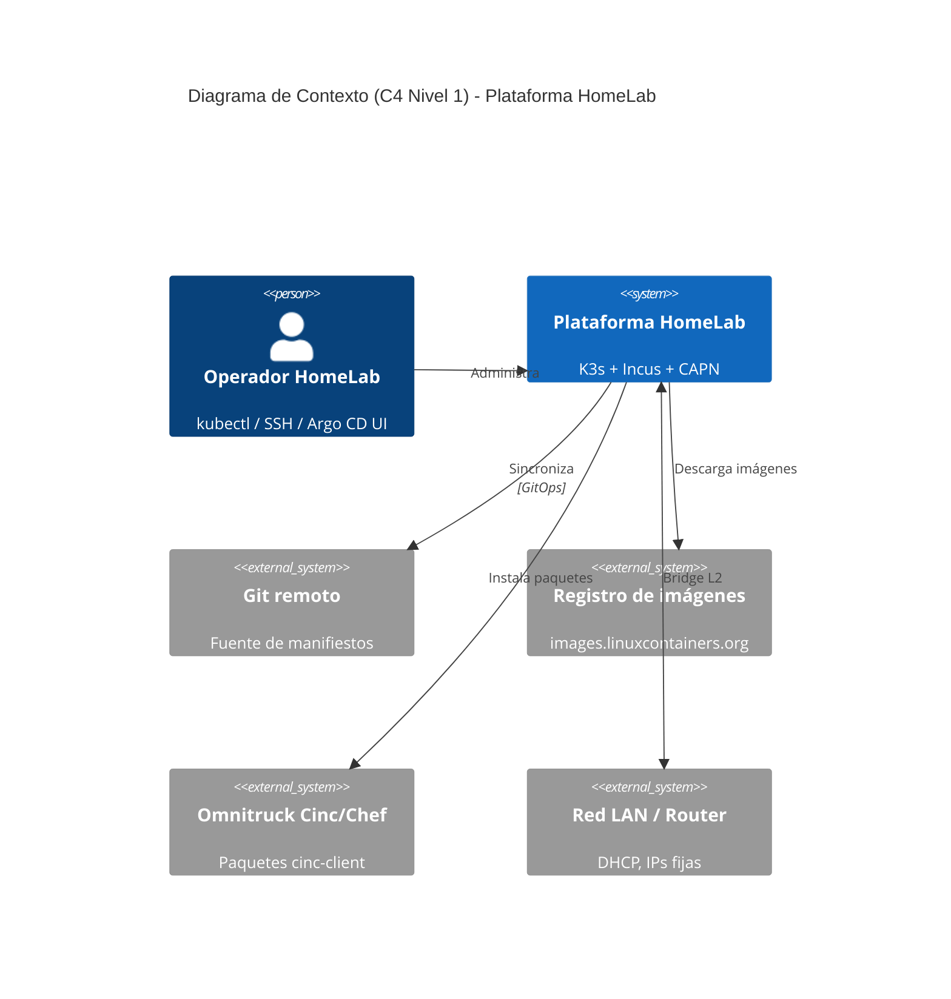

# 🏠 HomeLab — K3s + Incus + CAPN

📖 **Documentación publicada:** https://homelab.maceo.cl/

Documentación y código de infraestructura de mi HomeLab: un clúster Kubernetes
híbrido (x86_64 + ARM64) construido sobre Incus, con Cluster API (CAPN) para
provisionar clusters efímeros bajo demanda. Este README es la portada del
repo; la documentación navegable completa (con búsqueda) vive en el sitio
de GitHub Pages generado por MkDocs.

## Hardware

| Nodo | Modelo | CPU | RAM (medida) | IP | Rol |
|---|---|---|---|---|---|
| `invincible` | Lenovo ThinkCentre M920q | x86_64 i7-8700T | 15.5 GB | 192.168.20.6 | Incus leader / K3s worker |
| `oliver` | Lenovo ThinkCentre M700 | x86_64 i3-6100T | 7.7 GB | 192.168.20.7 | Incus (quorum) / K3s worker |
| `deborah` | Orange Pi 5 Plus | ARM64 RK3588 | 31 GB | 192.168.20.5 | K3s control-plane |

Detalle completo en [`docs/hardware/inventory.md`](docs/hardware/inventory.md).

> Los hostnames de los nodos (`invincible`, `oliver`, `deborah`, ...) siguen
> la serie de cómics/animación *Invincible* — ver
> [personajes](https://invincible.fandom.com/es/wiki/Categor%C3%ADa:Personajes).

## Arquitectura



Diagramas completos (niveles 1 a 4) en [`docs/architecture/`](docs/architecture/).

## Estructura del repo

```
.
├── docs/                  # documentación (fuente de verdad humana, publicada en Pages)
├── includes/              # siglas con tooltip en todas las páginas (abbreviations.md)
├── hooks/                 # hooks de MkDocs (siglas por idioma)
├── mkdocs.yml             # config del sitio MkDocs
├── translate_docs.py      # traducción al inglés (*.en.md) con el Ollama del HomeLab
├── ansible/               # bare-metal: Incus, netplan, K3s, BIND, firewall, Ollama, métricas de nodo
├── opentofu/              # recursos declarativos de Incus (perfiles, redes, cluster groups)
├── ollama-node/           # agente de nodo del Ollama dinámico (nodos Linux y Mac)
├── cinc-lab/              # cookbooks de prueba para el sandbox Cinc/Chef
└── .github/workflows/     # CI: deploy y traducción de docs + lint
```

## Sitio de documentación (MkDocs + GitHub Pages)

`docs/` se publica automáticamente como sitio estático vía GitHub Actions
(`.github/workflows/deploy-docs.yml`) en cada push a `main` que toque
`docs/`, `includes/`, `hooks/`, `mkdocs.yml` o `requirements-docs.txt`. Índice completo, con búsqueda,
en el sitio publicado (link arriba).

Con la CLI de GitHub (`gh`):

```bash
# lanzar el despliegue a mano
gh workflow run deploy-docs.yml --repo maceosoft/homelab --ref main
# seguir la corrida
gh run list --workflow deploy-docs.yml --repo maceosoft/homelab --limit 3
# ver la configuración de GitHub Pages (URL y origen)
gh api repos/maceosoft/homelab/pages
```

**Desarrollo local:**
```bash
# solo lo del sitio (requirements.txt trae además Ansible, lint y 1Password)
pip install -r requirements-docs.txt
# http://127.0.0.1:8000, con recarga en vivo
mkdocs serve
```

## Estado

🚧 En construcción activa. El bootstrap bare-metal (Incus, K3s, GitOps) sigue el recorrido de
[`docs/implementacion/`](docs/implementacion/). K3s se instala con la versión de `k3s_install.core.version` y después
se actualiza solo; el CNI es Calico; CAPN y vCluster son opcionales (sync manual).
