# Ansible — role catalog

Inventory of roles in [`ansible/roles/`](https://github.com/maceosoft/homelab/tree/main/ansible/roles). Each role has
its `README.md` with variables, tags and verification.

!!! tip "From scratch to a working node?"
    This page is the catalog by role/phase. The **complete order** to
    take a node from bare metal to operational (including hardening,
    BIND, WiFi — currently outside phases 1-4 below) is in
    [`ansible/bootstrap/README.md`](https://github.com/maceosoft/homelab/blob/main/ansible/bootstrap/README.md).

## By implementation phase

| Phase | Role(s) | Playbook |
|---|---|---|
| [1 — Network](../implementacion/fase-1-red.md) | `netplan_bridge` | `playbook-set-static-ip.yml` |
| [2 — Incus](../implementacion/fase-2-incus.md) | `incus_install`, `incus_cluster`, `incus_ui` | `playbook-bootstrap.yml` + `playbook-incus-cluster.yml` |
| [3 — K3s](../implementacion/fase-3-k3s.md) | `k3s_*` (10 roles) | `playbook-k3s.yml` |
| [4 — GitOps](../implementacion/fase-4-gitops.md) | — (inline playbook) | `playbook-dex-oauth-secrets.yml` |

## Roles

| Role | Purpose | Playbook | Tags |
|---|---|---|---|
| [`netplan_bridge`](https://github.com/maceosoft/homelab/blob/main/ansible/roles/netplan_bridge/README.md) | Static IP on `br0` (Netplan) and static `/etc/resolv.conf` | `playbook-set-static-ip.yml` | — |
| [`incus_install`](https://github.com/maceosoft/homelab/blob/main/ansible/roles/incus_install/README.md) | Incus package (Zabbly) | `playbook-bootstrap.yml` | — |
| [`incus_cluster`](https://github.com/maceosoft/homelab/blob/main/ansible/roles/incus_cluster/README.md) | Incus bootstrap/join/groups | `playbook-incus-cluster.yml` | `bootstrap`, `join`, `groups`, `scheduler` |
| [`incus_ui`](https://github.com/maceosoft/homelab/blob/main/ansible/roles/incus_ui/README.md) | Native Incus UI | `playbook-incus-cluster.yml` | `ui` |
| [`incus_ovn`](https://github.com/maceosoft/homelab/blob/main/ansible/roles/incus_ovn/README.md) | OVN for Incus (optional, off by default) | `playbook-incus-cluster.yml` | `ovn` |
| [`bind_dns`](https://github.com/maceosoft/homelab/blob/main/ansible/roles/bind_dns/README.md) | BIND on deborah: LAN DNS and the `mco.local` zone, its reverse zone and `homelab.local` | `playbook-bind-dns.yml` | — |
| — (no role) | Registers in Incus the metrics certificate that vmagent reads (issued by cert-manager; read from the Secret `monitoring/incus-metrics`) | `playbook-incus-metrics.yml` | — |
| [`node_apt_metrics`](https://github.com/maceosoft/homelab/blob/main/ansible/roles/node_apt_metrics/README.md) | Publishes to Prometheus the pending apt patches and whether the node needs a reboot (only warns, installs nothing) | `playbook-apt-metrics.yml` | — |
| [`k3s_prereqs`](https://github.com/maceosoft/homelab/blob/main/ansible/roles/k3s_prereqs/README.md) | Swap, kernel modules, sysctl, Longhorn requirements (open-iscsi, NFS) | `playbook-k3s.yml` | `prereqs`, `always` |
| [`k3s_server`](https://github.com/maceosoft/homelab/blob/main/ansible/roles/k3s_server/README.md) | K3s control plane | `playbook-k3s.yml` | `server`, `core` |
| [`k3s_cni`](https://github.com/maceosoft/homelab/blob/main/ansible/roles/k3s_cni/README.md) | Canal/Calico/Cilium CNI | `playbook-k3s.yml` | `cni`, `core` |
| [`k3s_agent`](https://github.com/maceosoft/homelab/blob/main/ansible/roles/k3s_agent/README.md) | K3s workers | `playbook-k3s.yml` | `agent`, `core` |
| [`k3s_kube_vip`](https://github.com/maceosoft/homelab/blob/main/ansible/roles/k3s_kube_vip/README.md) | API VIP `:6443` | `playbook-k3s.yml` | `kube_vip` |
| [`k3s_cleanup_traefik`](https://github.com/maceosoft/homelab/blob/main/ansible/roles/k3s_cleanup_traefik/README.md) | Cleans up Traefik/svclb | `playbook-k3s.yml` | `traefik` |
| [`k3s_node_labels`](https://github.com/maceosoft/homelab/blob/main/ansible/roles/k3s_node_labels/README.md) | Node labels | `playbook-k3s.yml` | `labels` |
| [`k3s_argocd`](https://github.com/maceosoft/homelab/blob/main/ansible/roles/k3s_argocd/README.md) | Argo CD controller | `playbook-k3s.yml` | `argocd`, `gitops` |
| [`k3s_fetch_kubeconfig`](https://github.com/maceosoft/homelab/blob/main/ansible/roles/k3s_fetch_kubeconfig/README.md) | Local kubeconfig | `playbook-k3s.yml` | `kubeconfig` |
| [`k3s_os_hardening`](https://github.com/maceosoft/homelab/blob/main/ansible/roles/k3s_os_hardening/README.md) | unattended-upgrades | `playbook-k3s.yml` | `hardening` |
| [`host_hardening`](https://github.com/maceosoft/homelab/blob/main/ansible/roles/host_hardening/README.md) | SSH, default accounts, sysctl, auditd | `playbook-hardening.yml` | — |
| [`opkssh`](https://github.com/maceosoft/homelab/blob/main/ansible/roles/opkssh/README.md) | SSH to the hosts with the Dex identity (`devops` team) | `playbook-opkssh.yml` | — |
| [`ollama_ondemand`](https://github.com/maceosoft/homelab/blob/main/ansible/roles/ollama_ondemand/README.md) | Multi-node Ollama (`llm_nodes` group: `deborah`, `invincible`, `oliver`) that only starts when a request arrives: systemd socket + proxy, download per architecture, per-node `MemoryMax`, a CPU cap (`CPUQuota`) and a guard that stops it and alerts if it spends 2 hours saturating the node, hardened systemd units, model download through the socket, models and priority from `host_vars`, and the agent that registers the node with the router ([guide](../operacion/agregar-nodo-ollama.md)) | `playbook-ollama.yml` | `models`, `cpu_guard` |
| [`host_firewall`](https://github.com/maceosoft/homelab/tree/main/ansible/roles/host_firewall) | Host firewall with `nftables` (its own table), applied with auto-rollback after 300 seconds if not confirmed; covers VXLAN, Geneve, etcd and the calico-node metrics ([README](https://github.com/maceosoft/homelab/blob/main/ansible/roles/host_firewall/README.md), [guide](../security/hardening-post-incidente.md)) | `playbook-firewall.yml` | — |
| [`ollama_node`](https://github.com/maceosoft/homelab/blob/main/ansible/roles/ollama_node/README.md) | Ollama registration agent as a systemd service (`ollama-node-register`), running as user `ollama-node` (supplementary group `ollama`), that announces the node's models to the router ([guide](../operacion/agregar-nodo-ollama.md)) | `playbook-ollama.yml` | `register` |
| [`wifi_failover`](https://github.com/maceosoft/homelab/blob/main/ansible/roles/wifi_failover/README.md) | WiFi backup for the wired link (nodes with WiFi) | `playbook-wifi-failover.yml` | — |
| [`storage_provision`](https://github.com/maceosoft/homelab/blob/main/ansible/roles/storage_provision/README.md) | Formats and mounts a free disk (destructive) | `playbook-storage-provision.yml` | — |

## Playbooks without a role (inline tasks)

| Playbook | Phase | Description |
|---|---|---|
| [`setup_sudo.yml`](https://github.com/maceosoft/homelab/blob/main/ansible/bootstrap/setup_sudo.yml) | Day 0 | Installs python3 and sudo and makes your user an administrator with sudo (connects as root; the user can be set with `-e bootstrap_admin_user=<usuario>`) |
| [`playbook-discovery.yml`](https://github.com/maceosoft/homelab/blob/main/ansible/playbook-discovery.yml) | 0 | Hardware inventory → `ansible/reports/` |
| [`playbook-incus-cluster.yml`](https://github.com/maceosoft/homelab/blob/main/ansible/playbook-incus-cluster.yml) | 2 | Incus bootstrap/join/groups/UI |
| [`playbook-dex-oauth-secrets.yml`](https://github.com/maceosoft/homelab/blob/main/ansible/playbook-dex-oauth-secrets.yml) | 4 | Dex OAuth: 1Password + Argo CD + Incus/vCluster |
| [`playbook-rotate-root-passwords.yml`](https://github.com/maceosoft/homelab/blob/main/ansible/playbook-rotate-root-passwords.yml) | Security | Rotates the root password → 1Password (HomeLab vault) |
| [`playbook-k3s-uninstall.yml`](https://github.com/maceosoft/homelab/blob/main/ansible/playbook-k3s-uninstall.yml) | Appendix | Uninstalls K3s on the 3 nodes |

OAuth documentation: [`gitops/argocd/secrets/1password.md`](https://github.com/maceosoft/gitops/blob/main/argocd/secrets/1password.md)

## K3s execution order

```mermaid
flowchart LR
  prereqs[k3s_prereqs] --> server[k3s_server]
  server --> cni[k3s_cni_opcional]
  cni --> kube_vip[k3s_kube_vip_opcional]
  server --> kube_vip
  kube_vip --> agent[k3s_agent]
  agent --> traefik[k3s_cleanup_traefik]
  traefik --> labels[k3s_node_labels_opcional]
  labels --> argocd[k3s_argocd_opcional]
  argocd --> kubeconfig[k3s_fetch_kubeconfig_opcional]
  kubeconfig --> hardening[k3s_os_hardening_opcional]
```

## Global configuration

| File | Content |
|---|---|
| [`group_vars/incus_cluster/k3s_install.yml`](https://github.com/maceosoft/homelab/blob/main/ansible/group_vars/incus_cluster/k3s_install.yml) | K3s playbook flags |
| [`group_vars/dex_oauth_secrets.yml`](https://github.com/maceosoft/homelab/blob/main/ansible/group_vars/dex_oauth_secrets.yml) | Dex OAuth |
| [`group_vars/incus_cluster/vars.yml`](https://github.com/maceosoft/homelab/blob/main/ansible/group_vars/incus_cluster/vars.yml) | Incus storage, groups, UI |
| [`group_vars/all.yml`](https://github.com/maceosoft/homelab/blob/main/ansible/group_vars/all.yml) | Gateway, control plane IP |
| [`host_vars/*.yml`](https://github.com/maceosoft/homelab/tree/main/ansible/host_vars) | Labels, kubelet args per node |

## References

- [K3s playbook options](../k3s/playbook-options.md)
- [Implementation guide](../implementacion/index.md)
