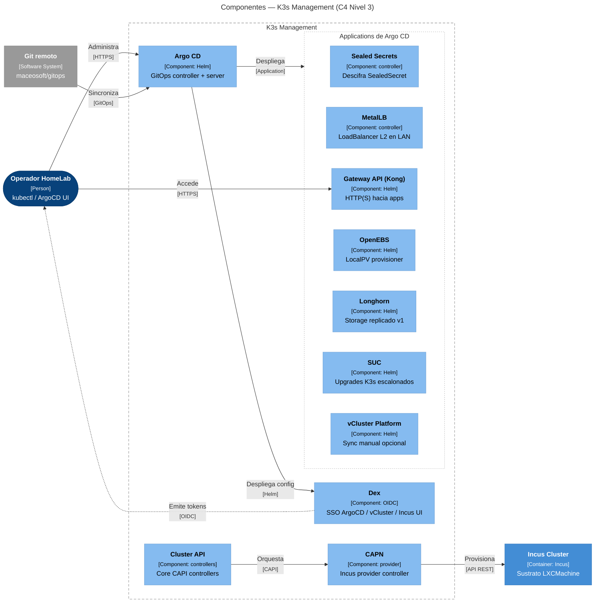
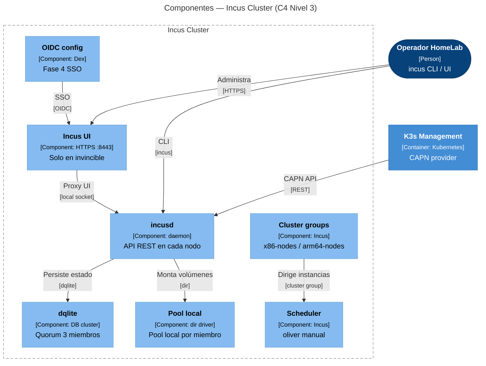
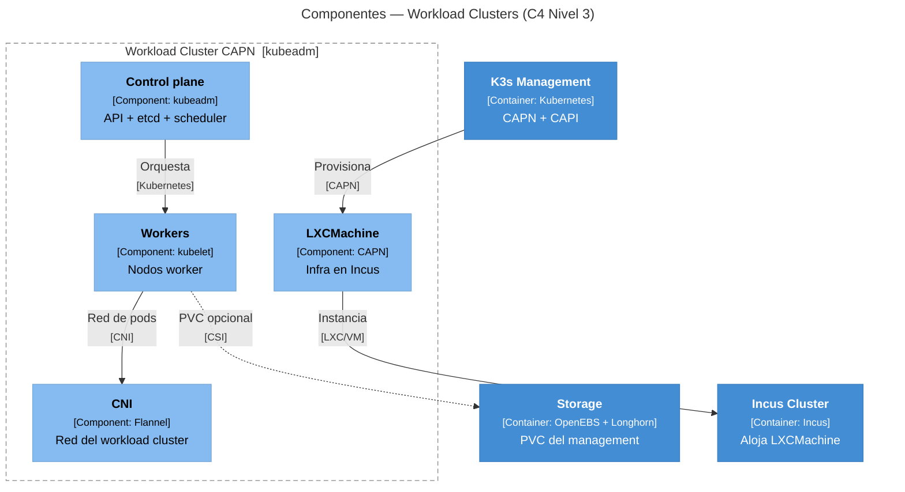
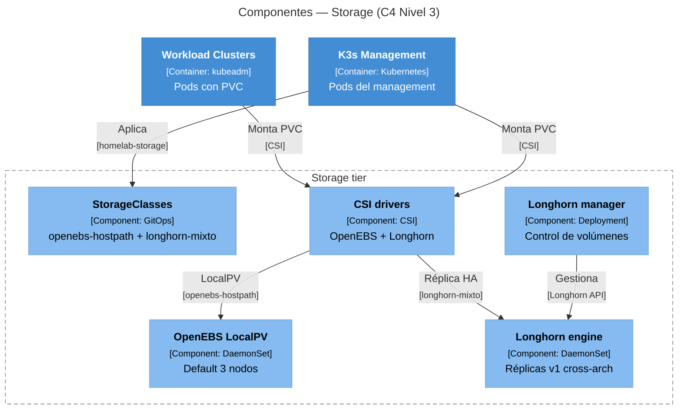
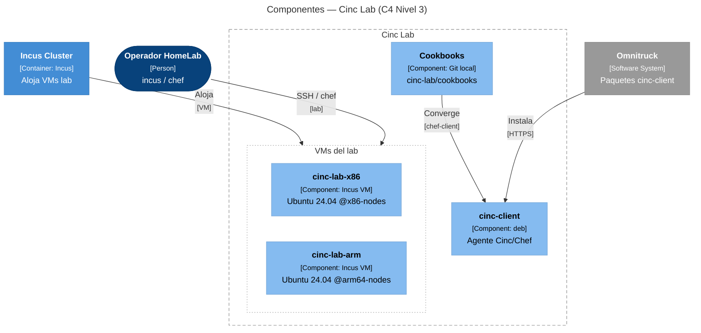
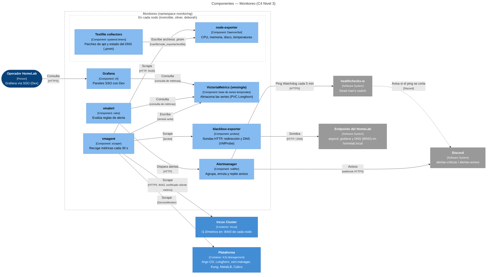

# C4 Level 3 — Components

Zoom into each **container** of the [Level 2](overview.md#level-2-containers):
internal components, technologies, and relationships. For the physical node map,
continue to **[Level 4 — Deployment](nivel-4-despliegue.md)**.

Return to [Overview (Levels 1–2)](overview.md).

## 3.1 — K3s Management

Breakdown of the bare-metal control cluster: GitOps (Argo CD), identity (Dex),
provisioning CAPI/CAPN, service network (MetalLB, Gateway), storage operators (OpenEBS, Longhorn), secrets (Sealed Secrets), upgrades (SUC), and optional vCluster Platform.

Operational details: [Technology Stack](../implementacion/stack-tecnologico.md),
[GitOps](../gitops/index.md).

## 3.2 — Incus Cluster

Internals of the HA (high availability) Incus cluster on the 3 physical nodes: quorum dqlite, daemon
per member, pool `local` (driver `dir`), cluster groups, manual scheduler in
`oliver`, native UI in invincible and OIDC (OpenID Connect) Dex (Phase 4).

Details: [Incus Cluster](../incus/cluster-setup.md).

## 3.3 — Workload Clusters

Internal structure of a **kubeadm** ephemeral cluster provisioned by CAPN (Cluster API Provider for Incus)
(e.g., `demo`): LXCMachine in Incus, control plane, workers, and CNI (Container Network Interface) Flannel of
the workload. Not a nested K3s (lightweight Kubernetes distribution).

Details: [CAPN](../capn/index.md), [Phase 6](../implementacion/fase-6-capn.md).

## 3.4 — Storage

Logical components of the hybrid tier **OpenEBS LocalPV** (default, 3 nodes) +
**Longhorn v1** (cross-arch replica between `invincible` and `deborah`; see [Longhorn v1](../storage/index.md#longhorn-v1-ha-selectiva-cross-arch)). The pods
run in K3s; here they are modeled as a separate Level 2 C4 container for clarity.

Details: [Storage](../storage/index.md).

## 3.5 — Cinc Lab

Learning sandbox **Cinc/Chef** in Incus VMs (virtual machines) (Ubuntu 24.04), one in
`@x86-nodes` and another in `@arm64-nodes`. Not a production piece of the HomeLab.

Details: [Cinc/Chef Lab](../labs/cinc/index.md).

## 3.6 — Monitoring

Observability stack in the namespace `monitoring`, deployed by Argo CD. **VictoriaMetrics** (Prometheus-compatible metrics database) stores the series; **vmagent** scrapes them every 30 seconds from the nodes, the platform, and Incus; **vmalert** evaluates the rules and **Alertmanager** sends the alerts to Discord. The **probes** are executed by **blackbox-exporter** (HTTP and DNS seen from inside the cluster). On each node, **node-exporter** publishes CPU, memory, and temperatures, and also reads the **textfile collectors**: files `.prom` that some timers
(`systemd timers`) write to the node with pending apt patches and the DNS (BIND) status; the SMART role is prepared in the repo.

## Next

**[→ Level 4 — Deployment](nivel-4-despliegue.md)** — physical map of the 3 nodes.
