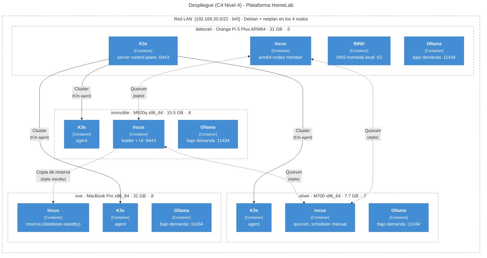

# C4 Level 4 — Deployment

**Physical** map of the platform: the 4 nodes on the LAN (local network), running Debian with
`br0`, the Incus daemon, and a K3s role (lightweight Kubernetes distribution) on each one. It complements the logical zoom in
[Level 3 — Components](nivel-3-componentes.md).

Back to [Overview (Level 1–2)](overview.md).

## Nodes and roles

| Node | Hardware | RAM | IP `br0` | Incus | K3s |
|---|---|---|---|---|---|
| `invincible` | Lenovo M920q x86_64 | 15.5 GB | 192.168.20.6 | Leader + UI `:8443` | agent |
| `oliver` | Lenovo M700 x86_64 | 7.7 GB | 192.168.20.7 | Quorum; **manual** scheduler | agent |
| `deborah` | Orange Pi 5 Plus ARM64 | 31 GB | 192.168.20.5 | `arm64-nodes` member | **server** (CP) `:6443` |
| `eve` | MacBook Pro 16" 2019 x86_64 | 31 GB | 192.168.20.8 | Database standby (`database-standby`, non-voting) | agent |

All four nodes also run Ollama on demand (group `llm_nodes`, see [Local AI](../operacion/ia-ollama.md)),
and contribute disk to Longhorn; in addition, `deborah` serves the LAN DNS (BIND, zone `homelab.local`).

Three members vote in the Incus database (dqlite): `invincible`, `oliver`, and `deborah`. `eve` is kept on standby
(`database-standby`): it receives a copy of the database and, if a voting member goes down, Incus promotes it to keep
three votes. The database leader (currently `invincible`) can move between nodes.

!!! note "RAM budget"
    `oliver` has a manual scheduler because it must not host Incus instances
    automatically (it preserves RAM for the management cluster). `deborah` is
    a control plane because of its available RAM (31 GB), even though it is ARM64 (64-bit ARM architecture) — validate CNI (Container Network Interface)
    and workloads before intensive production use.

Hardware details: [Inventory](../hardware/inventory.md).

## Deployment diagram

## Previous

**[← Level 3 — Components](nivel-3-componentes.md)**
