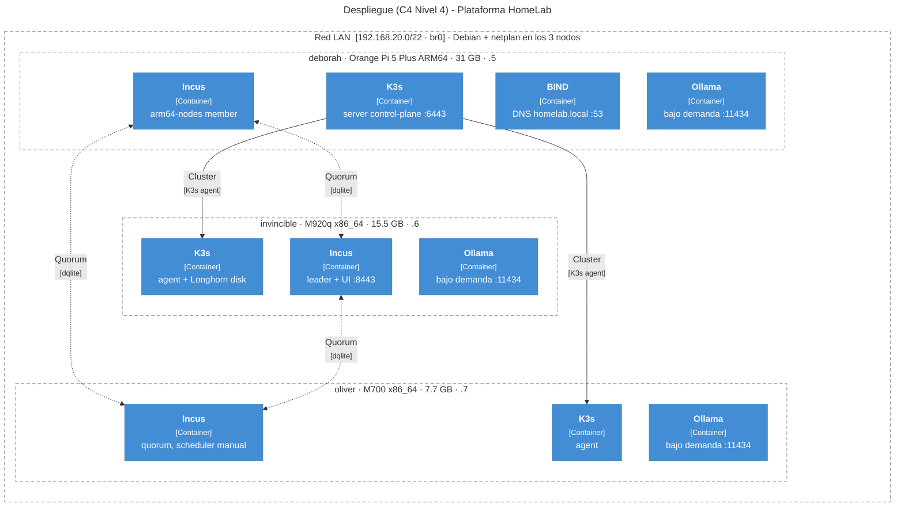

# C4 Level 4 — Deployment

**Physical** map of the platform: the 3 nodes on the LAN (local network), Debian OS with
`br0`, the Incus daemon and the K3s (lightweight Kubernetes distribution) role on each one. It complements the logical zoom of
[Level 3 — Components](nivel-3-componentes.md).

Back to [Overview (Level 1–2)](overview.md).

## Nodes and roles

| Node | Hardware | RAM | `br0` IP | Incus | K3s |
|---|---|---|---|---|---|
| `invincible` | Lenovo M920q x86_64 | 15.5 GB | 192.168.20.6 | Leader + UI `:8443` | agent; Longhorn disk |
| `oliver` | Lenovo M700 x86_64 | 7.7 GB | 192.168.20.7 | Quorum; **manual** scheduler | agent |
| `deborah` | Orange Pi 5 Plus ARM64 | 31 GB | 192.168.20.5 | `arm64-nodes` member | **server** (CP) `:6443` |

All three nodes also run on-demand Ollama (`llm_nodes` group, see [Local AI](../operacion/ia-ollama.md)), and
`deborah` serves the LAN DNS (BIND, `homelab.local` zone).

!!! note "RAM budget"
    `oliver` has a manual scheduler because it must not host Incus instances
    automatically (it saves RAM for the management cluster). `deborah` is the
    control plane because of its available RAM (31 GB), even though it is ARM64 (64-bit ARM architecture) — validate the CNI (Container Network Interface)
    and workloads before heavy production use.

Hardware details: [Inventory](../hardware/inventory.md).

## Deployment diagram

## Previous

**[← Level 3 — Components](nivel-3-componentes.md)**
