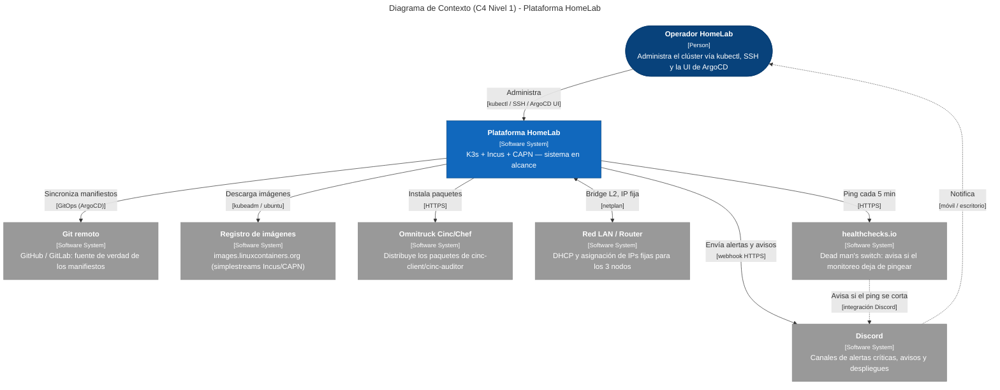
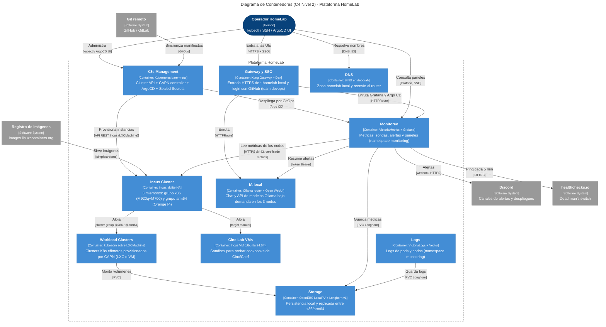

# Architecture

Design view of the HomeLab. For the **technology stack** with a layered diagram
and links to official documentation of each product, see **[Technology Stack](../implementacion/stack-tecnologico.md)**.

Executable guide: **[Implementation](../implementacion/index.md)**.

## Layers

1. **Hardware** — 3 physical nodes (2x x86_64, 1x ARM64). See [inventory](../hardware/inventory.md).
2. **Incus Cluster** — virtualization substrate, 3 members with dqlite quorum.
   Cluster groups `x86-nodes` / `arm64-nodes` to direct where each instance runs.
3. **K3s (lightweight Kubernetes distribution) Management** — the existing bare-metal K3s cluster, hosting:
    - Cluster API core + CAPN controller (Cluster API Provider for Incus)
    - Argo CD (GitOps)
    - Sealed Secrets controller
4. **Workload Clusters** — ephemeral kubeadm clusters provisioned by CAPN as Incus (LXC or VM) instances for dev/test/isolation.
5. **Storage** — OpenEBS LocalPV (default, on all 3 nodes) + Longhorn v1
   (replicated between `invincible` and `deborah`; `oliver` stays out due to RAM if `createDefaultDiskLabeledNodes` is activated, see [Longhorn v1](../storage/index.md#longhorn-v1-selective-ha-cross-arch)).

## Key Design Decision

The production K3s is not migrated to nested-K8s. The existing K3s cluster is
kept as the *management cluster* for Cluster API; CAPN provisions additional
clusters on demand over the same hardware without touching production.

## C4 Diagrams

### Level 1 — Context

High-level view: the **HomeLab Platform** as a single black box and the external
actors/systems it interacts with (operator, Git, image registry, Omnitruck, LAN,
and Discord and healthchecks.io alert services). Useful for understanding *what
goes in and out* of the system without internal details.

### Level 2 — Containers

Open the box of the platform and show the **logical containers** (K3s Management,
Incus Cluster, Workload Clusters, Storage, Monitoring, Logs, Local AI, Gateway
and SSO, DNS, and Cinc Lab) with their technologies and how they relate to each
other and to external systems.

## Dive Deeper into C4

| Level | Page | What it shows |
|---|---|---|
| 1–2 | *(this page)* | Context + logical containers |
| 3 | **[Components](nivel-3-componentes.md)** | Zoom into container (K3s, Incus, workload, storage, monitoring, Cinc); AI, logs, and access in [Local AI](../operacion/ia-ollama.md), [Logs](../operacion/logs.md), and [Authentication Model](../security/modelo-de-autenticacion.md) |
| 4 | **[Deployment](nivel-4-despliegue.md)** | 3 physical nodes on the LAN |

