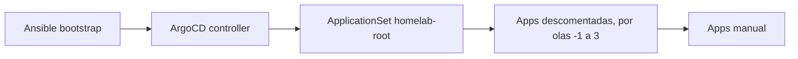

# GitOps — catalog and troubleshooting

!!! info "Part of the implementation guide"
    The step-by-step walkthrough is in **[Phase 4 — GitOps](../implementacion/fase-4-gitops.md)**.
    Ansible bootstrap (K3s, network): [Phases 0–3](../implementacion/index.md).

Reference for Argo CD **Applications** and troubleshooting. Manifests in
[`gitops/`](https://github.com/maceosoft/gitops).

Related documentation:

- [K3s playbook options](../k3s/playbook-options.md) — Ansible flags (kube-vip, Argo CD controller, …)
- [vCluster Platform](../vcluster/index.md) — SSO (single sign-on) Dex + web kubeconfig (K3s host + vClusters)
- [Incus Cluster](../incus/cluster-setup.md#admin-ui) — web UI + OIDC (OpenID Connect) Dex
- [Storage](../storage/index.md) / [Secrets](../secrets/index.md)
- [Tech stack](../implementacion/stack-tecnologico.md)

## Two repos, two responsibilities

| Repo | What it installs | Tool |
|---|---|---|
| [`homelab`](https://github.com/maceosoft/homelab) | K3s binary, kube-vip CP, Argo CD controller, OS network | [Ansible](https://docs.ansible.com/) |
| [`gitops`](https://github.com/maceosoft/gitops) | MetalLB, Gateway API, storage, vCluster, CAPN, … | [Argo CD](https://argo-cd.readthedocs.io/) |

---

## GitOps component catalog

Each row is an Argo CD **Application** (except auxiliary manifests).
Sync **auto** = synced by `homelab-root` (if uncommented in `root-appset.yaml`); **manual** = stays commented until you enable it.

### Bootstrap

| Manifest | Sync | Purpose |
|---|---|---|
| [`bootstrap/root-appset.yaml`](https://github.com/maceosoft/gitops/blob/main/bootstrap/root-appset.yaml) | Once, manually | **ApplicationSet**: generates the root Application `homelab-root` with the uncommented apps from its list, deployed in waves. It is the only `kubectl apply` GitOps after having the controller; Argo CD does not manage it, so it is reapplied with `kubectl apply -f` whenever the list changes. |

### Wave 0 — Foundations (storage + LB controller)

| Application | Product | Purpose |
|---|---|---|
| **`sealed-secrets`** | [Sealed Secrets](https://github.com/bitnami-labs/sealed-secrets) | Controller that decrypts `SealedSecret` in the cluster. |
| **`openebs`** | [OpenEBS](https://openebs.io/docs) | Per-node local storage (LocalPV). |
| **`homelab-storage`** | — | StorageClasses `openebs-hostpath` (default) and `longhorn-mixto` ([trade-offs](../storage/index.md#cluster-storageclasses)). |
| **`metallb`** | [MetalLB](https://metallb.universe.tf/) | LoadBalancer controller on LAN. **Not** kube-vip. |
| **`gateway-api`** | [Gateway API](https://gateway-api.sigs.k8s.io/) | CRDs `Gateway`, `HTTPRoute`, etc. (standard channel). |
| **`cert-manager`** | [cert-manager](https://cert-manager.io/docs/) | TLS certificate issuance. |

### Wave 1 — Service mesh + HA storage

| Application | Product | Purpose |
|---|---|---|
| **`metallb-config`** | [MetalLB](https://metallb.universe.tf/) | L2 pool `192.168.23.200–192.168.23.220` (reserved outside router DHCP). |
| **`cert-manager-config`** | [cert-manager](https://cert-manager.io/docs/) | HomeLab private CA (`ClusterIssuer homelab-ca`). |
| **`kong`** (or `traefik`, `nginx-gateway`) | [Kong Ingress Controller](https://developer.konghq.com/kubernetes-ingress-controller/) | [Gateway API](https://gateway-api.sigs.k8s.io/) controller and `Gateway homelab` (HTTP/HTTPS, `*.homelab.local`). Only one is enabled; see [Switch Gateway Controller](../operacion/cambiar-gateway.md). |
| **`longhorn`** | [Longhorn](https://longhorn.io/docs/) | Cross-arch replicated storage. |

### Wave 2 — Accessible Argo CD + Dex

| Application / folder | Product | Purpose |
|---|---|---|
| **`argocd-route`** | [Gateway API](https://gateway-api.sigs.k8s.io/) | `HTTPRoute`: UI at [`https://argocd.homelab.local`](https://argocd.homelab.local). |
| **`argocd/config/`** (`argocd`) | [Dex](https://dexidp.io/docs/) | GitHub connector + staticClients for vCluster and Incus UI. |
| **`victoria-metrics`** *(optional)* | [VictoriaMetrics](https://docs.victoriametrics.com/helm/victoria-metrics-k8s-stack/) | Monitoring: metrics, Alertmanager (alerts to Discord) and Grafana at [`https://grafana.homelab.local`](https://grafana.homelab.local). Requires `playbook-platform-secrets.yml` Secrets before enabling ([4.13](../implementacion/fase-4-gitops.md#413-monitoring-and-alerts-optional)). |
| [`argocd/config/notifications/`](https://github.com/maceosoft/gitops/tree/main/argocd/config/notifications) | Argo CD Notifications | Services, triggers and templates for Discord notifications ([4.14](../implementacion/fase-4-gitops.md#414-argocd-notifications-to-discord-optional)); `test.sh` tests them without sending. |
| [`argocd/secrets/`](https://github.com/maceosoft/gitops/tree/main/argocd/secrets) | [1Password SDK](https://github.com/1Password/onepassword-sdk-python) | OAuth from local app |

**What it looks like.** The Argo CD UI at [`https://argocd.homelab.local`](https://argocd.homelab.local) prompts for GitHub login (Dex):

??? note "View screenshot: Argo CD login"
    { loading=lazy }

The root application `homelab-root` groups all others: in its tree view, each "application" box is one of the Applications from the catalog.

??? note "View screenshot: homelab-root tree"
    { loading=lazy }

### Wave 3 — Operations

| Application | Product | Purpose |
|---|---|---|
| **`k3s-upgrade`** | [system-upgrade-controller](https://github.com/rancher/system-upgrade-controller) | Staggered K3s upgrades. |
| **`victoria-metrics-config`** *(optional)* | [VictoriaMetrics](https://docs.victoriametrics.com/operator/) | Alert rules (`VMRule`), scrapes for cert-manager, Longhorn and Argo CD, and the `HTTPRoute` Grafana dashboard. Goes after `victoria-metrics` because its CRDs are installed by that chart. |

### AI Assistant (folder `ai/`)

| Application | Purpose |
|---|---|
| **`ollama-router`** | Namespace `ai`, Service, Kong route (HTTPS only, `ollama.homelab.local`) and single router for Ollama nodes: automatic registration, per-client Bearer token, node selection by model, and metrics by model and node. Replaces per-node Services and the `/api/tags` cache. |
| **`open-webui`** | Assistant web chat (`open-webui.homelab.local`), with SSO via Dex (client `open-webui`). |
| **`open-terminal`** | Terminal with code execution for the assistant, isolated in the `ai-sandbox` namespace and accessible only from Open WebUI. |
| **`ai-tools`** | Read-only tools (Kubernetes and metrics) used by the assistant. |
| **`k8sgpt`** | K8sGPT: cluster analysis explained by Ollama. The alert summary lives in `ai/alert-triage`. **Staged** (commented in `root-appset.yaml`): its chart includes a ClusterRole `*/*/*`; the decision to enable it is up to the user (see [Authentication Model](../security/modelo-de-autenticacion.md#optional-checks)). |

### Logs and Reports (folders `monitoring/` and `ai/log-report/`)

| Application | Purpose |
|---|---|
| **`victoria-logs`** | VictoriaLogs: log database (30-day retention), ClusterIP only. |
| **`vector`** | Vector: DaemonSet that reads pod logs and node journals and sends them to VictoriaLogs. |
| **`log-report`** | CronJobs `log-digest-daily` (daily summary saved as log) and `log-report-weekly` (weekly AI report to the `#ia` channel). |

See [Centralized Logs and AI Reports](../operacion/logs.md).

### Security (folder `security/` and NetworkPolicies per namespace)

Security manifests, almost all **to be enabled** one by one (commented in `root-appset.yaml`, with README for checks and rollback):

- NetworkPolicies `default-deny` with explicit permissions (Applications `netpol-ai`, `netpol-monitoring`,
  `netpol-longhorn-system`, `netpol-kong`, `netpol-gateway` and `netpol-arc-runners`, folder
  [`security/networkpolicies/`](https://github.com/maceosoft/gitops/tree/main/security/networkpolicies)). The one for
  `ai-sandbox` travels with the app `open-terminal`.
- Pod Security Admission labels in `warn` and `audit` (`namespace-labels`) and `allowedRoutes` by selector.
- `oauth2-proxy` (optional) to publish internal interfaces behind Dex.
- [`security/k8sgpt-rbac/`](https://github.com/maceosoft/gitops/tree/main/security/k8sgpt-rbac) and
  [`security/calico-policy-edit/`](https://github.com/maceosoft/gitops/tree/main/security/calico-policy-edit):
  documentation and proposals for K8sGPT (staged) and for the Calico risk.

**Enabled:** `security-rbac`, which grants read-only (`view`) to the `oidc:maceosoft:devops` group when logging in via Dex. The NetworkPolicies for logs, `ai/tools`, `alert-triage` and Open Terminal already travel with their application. Kong Manager disabled and Argo CD without the local `admin` are part of the normal configuration. The report CronJob scripts have their source versioned in [`scripts/log-report/`](https://github.com/maceosoft/gitops/tree/main/scripts/log-report). See
[Authentication Model](../security/modelo-de-autenticacion.md).

See [Local AI Assistant](../operacion/ia-ollama.md).

### Manual Sync (you decide when)

| Application | Product | Purpose |
|---|---|---|
| **`vcluster-platform`** | [vCluster Platform](https://www.vcluster.com/docs/platform/) | UI: K3s host kubeconfig (connected) + vClusters. |
| **`capn-demo`** | [CAPN](https://capn.linuxcontainers.org/) | Cluster API over Incus. |
| **`calico-operator`** + **`calico-config`** | [Calico](https://docs.tigera.io/calico/latest/about/) | Calico CNI (CRDs + operator + `Installation`). **Active**: Argo CD manages and updates Calico (v3.33.0); Ansible installed it when creating the cluster. **Manual** sync. See [Calico with Argo CD](../operacion/actualizar-calico.md). |
| **`canal`** | [Canal](https://docs.tigera.io/calico/latest/getting-started/kubernetes/flannel/flannel) | Canal CNI (Flannel + Calico policies). |
| **`cilium`** | [Cilium](https://docs.cilium.io/) | Cilium CNI via Helm. |

!!! note "CNI: Phase 3, not Phase 4"
    The CNI (Container Network Interface) is chosen in [Phase 3 — K3s](../implementacion/fase-3-k3s.md) (`k3s_install.core.cni`).
    By default **embedded Flannel** (Ansible, no Application). The apps above
    are GitOps alternatives if K3s (lightweight Kubernetes distribution) already has `--flannel-backend=none`. See
    [playbook-options — CNI](../k3s/playbook-options.md#cni).

### Support Manifests (not Applications)

| Path | Purpose |
|---|---|
| [`storage/`](https://github.com/maceosoft/gitops/tree/main/storage) | StorageClasses via `homelab-storage`. |
| [`metallb/`](https://github.com/maceosoft/gitops/tree/main/metallb) | Pool + L2Advertisement. |
| [`k3s-upgrade/`](https://github.com/maceosoft/gitops/tree/main/k3s-upgrade) | `Plan` SUC CRs. |
| [`monitoring/`](https://github.com/maceosoft/gitops/tree/main/monitoring) | VictoriaMetrics chart values, rules, scrapes, Grafana route, and rule tests (`victoria-metrics` and `victoria-metrics-config`). |
| [`vcluster/values/platform.yaml`](https://github.com/maceosoft/gitops/blob/main/vcluster/values/platform.yaml) | Platform Helm values + Dex OIDC. |
| [`capn/clusters/`](https://github.com/maceosoft/gitops/tree/main/capn/clusters) | Clusters generated with `clusterctl`. |
| [`ai/`](https://github.com/maceosoft/gitops/tree/main/ai) | AI assistant manifests: `ollama-router`, `open-webui`, `open-terminal`, `tools`, `alert-triage`, `k8sgpt` and `log-report`. |
| [`cni/calico/`](https://github.com/maceosoft/gitops/tree/main/cni/calico) | Calico Installation CR (`calico-config` Application). |

---

## kube-vip (Ansible) vs MetalLB (GitOps)

| | [kube-vip](https://kube-vip.io/) | [MetalLB](https://metallb.universe.tf/) |
|---|---|---|
| **Who installs it** | Ansible (`k3s_kube_vip`) | Argo CD |
| **What gets the VIP** | Only API server `:6443` | Services `LoadBalancer` |
| **Key config** | `svc_enable=false` | Pool `192.168.23.200–.220` |

---

## Quick troubleshooting

| Symptom | Check |
|---|---|
| Application `Degraded` | `kubectl describe application -n argocd <nombre>` |
| `arc-runners` `OutOfSync` and the listener pod restarts every few minutes | Argo CD prunes in a loop the resources created by the ARC controller (`AutoscalingListener`, `Role`, `RoleBinding`: they copy the `app.kubernetes.io/instance` label). Fixed with `application.resourceTrackingMethod: annotation` in `argocd-cm` (already in `gitops/argocd/config`). Check: `kubectl -n argocd get cm argocd-cm -o jsonpath='{.data.application\.resourceTrackingMethod}'` → `annotation`; if not, sync `argocd` and restart the controller: `kubectl -n argocd rollout restart statefulset argocd-application-controller` |
| `openebs` `OutOfSync` with sync stuck at `Running` | The chart's `pre-upgrade` hook Job doesn't finish and Argo CD waits for it. In OpenEBS it uses an image (`bitnami/kubectl:1.25.15`) that no longer exists on Docker Hub; the hook only migrates from v3 to v4 and is disabled in `argocd/apps/openebs.yaml` (`preUpgradeHook.enabled: false`). If the old Job is still there with the `argocd.argoproj.io/hook-finalizer` finalizer, cancel the operation (`status.operationState.phase: Terminating`) and remove the finalizer |
| `longhorn` with sync stuck at `Running`: the `longhorn-pre-upgrade` Job has no pod (`serviceaccount "longhorn-service-account" not found`) | In a **clean install** with Argo CD that Job runs before its ServiceAccount and the sync waits forever: disable it with `preUpgradeChecker.jobEnabled: false` (already set in `argocd/apps/longhorn.yaml`). If you cancel the operation (`status.operationState.phase: Terminating`), remove the Job's finalizer and refresh. In an **upgrade** the Job does run and fails for a reason if the upgrade path isn't supported: read `kubectl logs -n longhorn-system job/longhorn-pre-upgrade` before disabling it |
| Gateway without address | `metallb-config` sync, free pool in LAN |
| vCluster SSO fails | `playbook-dex-oauth-secrets.yml --tags ensure,argocd,vcluster`; restart Dex |
| Incus UI SSO fails | `incus config get oidc.issuer` / `oidc.client.id` in invincible; `invincible` must trust the HomeLab CA (`--tags incus_ca`); public `incus-ui` client in `dex.config`; restart Dex |
| Dex login without GitHub | GitHub secrets in `argocd-secret`; OAuth App Redirect URIs correct |
| GitHub login rejected | User must belong to the `devops` team in the `maceosoft` org |
| Longhorn pod pending | Labels `node.longhorn.io/create-default-disk` ([playbook labels](../k3s/playbook-options.md)) |
| CNI pods not Ready | K3s with `--flannel-backend=none` before sync; only **one** CNI app active ([CNI](../k3s/playbook-options.md#cni)) |

Source manifests: [`gitops/argocd/apps/`](https://github.com/maceosoft/gitops/tree/main/argocd/apps).

Runnable guide: **[Phase 4 — GitOps](../implementacion/fase-4-gitops.md)**.
