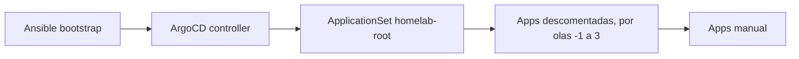

# GitOps — catálogo y troubleshooting

!!! info "Parte de la guía de implementación"
    El recorrido paso a paso está en **[Fase 4 — GitOps](../implementacion/fase-4-gitops.md)**.
    Ansible bootstrap (K3s, red): [Fases 0–3](../implementacion/index.md).

Referencia de **Applications** Argo CD y resolución de problemas. Manifiestos en
[`gitops/`](https://github.com/maceosoft/gitops).

Documentación relacionada:

- [Opciones del playbook K3s](../k3s/playbook-options.md) — flags Ansible (kube-vip, Argo CD controller, …)
- [vCluster Platform](../vcluster/index.md) — SSO (inicio de sesión único) Dex + kubeconfig web (K3s host + vClusters)
- [Clúster Incus](../incus/cluster-setup.md#ui-de-administracion) — UI (interfaz de usuario) web + OIDC (OpenID Connect) Dex
- [Storage](../storage/index.md) / [Secretos](../secrets/index.md)
- [Stack tecnológico](../implementacion/stack-tecnologico.md)

## Dos repos, dos responsabilidades

| Repo | Qué instala | Herramienta |
|---|---|---|
| [`homelab`](https://github.com/maceosoft/homelab) | K3s binario, kube-vip CP, controller Argo CD, red SO | [Ansible](https://docs.ansible.com/) |
| [`gitops`](https://github.com/maceosoft/gitops) | MetalLB, Gateway API, storage, vCluster, CAPN, … | [Argo CD](https://argo-cd.readthedocs.io/) |

---

## Catálogo de componentes GitOps

Cada fila es una **Application** de Argo CD (salvo manifiestos auxiliares).
Sync **auto** = la sincroniza `homelab-root` (si está descomentada en `root-appset.yaml`); **manual** = queda comentada hasta que la actives.

### Bootstrap

| Manifiesto | Sync | Para qué sirve |
|---|---|---|
| [`bootstrap/root-appset.yaml`](https://github.com/maceosoft/gitops/blob/main/bootstrap/root-appset.yaml) | Una vez, a mano | **ApplicationSet**: genera la Application raíz `homelab-root` con las apps descomentadas de su lista, desplegadas por olas. Es el único `kubectl apply` GitOps tras tener el controller; Argo CD no lo gestiona, así que se vuelve a aplicar con `kubectl apply -f` cada vez que cambia la lista. |

### Wave 0 — Fundamentos (storage + LB controller)

| Application | Producto | Para qué sirve |
|---|---|---|
| **`sealed-secrets`** | [Sealed Secrets](https://github.com/bitnami-labs/sealed-secrets) | Controller que descifra `SealedSecret` en el clúster. |
| **`openebs`** | [OpenEBS](https://openebs.io/docs) | Storage local por nodo (LocalPV). |
| **`homelab-storage`** | — | StorageClasses `openebs-hostpath` (default) y `longhorn-mixto` ([trade-offs](../storage/index.md#storageclasses-del-cluster)). |
| **`metallb`** | [MetalLB](https://metallb.universe.tf/) | Controller LoadBalancer en LAN. **No** es kube-vip. |
| **`gateway-api`** | [Gateway API](https://gateway-api.sigs.k8s.io/) | CRDs `Gateway`, `HTTPRoute`, etc. (canal standard). |
| **`cert-manager`** | [cert-manager](https://cert-manager.io/docs/) | Emisión de certificados TLS. |

### Wave 1 — Red de servicios + storage HA

| Application | Producto | Para qué sirve |
|---|---|---|
| **`metallb-config`** | [MetalLB](https://metallb.universe.tf/) | Pool L2 `192.168.23.200–192.168.23.220` (reservado fuera del DHCP del router). |
| **`cert-manager-config`** | [cert-manager](https://cert-manager.io/docs/) | CA propia del HomeLab (`ClusterIssuer homelab-ca`). |
| **`kong`** (o `traefik`, `nginx-gateway`) | [Kong Ingress Controller](https://developer.konghq.com/kubernetes-ingress-controller/) | Controlador de [Gateway API](https://gateway-api.sigs.k8s.io/) y `Gateway homelab` (HTTP/HTTPS, `*.homelab.local`). Se activa solo uno; ver [Cambiar el controlador de Gateway](../operacion/cambiar-gateway.md). |
| **`longhorn`** | [Longhorn](https://longhorn.io/docs/) | Storage replicado cross-arch. |

### Wave 2 — Argo CD accesible + Dex

| Application / carpeta | Producto | Para qué sirve |
|---|---|---|
| **`argocd-route`** | [Gateway API](https://gateway-api.sigs.k8s.io/) | `HTTPRoute`: UI en [`https://argocd.homelab.local`](https://argocd.homelab.local). |
| **`argocd/config/`** (`argocd`) | [Dex](https://dexidp.io/docs/) | Connector GitHub + staticClients vCluster e Incus UI. |
| **`victoria-metrics`** *(opcional)* | [VictoriaMetrics](https://docs.victoriametrics.com/helm/victoria-metrics-k8s-stack/) | Monitoreo: métricas, Alertmanager (alertas a Discord) y Grafana en [`https://grafana.homelab.local`](https://grafana.homelab.local). Necesita los Secrets de `playbook-platform-secrets.yml` antes de activarla ([4.13](../implementacion/fase-4-gitops.md#413-monitoreo-y-alertas-opcional)). |
| [`argocd/config/notifications/`](https://github.com/maceosoft/gitops/tree/main/argocd/config/notifications) | Argo CD Notifications | Servicios, disparadores y plantillas de las notificaciones a Discord ([4.14](../implementacion/fase-4-gitops.md#414-notificaciones-de-argocd-a-discord-opcional)); `test.sh` las prueba sin enviar nada. |
| [`argocd/secrets/`](https://github.com/maceosoft/gitops/tree/main/argocd/secrets) | [1Password SDK](https://github.com/1Password/onepassword-sdk-python) | OAuth desde app local |

**Cómo se ve.** La UI de Argo CD en [`https://argocd.homelab.local`](https://argocd.homelab.local) pide iniciar sesión con GitHub (Dex):

??? note "Ver captura: inicio de sesión de Argo CD"
    { loading=lazy }

La aplicación raíz `homelab-root` agrupa todas las demás: en su vista de árbol, cada recuadro «application» es una de las Application del catálogo.

??? note "Ver captura: árbol de homelab-root"
    { loading=lazy }

### Wave 3 — Operaciones

| Application | Producto | Para qué sirve |
|---|---|---|
| **`k3s-upgrade`** | [system-upgrade-controller](https://github.com/rancher/system-upgrade-controller) | Upgrades K3s escalonados. |
| **`victoria-metrics-config`** *(opcional)* | [VictoriaMetrics](https://docs.victoriametrics.com/operator/) | Reglas de alerta (`VMRule`), scrapes de cert-manager, Longhorn y Argo CD, y la `HTTPRoute` de Grafana. Va después de `victoria-metrics` porque sus CRD los instala ese chart. |

### Asistente de IA (carpeta `ai/`)

| Application | Para qué sirve |
|---|---|
| **`ollama-router`** | Namespace `ai`, Service, ruta de Kong (solo HTTPS, `ollama.homelab.local`) y router único de los nodos de Ollama: registro automático, token Bearer por cliente, elección del nodo por modelo y métricas por modelo y nodo. Reemplaza a los Services por nodo, a la caché de `/api/tags`. |
| **`open-webui`** | Chat web del asistente (`open-webui.homelab.local`), con SSO por Dex (cliente `open-webui`). |
| **`open-terminal`** | Terminal con ejecución de código para el asistente, aislado en el namespace `ai-sandbox` y accesible solo desde Open WebUI. |
| **`ai-tools`** | Herramientas de solo lectura (Kubernetes y métricas) que usa el asistente. |
| **`k8sgpt`** | K8sGPT: análisis del clúster explicado por Ollama. El resumen de alertas vive en `ai/alert-triage`. **Etapado** (comentado en `root-appset.yaml`): su chart trae un ClusterRole `*/*/*`; la decisión de activarlo es del usuario (ver [Modelo de autenticación](../security/modelo-de-autenticacion.md#comprobaciones-opcionales)). |

### Logs y reportes (carpetas `monitoring/` y `ai/log-report/`)

| Application | Para qué sirve |
|---|---|
| **`victoria-logs`** | VictoriaLogs: base de datos de logs (retención de 30 días), solo ClusterIP. |
| **`vector`** | Vector: DaemonSet que lee los logs de los pods y el journal de los nodos y los envía a VictoriaLogs. |
| **`log-report`** | CronJobs `log-digest-daily` (resumen diario guardado como log) y `log-report-weekly` (reporte semanal con IA al canal `#ia`). |

Ver [Logs centralizados y reportes con IA](../operacion/logs.md).

### Seguridad (carpeta `security/` y NetworkPolicies por namespace)

Manifiestos de seguridad, casi todos **por activar** uno a uno (comentados en `root-appset.yaml`, con README de
comprobaciones y rollback):

- NetworkPolicies `default-deny` con permisos explícitos (Applications `netpol-ai`, `netpol-monitoring`,
  `netpol-longhorn-system`, `netpol-kong`, `netpol-gateway` y `netpol-arc-runners`, carpeta
  [`security/networkpolicies/`](https://github.com/maceosoft/gitops/tree/main/security/networkpolicies)). La de
  `ai-sandbox` viaja con la app `open-terminal`.
- Etiquetas de Pod Security Admission en modo `warn` y `audit` (`namespace-labels`) y `allowedRoutes` por selector.
- `oauth2-proxy` (opcional) para publicar interfaces internas detrás de Dex.
- [`security/k8sgpt-rbac/`](https://github.com/maceosoft/gitops/tree/main/security/k8sgpt-rbac) y
  [`security/calico-policy-edit/`](https://github.com/maceosoft/gitops/tree/main/security/calico-policy-edit):
  documentación y propuestas para K8sGPT (etapado) y para el riesgo de Calico.

**Activa:** `security-rbac`, que da solo lectura (`view`) al grupo `oidc:maceosoft:devops` cuando se entra con Dex. Las
NetworkPolicy de logs, `ai/tools`, `alert-triage` y Open Terminal ya viajan con su aplicación. Kong Manager desactivado y
Argo CD sin el `admin` local forman parte de la configuración normal. Los scripts de los CronJobs de reportes tienen su
fuente versionada en [`scripts/log-report/`](https://github.com/maceosoft/gitops/tree/main/scripts/log-report). Ver
[Modelo de autenticación](../security/modelo-de-autenticacion.md).

Ver [Asistente de IA local](../operacion/ia-ollama.md).

### Sync manual (tú decides cuándo)

| Application | Producto | Para qué sirve |
|---|---|---|
| **`vcluster-platform`** | [vCluster Platform](https://www.vcluster.com/docs/platform/) | UI: kubeconfig del host K3s (connected) + vClusters. |
| **`capn-demo`** | [CAPN](https://capn.linuxcontainers.org/) | Cluster API sobre Incus. |
| **`calico-operator`** + **`calico-config`** | [Calico](https://docs.tigera.io/calico/latest/about/) | CNI Calico (CRDs + operador + `Installation`). **Activas**: Argo CD administra y actualiza Calico (v3.33.0); lo instaló Ansible al crear el clúster. Sync **manual**. Ver [Calico con Argo CD](../operacion/actualizar-calico.md). |
| **`canal`** | [Canal](https://docs.tigera.io/calico/latest/getting-started/kubernetes/flannel/flannel) | CNI Canal (Flannel + políticas Calico). |
| **`cilium`** | [Cilium](https://docs.cilium.io/) | CNI Cilium vía Helm. |

!!! note "CNI: Fase 3, no Fase 4"
    El CNI (Container Network Interface) se elige en [Fase 3 — K3s](../implementacion/fase-3-k3s.md) (`k3s_install.core.cni`).
    Por defecto **Flannel** embebido (Ansible, sin Application). Las apps anteriores
    son alternativa GitOps si K3s (distribución ligera de Kubernetes) ya tiene `--flannel-backend=none`. Ver
    [playbook-options — CNI](../k3s/playbook-options.md#cni).

### Manifiestos de soporte (no son Applications)

| Ruta | Para qué sirve |
|---|---|
| [`storage/`](https://github.com/maceosoft/gitops/tree/main/storage) | StorageClasses vía `homelab-storage`. |
| [`metallb/`](https://github.com/maceosoft/gitops/tree/main/metallb) | Pool + L2Advertisement. |
| [`k3s-upgrade/`](https://github.com/maceosoft/gitops/tree/main/k3s-upgrade) | CRs `Plan` SUC. |
| [`monitoring/`](https://github.com/maceosoft/gitops/tree/main/monitoring) | Values del chart de VictoriaMetrics, reglas, scrapes, ruta de Grafana y pruebas de las reglas (`victoria-metrics` y `victoria-metrics-config`). |
| [`vcluster/values/platform.yaml`](https://github.com/maceosoft/gitops/blob/main/vcluster/values/platform.yaml) | Helm values Platform + OIDC Dex. |
| [`capn/clusters/`](https://github.com/maceosoft/gitops/tree/main/capn/clusters) | Clusters generados con `clusterctl`. |
| [`ai/`](https://github.com/maceosoft/gitops/tree/main/ai) | Manifiestos del asistente de IA: `ollama-router`, `open-webui`, `open-terminal`, `tools`, `alert-triage`, `k8sgpt` y `log-report`. |
| [`cni/calico/`](https://github.com/maceosoft/gitops/tree/main/cni/calico) | Installation CR Calico (`calico-config` Application). |

---

## kube-vip (Ansible) vs MetalLB (GitOps)

| | [kube-vip](https://kube-vip.io/) | [MetalLB](https://metallb.universe.tf/) |
|---|---|---|
| **Quién lo instala** | Ansible (`k3s_kube_vip`) | Argo CD |
| **A qué le da VIP** | Solo API server `:6443` | Services `LoadBalancer` |
| **Config clave** | `svc_enable=false` | Pool `192.168.23.200–.220` |

---

## Resolución de problemas rápida

| Síntoma | Revisar |
|---|---|
| Application `Degraded` | `kubectl describe application -n argocd <nombre>` |
| `arc-runners` `OutOfSync` y el pod del listener se reinicia cada pocos minutos | Argo CD poda en bucle los recursos que crea el controlador de ARC (`AutoscalingListener`, `Role`, `RoleBinding`: copian la etiqueta `app.kubernetes.io/instance`). Se corrige con `application.resourceTrackingMethod: annotation` en `argocd-cm` (ya está en `gitops/argocd/config`). Comprueba: `kubectl -n argocd get cm argocd-cm -o jsonpath='{.data.application\.resourceTrackingMethod}'` → `annotation`; si no, sincroniza `argocd` y reinicia el controlador: `kubectl -n argocd rollout restart statefulset argocd-application-controller` |
| `openebs` `OutOfSync` con el sync en `Running` | El Job del hook `pre-upgrade` del chart no termina y Argo CD lo espera. En OpenEBS usa una imagen (`bitnami/kubectl:1.25.15`) que ya no existe en Docker Hub; el hook solo migra de v3 a v4 y está desactivado en `argocd/apps/openebs.yaml` (`preUpgradeHook.enabled: false`). Si el Job viejo sigue ahí con el finalizador `argocd.argoproj.io/hook-finalizer`, cancela la operación (`status.operationState.phase: Terminating`) y quítale el finalizador |
| `longhorn` con el sync en `Running`: el Job `longhorn-pre-upgrade` no tiene pod (`serviceaccount "longhorn-service-account" not found`) | En una **instalación limpia** con Argo CD ese Job corre antes que su ServiceAccount y el sync espera para siempre: desactívalo con `preUpgradeChecker.jobEnabled: false` (ya está así en `argocd/apps/longhorn.yaml`). Si cancelas la operación (`status.operationState.phase: Terminating`), quita el finalizador del Job y refresca. En una **actualización** el Job sí funciona y falla con razón si el salto no está soportado: lee `kubectl logs -n longhorn-system job/longhorn-pre-upgrade` antes de desactivarlo |
| Gateway sin dirección | `metallb-config` sync, pool libre en LAN |
| SSO vCluster falla | `playbook-dex-oauth-secrets.yml --tags ensure,argocd,vcluster`; restart Dex |
| Incus UI SSO falla | `incus config get oidc.issuer` / `oidc.client.id` en invincible; `invincible` debe confiar en la CA del HomeLab (`--tags incus_ca`); cliente `incus-ui` público en `dex.config`; restart Dex |
| Dex login sin GitHub | Secretos GitHub en `argocd-secret`; Redirect URIs de la OAuth App correcto |
| GitHub login rechazado | Usuario debe pertenecer al team `devops` de la org `maceosoft` |
| Longhorn pod pending | Etiquetas `node.longhorn.io/create-default-disk` ([playbook labels](../k3s/playbook-options.md)) |
| Pods CNI no Ready | K3s con `--flannel-backend=none` antes de sync; solo **una** app CNI activa ([CNI](../k3s/playbook-options.md#cni)) |

Manifiestos fuente: [`gitops/argocd/apps/`](https://github.com/maceosoft/gitops/tree/main/argocd/apps).

Guía ejecutable: **[Fase 4 — GitOps](../implementacion/fase-4-gitops.md)**.
