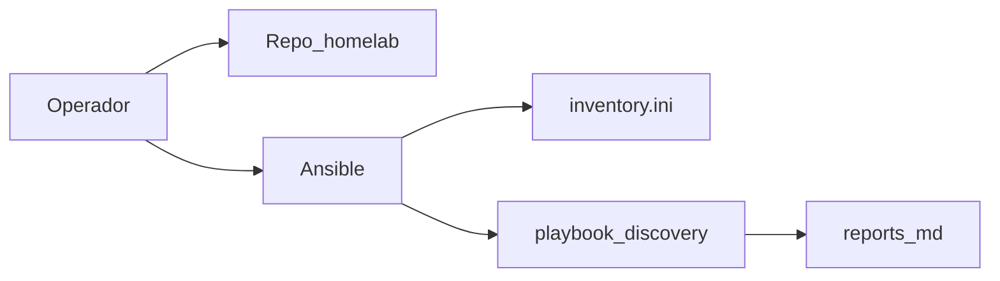

# Phase 0 — Preparation

## Objective

Have the repo cloned, Ansible operational, inventory validated, and (optional)
a hardware report measured before touching the network or clusters.

## What You Learn

How Ansible uses an **inventory** as the source of truth for hosts, and why
an optional **discovery** avoids assumptions about RAM, disk, and architecture
when choosing roles (control plane, Longhorn, etc.).

!!! abstract "Learn this phase"
    **In simple terms:** Ansible is like a list of tasks you hand to several helpers: they all execute it the same way, without you having to go one by one. The **inventory** is the agenda with the name, address, and role of each helper (each node).

    **Key concepts**

    - **Inventory:** the file that says which machines exist and how to connect to them.
    - **Playbook:** the recipe of tasks that Ansible applies to those machines.
    - **Idempotency:** repeating a playbook leaves the same result; it doesn't break what was already good.
    - **Simulation mode (`-C`):** shows what would change without touching anything.
    - **SSH (Secure Shell):** the encrypted channel with which Ansible enters each node.

    **Practical challenge (safe, read-only):** check that Ansible reaches the three nodes and see what a playbook would change without applying it.

    ```bash
    ansible -i ansible/inventory.ini incus_cluster -m ping
    ansible-playbook -i ansible/inventory.ini ansible/playbook-discovery.yml -C
    ```

    ??? question "What is an inventory used for?"
        To let Ansible know which machines to manage, how to reach them, and which group each belongs to.
        It is the source of truth for the nodes.

    ??? question "Why can an idempotent playbook be run repeatedly without fear?"
        Because each task first checks the current state and only changes what is missing. If everything is already good, it does nothing.

    ??? question "What is the difference between running a playbook and running it with `-C`?"
        With `-C` Ansible simulates: it reports what would change but does not modify the machines.

    Questions? Use the **Learn with AI** button next to each title, or the page [Learn](../aprende.md).

## Stack for this phase



- **[Ansible](https://docs.ansible.com/)** — Orchestration for bootstrap; Phases 0–3.
- **[Debian](https://www.debian.org/)** — OS on invincible, oliver, and deborah.

Further reading: [Hardware Discovery](../hardware/discovery.md) · [Inventory](../hardware/inventory.md)

## Before You Start

- [x] Three nodes accessible via SSH (even if still on DHCP is fine).
- [x] Python 3.11+ on your workstation.
- [x] SSH key configured towards the nodes.
- [x] **GitHub:** the organization **`maceosoft`** created, with a team
      **`devops`** (its members are who can enter Argo CD) and an
      account that is **owner** of the organization to create the Apps.
      Details in [maceosoft Platform — GitHub](../maceosoft/github.md).
- [x] **1Password:** the desktop app installed, with a vault called
      **`HomeLab`** and *Settings → Developer → Integrate with other apps*
      activated. There it stores the credentials used by the playbooks
      ([which items and fields](../maceosoft/github.md#items-in-1password)).

## Run

### Clone repo and Ansible environment

```bash
git clone https://github.com/maceosoft/homelab.git
cd homelab
python3 -m venv .venv
source .venv/bin/activate
# Ansible, mkdocs, ansible-lint, etc.
pip install -r requirements.txt
ansible-galaxy collection install -r ansible/requirements.yml
```

!!! warning "Path of requirements.txt"
    `requirements.txt` lives in the **repo root**, not in `ansible/` — it is a
    common mistake to confuse it with `ansible/requirements.yml` (that is the
    manifest of *collections* from Galaxy, a different YAML file, not something
    that `pip install -r` can install).

### Day 0 — freshly installed nodes (only the first time per node)

A freshly flashed node (Debian netinst) still does not have `python3` or
`sudo` ready, and the admin user is not in the group `sudo` — the `ping`
below (uses the `ansible.builtin.ping` module, which does need Python
on the target) will fail without this step first:

```bash
cd ansible
ansible-playbook -i bootstrap/inventory.ini bootstrap/setup_sudo.yml --ask-pass
cd ..
```

**Which user receives `sudo`.** The playbook gives `sudo` without a password to the admin user you created when
installing Debian. By default it is the **same name you use on your workstation**, because Ansible connects later with
that name. If on the node it has a different name, indicate it and tell Ansible how to connect:

```bash
ansible-playbook -i bootstrap/inventory.ini bootstrap/setup_sudo.yml --ask-pass -e bootstrap_admin_user=<usuario>
```

and add `ansible_user=<usuario>` to the nodes in `inventory.ini`. The user must already exist on the node (the
playbook stops if it doesn't) and only accepts lowercase letters, digits, `_` and `-`.

Full details (why it connects as `root` and where it fits in the rest
of the bootstrap) in
[`ansible/bootstrap/README.md`](https://github.com/maceosoft/homelab/blob/main/ansible/bootstrap/README.md).
If your 3 nodes already have an admin user with sudo working, skip
this step.

### Validate inventory

Review [`ansible/inventory.ini`][inventory-ini]: `ansible_host`, `static_ip`,
`bridge_iface` per node.

[inventory-ini]: https://github.com/maceosoft/homelab/blob/main/ansible/inventory.ini

```bash
ansible -i ansible/inventory.ini incus_cluster -m ping
```

### Optional discovery (recommended the first time)

=== "Recommended (Ansible)"

    ```bash
    cd ansible
    ansible-playbook -i inventory.ini playbook-discovery.yml
    ```

    Output in `ansible/reports/` (gitignored): node profile + `summary.md`.

=== "Manual alternative"

    Gather CPU, RAM, disk, and network with `lscpu`, `free -h`, `lsblk`, `ip -br link`
    and compare with [Hardware Inventory](../hardware/inventory.md).

### GitHub and 1Password — org maceosoft (manual, one time)

Here you prepare, once, the GitHub accounts and credentials that the HomeLab needs: the Apps that the cluster uses to communicate with GitHub (including the one Argo CD uses to read the private repo `maceosoft/gitops`) and the base repos (`gitops`, `core-pipelines`, and `infra`). Everything is created manually, and the credentials are stored in 1Password so that playbooks can read them from there. The details of each one (permissions, where to find each piece of data in GitHub, and how to load it into 1Password) are in [Plataforma maceosoft — GitHub](../maceosoft/github.md).

The 1Password items go in the vault **`HomeLab`**, mostly as **Secure Note** with custom fields. The item title and field names must be **exact**, because the playbook looks for them by name: [how to create the item](../maceosoft/github.md#how-to-create-an-item-with-custom-fields).

With an **organization owner** account `maceosoft`:

1. **GitHub App `maceosoft-terraform`** → item `maceosoft-terraform` (Secure Note) with the fields `app_id` (Text), `installation_id` (Text), and `private_key` (Password, the full `.pem`).
   [Permissions and where each piece of data is](../maceosoft/github.md#maceosoft-terraform).
2. **GitHub App `maceosoft-arc-runners`** → item `maceosoft-arc-runners`, with the same three fields but with the data for this App.
   [Permissions and steps](../maceosoft/github.md#maceosoft-arc-runners).
3. **OAuth (Open Authorization) App `Maceosoft Dex`** → fields `GITHUB_CLIENT_ID` (Text) and `GITHUB_CLIENT_SECRET` (Password) in the item `maceosoft-dex` (Secure Note).
   [Steps](../maceosoft/github.md#oauth-app-maceosoft-dex).
4. **Private repos**, with their content uploaded with git:
    - `gitops`.
    - `core-pipelines`: in *Settings → Actions → General → Access*, choose "Accessible from repositories in the 'maceosoft' organization". No need to create tags: while testing, other repos use it with `@main`.
    - `infra`.
5. **GitHub App `maceosoft-argocd`** (read-only, installed **only in `gitops`**) → item `maceosoft-argocd` with the same three fields. Comes after the repos because it is installed in `gitops`.
   [Permissions and steps](../maceosoft/github.md#paso-2-repos-app-de-argocd-y-ftp-manual).
6. **Sealed Secrets Key** *(optional until Phase 6)*: a key pair generated with `openssl`, in the item `sealed-secrets` (`certificate` and `private_key`), so that it survives if you reinstall K3s.
   [Command and steps](../maceosoft/github.md#paso-2-repos-app-de-argocd-y-ftp-manual).
7. **FTP (File Transfer Protocol) credentials for the repo `api`**: `api` is the first project in the repo map and deploys via FTP, so it needs its item `ftp-api` (Secure Note) from the first pipeline. Each repo you add later follows the [routine procedure — Add a repo](../operacion/agregar-repo.md). The item has 8 fields: `dev_host`, `dev_user`, `dev_password`, `dev_remote_dir`, and the same four with `prod_`. The `*_password` go as Password and the rest as Text.
   [Table with examples](../maceosoft/github.md#paso-2-repos-app-de-argocd-y-ftp-manual).

All commands to create these items with the CLI `op` (and the GitHub commands with `gh`) are in the sections of [Plataforma maceosoft — GitHub](../maceosoft/github.md): the Apps and the OAuth App are **created only from the web**, and from there on saving the data in 1Password, listing installations, and creating the repos is done with `op` and `gh`.

Check that all credentials can be read from 1Password. There are two commands, and neither touches a cluster or shows secret values:

- **`--check`**: checks each expected item and marks ✓ for fields that are correct and ✗ for missing fields, different names, or fields within a section. Run it first: if something is wrong, it tells you exactly what.
- **`--dry-run`**: reads all values and lists the Secrets that will be created in the cluster, with values hidden (`<redacted>`). Confirms that the keys can be interpreted.

The script reads 1Password through the desktop app, so the app must be **unlocked** and have *Settings → Developer → Integrate with other apps* enabled. Additionally, you need to tell it **which account** to use with the variable **`ONEPASSWORD_ACCOUNT_NAME`**: it is the name of your account as it appears at the top left in the app sidebar (for example `Mi Cuenta`). If you don't define it, it uses `Personal`.

```bash
# tu cuenta
export ONEPASSWORD_ACCOUNT_NAME="Mi Cuenta"
.venv/bin/python ansible/scripts/apply_platform_secrets.py --check
.venv/bin/python ansible/scripts/apply_platform_secrets.py --dry-run
```

`--check` completes successfully when all items have ✓ (the warning that there are no items `ftp-<repo>` is only informative if no repo deploys).

## Options

| Option | When |
|---|---|
| Skip discovery | Redeployment and known hardware |
| Update inventory | After changing IPs in Phase 1 |

<div class="card">
  <div class="card-kicker">Trade-off analysis</div>
  <div class="option-grid">
    <div class="card-col">
      <div class="card-title">Ansible Discovery</div>
      <div class="text-muted">Measured RAM/disk/I/O → <code>reports/</code></div>
      <div class="text-muted">Requires SSH and a few minutes per node</div>
    </div>
    <div class="card-col">
      <div class="card-title">Manual Discovery</div>
      <div class="text-muted">No playbook</div>
      <div class="text-muted">Outdated values; planning errors</div>
    </div>
    <div class="card-col">
      <div class="card-title">Skip discovery</div>
      <div class="text-muted">Faster in redeployments</div>
      <div class="text-muted">RAM/disk budget may not match reality</div>
    </div>
  </div>
</div>

## Verify

```bash
ansible -i ansible/inventory.ini incus_cluster -m ping
# todos → SUCCESS

# tu cuenta
export ONEPASSWORD_ACCOUNT_NAME="Mi Cuenta"
.venv/bin/python ansible/scripts/apply_platform_secrets.py --check
# todos los items con ✓
.venv/bin/python ansible/scripts/apply_platform_secrets.py --dry-run
# lista los Secrets de plataforma (valores <redacted>), sin errores de 1Password
```

## If It Fails

| Symptom | Check |
|---|---|
| `UNREACHABLE` | `ansible_host`, firewall, SSH key |
| `ping` fails due to missing Python | New node installation — run `setup_sudo.yml` (Day 0 step above) |
| Discovery has no reports | Run from `ansible/`; write permissions |
| `--check` or `--dry-run` do not read 1Password | App unlocked with *Integrate with other apps* and `ONEPASSWORD_ACCOUNT_NAME` with your account name. If it says *field cannot be found* or *Vault not found*, check the output of `--check`: mark which item or field does not match ([expected names](../maceosoft/github.md#items-in-1password)) |

## Next

**[→ Phase 1 — Network](fase-1-red.md)**
