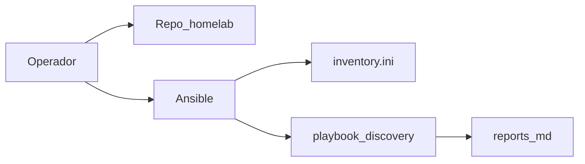

# Phase 0 — Preparation

## Objective

Have the repo cloned, Ansible operational, inventory validated, and (optionally)
a measured hardware report before touching network or clusters.

## What you learn

How Ansible uses an **inventory** as the source of truth for hosts, and why
an optional **discovery** avoids assumptions about RAM, disk, and architecture
when choosing roles (control plane, Longhorn, etc.).

!!! abstract "Learn this phase"
    **In short:** Ansible is like a task list you hand to several helpers: they all
    run it the same way, without you having to go one by one. The **inventory** is the address book with the name,
    address, and role of each helper (each node).

    **Key concepts**

    - **Inventory:** the file that says which machines exist and how to connect to them.
    - **Playbook:** the recipe of tasks Ansible applies to those machines.
    - **Idempotence:** repeating a playbook leaves the same result; it doesn't break what was already correct.
    - **Simulation mode (`-C`):** shows what would change without touching anything.
    - **SSH (Secure Shell):** the encrypted channel Ansible uses to reach each node.

    **Hands-on challenge (safe, read-only):** verify Ansible reaches the three nodes and see what
    a playbook would change without applying it.

    ```bash
    ansible -i ansible/inventory.ini incus_cluster -m ping
    ansible-playbook -i ansible/inventory.ini ansible/playbook-discovery.yml -C
    ```

    ??? question "What is an inventory for?"
        So Ansible knows which machines to manage, how to reach them, and which group each belongs to.
        It is the source of truth for the nodes.

    ??? question "Why can an idempotent playbook be repeated safely?"
        Because each task checks the current state first and only changes what is missing. If everything is already correct,
        it does nothing.

    ??? question "What is the difference between running a playbook and running it with `-C`?"
        With `-C` Ansible simulates: it reports what would change but does not modify the machines.

    Questions? Use the **Learn with AI** button next to each heading, or the [Learn](../aprende.md) page.

## Stack for this phase



- **[Ansible](https://docs.ansible.com/)** — Bootstrap orchestrator; Phases 0–3.
- **[Debian](https://www.debian.org/)** — OS on invincible, oliver, and deborah.

Deep dive: [Hardware discovery](../hardware/discovery.md) · [Inventory](../hardware/inventory.md)

## Before you start

- [x] Three nodes accessible via SSH (even if still on DHCP is fine).
- [x] Python 3.11+ on your workstation.
- [x] SSH key configured to the nodes.
- [x] **GitHub:** the **`maceosoft`** organization created, with a team
      **`devops`** (its members are who can access Argo CD) and an
      account that is **owner** of the organization to create the Apps.
      Details in [maceosoft Platform — GitHub](../maceosoft/github.md).
      Creating the organization is **web-only**; the team can be created either way:

    === "🖱️ From the UI"

        In the org: **Teams** → **New team** → name `devops`, visibility *Visible* → **Create team**, then
        **Add a member** for each person who should access Argo CD.

    === "⌨️ From the console"

        Requires org admin permission (`gh auth refresh -s admin:org`, one time). Whoever creates the
        team becomes its *maintainer*; others are added with the second command:

        ```bash
        gh api orgs/maceosoft/teams -f name=devops -f privacy=closed
        gh api -X PUT orgs/maceosoft/teams/devops/memberships/<usuario> -f role=member
        ```

- [x] **1Password:** desktop app installed, with a vault named
      **`HomeLab`** and *Settings → Developer → Integrate with other apps*
      enabled. Credentials used by playbooks are stored there
      ([which items and fields](../maceosoft/github.md#1password-items)).
      App integration is enabled **only from the app**; the vault can be created either way:

    === "🖱️ From the UI"

        In the 1Password app: sidebar → **+** next to vaults (*New Vault*) → name `HomeLab` → **Create**.

    === "⌨️ From the console"

        With the app unlocked and integration already enabled (if you have more than one account, export `OP_ACCOUNT` first):

        ```bash
        op vault create HomeLab
        op vault list
        ```

## Run

### Clone repo and Ansible environment

```bash
git clone https://github.com/maceosoft/homelab.git
cd homelab
python3 -m venv .venv
source .venv/bin/activate
# Ansible, mkdocs, ansible-lint, etc.
pip install -r requirements.txt
ansible-galaxy collection install -r ansible/requirements.yml
```

!!! warning "requirements.txt path"
    `requirements.txt` lives in the **repo root**, not in `ansible/` — it's a
    common mistake to confuse it with `ansible/requirements.yml` (that's the
    Galaxy *collections* manifest, a different YAML file, not something
    `pip install -r` can install).

### Day 0 — freshly installed nodes (only the first time per node)

A freshly flashed node (Debian netinst) still doesn't have `python3` or
`sudo` ready, and the admin user isn't in the `sudo` group — the `ping`
below (uses the `ansible.builtin.ping` module, which does need Python
on the target) will fail without this step first:

```bash
cd ansible
ansible-playbook -i bootstrap/inventory.ini bootstrap/setup_sudo.yml --ask-pass
cd ..
```

**Which user gets `sudo`.** The playbook grants passwordless `sudo` to the admin user you created
during Debian install. By default it's the **same name you use on your workstation**, because Ansible connects later
with that name. If the node uses a different name, specify it and tell Ansible how to connect:

```bash
ansible-playbook -i bootstrap/inventory.ini bootstrap/setup_sudo.yml --ask-pass -e bootstrap_admin_user=<usuario>
```

and add `ansible_user=<usuario>` to the nodes in `inventory.ini`. The user must already exist on the node (the
playbook stops if not) and only allows lowercase, digits, `_` and `-`.

Full detail (why it connects as `root` and where it fits in the rest
of the bootstrap) in
[`ansible/bootstrap/README.md`](https://github.com/maceosoft/homelab/blob/main/ansible/bootstrap/README.md).
If your 3 nodes already have a working admin user with sudo, skip
this step.

### Validate inventory

Check [`ansible/inventory.ini`][inventory-ini]: `ansible_host`, `static_ip`,
`bridge_iface` per node.

[inventory-ini]: https://github.com/maceosoft/homelab/blob/main/ansible/inventory.ini

```bash
ansible -i ansible/inventory.ini incus_cluster -m ping
```

### Optional discovery (recommended first time)

=== "Recommended (Ansible)"

    ```bash
    cd ansible
    ansible-playbook -i inventory.ini playbook-discovery.yml
    ```

    Output in `ansible/reports/` (gitignored): one card per node + `summary.md`.

=== "Manual alternative"

    Collect CPU, RAM, disk, and network with `lscpu`, `free -h`, `lsblk`, `ip -br link`
    and compare with [Hardware inventory](../hardware/inventory.md).

### GitHub and 1Password — maceosoft org (manual, one time only)

Here you prepare, once, the GitHub accounts and credentials the
HomeLab needs: the Apps the cluster uses to talk to GitHub (including
the one Argo CD uses to read the private repo `maceosoft/gitops`) and the
base repos (`gitops`, `core-pipelines`, and `infra`). Everything is created by hand, and credentials are
stored in 1Password so playbooks can read them from there later. The
details for each one (permissions, where to find each piece of data in
GitHub, and how to load it into 1Password) are in
[maceosoft Platform — GitHub](../maceosoft/github.md).

1Password items go in the **`HomeLab`** vault, almost all as
**Secure Note** with custom fields. The item title and each field name
must be **exact**, because the playbook looks them up by name:
[how to create the item](../maceosoft/github.md#how-to-create-an-item-with-custom-fields).

With an **organization owner** account `maceosoft`:

1. **GitHub App `maceosoft-terraform`** → item `maceosoft-terraform`.
   [Permissions and where to find each datum](../maceosoft/github.md#maceosoft-terraform).
   Creating the App, generating its private key (`.pem`), and installing it are done **only from the web**; saving its data in
   1Password can be done either way:

    === "🖱️ From the UI"

        Secure Note in vault `HomeLab` with fields `app_id` (Text), `installation_id` (Text), and
        `private_key` (Password, the full `.pem`).

    === "⌨️ From the console"

        `gh api` gives you the `app_id` and `installation_id` of the installed App (once before:
        `gh auth refresh -s admin:read:org`), and the `.pem` is read from the file, so no value ends up written in
        the command:

        ```bash
        APP=maceosoft-terraform
        read -r APP_ID INST_ID < <(gh api orgs/maceosoft/installations \
          --jq ".installations[] | select(.app_slug==\"$APP\") | \"\(.app_id) \(.id)\"")
        op item create --category "Secure Note" --vault HomeLab --title "$APP" \
          "app_id[text]=$APP_ID" "installation_id[text]=$INST_ID" \
          "private_key[password]=$(cat ~/Downloads/$APP.*.private-key.pem)"
        ```

2. **GitHub App `maceosoft-arc-runners`** → item `maceosoft-arc-runners`.
   [Permissions and steps](../maceosoft/github.md#maceosoft-arc-runners).
   Same as above: the App is created and installed **only from the web**.

    === "🖱️ From the UI"

        The same three fields but with this App's data: `app_id` (Text), `installation_id` (Text), and
        `private_key` (Password), in a Secure Note in vault `HomeLab`.

    === "⌨️ From the console"

        ```bash
        APP=maceosoft-arc-runners
        read -r APP_ID INST_ID < <(gh api orgs/maceosoft/installations \
          --jq ".installations[] | select(.app_slug==\"$APP\") | \"\(.app_id) \(.id)\"")
        op item create --category "Secure Note" --vault HomeLab --title "$APP" \
          "app_id[text]=$APP_ID" "installation_id[text]=$INST_ID" \
          "private_key[password]=$(cat ~/Downloads/$APP.*.private-key.pem)"
        ```

3. **OAuth (Open Authorization) App `Maceosoft Dex`** → item `maceosoft-dex`.
   [Steps](../maceosoft/github.md#oauth-app-maceosoft-dex).
   Creating the OAuth App and generating its *client secret* is **only from the web** (GitHub has no API for OAuth Apps).

    === "🖱️ From the UI"

        Fields `GITHUB_CLIENT_ID` (Text) and `GITHUB_CLIENT_SECRET` (Password) in item `maceosoft-dex` (Secure
        Note, vault `HomeLab`).

    === "⌨️ From the console"

        Paste each value when prompted; the secret is not shown on screen or saved in history:

        ```bash
        # pega el Client ID y Enter
        read -r  GH_CID
        # pega el Client secret y Enter
        read -rs GH_CSEC
        op item create --category "Secure Note" --vault HomeLab --title maceosoft-dex \
          "GITHUB_CLIENT_ID[text]=$GH_CID" "GITHUB_CLIENT_SECRET[password]=$GH_CSEC"
        unset GH_CID GH_CSEC
        ```

4. **Private repos**, with their content pushed via git:
    - `gitops`.
    - `core-pipelines`: accessible from other repos in the org. No need
      to create tags: while testing, other repos use it with `@main`.
    - `infra`.

    === "🖱️ From the UI"

        Create each repo in the org with **New repository** (private) and push its content with git. In `core-pipelines`,
        under *Settings → Actions → General → Access*, choose
        "Accessible from repositories in the 'maceosoft' organization".

    === "⌨️ From the console"

        From each project's folder:

        ```bash
        gh repo create maceosoft/gitops --private --source . --remote origin --push
        # igual para core-pipelines e infra
        gh api -X PUT repos/maceosoft/core-pipelines/actions/permissions/access -f access_level=organization
        ```

5. **GitHub App `maceosoft-argocd`** (read-only, installed **only in
   `gitops`**) → item `maceosoft-argocd`. Comes
   after the repos because it installs into `gitops`.
   [Permissions and steps](../maceosoft/github.md#step-2-repos-argocd-app-and-ftp-manual).
   The App is created and installed **only from the web**.

    === "🖱️ From the UI"

        The same three fields: `app_id` (Text), `installation_id` (Text), and `private_key` (Password), in a
        Secure Note in vault `HomeLab`.

    === "⌨️ From the console"

        ```bash
        APP=maceosoft-argocd
        read -r APP_ID INST_ID < <(gh api orgs/maceosoft/installations \
          --jq ".installations[] | select(.app_slug==\"$APP\") | \"\(.app_id) \(.id)\"")
        op item create --category "Secure Note" --vault HomeLab --title "$APP" \
          "app_id[text]=$APP_ID" "installation_id[text]=$INST_ID" \
          "private_key[password]=$(cat ~/Downloads/$APP.*.private-key.pem)"
        ```

6. **Sealed Secrets key** *(optional until Phase 6)*: a key pair
   generated with `openssl`, in item `sealed-secrets`, so it survives a K3s reinstall.
   [Command and steps](../maceosoft/github.md#step-2-repos-argocd-app-and-ftp-manual).

    === "🖱️ From the UI"

        Secure Note in vault `HomeLab` with `certificate` (Text, all of `tls.crt`) and `private_key` (Password,
        all of `tls.key`).

    === "⌨️ From the console"

        Generate the pair in a temp folder, save it by reading the files, and delete them:

        ```bash
        cd "$(mktemp -d)"
        openssl req -x509 -days 3650 -nodes -newkey rsa:4096 \
          -keyout tls.key -out tls.crt -subj "/CN=sealed-secret/O=sealed-secret"
        op item create --category "Secure Note" --vault HomeLab --title sealed-secrets \
          "certificate[text]=$(cat tls.crt)" "private_key[password]=$(cat tls.key)"
        rm -f tls.key tls.crt
        ```

7. **FTP (File Transfer Protocol) credentials for repo `api`**: `api` is the
   first project in the repo map and deploys via FTP, so it needs its
   item `ftp-api` (Secure Note) from the first pipeline. Every repo
   you add afterward follows the
   [routine procedure — Add a repo](../operacion/agregar-repo.md).
   [Table with examples](../maceosoft/github.md#step-2-repos-argocd-app-and-ftp-manual).

    === "🖱️ From the UI"

        The item has 8 fields: `dev_host`, `dev_user`,
        `dev_password`, `dev_remote_dir`, and the same four with `prod_`. The
        `*_password` go as Password and the rest as Text.

    === "⌨️ From the console"

        Change hosts, users, and folders to yours; the two passwords are pasted without echo:

        ```bash
        # pega cada contraseña y Enter
        read -rs FTP_DEV_PASS;  read -rs FTP_PROD_PASS
        op item create --category "Secure Note" --vault HomeLab --title ftp-api \
          "dev_host[text]=dev.tu-cpanel.example.com" "dev_user[text]=usuario_dev" \
          "dev_password[password]=$FTP_DEV_PASS" "dev_remote_dir[text]=/home/usuario/dev.maceosoft.example.com" \
          "prod_host[text]=tu-cpanel.example.com" "prod_user[text]=usuario_prod" \
          "prod_password[password]=$FTP_PROD_PASS" "prod_remote_dir[text]=/home/usuario/public_html"
        unset FTP_DEV_PASS FTP_PROD_PASS
        ```

All commands to create these items with the `op` CLI (and the GitHub ones with `gh`) are in the
[maceosoft Platform — GitHub](../maceosoft/github.md) sections: the Apps and the OAuth App are **created only from the web**, and from there on
saving data to 1Password, listing installations, and creating repos is done with `op` and `gh`.

Verify that all credentials can be read from 1Password. Two commands,
and neither touches a cluster nor reveals secret values:

- **`--check`**: checks each expected item and marks fields that are correct with ✓ and those that are missing, have a different name, or are inside a section with ✗. Run it first: if something is wrong, it tells you exactly what.
- **`--dry-run`**: reads all values and lists the Secrets that will be created in the cluster, with hidden values (`<redacted>`). Confirms that the keys can be interpreted.

The script reads 1Password via the desktop app, so the app must be **unlocked** and have *Settings → Developer → Integrate with other apps* enabled. You also need to tell it **which account** to use with the **`ONEPASSWORD_ACCOUNT_NAME`** variable: it's your account name as it appears in the top left of the app sidebar (for example `Mi Cuenta`). If you don't define it, it uses `Personal`.

```bash
# tu cuenta
export ONEPASSWORD_ACCOUNT_NAME="Mi Cuenta"
.venv/bin/python ansible/scripts/apply_platform_secrets.py --check
.venv/bin/python ansible/scripts/apply_platform_secrets.py --dry-run
```

`--check` exits successfully when all items have ✓ (the notice that there are no items `ftp-<repo>` is only informational if no repo deploys).

## Options

| Option | When |
|---|---|
| Skip discovery | Re-deployment and hardware already known |
| Update inventory | After changing IPs in Phase 1 |

<div class="card">
  <div class="card-kicker">Trade-off analysis</div>
  <div class="option-grid">
    <div class="card-col">
      <div class="card-title">Ansible Discovery</div>
      <div class="text-muted">Measured RAM/disk/I/O → <code>reports/</code></div>
      <div class="text-muted">Requires SSH and a few minutes per node</div>
    </div>
    <div class="card-col">
      <div class="card-title">Manual Discovery</div>
      <div class="text-muted">No playbook</div>
      <div class="text-muted">Outdated values; planning errors</div>
    </div>
    <div class="card-col">
      <div class="card-title">Skip Discovery</div>
      <div class="text-muted">Faster on re-deployments</div>
      <div class="text-muted">RAM/disk budget may not match reality</div>
    </div>
  </div>
</div>

## Verify

```bash
ansible -i ansible/inventory.ini incus_cluster -m ping
# todos → SUCCESS

# tu cuenta
export ONEPASSWORD_ACCOUNT_NAME="Mi Cuenta"
.venv/bin/python ansible/scripts/apply_platform_secrets.py --check
# todos los items con ✓
.venv/bin/python ansible/scripts/apply_platform_secrets.py --dry-run
# lista los Secrets de plataforma (valores <redacted>), sin errores de 1Password
```

## If it fails

| Symptom | Check |
|---|---|
| `UNREACHABLE` | `ansible_host`, firewall, SSH key |
| `ping` fails due to missing Python | Freshly installed node — run `setup_sudo.yml` ("Day 0" step above) |
| Discovery without reports | Run from `ansible/`; write permissions |
| `--check` or `--dry-run` don't read 1Password | App unlocked with *Integrate with other apps* and `ONEPASSWORD_ACCOUNT_NAME` set to your account name. If it says *field cannot be found* or *Vault not found*, check the output of `--check`: it marks which item or field doesn't match ([expected names](../maceosoft/github.md#1password-items)) |

## Next

**[→ Phase 1 — Network](fase-1-red.md)**
