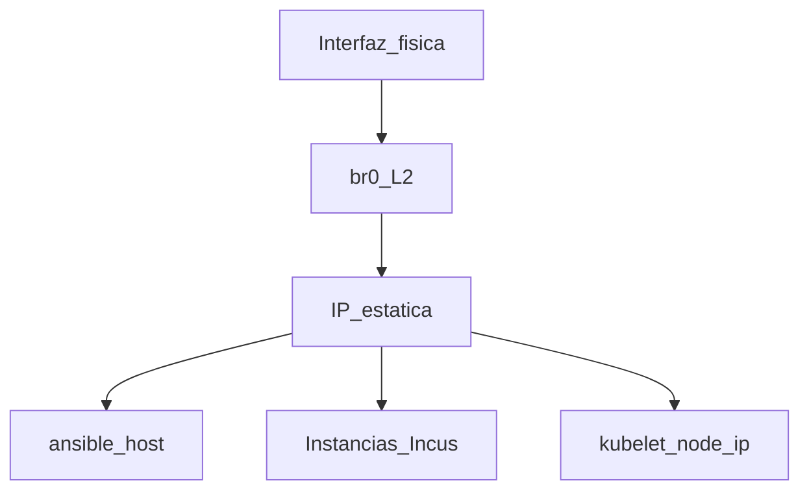

# Phase 1 — Network

## Objective

Bridge `br0` with **static IP** on the 3 nodes, ready for Incus, K3s (lightweight Kubernetes distribution), and CAPN (Cluster API Provider for Incus).

## What You Learn

Why the Homelab requires a fixed IP: Incus records `cluster.https_address`, K3s uses
the IP as the kubelet identity, and CAPN references `https://<IP>:8443` in
secrets.

!!! abstract "Learn this phase"
    **In simple terms:** a fixed IP is your postal address: if it changes every day, no one can find you. A **bridge** is like a virtual multi-outlet: it lets the machine and virtual machines share the same network connection.

    **Key concepts**

    - **Static or dynamic IP:** a static IP stays the same; a dynamic one is assigned by the router (DHCP, Dynamic Host Configuration Protocol) and can change.
    - **Mask and CIDR (Classless Inter-Domain Routing):** the notation `/22` indicates how many addresses share the network.
    - **Gateway:** the device, usually the router, through which you exit to other networks.
    - **DNS (Domain Name System):** the "phone book" that translates names to IP addresses.
    - **Bridge `br0`:** the virtual interface that the node, Incus, and K3s share.

    **Practical challenge (read-only):** on a node, find its IP, its mask, and its gateway.

    ```bash
    ip -br addr show br0
    ip route | grep default
    ```

    ??? question "Why does the Homelab need a fixed IP on the nodes?"
        Because Incus stores the cluster address, K3s uses the IP as the node identity, and other
        components reference it: if it changes, the cluster will lose connectivity.

    ??? question "What is a bridge and what is it used for here?"
        It is a virtual interface that connects multiple interfaces into a single network. It allows
        Incus instances and pods to use the node's physical network.

    ??? question "In `192.168.20.5/22`, which part is the address and which is the mask?"
        `192.168.20.5` is the address and `/22` indicates that the first 22 bits are the network.

    Questions? Use the **Learn with AI** button next to each title, or the page [Learn](../aprende.md).

## Stack for this phase



- **[Netplan](https://netplan.io/)** — Declarative network configuration on Debian; Phase 1.
- **[Ansible](https://docs.ansible.com/)** — Applies Netplan idempotently via `playbook-set-static-ip.yml`.
- Role: [`netplan_bridge`](https://github.com/maceosoft/homelab/blob/main/ansible/roles/netplan_bridge/README.md)

Further reading: [Network — Netplan examples](../networking/index.md)

## Before You Start

- [ ] [Phase 0 — Preparation](fase-0-preparacion.md) completed (`ansible ping` OK).
- [ ] Know the physical interface per node (`eno1`, `eno2`, `enP4p65s0`).
- [ ] Target IPs defined in inventory.

| Node | Interface | IP on br0 |
|---|---|---|
| invincible | `eno2` | 192.168.20.6 |
| oliver | `eno1` | 192.168.20.7 |
| deborah | `enP4p65s0` | 192.168.20.5 |

> Confirm always with `ip -br link` on the node before assuming these
> values.

## Run

!!! warning "SSH Disconnect"
    If you change the IP, Ansible may lose the session. The playbook uses
    `serial: 1` — one node at a time. Update `ansible_host` after each node
    if the connection IP changed.

=== "Recommended (Ansible)"

    ```bash
    cd ansible
    # Un nodo a la vez si la IP de conexión cambia
    ansible-playbook -i inventory.ini playbook-set-static-ip.yml \
      --limit invincible
    # Actualiza ansible_host en inventory.ini si hace falta, luego:
    ansible-playbook -i inventory.ini playbook-set-static-ip.yml \
      --limit oliver
    ansible-playbook -i inventory.ini playbook-set-static-ip.yml \
      --limit deborah
    ```

=== "Alternative manual"

    See YAML examples in [Network](../networking/index.md):

    ```bash
    sudo apt install -y netplan.io
    sudo netplan apply
    ```

## Options

| Decision | Default Homelab |
|---|---|
| Node order | One at a time (`serial: 1`) |

!!! note "All three nodes change IP upon apply"
    No shortcut: update `ansible_host` in `inventory.ini` after
    each node (that's why `serial: 1`).

<div class="card">
  <div class="card-kicker">Trade-off analysis</div>
  <div class="option-grid">
    <div class="card-col">
      <div class="card-title">Ansible (<code>playbook-set-static-ip.yml</code>)</div>
      <div class="text-muted">Idempotent; Netplan template per host</div>
      <div class="text-muted">May disconnect SSH if IP changes</div>
    </div>
    <div class="card-col">
      <div class="card-title">Manual Netplan</div>
      <div class="text-muted">Full control over YAML</div>
      <div class="text-muted">No automatic rollback; easy to misalign the three nodes</div>
    </div>
    <div class="card-col">
      <div class="card-title"><code>serial: 1</code></div>
      <div class="text-muted">Node-by-node recovery</div>
      <div class="text-muted">Slower than three in parallel</div>
    </div>
  </div>
</div>

## Verify

```bash
ansible -i ansible/inventory.ini incus_cluster -m command -a "ip -br addr show br0"
# Cada nodo muestra su IP estática en br0
ping -c 2 192.168.20.5
ping -c 2 192.168.20.6
ping -c 2 192.168.20.7
```

## If It Fails

| Symptom | Check |
|---|---|
| Lost SSH after apply | Connect by new IP; update `inventory.ini` |
| No `br0` | Interface in `bridge_iface`; logs `journalctl -u systemd-networkd` |

## DNS (BIND on deborah)

The three nodes use `192.168.20.5` (deborah) as the first DNS and the gateway
`192.168.20.1` as the second. With the fixed IP already applied on deborah, install
and configure BIND (Berkeley Internet Name Domain) there (runs only on deborah):

```bash
ansible-playbook -i inventory.ini playbook-bind-dns.yml
```

Until it runs, the nodes resolve by the gateway, with some delay in
each query.

Two things that `playbook-set-static-ip.yml` leaves and that subsequent phases depend on:

- A fixed `/etc/resolv.conf` on each node, with `search homelab.local mco.local` and first the BIND (`192.168.20.5`).
  If the node has NetworkManager, also install `dns=none` to prevent it from rewriting the DNS with the router's DNS. Without
  this, a node stops resolving `*.homelab.local` (the nodes cannot validate the SSO —single sign-on— of the [4.12](fase-4-gitops.md#412-ssh-to-hosts-with-dex-optional)).
- The BIND zone `homelab.local` brings a record for each node and each published service, without wildcard
  (see [4.8](fase-4-gitops.md#48-homelablocal-dns)).

Check on each node: `cat /etc/resolv.conf` and `getent hosts oliver.homelab.local`. Details:
[`ansible/roles/bind_dns/README.md`](https://github.com/maceosoft/homelab/blob/main/ansible/roles/bind_dns/README.md).

## Hardening (recommended before proceeding)

With the IP already fixed, it's time to harden the host before it joins
the cluster. This goes **here** in the sequence (see
[Post-incident Hardening](../security/hardening-post-incidente.md)):

```bash
ansible-playbook -i inventory.ini playbook-hardening.yml --check --diff
ansible-playbook -i inventory.ini playbook-hardening.yml
```

Details:
[`ansible/roles/host_hardening/README.md`](https://github.com/maceosoft/homelab/blob/main/ansible/roles/host_hardening/README.md).

## Next

**[→ Phase 2 — Incus](fase-2-incus.md)**

Complete bootstrap order (includes hardening, BIND, WiFi):
[`ansible/bootstrap/README.md`](https://github.com/maceosoft/homelab/blob/main/ansible/bootstrap/README.md).
