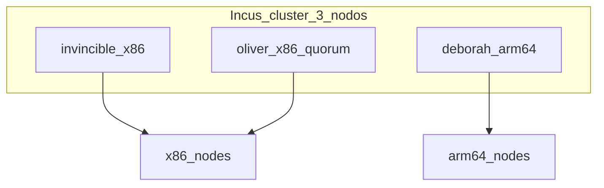

# Phase 2 — Incus

## Objective

**Incus** cluster of 3 nodes with quorum, cluster groups by architecture, and
`oliver` in manual scheduler.

## What you learn

Incus as a **shared hypervisor**: dqlite quorum across 3 members, cluster
groups to steer x86 vs ARM64 (64-bit ARM architecture) workloads, and manual scheduler to protect RAM.

!!! abstract "Learn this phase"
    **In short:** Incus is an apartment building. Each apartment is an **instance**:
    a container (a lightweight room sharing the building's utilities) or a virtual machine
    (a full apartment with its own kitchen). With three coordinated buildings, if one closes the other two keep running.

    **Key concepts**

    - **Container and virtual machine:** the container is lighter; the VM (Virtual Machine) isolates more.
    - **Cluster and quorum:** with 3 members, the cluster decides by majority and tolerates the loss of one.
    - **Cluster group:** a label to direct workloads to a node type (for example, ARM64 only).
    - **x86_64 and ARM64:** two distinct processor architectures; they don't mix in the same instance.
    - **Manual scheduler:** the `oliver` node does not receive instances automatically; protects its memory.

    **Practical challenge (read-only):** view cluster members and their instances.

    ```bash
    incus cluster list
    incus list -c ns4
    ```

    ??? question "Why a three-member cluster and not two?"
        With two, if one falls there is no majority and the cluster blocks. With three, the majority is two and
        it can keep running.

    ??? question "When do you prefer a container and when a VM?"
        Container for light, fast Linux workloads; VM when you need another kernel or more isolation.

    ??? question "What are cluster groups for?"
        To decide on which nodes an instance runs, for example keeping ARM64 workloads on `deborah`.

    Questions? Use the **Learn with AI** button next to each heading, or the [Learn](../aprende.md) page.

## Stack for this phase



- **[Incus](https://linuxcontainers.org/incus/docs/main/)** — LXC virtualization (Linux system containers)/VM; Phase 2.
- **[Zabbly Incus stable](https://github.com/zabbly/incus)** — Debian packages; Phase 2.
- **[Ansible](https://docs.ansible.com/)** — Installs package, bootstrap, join, groups, UI (user interface).
- Roles: [`incus_install`](https://github.com/maceosoft/homelab/blob/main/ansible/roles/incus_install/README.md),
  [`incus_cluster`](https://github.com/maceosoft/homelab/blob/main/ansible/roles/incus_cluster/README.md),
  [`incus_ui`](https://github.com/maceosoft/homelab/blob/main/ansible/roles/incus_ui/README.md)

Deep dive: [Incus Cluster](../incus/cluster-setup.md)

**This decision in other environments**

=== "🏠 At home"

    An Incus cluster with 3 members (dqlite quorum) on hardware you already had, free and with containers and VMs
    in the same tool. If a member falls, the other two keep deciding; `oliver` only votes and receives no workloads.

=== "🏢 In a company"

    - **Benefits:** a virtualization cluster pools several servers into a single resource: move VMs between nodes
      for maintenance without cutting service, restart workloads on another node if one fails, and manage everything
      from a single API or console, with permissions and audit trail of who did what.
    - **Commercial products:** the most common is [VMware vSphere](https://www.vmware.com/products/cloud-infrastructure/vsphere)
      (now Broadcom, with licensing changes driving many companies to seek alternatives),
      [Nutanix AHV](https://www.nutanix.com/products/ahv) or
      [Proxmox VE](https://www.proxmox.com/en/products/proxmox-virtual-environment/overview) with support subscription.
      For large private clouds, [OpenStack](https://www.openstack.org/).
    - **Shared storage:** instead of the local `dir` driver, shared or distributed storage
      (Ceph, SAN) is used, so a VM can move or start on another node without copying its disk.
    - **Incus support:** Incus also has commercial support ([Zabbly](https://zabbly.com/),
      [FuturFusion](https://futurfusion.io/)); the real cost is in the people who know how to operate it.
    - **When Incus makes sense:** escaping expensive VMware licenses, edge or branch sites with few servers,
      and labs or CI that need to create and destroy many instances quickly.

=== "☁️ In the cloud"

    | Cloud | Equivalent service |
    |---|---|
    | GCP | [Compute Engine](https://cloud.google.com/products/compute) |
    | AWS | [Amazon EC2](https://aws.amazon.com/ec2/) |
    | Azure | [Azure Virtual Machines](https://azure.microsoft.com/en-us/products/virtual-machines) |
    | Oracle Cloud (OCI) | [OCI Compute](https://www.oracle.com/cloud/compute/) |

    You get VMs instantly, without buying or maintaining hardware, with SLA and in many regions. You lose control over the
    hypervisor, pay for every hour the VM is running, and are locked into that provider's network and images.

## Before you start

- [X] [Phase 1 — Network](fase-1-red.md) completed (static IPs in `br0`).
- [X] `br0` operational on all 3 nodes.
- [X] ≥ **20 GB free** on each node (see storage requirements).

## Storage requirements

Default HomeLab: driver **`dir`** (directory on the OS filesystem, no
dedicated disk). Variables in [`group_vars/incus_cluster/vars.yml`](https://github.com/maceosoft/homelab/blob/main/ansible/group_vars/incus_cluster/vars.yml).

| Aspect | Value / requirement |
|---|---|
| Driver | `dir` — no dedicated partition or loop |
| Pool per node | `local` (each member has its local pool) |
| Pool path | `/var/lib/incus/storage-pools/local` |
| Filesystem | ext4 or xfs; **not** NFS/CIFS as backend |
| Minimum free space | **20 GB** per node; **50 GB+** if you will create VMs or many instances |
| Metadata | dqlite and daemon config share disk with the pool |

### Per node

| Node | Disk | Implication |
|---|---|---|
| `invincible` | Kingston 224 GB SSD | Leader + UI; largest pool of the x86 nodes |
| `oliver` | TECLAST 120 GB SSD | Quorum; local pool mandatory even if it receives no instances; avoid filling disk with CAPN images |
| `deborah` | eMMC 233 GB (NVMe 250 GB not detected today) | If eMMC tight: `incus_storage_path: /srv/incus/storage-pools/local` in host_vars |

### Limitations of `dir`

- No pool-level copy-on-write (instance snapshots and export tarball do work).
- VMs (virtual machines) slower than with `zfs`/`btrfs`/`lvm`.
- No thin provisioning or native compression.
- Each member maintains its own `local` pool; no distributed storage like Ceph.

Deep dive: [Incus Cluster — Storage](../incus/cluster-setup.md#storage)

## Run

### Step 1 — Install Incus package on all 3 nodes

=== "Recommended (Ansible)"

    ```bash
    cd ansible
    ansible-playbook -i inventory.ini playbook-bootstrap.yml
    ```

=== "Manual alternative"

    On each node:

    ```bash
    curl https://pkgs.zabbly.com/get/incus-stable | sudo bash -x
    ```

### Step 2 — Bootstrap, join, groups, scheduler, and UI

=== "Recommended (Ansible)"

    A single playbook: bootstrap on **invincible**, join on **oliver** and **deborah**,
    cluster groups, manual scheduler, and UI.

    ```bash
    cd ansible
    ansible-playbook -i inventory.ini playbook-incus-cluster.yml
    ```

    Optional tags: `--tags bootstrap`, `--tags join`, `--tags groups`, `--tags ui`.

=== "Manual alternative"

    On **invincible** (bootstrap):

    ```bash
    sudo incus admin init
    # clustering=yes, no te unes (bootstrap), storage backend dir
    ```

    On **invincible**, generate tokens:

    ```bash
    incus cluster add oliver
    incus cluster add deborah
    ```

    On **oliver** and **deborah**: `incus admin init` → join with token.

    Cluster groups and scheduler:

    ```bash
    incus cluster group create x86-nodes
    incus cluster group create arm64-nodes
    incus cluster group assign invincible x86-nodes,default
    incus cluster group assign oliver x86-nodes,default
    incus cluster group assign deborah arm64-nodes,default
    incus cluster set oliver scheduler.instance manual
    ```

    UI on invincible:

    ```bash
    sudo apt install incus-ui-canonical
    sudo incus config set core.https_address=:8443
    ```

## Network profile (instances on LAN)

**Mandatory manual step** — neither the Ansible playbook nor `incus admin init`
do this automatically, in neither of the two paths above. Without this, Incus
instances remain on the default private NAT (Network Address Translation) network, not on your LAN (local network).

On **invincible** (profiles are shared across the whole cluster, no
need to repeat on oliver/deborah):

```bash
incus profile device add default eth0 nic nictype=bridged parent=br0
```

Verify:

```bash
# tiene que mostrar eth0 → parent br0
incus profile show default
```

## Admin UI

Ansible installs `incus-ui-canonical` and `core.https_address` on **invincible**
(play `ui` of the playbook). Initial access via **client certificate**; SSO (single sign-on)
(Dex) in [Phase 4](fase-4-gitops.md#incus-ui-oidc).

1. Add `incus.homelab.local` in `/etc/hosts` (full block in
   [HomeLab Summary](resumen-homelab.md#dns-en-tu-estacion-de-trabajo)).
2. Open [`https://incus.homelab.local:8443`](https://incus.homelab.local:8443)
3. Accept the self-signed certificate
4. Generate/import a **client certificate**

!!! note "OIDC with Dex"
    SSO login (GitHub via Dex) is configured in
    **[Phase 4 — Incus UI OIDC (OpenID Connect)](fase-4-gitops.md#incus-ui-oidc)**.
    Only the `devops` team from `maceosoft` enters (Dex filter) and, with Incus default
    configuration, those OIDC users have full access.

Deep dive: [Incus Cluster — UI](../incus/cluster-setup.md#ui-de-administracion)

## Backup and snapshots (optional)

Not configured in bootstrap. The procedure is in [Incus Backups](../operacion/backups-incus.md); the
alternatives, in [Backup and snapshots](../incus/cluster-setup.md#backup-and-snapshots-optional).

## Options

| Decision | Default HomeLab | Alternative |
|---|---|---|
| Storage backend | `dir` (Ansible) | `btrfs`, `zfs`, `lvm` via `incus_storage_driver` in host_vars |
| oliver | `scheduler.instance manual` | — |
| Pool on deborah | Default path on eMMC | `incus_storage_path` on NVMe (`/srv/incus/...`) |

!!! warning "Change driver in existing cluster"
    An already initialized cluster **cannot** be re-initialized with a preseed without manual migration.
    Choose the driver before the first `playbook-incus-cluster.yml`.

<div class="card">
  <div class="card-kicker">Trade-off analysis</div>
  <div class="option-grid">
    <div class="card-col">
      <div class="card-title">Ansible (<code>playbook-incus-cluster.yml</code>)</div>
      <div class="text-muted">Idempotent preseed, tokens, and UI in one step</div>
      <div class="text-muted">Requires Ansible and SSH to all 3 nodes</div>
    </div>
    <div class="card-col">
      <div class="card-title">Manual (<code>incus admin init</code>)</div>
      <div class="text-muted">No playbook; useful for debugging a node</div>
      <div class="text-muted">Single-use tokens; easy to drift versions</div>
    </div>
    <div class="card-col">
      <div class="card-title">Storage <code>dir</code></div>
      <div class="text-muted">Zero friction, 20 GB free is enough</div>
      <div class="text-muted">Slow VMs; no pool CoW</div>
    </div>
    <div class="card-col">
      <div class="card-title"><code>zfs</code> / <code>btrfs</code></div>
      <div class="text-muted">Snapshots and better I/O</div>
      <div class="text-muted">Dedicated disk/loop; cannot change after bootstrap</div>
    </div>
    <div class="card-col">
      <div class="card-title">Pool on eMMC (deborah)</div>
      <div class="text-muted">No NVMe mount needed</div>
      <div class="text-muted">Risk of filling eMMC with images</div>
    </div>
    <div class="card-col">
      <div class="card-title">Pool on NVMe (<code>/srv/incus</code>)</div>
      <div class="text-muted">More space and I/O</div>
      <div class="text-muted">Extra config in <code>host_vars</code></div>
    </div>
  </div>
</div>

## Verify

```bash
incus cluster list
# 3 miembros ONLINE
incus cluster group list
incus storage list
# eth0 → parent br0
incus profile show default
curl -kI https://incus.homelab.local:8443
```

## If it fails

| Symptom | Check |
|---|---|
| Join rejected | Single-use token; stable IP in `br0` |
| Broken quorum | Incus versions aligned on all 3 nodes |
| Insufficient space | `df -h`; minimum 20 GB (`incus_storage_min_free_gb`) |
| Playbook not idempotent | Node already clustered; check `incus cluster list` |

## Next

**[→ Phase 3 — K3s](fase-3-k3s.md)**

URLs and global `/etc/hosts`: [HomeLab Summary](resumen-homelab.md) (after Phase 4).
