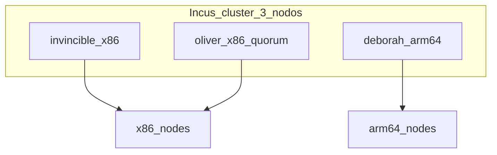

# Phase 2 — Incus

## Objective

3-node **Incus** cluster with quorum, cluster groups by architecture, and
`oliver` in manual scheduler.

## What You Learn

Incus as a **shared hypervisor**: quorum dqlite in 3 members, cluster
groups to direct loads x86 vs ARM64 (64-bit ARM architecture), and manual scheduler to protect RAM.

!!! abstract "Learn this phase"
    **In simple terms:** Incus is a building of apartments. Each apartment is an **instance**:
    a container (a light room that shares the building's facilities) or a virtual machine
    (a complete apartment, with its own kitchen). With three coordinated buildings, if one closes the other two keep working.

    **Key concepts**

    - **Container and virtual machine:** the container is lighter; the VM (Virtual Machine) isolates more.
    - **Cluster and quorum:** with 3 members, the cluster decides by majority and tolerates the failure of one.
    - **Cluster group:** a label to direct loads to a type of node (e.g., only ARM64).
    - **x86_64 and ARM64:** two different processor architectures; do not mix in the same instance.
    - **Manual scheduler:** the node `oliver` does not receive instances automatically; protects its memory.

    **Practical challenge (read-only):** look at the cluster members and their instances.

    ```bash
    incus cluster list
    incus list -c ns4
    ```

    ??? question "Why a cluster of three members and not two?"
        With two, if one fails there is no majority and the cluster locks up. With three, the majority is two and
        it can continue functioning.

    ??? question "When do you prefer a container and when a VM?"
        Container for light and fast Linux loads; VM when you need another kernel or more isolation.

    ??? question "What are cluster groups for?"
        To decide on which nodes an instance runs, for example keeping ARM64 loads on `deborah`.

    Questions? Use the **Learn with AI** button next to each title, or the page [Learn](../aprende.md).

## Stack for this phase



- **[Incus](https://linuxcontainers.org/incus/docs/main/)** — LXC virtualization (Linux system containers)/VM; Phase 2.
- **[Zabbly Incus stable](https://github.com/zabbly/incus-stable)** — Debian packages; Phase 2.
- **[Ansible](https://docs.ansible.com/)** — Installs package, bootstrap, join, groups, UI (user interface).
- Roles: [`incus_install`](https://github.com/maceosoft/homelab/blob/main/ansible/roles/incus_install/README.md),
  [`incus_cluster`](https://github.com/maceosoft/homelab/blob/main/ansible/roles/incus_cluster/README.md),
  [`incus_ui`](https://github.com/maceosoft/homelab/blob/main/ansible/roles/incus_ui/README.md)

Further reading: [Incus Cluster](../incus/cluster-setup.md)

## Before You Start

- [ ] [Phase 1 — Network](fase-1-red.md) completed (fixed IPs in `br0`).
- [ ] `br0` operational on the 3 nodes.
- [ ] ≥ **20 GB free** on each node (see storage requirements).

## Storage Requirements

Default HomeLab: driver **`dir`** (directory in the OS filesystem, no dedicated disk).
Variables in [`group_vars/incus_cluster/vars.yml`](https://github.com/maceosoft/homelab/blob/main/ansible/group_vars/incus_cluster/vars.yml).

| Aspect | Value / Requirement |
|---|---|
| Driver | `dir` — no dedicated partition or loop |
| Pool per node | `local` (each member has its local pool) |
| Pool path | `/var/lib/incus/storage-pools/local` |
| Filesystem | ext4 or xfs; **not** NFS/CIFS as backend |
| Minimum free space | **20 GB** per node; **50 GB+** if you will create VMs or many instances |
| Metadata | dqlite and daemon config share disk with the pool |

### Per Node

| Node | Disk | Implication |
|---|---|---|
| `invincible` | Kingston 224 GB SSD | Leader + UI; the largest pool of the x86 nodes |
| `oliver` | TECLAST 120 GB SSD | Quorum; local pool required even if it does not receive instances; avoid filling the disk with CAPN images |
| `deborah` | eMMC 233 GB (250 GB NVMe not detected today) | If eMMC is tight: `incus_storage_path: /srv/incus/storage-pools/local` in host_vars |

### Limitations of `dir`

- No copy-on-write at pool level (instance snapshots and export tarball are fine).
- VMs (virtual machines) slower than with `zfs`/`btrfs`/`lvm`.
- No thin provisioning or native compression.
- Each member maintains its own pool `local`; no distributed storage like Ceph.

Further reading: [Incus Cluster — Storage](../incus/cluster-setup.md#storage)

## Run

### Step 1 — Install Incus package on the 3 nodes

=== "Recommended (Ansible)"

    ```bash
    cd ansible
    ansible-playbook -i inventory.ini playbook-bootstrap.yml
    ```

=== "Alternative manual"

    On each node:

    ```bash
    curl https://pkgs.zabbly.com/get/incus-stable | sudo bash -x
    ```

### Step 2 — Bootstrap, join, groups, scheduler, and UI

=== "Recommended (Ansible)"

    Single playbook: bootstrap on **invincible**, join on **oliver** and **deborah**,
    cluster groups, manual scheduler, and UI.

    ```bash
    cd ansible
    ansible-playbook -i inventory.ini playbook-incus-cluster.yml
    ```

    Optional tags: `--tags bootstrap`, `--tags join`, `--tags groups`, `--tags ui`.

=== "Alternative manual"

    On **invincible** (bootstrap):

    ```bash
    sudo incus admin init
    # clustering=yes, no te unes (bootstrap), storage backend dir
    ```

    On **invincible**, generate tokens:

    ```bash
    incus cluster add oliver
    incus cluster add deborah
    ```

    On **oliver** and **deborah**: `incus admin init` → join with the token.

    Cluster groups and scheduler:

    ```bash
    incus cluster group create x86-nodes
    incus cluster group create arm64-nodes
    incus cluster group assign invincible x86-nodes,default
    incus cluster group assign oliver x86-nodes,default
    incus cluster group assign deborah arm64-nodes,default
    incus cluster set oliver scheduler.instance manual
    ```

    UI on invincible:

    ```bash
    sudo apt install incus-ui-canonical
    sudo incus config set core.https_address=:8443
    ```

## Network Profile (instances on LAN)

**Mandatory manual step** — neither the Ansible playbook nor `incus admin init`
does it alone, in either of the two paths above. Without this, the
Incus instances remain on the default NAT (Network Address Translation) private network, not on your LAN (local network).

On **invincible** (the profiles are shared across the entire cluster, no
need to repeat them on oliver/deborah):

```bash
incus profile device add default eth0 nic nictype=bridged parent=br0
```

Verify:

```bash
# tiene que mostrar eth0 → parent br0
incus profile show default
```

## Admin UI

Ansible installs `incus-ui-canonical` and `core.https_address` on **invincible**
(play `ui` of the playbook). Initial access via **client certificate**; SSO (single sign-on)
(Dex) in [Phase 4](fase-4-gitops.md#incus-ui-oidc).

1. Add `incus.homelab.local` in `/etc/hosts` (full block in
   [Homelab Summary](resumen-homelab.md#dns-on-your-workstation)).
2. Open [`https://incus.homelab.local:8443`](https://incus.homelab.local:8443)
3. Accept the self-signed certificate
4. Generate/import a **client certificate**

!!! note "OIDC with Dex"
    The SSO login (GitHub via Dex) is configured in
    **[Phase 4 — Incus UI OIDC (OpenID Connect)](fase-4-gitops.md#incus-ui-oidc)**.
    Only the team `devops` of `maceosoft` (Dex filter) can log in, and with the default
    Incus configuration, those OIDC users have full access.

Further reading: [Incus Cluster — UI](../incus/cluster-setup.md#admin-ui)

## Backup and snapshots (optional)

Not configured during bootstrap. Procedure is in [Incus Backups](../operacion/backups-incus.md); alternatives in [Backup and snapshots](../incus/cluster-setup.md#backup-and-snapshots-optional).

## Options

| Decision | Default Homelab | Alternative |
|---|---|---|
| Storage backend | `dir` (Ansible) | `btrfs`, `zfs`, `lvm` via `incus_storage_driver` in host_vars |
| oliver | `scheduler.instance manual` | — |
| Pool on deborah | Default path on eMMC | `incus_storage_path` on NVMe (`/srv/incus/...`) |

!!! warning "Changing driver in existing cluster"
    A cluster that has already been initialized **cannot** be reinitialized with a preseed without manual migration.
    Choose the driver before the first `playbook-incus-cluster.yml`.

<div class="card">
  <div class="card-kicker">Trade-off analysis</div>
  <div class="option-grid">
    <div class="card-col">
      <div class="card-title">Ansible (<code>playbook-incus-cluster.yml</code>)</div>
      <div class="text-muted">Idempotent preseed, tokens and UI in one step</div>
      <div class="text-muted">Requires Ansible and SSH to the 3 nodes</div>
    </div>
    <div class="card-col">
      <div class="card-title">Manual (<code>incus admin init</code>)</div>
      <div class="text-muted">No playbook; useful for debugging a node</div>
      <div class="text-muted">One-time tokens; easy to misalign versions</div>
    </div>
    <div class="card-col">
      <div class="card-title">Storage <code>dir</code></div>
      <div class="text-muted">Zero friction, 20 GB free is enough</div>
      <div class="text-muted">Slow VMs; no CoW pool</div>
    </div>
    <div class="card-col">
      <div class="card-title"><code>zfs</code> / <code>btrfs</code></div>
      <div class="text-muted">Snapshots and better I/O</div>
      <div class="text-muted">Dedicated disk/loop; cannot change after bootstrap</div>
    </div>
    <div class="card-col">
      <div class="card-title">Pool on eMMC (deborah)</div>
      <div class="text-muted">No need to mount NVMe</div>
      <div class="text-muted">Risk of filling eMMC with images</div>
    </div>
    <div class="card-col">
      <div class="card-title">Pool on NVMe (<code>/srv/incus</code>)</div>
      <div class="text-muted">More space and I/O</div>
      <div class="text-muted">Extra config in <code>host_vars</code></div>
    </div>
  </div>
</div>

## Verify

```bash
incus cluster list
# 3 miembros ONLINE
incus cluster group list
incus storage list
# eth0 → parent br0
incus profile show default
curl -kI https://incus.homelab.local:8443
```

## If it fails

| Symptom | Check |
|---|---|
| Join rejected | One-time token; stable IP in `br0` |
| Quorum broken | Incus versions aligned on the 3 nodes |
| Insufficient space | `df -h`; minimum 20 GB (`incus_storage_min_free_gb`) |
| Non-idempotent playbook | Node already clustered; check `incus cluster list` |

## Next

**[→ Phase 3 — K3s](fase-3-k3s.md)**

URLs and `/etc/hosts` globally: [Homelab Summary](resumen-homelab.md) (after Phase 4).
