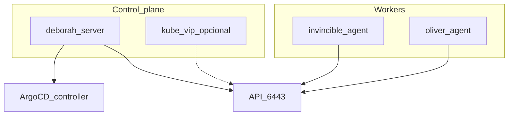

# Phase 3 — K3s

## Objective

Management cluster **K3s (lightweight Kubernetes distribution)** on 3 nodes (control plane on deborah, workers on invincible and oliver; the control plane can be moved to oliver, see [Move the control plane](../operacion/mover-control-plane.md)), with **Argo CD** controller ready for GitOps.

## What you learn

K3s as lightweight bare-metal Kubernetes: server/agent, configurable CNI (Container Network Interface) (Flannel by default in K3s; in this HomeLab, Calico), disable Traefik/ServiceLB to control Gateway and LoadBalancer via GitOps later.

!!! abstract "Learn this phase"
    **In simple terms:** Kubernetes is a restaurant manager: you tell it "I always want three cooks working" and it takes care of replacing whoever is missing. The **control plane** is management (decides) and the **workers** are the kitchen (do the work). K3s is a version of Kubernetes designed for small teams.

    **Key concepts**

    - **Node:** a machine in the cluster; can be control plane (decides) or worker (executes).
    - **Pod:** the smallest execution unit: one or more containers that live together.
    - **Deployment:** declares how many copies of a pod should exist and keeps them running.
    - **CNI:** the component that gives pods networking; here, Calico.
    - **`kubectl` and kubeconfig:** the command-line tool and the file with cluster access data.

    **Hands-on challenge (safe):** create a test deployment, delete one of its pods and watch Kubernetes replace it.

    ```bash
    kubectl get nodes -o wide
    kubectl create deployment demo --image=nginx --replicas=2
    kubectl get pods -l app=demo
    kubectl delete pod -l app=demo --wait=false
    # aparecen pods nuevos
    kubectl get pods -l app=demo
    # limpieza
    kubectl delete deployment demo
    ```

    ??? question "What is the difference between a pod and a deployment?"
        The pod is a running copy; the deployment is the rule that says how many copies should exist and recreates them if they disappear.

    ??? question "What happens if a worker goes down?"
        Kubernetes detects that the pods stopped responding and recreates them on other healthy nodes.

    ??? question "Why is a CNI needed?"
        Because Kubernetes doesn't bring its own pod networking in this setup: the CNI gives them addresses and connects them across nodes.

    Questions? Use the **Learn with AI** button next to each heading, or the [Learn](../aprende.md) page.

## Stack for this phase



- **[K3s](https://docs.k3s.io/)** — Management cluster; Phase 3.
- **CNI** — [Flannel](https://github.com/flannel-io/flannel) (default), [Canal](https://docs.tigera.io/calico/latest/getting-started/kubernetes/flannel/flannel), [Calico](https://docs.tigera.io/calico/latest/about/), [Cilium](https://docs.cilium.io/); Phase 3.
- **[kube-vip](https://kube-vip.io/)** — Optional VIP (virtual IP) `:6443`; fork Phase 3.
- **[Argo CD](https://argo-cd.readthedocs.io/)** — Bootstrap controller; Phase 3 → GitOps Phase 4.
- **[Ansible](https://docs.ansible.com/)** — `playbook-k3s.yml`.

Deep dive: [Playbook options](../k3s/playbook-options.md) · [Ansible roles catalog](../ansible/index.md) · [K3s manual (legacy)](../k3s/index.md)

## Before you start

- [ ] [Phases 0](fase-0-preparacion.md), [1](fase-1-red.md) and [2](fase-2-incus.md) completed.
- [ ] Healthy Incus cluster (optional but recommended before CAPN —Cluster API Provider for Incus—).

## Run

=== "Recommended (Ansible)"

    Playbook options are enabled in [`group_vars/incus_cluster/k3s_install.yml`](https://github.com/maceosoft/homelab/blob/main/ansible/group_vars/incus_cluster/k3s_install.yml), not via command line. Today Argo CD (`gitops_argocd`), node labels (`node_labels`) and local kubeconfig (`fetch_kubeconfig`) come enabled, with Calico CNI. Review the file and run:

    ```bash
    cd ansible
    ansible-playbook -i inventory.ini playbook-k3s.yml
    ```

    !!! warning "Do not use `-e k3s_install.<opción>=…`"
        Ansible ignores it: `k3s_install` is a dictionary and a key with dots in `-e` does not modify it (the default CNI would be installed without warning). And passing `-e` with JSON is worse: it replaces the entire dictionary and `core.version`, `cluster_cidr`, etc. are lost. That's why the playbook **fails** in both cases. To change the CNI use `-e k3s_cni=canal` (or edit the file); see [playbook options](../k3s/playbook-options.md).

=== "Manual alternative"

    curl steps in [K3s — manual installation](../k3s/index.md). Use only if Ansible is not available; the supported path is the playbook.

## Options

| If you need… | In `k3s_install.yml` | Today | Doc |
|---|---|---|---|
| Stable API VIP | `kube_vip.enabled: true` | disabled | [playbook-options](../k3s/playbook-options.md) |
| Longhorn/arch labels | `node_labels.enabled: true` | enabled | [playbook-options](../k3s/playbook-options.md) |
| Local kubeconfig | `fetch_kubeconfig.enabled: true` | enabled | [playbook-options](../k3s/playbook-options.md) |
| OS hardening | `os_hardening.enabled: true` | disabled | [playbook-options](../k3s/playbook-options.md) |

| Decision | Option A (default) | Option B |
|---|---|---|
| K3s API | Name `k3s.homelab.local` (variable `k3s_api_endpoint`) pointing to control plane IP, today deborah `192.168.20.5` | kube-vip `192.168.20.4` |
| CNI | Calico (configured in this repo) | Flannel `vxlan` (K3s default), Canal or Cilium (`k3s_install.core.cni`) |

### CNI

| CNI | Variable | Notes |
|---|---|---|
| **Flannel** (K3s default) | `cni: flannel` | Embedded in K3s; `flannel_backend: vxlan` or `host-gw` |
| **Canal** | `cni: canal` | Flannel overlay + Calico policies; role `k3s_cni` |
| **Calico** | `cni: calico` | NetworkPolicy, optional BGP; `--flannel-backend=none` |
| **Cilium** | `cni: cilium` | eBPF, Hubble; validate on ARM64 (deborah) |

The CNI is chosen in `k3s_install.core.cni` (currently: `calico`), **before** installing K3s: changing it in an already installed cluster requires reinstalling it.

```yaml
# group_vars/incus_cluster/k3s_install.yml
k3s_install:
  core:
    cni: calico  # flannel | canal | calico | cilium
```

Detail: [playbook-options — CNI](../k3s/playbook-options.md#cni).

<div class="card">
  <div class="card-kicker">Trade-off analysis</div>
  <div class="option-grid">
    <div class="card-col">
      <div class="card-title">Ansible (<code>playbook-k3s.yml</code>)</div>
      <div class="text-muted">Flags in <code>group_vars</code>; role <code>k3s_cni</code></div>
      <div class="text-muted">Requires SSH and server → CNI → agents order</div>
    </div>
    <div class="card-col">
      <div class="card-title">Manual curl</div>
      <div class="text-muted">Escape hatch</div>
      <div class="text-muted">No idempotency; easy to forget <code>--disable traefik</code></div>
    </div>
    <div class="card-col">
      <div class="card-title">Fixed IP <code>192.168.20.5</code></div>
      <div class="text-muted">No extra components</div>
      <div class="text-muted">If CP migrates, agents must be reconfigured</div>
    </div>
    <div class="card-col">
      <div class="card-title">kube-vip <code>192.168.20.4</code></div>
      <div class="text-muted">Stable API VIP</div>
      <div class="text-muted">Additional daemon; different from MetalLB</div>
    </div>
    <div class="card-col">
      <div class="card-title">Flannel</div>
      <div class="text-muted">Zero friction; low overhead</div>
      <div class="text-muted">No native NetworkPolicy</div>
    </div>
    <div class="card-col">
      <div class="card-title">Canal</div>
      <div class="text-muted">Calico policies over overlay</div>
      <div class="text-muted">Legacy project; two stacks</div>
    </div>
    <div class="card-col">
      <div class="card-title">Calico</div>
      <div class="text-muted">Mature NetworkPolicy; BGP on L2</div>
      <div class="text-muted">More pods/RAM; IP pools</div>
    </div>
    <div class="card-col">
      <div class="card-title">Cilium</div>
      <div class="text-muted">eBPF; L3–L7 policies; Hubble</div>
      <div class="text-muted">More CPU; kernel/BPF; test on deborah</div>
    </div>
    <div class="card-col">
      <div class="card-title"><code>node_labels</code> / <code>fetch_kubeconfig</code></div>
      <div class="text-muted">Longhorn and local kubeconfig ready</div>
      <div class="text-muted">Longer play; misplaced labels affect storage</div>
    </div>
  </div>
</div>

## Verify

```bash
# En deborah o con kubeconfig
sudo k3s kubectl get nodes
# 3 nodos Ready
sudo k3s kubectl get pods -n argocd
# argocd-server Running (si gitops_argocd.enabled=true)
```

Wait for pods `argocd-server` in `Running` before Phase 4.

## If it fails

| Symptom | Check |
|---|---|
| Agent doesn't join | Token, `K3S_URL`, firewall `:6443` |
| Residual Traefik | `--tags traefik` or role `k3s_cleanup_traefik` |
| CP down after reboot | `systemctl enable --now k3s` on deborah |

## Next

**[→ Phase 4 — GitOps](fase-4-gitops.md)**
