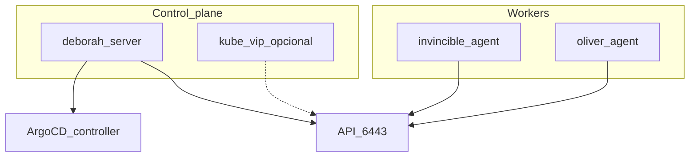

# Fase 3 — K3s

## Objetivo

Management cluster **K3s (distribución ligera de Kubernetes)** en 3 nodos (control plane en deborah, workers en invincible y
oliver), con controller **Argo CD** listo para GitOps.

## Qué aprendes

K3s como Kubernetes ligero bare-metal: server/agent, CNI (Container Network Interface) configurable
(Flannel por defecto en K3s; en este HomeLab, Calico), deshabilitar Traefik/ServiceLB para controlar el Gateway y
LoadBalancer vía GitOps después.

!!! abstract "Aprende esta fase"
    **En simple:** Kubernetes es el gerente de un restaurante: tú le dices "quiero siempre tres
    cocineros trabajando" y él se encarga de reemplazar al que falte. El **control plane** es la gerencia
    (decide) y los **workers** son la cocina (trabajan). K3s es una versión de Kubernetes pensada para
    equipos pequeños.

    **Conceptos clave**

    - **Nodo:** un equipo del clúster; puede ser control plane (decide) o worker (ejecuta).
    - **Pod:** la unidad mínima de ejecución: uno o más contenedores que viven juntos.
    - **Deployment:** declara cuántas copias de un pod deben existir y las mantiene.
    - **CNI:** el componente que da red a los pods; aquí, Calico.
    - **`kubectl` y kubeconfig:** la herramienta de línea de comandos y el archivo con los datos de acceso al clúster.

    **Reto práctico (seguro):** crea un deployment de prueba, borra uno de sus pods y mira cómo Kubernetes lo repone.

    ```bash
    kubectl get nodes -o wide
    kubectl create deployment demo --image=nginx --replicas=2
    kubectl get pods -l app=demo
    kubectl delete pod -l app=demo --wait=false
    # aparecen pods nuevos
    kubectl get pods -l app=demo
    # limpieza
    kubectl delete deployment demo
    ```

    ??? question "¿Qué diferencia hay entre un pod y un deployment?"
        El pod es una copia en ejecución; el deployment es la regla que dice cuántas copias deben existir
        y las recrea si desaparecen.

    ??? question "¿Qué pasa si se cae un worker?"
        Kubernetes detecta que los pods dejaron de responder y los vuelve a crear en otros nodos sanos.

    ??? question "¿Por qué hace falta un CNI?"
        Porque Kubernetes no trae red de pods propia en este montaje: el CNI les da direcciones y los
        comunica entre nodos.

    ¿Dudas? Usa el botón **Aprende con IA** junto a cada título, o la página [Aprende](../aprende.md).

## Stack de esta fase



- **[K3s](https://docs.k3s.io/)** — Management cluster; Fase 3.
- **CNI** — [Flannel](https://github.com/flannel-io/flannel) (default), [Canal](https://docs.tigera.io/calico/latest/getting-started/kubernetes/flannel/flannel), [Calico](https://docs.tigera.io/calico/latest/about/), [Cilium](https://docs.cilium.io/); Fase 3.
- **[kube-vip](https://kube-vip.io/)** — VIP (IP virtual) opcional `:6443`; fork Fase 3.
- **[Argo CD](https://argo-cd.readthedocs.io/)** — Controller bootstrap; Fase 3 → GitOps Fase 4.
- **[Ansible](https://docs.ansible.com/)** — `playbook-k3s.yml`.

Profundización: [Opciones del playbook](../k3s/playbook-options.md) · [Catálogo roles Ansible](../ansible/index.md) · [K3s manual (legacy)](../k3s/index.md)

**Esta decisión en otros entornos**

=== "🏠 En casa"

    Un solo control plane en deborah, con el datastore por defecto de K3s (SQLite), y dos workers. Es simple, gasta
    poca memoria y basta para aprender; si deborah se apaga, los pods siguen corriendo pero no puedes cambiar nada
    hasta que vuelva. Si más adelante quieres alta disponibilidad, K3s puede pasar a
    [etcd embebido](https://docs.k3s.io/datastore/ha-embedded).

=== "🏢 En la empresa"

    - **Beneficios:** Kubernetes da una forma única de desplegar, escalar y recuperar las aplicaciones en cualquier
      servidor; un equipo pequeño opera muchos servicios con los mismos manifiestos, y K3s lo logra con un binario
      liviano que se instala y actualiza en minutos.
    - **Alta disponibilidad:** se usan **3 control planes** (número impar para que etcd mantenga quórum), con etcd
      embebido o [externo](https://docs.k3s.io/datastore), detrás de una IP virtual o un balanceador.
      SQLite no sirve con varios servers.
    - **Actualizaciones sin corte:** con varios control planes se actualiza uno a la vez y el API nunca se cae.
    - **Soporte comercial:** es común pagar una distribución con soporte y parches de seguridad, como
      [RKE2](https://docs.rke2.io/) dentro de [SUSE Rancher Prime](https://www.suse.com/products/rancher/) o
      [Red Hat OpenShift](https://www.redhat.com/en/technologies/cloud-computing/openshift).
    - **Cuándo K3s sí conviene:** en el edge (tiendas, sucursales, fábricas, IoT), donde hay poco hardware, poca
      gente técnica en sitio o conexión intermitente. Ahí un clúster pequeño y fácil de reponer vale más que uno grande.

=== "☁️ En la nube"

    | Nube | Servicio equivalente |
    |---|---|
    | GCP | [Google Kubernetes Engine (GKE)](https://cloud.google.com/kubernetes-engine) |
    | AWS | [Amazon Elastic Kubernetes Service (EKS)](https://aws.amazon.com/eks/) |
    | Azure | [Azure Kubernetes Service (AKS)](https://azure.microsoft.com/en-us/products/kubernetes-service) |
    | Oracle Cloud (OCI) | [OCI Kubernetes Engine (OKE)](https://www.oracle.com/cloud/cloud-native/kubernetes-engine/) |

    Ganas un control plane administrado por el proveedor: alta disponibilidad, parches y SLA sin que tú cuides etcd.
    Pierdes control sobre ese control plane, pagas por el servicio y quedas más atado a las integraciones de esa nube.

## Antes de empezar

- [ ] [Fases 0](fase-0-preparacion.md), [1](fase-1-red.md) y [2](fase-2-incus.md) completadas.
- [ ] Clúster de Incus sano (opcional pero recomendado antes de CAPN —Cluster API Provider for Incus—).

## Ejecutar

=== "Recomendado (Ansible)"

    Las opciones del playbook se activan en
    [`group_vars/incus_cluster/k3s_install.yml`](https://github.com/maceosoft/homelab/blob/main/ansible/group_vars/incus_cluster/k3s_install.yml),
    no por línea de comandos. Hoy vienen activadas Argo CD
    (`gitops_argocd`), las etiquetas de nodos (`node_labels`) y el kubeconfig
    local (`fetch_kubeconfig`), con CNI Calico.
    Revisa el archivo y corre:

    ```bash
    cd ansible
    ansible-playbook -i inventory.ini playbook-k3s.yml
    ```

    !!! warning "No uses `-e k3s_install.<opción>=…`"
        Ansible lo ignora: `k3s_install` es un diccionario y una clave con
        puntos en `-e` no lo modifica (se instalaría el CNI por defecto sin avisar). Y pasar `-e`
        con JSON es peor: reemplaza el diccionario entero y se pierden `core.version`,
        `cluster_cidr`, etc. Por eso el playbook **falla** en ambos casos. Para cambiar el CNI usa
        `-e k3s_cni=canal` (o edita el archivo); ver
        [opciones del playbook](../k3s/playbook-options.md).

=== "Alternativa manual"

    Pasos curl en [K3s — instalación manual](../k3s/index.md). Usar solo si
    Ansible no está disponible; el camino soportado es el playbook.

## Opciones

| Si necesitas… | En `k3s_install.yml` | Hoy | Doc |
|---|---|---|---|
| VIP estable del API | `kube_vip.enabled: true` | desactivado | [playbook-options](../k3s/playbook-options.md) |
| Etiquetas Longhorn/arch | `node_labels.enabled: true` | activado | [playbook-options](../k3s/playbook-options.md) |
| Kubeconfig local | `fetch_kubeconfig.enabled: true` | activado | [playbook-options](../k3s/playbook-options.md) |
| Endurecimiento del SO | `os_hardening.enabled: true` | desactivado | [playbook-options](../k3s/playbook-options.md) |

| Decisión | Opción A (default) | Opción B |
|---|---|---|
| API K3s | Nombre `k3s.homelab.local` (variable `k3s_api_endpoint`) hacia la IP del control plane, hoy deborah `192.168.20.5` | kube-vip `192.168.20.4` |
| CNI | Calico (configurado en este repo) | Flannel `vxlan` (default de K3s), Canal o Cilium (`k3s_install.core.cni`) |

### CNI

| CNI | Variable | Notas |
|---|---|---|
| **Flannel** (default de K3s) | `cni: flannel` | Embebido en K3s; `flannel_backend: vxlan` o `host-gw` |
| **Canal** | `cni: canal` | Flannel overlay + políticas Calico; rol `k3s_cni` |
| **Calico** | `cni: calico` | NetworkPolicy, BGP opcional; `--flannel-backend=none` |
| **Cilium** | `cni: cilium` | eBPF, Hubble; validar en ARM64 (deborah) |

El CNI se elige en `k3s_install.core.cni` (hoy: `calico`), **antes** de
instalar K3s: cambiarlo en un clúster ya instalado obliga a reinstalarlo.

```yaml
# group_vars/incus_cluster/k3s_install.yml
k3s_install:
  core:
    cni: calico  # flannel | canal | calico | cilium
```

Detalle: [playbook-options — CNI](../k3s/playbook-options.md#cni).

<div class="card">
  <div class="card-kicker">Análisis de trade-offs</div>
  <div class="option-grid">
    <div class="card-col">
      <div class="card-title">Ansible (<code>playbook-k3s.yml</code>)</div>
      <div class="text-muted">Flags en <code>group_vars</code>; rol <code>k3s_cni</code></div>
      <div class="text-muted">Requiere SSH y orden server → CNI → agents</div>
    </div>
    <div class="card-col">
      <div class="card-title">curl manual</div>
      <div class="text-muted">Escape hatch</div>
      <div class="text-muted">Sin idempotencia; fácil olvidar <code>--disable traefik</code></div>
    </div>
    <div class="card-col">
      <div class="card-title">IP fija <code>192.168.20.5</code></div>
      <div class="text-muted">Sin componentes extra</div>
      <div class="text-muted">Si el CP migra, hay que reconfigurar agents</div>
    </div>
    <div class="card-col">
      <div class="card-title">kube-vip <code>192.168.20.4</code></div>
      <div class="text-muted">VIP estable del API</div>
      <div class="text-muted">Daemon adicional; distinto de MetalLB</div>
    </div>
    <div class="card-col">
      <div class="card-title">Flannel</div>
      <div class="text-muted">Cero fricción; bajo consumo</div>
      <div class="text-muted">Sin NetworkPolicy nativa</div>
    </div>
    <div class="card-col">
      <div class="card-title">Canal</div>
      <div class="text-muted">Políticas Calico sobre overlay</div>
      <div class="text-muted">Proyecto legacy; dos stacks</div>
    </div>
    <div class="card-col">
      <div class="card-title">Calico</div>
      <div class="text-muted">NetworkPolicy madura; BGP en L2</div>
      <div class="text-muted">Más pods/RAM; IP pools</div>
    </div>
    <div class="card-col">
      <div class="card-title">Cilium</div>
      <div class="text-muted">eBPF; políticas L3–L7; Hubble</div>
      <div class="text-muted">Más CPU; kernel/BPF; probar en deborah</div>
    </div>
    <div class="card-col">
      <div class="card-title"><code>node_labels</code> / <code>fetch_kubeconfig</code></div>
      <div class="text-muted">Longhorn y kubeconfig local listos</div>
      <div class="text-muted">Play más largo; labels mal puestas afectan storage</div>
    </div>
  </div>
</div>

## Verificar

```bash
# En deborah o con kubeconfig
sudo k3s kubectl get nodes
# 3 nodos Ready
sudo k3s kubectl get pods -n argocd
# argocd-server Running (si gitops_argocd.enabled=true)
```

Espera pods `argocd-server` en `Running` antes de la Fase 4.

## Si falla

| Síntoma | Revisar |
|---|---|
| El agent no se une | Token, `K3S_URL`, firewall `:6443` |
| Traefik residual | `--tags traefik` o rol `k3s_cleanup_traefik` |
| CP caído tras reboot | `systemctl enable --now k3s` en deborah |

## Siguiente

**[→ Fase 4 — GitOps](fase-4-gitops.md)**
