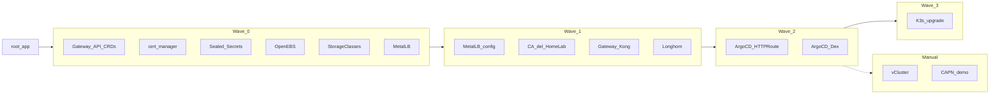
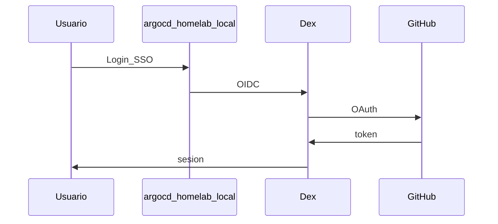
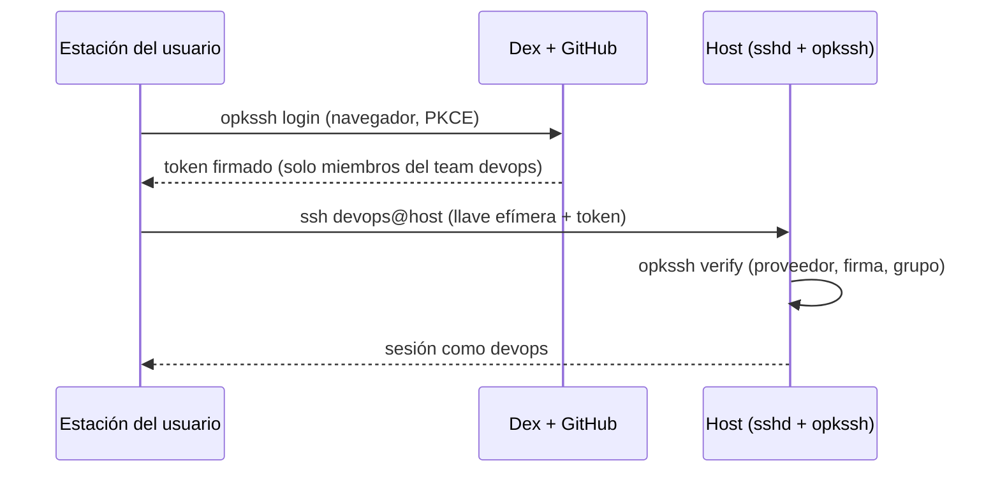
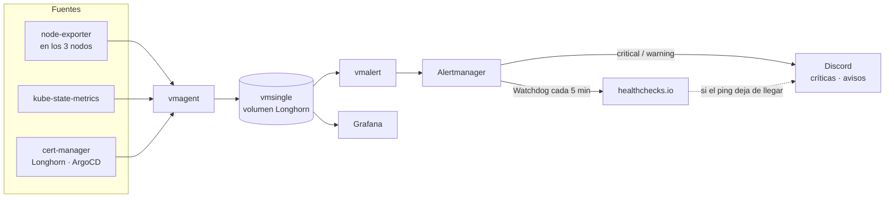

# Phase 4 — GitOps

## Objective

Deploy the full platform via **Argo CD** from
[`gitops/`](https://github.com/maceosoft/gitops): storage, MetalLB, Gateway API, Dex +
GitHub OAuth (Open Authorization), and operation waves.

## What you learn

**GitOps**: the cluster converges to the state declared in Git; a single
`kubectl apply` (ApplicationSet `homelab-root`) and Argo CD sync the rest. Clear separation:
Ansible bootstrap vs continuous GitOps.

!!! abstract "Learn this phase"
    **In short:** Git is the approved recipe and Argo CD is the chef who compares the kitchen with the recipe
    and corrects any difference. If someone changes something manually in the cluster, Argo CD puts it
    back as Git says. The team doesn't "run commands": they change the recipe.

    **Key concepts**

    - **GitOps:** the repository is the source of truth; the cluster converges to what it says.
    - **Application and sync:** Argo CD watches a Git folder and applies it; "Synced" means they match.
    - **Drift and self-heal:** drift is the difference between Git and the cluster; self-heal corrects it automatically.
    - **Waves (sync-waves):** the deployment order; the foundation (network, certificates) goes before applications.
    - **Secrets outside Git:** keys live in 1Password and are delivered to the cluster without committing them to the repo.
    - **Gateway and TLS (Transport Layer Security):** the HTTPS entry door and the certificate that protects it.

    **Practical challenge (read-only):** compare the cluster state with what Git declares.

    ```bash
    kubectl -n argocd get applications
    kubectl get gateway homelab -n gateway
    ```

    Open `gateway/kong/gateway.yaml` in the `gitops` repository and look for the same ports and the
    name `homelab` you see in the cluster.

    ??? question "What does it mean for an Application to be Synced and Healthy?"
        Synced: what's in the cluster matches Git. Healthy: the resources are working.

    ??? question "Why aren't secrets stored in Git?"
        Because anyone with access to the repository would see them, and Git history preserves everything that was committed.

    ??? question "What does self-heal do if someone changes something manually?"
        It detects the difference with Git and reapplies what is declared.

    Questions? Use the **Learn with AI** button next to each heading, or the [Learn](../aprende.md) page.

## Stack for this phase



- **[Argo CD](https://argo-cd.readthedocs.io/)** — GitOps; the whole phase.
- **[MetalLB](https://metallb.universe.tf/)** — LAN LoadBalancer (local network); wave 0–1.
- **[Gateway API](https://gateway-api.sigs.k8s.io/)** — Standard Kubernetes API for publishing HTTP(S) services (replaces `Ingress`); its CRDs go in wave 0.
- **[Kong Ingress Controller](https://developer.konghq.com/kubernetes-ingress-controller/)** (KIC) — default Gateway API controller; wave 1. Alternatives: [Traefik](https://doc.traefik.io/traefik/routing/providers/kubernetes-gateway/) and [NGINX Gateway Fabric](https://docs.nginx.com/nginx-gateway-fabric/).
- **[cert-manager](https://cert-manager.io/docs/)** — issues TLS certificates with a HomeLab-owned CA (Certificate Authority); waves 0–1.
- **[OpenEBS](https://openebs.io/docs)** / **[Longhorn](https://longhorn.io/docs/)** — Storage; waves 0–1.
- **[Sealed Secrets](https://github.com/bitnami-labs/sealed-secrets)** — Secrets in Git; wave 0.
- **[Dex](https://dexidp.io/docs/)** + **[GitHub](https://docs.github.com/en/apps/oauth-apps)** — SSO (Single Sign-On); wave 2.
- **[1Password Python SDK](https://github.com/1Password/onepassword-sdk-python)** — OAuth outside Git; step 4.7 (local app, DesktopAuth).
- **[system-upgrade-controller](https://github.com/rancher/system-upgrade-controller)** — K3s upgrades (lightweight Kubernetes distribution); wave 3.

!!! note "Why Gateway API and not Ingress"
    The Ingress NGINX project was archived in March 2026 and `Ingress` is
    frozen in Kubernetes. The HomeLab publishes everything with `Gateway` and
    `HTTPRoute`. **Only one** controller is enabled at a time (Kong, Traefik or
    NGINX Gateway Fabric): see [Switch Gateway Controller](../operacion/cambiar-gateway.md).

Deep dive: [GitOps Catalog](../gitops/index.md) · [Storage](../storage/index.md) · [Secrets](../secrets/index.md)

## Before you start

- [ ] [Phase 3 — K3s](fase-3-k3s.md) completed (`argocd-server` Running).
- [ ] `kubectl` configured on your workstation.
- [ ] [Phase 0 — GitHub and 1Password](fase-0-preparacion.md#github-and-1password-org-maceosoft-manual-one-time)
      completed (Apps, repos and 1Password items).
- [ ] In the router, the range **`192.168.23.200–192.168.23.220`** outside
      DHCP (reserved): this is the MetalLB pool for
      `LoadBalancer` services, like the Gateway ([IP scheme](../networking/index.md#ip-scheme)).

---

## 4.1 — kubectl Access

Copy the control plane kubeconfig (`deborah`) to your workstation as
`~/.kube/homelab-k3s.yaml`: this is the file used by the playbooks and the
procedures in this guide. If you ran `playbook-k3s.yml`
in full during Phase 3, you already have it (`k3s_install.fetch_kubeconfig.enabled: true`).

=== "Recommended (Ansible)"

    ```bash
    cd ansible
    ansible-playbook -i inventory.ini playbook-k3s.yml --tags kubeconfig
    cd ..
    ```

    The `k3s_fetch_kubeconfig` role reads `/etc/rancher/k3s/k3s.yaml` in
    `deborah`, replaces the API (Application Programming
    Interface) address with the real control plane IP (or the VIP —virtual IP— if you use kube-vip)
    and saves it to `~/.kube/homelab-k3s.yaml` with `0600` permissions.

=== "Manual alternative"

    The file on the node is owned by root with `600` permissions, so it is read with
    `sudo`; then `127.0.0.1` is replaced with the control plane IP. `<usuario-admin>` is your
    node admin user ([Phase 0, Day 0](fase-0-preparacion.md#day-0-freshly-installed-nodes-only-the-first-time-per-node)):
    SSO access ([4.12](#412-ssh-to-hosts-with-dex-optional)) does not exist yet, which requires Dex.

    ```bash
    mkdir -p ~/.kube
    ssh <usuario-admin>@192.168.20.5 sudo cat /etc/rancher/k3s/k3s.yaml \
      | sed 's#https://127.0.0.1:6443#https://192.168.20.5:6443#' \
      > ~/.kube/homelab-k3s.yaml
    chmod 600 ~/.kube/homelab-k3s.yaml
    ```

Use it and verify access:

```bash
export KUBECONFIG=~/.kube/homelab-k3s.yaml
kubectl get nodes
```

!!! tip "Web alternative (Phase 5)"
    After deploying [vCluster Platform](fase-5-vcluster.md), you can download
    the **management K3s** kubeconfig from
    [`https://vcluster.homelab.local`](https://vcluster.homelab.local) (connected cluster), with GitHub SSO via Dex.
    The local kubeconfig above remains the bootstrap path, before Phase 5.

<div class="card">
  <div class="card-kicker">kubectl Access</div>
  <div class="option-grid">
    <div class="card-col">
      <div class="card-title">Local kubeconfig (Ansible or manual)</div>
      <div class="text-muted">Works before Gateway and vCluster</div>
      <div class="text-muted">File on disk; manual rotation</div>
    </div>
    <div class="card-col">
      <div class="card-title">vCluster Platform (Phase 5)</div>
      <div class="text-muted">Kubeconfig via SSO; connected cluster</div>
      <div class="text-muted">Requires Phase 4+5 and assigned permissions</div>
    </div>
  </div>
</div>

---

## 4.2 — GitOps Bootstrap (ApplicationSet)

A single manual apply; from here on Argo CD manages the rest (auto).

**First, platform secrets.** `maceosoft/gitops` is private: without
the `maceosoft-argocd` App credentials, Argo CD cannot read the repo. The playbook reads them from
1Password and places them in the cluster. Just like in Phase 0, the 1Password
app must be unlocked and `ONEPASSWORD_ACCOUNT_NAME` with your
account name (the one in the app sidebar).

```bash
# tu cuenta
export ONEPASSWORD_ACCOUNT_NAME="Mi Cuenta"
cd ansible
ansible-playbook -i inventory.ini playbook-platform-secrets.yml
cd ..
```

| Secret | Namespace | Purpose |
|---|---|---|
| `repo-gitops` | `argocd` | App `maceosoft-argocd` for `https://github.com/maceosoft/gitops.git` |
| `arc-runners-github-app` | `arc-runners` | ARC runner registry |
| `terraform-app`, `tofu-vars` | `arc-runners` | OpenTofu credentials (`TF_VAR_*`) for the pipeline |

It also creates the `terraform` namespace, where OpenTofu stores its state. Always use
`~/.kube/homelab-k3s.yaml`, not the current `kubectl` context. It is
idempotent: run it again when you rotate something in 1Password. Details:
[maceosoft Platform — GitHub](../maceosoft/github.md#step-3-cluster-and-platform-secrets).

**Then, the bootstrap ApplicationSet:**

```bash
kubectl apply -f gitops/bootstrap/root-appset.yaml
```

[`bootstrap/root-appset.yaml`](https://github.com/maceosoft/gitops/blob/main/bootstrap/root-appset.yaml)
generates a root Application, `homelab-root`, with the apps that are
**uncommented** in its `apps` list. Initially only `argocd` is enabled: Argo CD managing itself, with
Dex, RBAC (Role-Based Access Control) and the health check required by waves. This lets you test each
component one by one:

1. Uncomment the next app in the list (they go in wave order) and push
   to the `gitops` repo.
2. **Re-apply the ApplicationSet**: Argo CD does not manage it (you created
   it with `kubectl`), so the push alone does not change the list:

    ```bash
    kubectl apply -f gitops/bootstrap/root-appset.yaml
    ```

3. Argo CD deploys it; wait for it to become `Healthy`
   (`kubectl get applications -n argocd`).
4. Continue with the next one.

**Waves:** since all apps sync together in `homelab-root`, Argo CD
respects their `argocd.argoproj.io/sync-wave` annotation and deploys by waves
(from -1 to 4), waiting for each to be `Healthy` before the
next. Waves 0 to 3 are described in 4.3, 4.4, 4.5 and 4.9; the diagram above shows the main ones.

To disable an app, comment it out again: `homelab-root` deletes its
Application (the resources it created remain in the cluster).

**Verify:**

```bash
kubectl get applications -n argocd
```

Provisional UI (no Gateway yet; `argocd-server` speaks HTTP, open [`http://localhost:8080`](http://localhost:8080)):

```bash
kubectl port-forward svc/argocd-server -n argocd 8080:80
kubectl get secret argocd-initial-admin-secret -n argocd \
  -o jsonpath='{.data.password}' | base64 -d; echo
```

---

## 4.3 — Wave 0: secrets + storage + MetalLB controller

Wait for `Healthy` in: `gateway-api`, `cert-manager`, `sealed-secrets`, `openebs`, `homelab-storage`, `metallb`.

| Application | Product | Purpose |
|---|---|---|
| `gateway-api` | [Gateway API](https://gateway-api.sigs.k8s.io/) | CRDs (Custom Resource Definition) `Gateway`, `HTTPRoute`, etc., standard channel |
| `cert-manager` | [cert-manager](https://cert-manager.io/docs/) | Issues certificates; creates one for each Gateway with the `cert-manager.io/cluster-issuer` annotation |
| `sealed-secrets` | [Sealed Secrets](https://github.com/bitnami-labs/sealed-secrets) | Decrypts `SealedSecret` in-cluster; uses the 1Password key (item `sealed-secrets`) if the secrets playbook already created it |
| `openebs` | [OpenEBS](https://openebs.io/docs) | Default LocalPV |
| `homelab-storage` | — | StorageClasses `openebs-hostpath` and `longhorn-mixto` ([which to use and trade-offs](../storage/index.md#cluster-storageclasses)) |
| `metallb` | [MetalLB](https://metallb.universe.tf/) | LoadBalancer Controller |

**Verify:**

```bash
kubectl get storageclass
kubectl get pods -n metallb-system
kubectl get pods -n openebs
```

---

## 4.4 — Wave 1: MetalLB pool + Gateway + Longhorn

Wait for `Healthy` in: `metallb-config`, `cert-manager-config`, `kong` and `longhorn`.

| Application | Product | Purpose |
|---|---|---|
| `metallb-config` | [MetalLB](https://metallb.universe.tf/) | L2 Pool `192.168.23.200–.220` |
| `cert-manager-config` | [cert-manager](https://cert-manager.io/docs/) | HomeLab custom CA (`ClusterIssuer homelab-ca`) |
| `kong` | [Kong Ingress Controller](https://developer.konghq.com/kubernetes-ingress-controller/) | Gateway API controller and `Gateway homelab` (HTTP 80 and HTTPS 443, `*.homelab.local`) |
| `longhorn` | [Longhorn](https://longhorn.io/docs/) | Replicated HA storage |

```bash
kubectl get gateway homelab -n gateway
# ADDRESS en rango 192.168.23.200–.220 y PROGRAMMED=True
```

**Verify:**

```bash
kubectl get ipaddresspool -n metallb-system
kubectl get pods -n longhorn-system
```

---

## 4.5 — Wave 2: Argo CD on LAN + Dex {#45-wave-2-argocd-en-lan-dex}

Wait for `Healthy` in `argocd-route` and `argocd`.

| Resource | Product | Purpose |
|---|---|---|
| `argocd-route` | [Gateway API](https://gateway-api.sigs.k8s.io/) | `HTTPRoute` to `https://argocd.homelab.local` (the Gateway terminates TLS; `argocd-server` stays HTTP with `server.insecure`) |
| `argocd` | [Argo CD](https://argo-cd.readthedocs.io/) and [Dex](https://dexidp.io/docs/) | Argo CD self-updates (tag `stable`); adds GitHub connector, vCluster and Incus UI staticClients, RBAC, and Application health check ([Update Argo CD](../operacion/actualizar-argocd.md)) |

---

## 4.6 — kube-vip vs MetalLB

| | [kube-vip](https://kube-vip.io/) | [MetalLB](https://metallb.universe.tf/) |
|---|---|---|
| **Who installs it** | Ansible (Phase 3) | Argo CD (Phase 4) |
| **What gets VIP** | Only API `:6443` | Services `LoadBalancer` |
| **Key config** | `svc_enable=false` | Pool `192.168.23.200–.220` |

Do not use kube-vip for application Services.

### Trade-off analysis — kube-vip vs MetalLB

| Alternative | Advantage | Cost / risk |
|---|---|---|
| kube-vip (Phase 3) | Fixed VIP only for API `:6443` | Does not expose Gateways or LB Services |
| MetalLB (Phase 4) | `LoadBalancer` for Gateway and apps | L2 pool `192.168.23.200–.220` must be free on LAN |
| Both (default HomeLab) | Separate responsibilities | Two distinct VIP mechanisms — do not mix roles |

---

## 4.7 — OAuth Secrets (GitHub + vCluster + Incus UI)

Sensitive values **do not go in Git**. Store them in 1Password and inject
`argocd-secret`.

!!! note "OAuth App already created in Phase 0"
    If you followed [Phase 0](fase-0-preparacion.md#github-and-1password-org-maceosoft-manual-one-time),
    the OAuth App `Maceosoft Dex` and its fields `GITHUB_*` already exist: just
    run the playbook below.

**GitHub OAuth App** in the **`maceosoft` org** ([maceosoft → Settings → Developer settings → OAuth Apps → New OAuth App](https://github.com/organizations/maceosoft/settings/applications/new)).
Created in the org, Dex can read its teams without approving it as a third-party app:

| GitHub Field | Value |
|---|---|
| Application name | `Maceosoft Dex` (or similar) |
| Homepage URL | `https://argocd.homelab.local` |
| Redirect URIs | `https://argocd.homelab.local/api/dex/callback` (only this one) |

**Homepage URL** is informational; the critical field is **Redirect URIs** (in older GitHub versions called *Authorization callback URL*): it must be exactly the URL above.

1Password items (**personal** account, **`HomeLab`** vault by default): see
[`argocd/secrets/1password.md`](https://github.com/maceosoft/gitops/blob/main/argocd/secrets/1password.md).

??? tip "With the CLI (`op`)"
    Creating the OAuth App and its client secret is **web-only** (GitHub has no API for OAuth Apps). Saving the item can be done with a command; it's in [maceosoft Platform — GitHub](../maceosoft/github.md#oauth-app-maceosoft-dex).

Test read (same module as apply):

```bash
# tu cuenta personal
export ONEPASSWORD_ACCOUNT_NAME="Mi Cuenta"
# o HomeLab
export ONEPASSWORD_VAULT="HomeLab"
python3 ansible/scripts/check_1password.py GITHUB_CLIENT_ID
```

Inject into cluster (recommended — Ansible):

```bash
cd ansible
ansible-playbook -i inventory.ini playbook-dex-oauth-secrets.yml
```

The `VCLUSTER_CLIENT_SECRET` field is generated in
1Password automatically if missing. `GITHUB_CLIENT_ID` and `GITHUB_CLIENT_SECRET` come from the GitHub
OAuth App created in Phase 0 (see note above); if you didn't create it, save them manually in 1Password before proceeding.

Alternative Python script:

```bash
pip install onepassword-sdk
python3 gitops/argocd/secrets/apply-from-1password.py.example
kubectl rollout restart deployment argocd-dex-server -n argocd
```

**GitHub** connector (only the `devops` team of the `maceosoft` org) and **vCluster** and **Incus UI** staticClients
in [`dex.config`](https://github.com/maceosoft/gitops/blob/main/argocd/config/dex.config).

`VCLUSTER_CLIENT_SECRET` does **not** come from GitHub.
Ansible generates it in 1Password if missing and applies it per destination. Incus **does not use a secret**:
it is a public OIDC (OpenID Connect) client (PKCE —Proof Key for Code Exchange—) in Dex.

| Field | Destinations (Ansible tags) |
|---|---|
| `VCLUSTER_CLIENT_SECRET` | `argocd-secret` (`argocd`) + Helm Platform (`vcluster`) |

### Test login: URLs and what to expect

First verify that the three keys reached `argocd-secret` and that Dex restarted:

```bash
kubectl -n argocd get secret argocd-secret -o jsonpath='{.data}' | python3 -c "import sys,json;print(list(json.load(sys.stdin)))"
kubectl -n argocd get pods -l app.kubernetes.io/name=argocd-dex-server
```

You should see `dex.github.clientId`, `dex.github.clientSecret`, and
`dex.vcluster.platform.clientSecret`. URLs need the [`*.homelab.local` DNS](#48-homelablocal-dns)
(or `/etc/hosts`); the certificate is signed by the HomeLab CA, so the browser warns until you
import it (and `curl` needs `-k`).

| What to test | URL | What you should see |
|---|---|---|
| **Argo CD** (UI) | [`https://argocd.homelab.local`](https://argocd.homelab.local) | Login screen with **Log in via GitHub** button. Clicking it goes through GitHub and returns to Argo CD with Applications |
| Argo CD (HTTP) | [`http://argocd.homelab.local`](http://argocd.homelab.local) | Redirects (`301`) to HTTPS version |
| Argo CD (API) | [`https://argocd.homelab.local/api/version`](https://argocd.homelab.local/api/version) | `{"Version":"v3.x.x"}`: server responds through Gateway |
| **Dex** (discovery) | [`https://argocd.homelab.local/api/dex/.well-known/openid-configuration`](https://argocd.homelab.local/api/dex/.well-known/openid-configuration) | JSON with `"issuer": "https://argocd.homelab.local/api/dex"` |
| Dex (callback) | `https://argocd.homelab.local/api/dex/callback` | **Do not open manually.** This is the URL that must be in *Redirect URIs* of the GitHub OAuth App |
| **vCluster Platform** | [`https://vcluster.homelab.local`](https://vcluster.homelab.local) | SSO login with GitHub (Phase 5; doesn't exist before) |
| **Incus UI** | [`https://incus.homelab.local:8443`](https://incus.homelab.local:8443) | **Login with SSO** → GitHub (see below) |

From the terminal:

```bash
curl -sk https://argocd.homelab.local/api/version
curl -sk https://argocd.homelab.local/api/dex/.well-known/openid-configuration
curl -s -o /dev/null -w "%{http_code} -> %{redirect_url}\n" http://argocd.homelab.local/
```

| If you see… | Cause | What to do |
|---|---|---|
| GitHub returns **404** and URL contains `client_id=.github.clientId` | Missing `dex.*` keys in `argocd-secret`: Dex couldn't substitute `$dex.github.clientId` | Run the playbook above (`--tags argocd`) and test again |
| GitHub says **redirect_uri mismatch** | OAuth App *Redirect URIs* differs | Must be exactly `https://argocd.homelab.local/api/dex/callback` |
| Login succeeds but Argo CD **shows no Applications** | Your account is not in the `devops` team of `maceosoft` | Add it to the team; the `groups` claim is `maceosoft:devops` |
| `invalid_client` or `bad credentials` | `GITHUB_CLIENT_SECRET` incorrect or rotated | Update the field in 1Password and re-run the playbook |

### Incus UI OIDC

Requirements: UI installed in [Phase 2](fase-2-incus.md#admin-ui),
`argocd` Healthy, secrets injected and Dex restarted.

Incus (7.x) only knows five OIDC keys: `oidc.issuer`, `oidc.client.id`, `oidc.audience`,
`oidc.claim` and `oidc.scopes`. It does **not** have `oidc.client.secret`, nor `oidc.groups.claim`, nor the
`incus auth` command (those belong to LXD —the project Incus forked from—). That is why in Dex the `incus-ui` client is **public**
(`public: true`, PKCE, no secret): it is in [`dex.config`](https://github.com/maceosoft/gitops/blob/main/argocd/config/dex.config).

**Ansible** (recommended) — `group_vars/dex_oauth_secrets.yml` already includes `apply_incus: true`. With
the `dex.*` keys already loaded ([Test login](#test-login-urls-and-what-to-expect)), run:

```bash
export KUBECONFIG=~/.kube/homelab-k3s.yaml
export ONEPASSWORD_ACCOUNT_NAME="Mi Cuenta"
cd ansible
ansible-playbook -i inventory.ini playbook-dex-oauth-secrets.yml --tags ensure,argocd,incus
```

That applies the keys in `argocd-secret`, restarts Dex, installs the HomeLab CA on **invincible**
and configures `oidc.issuer` and `oidc.client.id` in Incus.

!!! warning "Incus must trust the HomeLab CA"
    Incus validates the Dex HTTPS certificate (`https://argocd.homelab.local/api/dex`), which
    is signed by the HomeLab's own CA. If `invincible` doesn't know it, login fails (`curl` from
    the node gives `ssl_verify=20`). The playbook, with the `incus` tag, reads it from the
    cluster (`kubectl -n cert-manager get secret homelab-ca`), installs it in
    `/usr/local/share/ca-certificates/` and **restarts the `incus` service** (instances
    keep running; the API is unavailable for a few seconds). Just that step:
    `--tags incus_ca`.

Verify on the node that it now trusts and that OIDC is configured:

```bash
curl -s -o /dev/null -w "%{http_code} ssl_verify=%{ssl_verify_result}\n" https://argocd.homelab.local/api/dex/.well-known/openid-configuration
incus config get oidc.issuer
incus config get oidc.client.id
```

They should return `200 ssl_verify=0`, `https://argocd.homelab.local/api/dex` and `incus-ui`.

Manual alternative on the bootstrap node (**invincible**), after installing the CA
([manual](../incus/cluster-setup.md#oidc-via-dex-phase-4)):

```bash
incus config set oidc.issuer=https://argocd.homelab.local/api/dex
incus config set oidc.client.id=incus-ui
```

#### Who can sign in and what they can do

- **Who signs in:** the Dex GitHub connector only allows members of the
  `devops` team in the `maceosoft` org (`orgs`/`teams` in `dex.config`). Anyone not in the team
  never reaches Incus.
- **What they can do:** with Incus's default configuration, any user who
  authenticates via the OIDC provider gets **full access** to the server. For granular
  permissions (single project, read-only) Incus uses [OpenFGA](https://linuxcontainers.org/incus/docs/main/authentication/)
  as the authorization engine: it is not configured in the HomeLab. For now, the control
  is membership in the `devops` team.

Verify:

- [`https://incus.homelab.local:8443`](https://incus.homelab.local:8443) → **Login with SSO** → GitHub → you land in the Incus UI
- An account **not** in the `devops` team → GitHub/Dex rejects the login before it reaches Incus

### SSO Flow



| Decision | Option A (HomeLab default) | Option B |
|---|---|---|
| OAuth secrets | Local SDK; **Personal** account, **`HomeLab`** vault | `ONEPASSWORD_ACCOUNT_NAME` / `ONEPASSWORD_VAULT` or `kubectl patch` |

### Trade-off analysis — OAuth secrets

| Alternative | Advantage | Cost / risk |
|---|---|---|
| Ansible + 1Password SDK | Generates `VCLUSTER_CLIENT_SECRET` if missing; idempotent | 1Password app unlocked on the workstation |
| Manual Python script | Same SDK without playbook | Loose steps; easy to forget restart Dex |
| `kubectl patch` direct | No 1Password | Secrets in history; not reproducible |

---

## 4.8 — `*.homelab.local` DNS

Names are resolved by the LAN DNS (BIND on `deborah`,
[`playbook-bind-dns.yml`](https://github.com/maceosoft/homelab/blob/main/ansible/playbook-bind-dns.yml)).
The `homelab.local` zone contains:

| Record | Points to |
|---|---|
| `incus.homelab.local` | invincible (`192.168.20.6`) |
| `invincible.homelab.local`, `oliver.homelab.local`, `deborah.homelab.local` | each server, with its fixed IP (`192.168.20.6`, `.7` and `.5`) |
| `argocd.homelab.local`, `vcluster.homelab.local`, `api.homelab.local`, `grafana.homelab.local`, `open-webui.homelab.local`, `ollama.homelab.local` | the Gateway: `gateway_ip` = `192.168.23.200` (first IP of the MetalLB pool) |

No wildcard: every name is an explicit record in
[`db.homelab.local.j2`](https://github.com/maceosoft/homelab/blob/main/ansible/roles/bind_dns/templates/db.homelab.local.j2).
To publish an app with a new `HTTPRoute`, add its record to that template and apply
the playbook; until then its name will not resolve.

The Gateway IP is **fixed**: the `kong`, `traefik` and `nginx-gateway` Services
request it via a MetalLB annotation, and the same variable `gateway_ip`
(`ansible/group_vars/all.yml`) feeds DNS. If you change it, change it in both
places. Apply DNS (from `ansible/` on `homelab`):

```bash
ansible-playbook -i inventory.ini playbook-bind-dns.yml
# 192.168.23.200
dig @192.168.20.5 argocd.homelab.local +short
# 192.168.20.7
dig @192.168.20.5 oliver.homelab.local +short
```

Your workstation must use `192.168.20.5` as DNS. If you can't, the fallback is
`/etc/hosts`:

```
192.168.23.200  argocd.homelab.local vcluster.homelab.local api.homelab.local grafana.homelab.local open-webui.homelab.local ollama.homelab.local
192.168.20.6    incus.homelab.local invincible.homelab.local
192.168.20.7    oliver.homelab.local
192.168.20.5    deborah.homelab.local
```

Verify the Gateway has that IP:

```bash
kubectl get gateway homelab -n gateway -o jsonpath='{.status.addresses[0].value}'; echo
```

The certificate is signed by the HomeLab CA: for the browser to trust it,
import its root certificate (`kubectl -n cert-manager get secret homelab-ca -o jsonpath='{.data.ca\.crt}' | base64 -d > homelab-ca.crt`)
or use `curl -k` for now.

```bash
curl -kI https://argocd.homelab.local
curl -kI https://incus.homelab.local:8443
```

---

## 4.9 — Wave 3: K3s upgrades (optional)

Wait for `Healthy` in `k3s-upgrade` ([system-upgrade-controller](https://github.com/rancher/system-upgrade-controller)).

---

## 4.10 — Phase 4 Checklist

| Check | Criterion |
|---|---|
| Nodes Ready | `kubectl get nodes` → 3 Ready |
| Apps auto Healthy | `kubectl get applications -n argocd` |
| Storage default | PVC `openebs-hostpath` provisions |
| Gateway responds | `curl -k https://argocd.homelab.local` |
| Dex SSO | GitHub login in Argo CD |
| Incus UI OIDC | SSO login at [`https://incus.homelab.local:8443`](https://incus.homelab.local:8443) |
| ARC Runner | `arc-runners` Healthy; runner listed in *maceosoft → Settings → Actions → Runners* ([4.11](#411-arc-and-opentofu-pipeline)) |
| OpenTofu Pipeline | First `tofu apply` of `infra` green; `terraform/tfstate-default-github` exists ([4.11](#411-arc-and-opentofu-pipeline)) |
| SSH with Dex *(optional)* | `opkssh login` and `ssh devops@oliver.homelab.local` sign in ([4.12](#412-ssh-to-hosts-with-dex-optional)) |
| Monitoring *(optional)* | Grafana opens, node panel shows temperatures and a test alert reaches Discord ([4.13](#413-monitoring-and-alerts-optional)) |
| Argo CD Notifications *(optional)* | Test command sends a message to `despliegues` ([4.14](#414-notificaciones-de-argocd-a-discord-opcional)) |

Global checklist (URLs, `/etc/hosts`, nodes): **[HomeLab Summary](resumen-homelab.md)**.

## 4.11 — ARC and OpenTofu pipeline

With `arc-helm-repo`, `arc-controller`, `terraform-rbac` and `arc-runners` uncommented in `homelab-root`, Argo CD deploys the GitHub Actions runner:

| Application | What it deploys |
|---|---|
| `arc-controller` | ARC controller (`arc-systems`) |
| `terraform-rbac` | ServiceAccount `tofu-runner`, with access only to Secrets/Leases in the `terraform` namespace |
| `arc-runners` | Org scale set `maceosoft` (up to 3 runners), for CI, deploys and OpenTofu. The legacy org has its own, `arc-runners-symintel` (see [Two organizations](../maceosoft/github.md#two-organizations-one-scale-set-per-org)) |
| `arc-runners` (cache) | Shared volume `arc-cache` mounted at `/cache` on the runners ([Runner cache](../operacion/cache-arc.md)) |

```bash
kubectl get applications -n argocd | grep -E 'arc|terraform'
# controller + listener de arc-runners
kubectl get pods -n arc-systems
```

The runner appears in *maceosoft → Settings → Actions → Runners* (via CLI: `gh api orgs/maceosoft/actions/runners --jq '.runners[] | [.name, .status] | @tsv'`).

**First pipeline.** In `maceosoft/infra`, trigger *Actions → tofu → Run workflow* on `main`, or push to `main`. The reusable workflow [`tofu.yml`](https://github.com/maceosoft/core-pipelines/blob/main/.github/workflows/tofu.yml) runs on `arc-runners`: it does `plan` on PRs (pull requests) and `apply` on `main`. The first run creates the `api` repo with its environments and FTP (File Transfer Protocol) secrets.

```bash
# state tras el primer apply
kubectl -n terraform get secret tfstate-default-github
```

From here, each new repo is added using the [routine procedure — Add a repo](../operacion/agregar-repo.md): FTP credentials in 1Password (if it deploys), entry in the [`infra`](https://github.com/maceosoft/infra) map via PR, and the CI (continuous integration)/CD workflow.

## 4.12 — SSH to hosts with Dex (optional)

Members of the `devops` team in the `maceosoft` org on GitHub SSH (Secure Shell, encrypted terminal connection) into `invincible`, `oliver` and `deborah` using their Dex identity, without distributing keys. Incus instances are not included here: they are managed with `incus exec` and the UI SSO login. How a person logs in: [SSH into the servers](../operacion/acceso-ssh.md).

**Requirements.**

- Dex working ([4.5](#45-wave-2-argocd-en-lan-dex) and [4.7](#47-oauth-secrets-github-vcluster-incus-ui)).
- `homelab.local` DNS applied ([4.8](#48-homelablocal-dns)) and **each node using the `deborah` BIND** in its `/etc/resolv.conf` (set in [Phase 1](fase-1-red.md) with `playbook-set-static-ip.yml`). Without this a node cannot validate any login.
- `kubectl` with the HomeLab kubeconfig: the role reads the cert-manager CA so nodes trust Dex.
- Your regular key in `authorized_keys` on each node ([hardening](fase-1-red.md#hardening-recommended-before-proceeding)). This access **adds** to the keys, it does not replace them: it is your emergency path if Dex or K3s go down.

### How it works

SSH does not speak OIDC. [opkssh](https://github.com/openpubkey/opkssh), based on [OpenPubkey](https://github.com/openpubkey/openpubkey), acts as a bridge:



1. `opkssh login` authenticates against Dex (GitHub) and leaves an SSH key that expires in 24 hours.
2. On connect, `sshd` runs `opkssh verify` (via `AuthorizedKeysCommand`), which validates the token signature and that the issuer is Dex.
3. An opkssh *policy plugin* requires the `maceosoft:devops` group and the `devops` Linux user.

### Steps

1. **Client in Dex.** The `opkssh` client (public, PKCE, with the three callbacks in `localhost`) is in [`dex.config`](https://github.com/maceosoft/gitops/blob/main/argocd/config/dex.config). When Argo CD syncs, restart Dex so it loads it:

    ```bash
    kubectl -n argocd rollout restart deploy/argocd-dex-server
    ```

2. **Verify nodes resolve Dex** (from `ansible/` on `homelab`):

    ```bash
    ansible incus_cluster -i inventory.ini -b -m command -a "getent hosts argocd.homelab.local"
    ```

    All three must return `192.168.23.200`. If any does not, fix its DNS first (see *If it fails* below).

3. **One test node first** (`oliver`), with `--check` before applying:

    ```bash
    export KUBECONFIG=~/.kube/homelab-k3s.yaml
    cd ansible && source ../.venv/bin/activate
    ansible-playbook -i inventory.ini playbook-opkssh.yml --limit oliver --check --diff
    ansible-playbook -i inventory.ini playbook-opkssh.yml --limit oliver
    ```

    The role stops before installing anything if the node does not resolve Dex or does not trust its certificate.

4. **Test the login** following [SSH into the servers](../operacion/acceso-ssh.md) and, with the session working, extend to the rest: `--limit invincible,deborah`.

What the role [`opkssh`](https://github.com/maceosoft/homelab/blob/main/ansible/roles/opkssh/README.md) installs on each node: the pinned-version binary and its checksum, `/etc/opk/` (Dex provider and the plugin), the `devops` Linux account, the HomeLab CA, and a file in `/etc/ssh/sshd_config.d/`.

### Who gets in

Access depends on **belonging to the `devops` team on GitHub**. There are no user lists or email lists.

- **Dex** only issues tokens to team members ([GitHub connector](https://github.com/maceosoft/gitops/blob/main/argocd/config/dex.config)) and puts the team in the `groups` claim as `maceosoft:devops`.
- **Each node** requires that group with a policy plugin (`/etc/opk/devops-team.sh`). The group is changed with `opkssh_allowed_group` in the role.

Adding or removing access is changing the team in GitHub. A removal prevents obtaining new tokens, but the key the person already has remains valid until it expires (24 hours).

!!! note "Why a plugin and not `/etc/opk/auth_id`"
    The standard `oidc:groups:maceosoft:devops` rule does not work with GitHub groups: opkssh splits the rule by `:` and only compares the last segment (`devops`) with the full group (`maceosoft:devops`), so they never match, and quoting the value does not help either. That is why `auth_id` is left without rules and the plugin decides (the behavior is in `policy/enforcer.go` of opkssh).

!!! warning "Shared account with `sudo`"
    Everyone logs in as `devops`, with passwordless `sudo` (`opkssh_login_user_sudo_nopasswd`): anyone in the team is an administrator of the three nodes and session logs do not distinguish people by the Linux user. To require a `sudo` password, set that variable in `false` and assign a password to the account.

### Trade-off analysis — how to SSH in

| Alternative | Advantage | Cost / risk |
|---|---|---|
| **opkssh with Dex** (this guide) | Reuses Dex and the team; 24 h keys; no lists to maintain | Young project; needs a plugin for groups with `:`; Dex runs in K3s on these same nodes |
| SSH CA with ephemeral certs (step-ca) | Very mature | Another component with its own root key to operate. Plan B |
| GitHub public keys filtered by team | Simple | Doesn't use Dex; keys don't expire |
| `authorized_keys` via Ansible | No new pieces | Every add or remove is a manual change |
| Teleport / Boundary | Audit and session recording | Heavy for three nodes; Teleport Community doesn't offer generic OIDC |

### Undo

[`playbook-uninstall-opkssh.yml`](https://github.com/maceosoft/homelab/blob/main/ansible/playbook-uninstall-opkssh.yml)
removes what the role installs (`sshd` configuration, binary, `/etc/opk` and the `devops` account). It's safe by
default: without `-e opkssh_uninstall_confirm=true` it only shows what it would remove.

```bash
ansible-playbook -i inventory.ini playbook-uninstall-opkssh.yml --limit oliver
ansible-playbook -i inventory.ini playbook-uninstall-opkssh.yml --limit oliver -e opkssh_uninstall_confirm=true
```

Doesn't touch `authorized_keys` or the hardening. The HomeLab CA is preserved; to remove it as well:
`-e opkssh_uninstall_remove_ca=true`.

### If it fails (on the server)

| Symptom | Probable cause | What to check |
|---|---|---|
| Role stops: "cannot resolve argocd.homelab.local" | Node doesn't use HomeLab BIND. Happened in `deborah`: NetworkManager, without `dns=none`, rewrote `/etc/resolv.conf` with router DNS | `cat /etc/resolv.conf` and `getent hosts argocd.homelab.local` on the node. Fix with `playbook-set-static-ip.yml --limit <nodo>` ([Phase 1](fase-1-red.md)) |
| `Permission denied`; in `/var/log/opkssh.log`: `no policy to allow …` | Token doesn't bring the `maceosoft:devops` group, or a different Linux user was requested | `opkssh inspect ~/.ssh/id_ecdsa-cert.pub` (must list `groups`); `/etc/opk/policy.d/devops-team.yml` |
| `Permission denied`; in `/var/log/opkssh.log`: `lookup … no such host` | Same as first row | Node DNS |
| `x509: certificate signed by unknown authority` on the node | Node doesn't trust the HomeLab CA | `curl -s -o /dev/null -w "%{http_code} ssl_verify=%{ssl_verify_result}\n" https://argocd.homelab.local/api/dex/.well-known/openid-configuration` must return `200 ssl_verify=0` |
| No one can enter with SSO and Dex doesn't respond | Dex lives in K3s on these same nodes | Enter with the emergency key from `authorized_keys` |

## 4.13 — Monitoring and alerts (optional)

Provides visibility of the three nodes (temperature, memory, disk, Kubernetes and platform status) and notifies via
Discord only what requires attention. Uses [VictoriaMetrics](https://docs.victoriametrics.com/) for metrics and
alerts, Alertmanager to route them, and [Grafana](https://grafana.com/docs/grafana/latest/) for dashboards. What
each alert means and what to do: [Monitoring and alerts](../operacion/monitoreo.md).

**Requirements.**

- Longhorn `Healthy` ([4.4](#44-wave-1-metallb-pool-gateway-longhorn)): the metrics volume uses the `longhorn` class, the same as the ARC (Actions Runner Controller) cache.
- The `homelab.local` Gateway and DNS ([4.8](#48-homelablocal-dns)): Grafana is published at `grafana.homelab.local`.
- Cluster with internet access: after each deployment, a Job downloads standard dashboards and rules from GitHub.
- A [healthchecks.io](https://healthchecks.io/) account (free tier is enough) and a Discord server.

### How it works



The ping to healthchecks.io is what alerts if **the entire** cluster goes down: `deborah` is the only control plane, so monitoring
living in the cluster couldn't alert on its own failure. The `Watchdog` alert is always active and Alertmanager sends it
every 5 minutes to healthchecks.io (a *dead man's switch*); if the ping stops arriving, healthchecks.io alerts on its own.

### Steps

Do steps 1 through 5 **before** enabling the app in GitOps (step 6): Argo CD needs the namespace and Secrets to exist.

1. **Discord** (manually, no bot: just webhooks). Create a role and a private category with two channels, `alertas-criticas` and
   `alertas-avisos`, and one webhook per channel. Step by step, with the exact menu names:
   [Discord and healthchecks.io — Part 1](../maceosoft/discord-healthchecks.md#part-1-discord). Your server may have people
   outside infrastructure, so don't use an existing channel.

2. **healthchecks.io.** Create an account and a check (`Period` of 5 minutes, `Grace Time` of 10), copy its **ping URL** and connect it to
   `alertas-criticas` using its Discord integration:
   [Part 2](../maceosoft/discord-healthchecks.md#part-2-healthchecksio).

3. **1Password** (vault `HomeLab`). Three items, as **Secure Note** and with fields **outside any section**. The item title
   and each field name must be exact, because the script looks them up by name:

    | Item | Field | Content |
    |---|---|---|
    | `discord-webhooks` | `critical` | Webhook for `alertas-criticas` |
    | | `warnings` | Webhook for `alertas-avisos` |
    | `healthchecks-ping` | `url` | Check ping URL |
    | `grafana-admin` | `password` | Grafana admin password |
    | | `username` | *(optional)* username; defaults to `admin` |

    How to create and verify them (also with the `op` CLI): [Part 3](../maceosoft/discord-healthchecks.md#part-3-save-it-in-1password).

4. **Secrets in the cluster.** Requires the 1Password app unlocked (*Integrate with other apps*) and the homelab kubeconfig,
   like the rest of [platform secrets](../maceosoft/github.md). They are optional: if none of the three items exists the script does nothing; if any exists,
   it requires all three. Verify first, then apply (from `ansible/`):

    ```bash
    python3 scripts/apply_platform_secrets.py --check
    ansible-playbook -i inventory.ini playbook-platform-secrets.yml --check
    ansible-playbook -i inventory.ini playbook-platform-secrets.yml
    ```

    Creates the `monitoring` namespace (with `pod-security enforce=privileged`, because `node-exporter` uses the node's disk and network)
    and the `discord-webhooks`, `healthchecks-ping`, and `grafana-admin` Secrets. The script rejects a Discord URL that
    doesn't have the `https://discord.com/api/webhooks/<id>/<token>` format, to avoid sending alerts to the wrong destination.

5. **DNS.** Add the `grafana` record and apply it:

    ```bash
    ansible-playbook -i inventory.ini playbook-bind-dns.yml
    # 192.168.23.200
    dig @192.168.20.5 grafana.homelab.local +short
    ```

6. **Enable in GitOps.** `victoria-metrics` (wave 2) and `victoria-metrics-config` (wave 3, its rules and the Grafana route) are already
   in the [`root-appset.yaml`](https://github.com/maceosoft/gitops/blob/main/bootstrap/root-appset.yaml) list.
   Merge that change into `main` of the `gitops` repo and **then apply the ApplicationSet**: the `homelab-root` of the cluster was
   created manually with `kubectl apply` and Argo CD doesn't update it from git automatically, so without this command nothing happens.

    ```bash
    kubectl apply -f gitops/bootstrap/root-appset.yaml
    kubectl get applications -n argocd | grep victoria
    kubectl get pods -n monitoring -o wide
    kubectl top pods -n monitoring
    ```

    Expected consumption is **~1 to 1.5 GB** total (estimate; confirm with `kubectl top`). `vmsingle`, `vmagent`,
    `vmalert`, Alertmanager, and Grafana prefer `invincible` and never go to `oliver` (the lightweight node); `node-exporter` runs on all three.

7. **End-to-end test.** Go to [`https://grafana.homelab.local`](https://grafana.homelab.local) with **Sign in with SSO
   (GitHub)** (see [Grafana with SSO](#grafana-with-dex-sso)), or with `admin` and the 1Password password, and verify that
   the node panel shows temperatures. Then send a test alert:

    ```bash
    kubectl -n monitoring port-forward svc/vmalertmanager-vm-victoria-metrics-k8s-stack 9093:9093 &
    curl -s -XPOST localhost:9093/api/v2/alerts -H 'Content-Type: application/json' -d \
      '[{"labels":{"alertname":"PruebaManual","severity":"warning","nodename":"prueba"},"annotations":{"summary":"Alerta de prueba: si la ves, Discord funciona."}}]'
    ```

    It should arrive at `alertas-avisos` (change `severity` to `critical` to test `alertas-criticas`). If the Service isn't named
    that, find the name with `kubectl -n monitoring get svc | grep alertmanager`. To test the ping, create a 30-minute silence for
    `alertname=Watchdog` in the Alertmanager UI (*Silences*): the ping stops and healthchecks.io notifies
    at ~15 minutes; when the silence expires, it recovers.

### What it monitors

| Alert | When | Severity |
|---|---|---|
| `TemperaturaAlta` / `TemperaturaCritica` | `deborah` from 75 / 85 °C (the SoC throttles at those points); `invincible` and `oliver` from 80 / 90 °C (manufacturer limit: 100 °C) | warning / critical |
| `NodoNoListo` | a node stops being Ready for more than 2 minutes | critical |
| `ServicioBaseSinReplicas` | Argo CD, Kong, or cert-manager with no replicas | critical |
| `CertificadoPorVencer` | a certificate expires in less than 14 days / 3 days | warning / critical |
| `LonghornVolumenDegradado` / `Fallido` | a volume loses a replica / has no replicas left | critical |
| `ArgoCDAppNoSana` / `Desincronizada` | an app has been out of `Healthy` / `Synced` for more than 15 / 30 minutes | warning |
| Disk, memory, clock, and pods | chart default rules | warning / critical |

Temperature thresholds come from the trigger points that the hardware itself publishes in `/sys`. The rules are in
[`monitoring/config/rules`](https://github.com/maceosoft/gitops/tree/main/monitoring/config/rules) and have tests in
[`monitoring/tests`](https://github.com/maceosoft/gitops/tree/main/monitoring/tests) (`monitoring/tests/run.sh`, with Docker): if you change a
threshold, update the test.

### Undo

Remove `victoria-metrics` and `victoria-metrics-config` from the `root-appset.yaml` list, merge the change, and reapply it
(`kubectl apply -f gitops/bootstrap/root-appset.yaml`): the root deletes the Applications, but **the resources remain in the cluster**
(this repo's convention). To also delete the metrics history and Secrets,
delete the namespace: `kubectl delete namespace monitoring` (destructive: the metrics volume is lost).

### Grafana with Dex SSO

Grafana uses the same Dex as Argo CD, Incus, and vCluster (see [4.7](#47-oauth-secrets-github-vcluster-incus-ui)). Everything comes from Git, no new secrets:

- **`grafana` client in Dex** ([`dex.config`](https://github.com/maceosoft/gitops/blob/main/argocd/config/dex.config)): public
  client with PKCE, no secret, with the `https://grafana.homelab.local/login/generic_oauth` redirect.
  After merging the change, restart Dex so it picks it up: `kubectl -n argocd rollout restart deploy argocd-dex-server`.
- **`auth.generic_oauth` in Grafana** ([`values-vm-stack.yaml`](https://github.com/maceosoft/gitops/blob/main/monitoring/values-vm-stack.yaml)):
  the `maceosoft:devops` group gets the Admin role and any other is rejected (`role_attribute_strict`). The local `admin` user
  remains active as a fallback.
- **HomeLab CA:** Dex's certificate is signed by that CA, and pods don't trust it. A `Certificate` from cert-manager
  ([`grafana-ca.yaml`](https://github.com/maceosoft/gitops/blob/main/monitoring/config/route/grafana-ca.yaml)) places the CA in the
  `grafana-ca` Secret, which is mounted in Grafana as `tls_client_ca`.
- **Pod DNS:** by default CoreDNS forwards to `deborah`'s DNS, including the router, which responds NXDOMAIN (name does not exist) for `homelab.local`. An
  `coredns-custom` ([`coredns/`](https://github.com/maceosoft/gitops/tree/main/coredns)) forwards `homelab.local` and `mco.local`
  only to BIND. It is the Application `coredns-custom`: since the ApplicationSet was applied manually, after merging that change you must run `kubectl apply -f gitops/bootstrap/root-appset.yaml` again.

### Incus Metrics (optional)

Each Incus node publishes CPU, memory, disk, and network usage of **its** instances and VMs on `https://<nodo>:8443/1.0/metrics`. To read them you must present a **client certificate** (a digital ID) that Incus has in its trust list with the type `metrics`: it only allows reading metrics,
not administering Incus. No need to touch `core.metrics_address`: the API on port 8443 already serves that endpoint.

The certificate is issued by **cert-manager**, just like the Gateway ones, so there is nothing to create manually or store in 1Password:

1. **Merge the `gitops` change.** It brings a `Certificate` (`incus-metrics`, namespace `monitoring`, signed by the ClusterIssuer `homelab-ca`, usage
   `client auth`, 10-year duration) and the scrape
   [`incus.yaml`](https://github.com/maceosoft/gitops/blob/main/monitoring/config/scrapes/incus.yaml). cert-manager leaves the keypair in the
   `monitoring/incus-metrics` Secret, and the private key never leaves the cluster. Verify it is ready:

    ```bash
    # READY = True
    kubectl -n monitoring get certificate incus-metrics
    ```

2. **Register the public part in Incus** (from `ansible/`):

    ```bash
    ansible-playbook -i inventory.ini playbook-incus-metrics.yml
    ```

    It reads `tls.crt` from the Secret and adds it to Incus's trust store with `--type=metrics` and the name `vmagent`. If it already exists, it does nothing.
    With the 10-year duration there is no need to repeat it; if cert-manager renews it, run it again.

3. **Verify** in Grafana, *Explore*: `count by (nodename) (incus_procs_total)` must return a value for each node with instances. Then open the
   **Incus** dashboard.

!!! warning "Incus must trust the certificate, not the CA"
    Do not enable `core.trust_ca_certificates` in Incus: that would allow any certificate signed by `homelab-ca` (including the Gateway ones)
    to administer Incus. The playbook adds only this certificate and only with the type `metrics`.

### If it fails

| Symptom | Probable cause | What to check |
|---|---|---|
| `victoria-metrics` does not sync: *namespace "monitoring" not found* | Step 4 is missing | `kubectl get ns monitoring`; run `playbook-platform-secrets.yml` |
| `node-exporter` rejected: *violates PodSecurity* | The namespace lacks the `privileged` label | `kubectl get ns monitoring --show-labels`; run step 4 again |
| `vmsingle` in `Pending` | The `longhorn` volume is not created | `kubectl -n monitoring describe pvc`; Longhorn status ([4.4](#44-wave-1-metallb-pool-gateway-longhorn)) |
| No alerts arrive in Discord | Alertmanager does not read the webhook | `kubectl -n monitoring logs` of Alertmanager (look for `discord`) and that the files exist in `/etc/alertmanager-secrets/` |
| Grafana missing the chart's dashboards (Kubernetes, nodes, VictoriaMetrics) | The download Job did not reach GitHub | `kubectl -n monitoring get jobs` and its logs; cluster internet egress |
| Missing a dashboard with the `homelab` label (Argo CD, Longhorn, cert-manager, temperatures) | The sidecar did not pick up its ConfigMap | `kubectl -n monitoring get cm -l grafana_dashboard=1` must list four `grafana-dashboard-*`; logs of the `grafana-sc-dashboard` container |
| A `homelab` panel shows empty | Missing scrape or labels do not match | [Monitoring and alerts — Dashboards](../operacion/monitoreo.md#grafana-dashboards) |
| No `incus_*` metrics | The certificate is not issued or not registered in Incus | `kubectl -n monitoring get certificate incus-metrics` (READY) and, on invincible, `sudo incus config trust list` (there must be a `metrics` client named `vmagent`) |
| `grafana.homelab.local` does not open | Missing DNS record or route | step 5; `kubectl -n monitoring get httproute` |
| Grafana SSO fails with *Failed to get token from provider* | Grafana does not resolve or does not trust Dex | `kubectl -n monitoring logs deploy/vm-grafana -c grafana \| grep oauth`: *no such host* is DNS (Application `coredns-custom`); *x509* is the CA (`grafana-ca`) |
| Grafana SSO asks for a client that does not exist | Dex did not read the `grafana` client | `kubectl -n argocd rollout restart deploy argocd-dex-server` |
| `TargetDown` of etcd, scheduler, or controller-manager | K3s monitors were enabled | They must be `enabled: false` in [`values-vm-stack.yaml`](https://github.com/maceosoft/gitops/blob/main/monitoring/values-vm-stack.yaml) |

---

## 4.14 — Argo CD Notifications to Discord (optional) {#414-notificaciones-de-argocd-a-discord-opcional}

Argo CD includes a notifications controller, but without configuration it doesn't alert on anything. With the configuration from
[`argocd/config/notifications`](https://github.com/maceosoft/gitops/tree/main/argocd/config/notifications) (repo `gitops`) you get
two message types, for **all** Applications, without annotating each one:

| Event | Message | Channel |
|---|---|---|
| A sync succeeded and the app is healthy | 🚀 `<app>` deployed, with the revision, status, and **the images it uses** | your `despliegues` channel |
| A sync failed | 🟡 `<app>`: sync failed, with the error message | `alertas-avisos` |

The images in the message reflect the actual version: when Argo CD, Longhorn, or another product updates itself (charts use floating versions like `1.13.x`, and Argo CD tracks the `stable` branch), the deployment message carries the new version. Long‑lasting states (an app `Degraded` for more than 15 minutes or `OutOfSync` for more than 30) are still covered by Alertmanager
([4.13](#413-monitoring-and-alerts-optional)), so the two don't overlap.

!!! note "`despliegues` is visible to the whole team"
    Unlike alerts, which go to a private category, `despliegues` is a channel on your server that people outside
    infrastructure can see. Messages contain only the app name, revision, images, and a link to `argocd.homelab.local`.

**Prerequisites.** The 1Password items from [4.13](#413-monitoring-and-alerts-optional) (`discord-webhooks` included) and the secrets playbook already applied.

### Steps

1. **Webhook for the `despliegues` channel** in Discord, and save it in the `deployments` field of the `discord-webhooks` item:
   [Discord and healthchecks.io — step 7](../maceosoft/discord-healthchecks.md#7-a-webhook-for-the-deployment-channel-optional).
   With the 1Password CLI: `read -rs V; op item edit discord-webhooks "deployments[password]=$V"; unset V`.

2. **Create the Secret in the cluster** (from `ansible/`). The script adds the keys to the `argocd-notifications-secret` that Argo CD already ships:
   `discord-despliegues-url` (the `deployments` field) and `discord-avisos-url` (the `warnings` for alerts). The field is
   optional and is validated with the same Discord webhook format:

    ```bash
    ../.venv/bin/python scripts/apply_platform_secrets.py --check
    ansible-playbook -i inventory.ini playbook-platform-secrets.yml
    ```

3. **Merge the `gitops` change.** No need to touch the ApplicationSet: the configuration is part of the `argocd` app, which
   syncs automatically. The notifications controller watches its `ConfigMap` and its Secret, but if it doesn't pick up the change, restart it:

    ```bash
    kubectl -n argocd rollout restart deploy/argocd-notifications-controller
    ```

4. **Test.** This command sends **a real message** to the `despliegues` channel with the `argocd` app data:

    ```bash
    kubectl -n argocd exec deploy/argocd-server -- \
      argocd admin notifications template notify discord-deployed argocd --recipient discord-despliegues:
    ```

    To test the templates **without sending anything to Discord**, the repo `gitops` includes
    [`argocd/config/notifications/test.sh`](https://github.com/maceosoft/gitops/blob/main/argocd/config/notifications/test.sh): it renders them
    against a real app in the cluster and a local receiver, and verifies that the body is valid JSON and respects Discord limits.
    Requires `kustomize`, Docker, and a kubeconfig with read access. This is the recommended test: the command above,
    running inside the pod, sends a real message to the channel.

### If it fails

| Symptom | Likely cause | What to check |
|---|---|---|
| Nothing arrives at `despliegues` | Secret missing keys, or controller didn't reload | `kubectl -n argocd get secret argocd-notifications-secret -o jsonpath='{.data}'` must list `discord-despliegues-url` and `discord-avisos-url`; restart the controller |
| `config referenced '$discord-…', but key does not exist in secret` in logs | Missing `deployments` field in 1Password | `--check` of the script; rerun the playbook |
| An extra message arrives every time an app syncs | Expected: one message per successful sync | If too noisy, tune the trigger `on-deployed` in `argocd/config/notifications` |
| `HTTP 404` on send | Webhook was deleted in Discord | Create a new one and update `deployments` ([rotate](../operacion/rotar-credenciales.md#monitoring-discord-webhooks-healthchecksio-ping-and-grafana)) |

---

## Post-Phase 4 Options

| Component | Sync | Next step |
|---|---|---|
| [vCluster Platform](https://www.vcluster.com/docs/platform/) | manual | [Phase 5](fase-5-vcluster.md) |
| [CAPN](https://capn.linuxcontainers.org/) | manual | [Phase 6](fase-6-capn.md) |
| External CNI (Calico in this HomeLab; Canal or Cilium) | Ansible | [Phase 3 — CNI](fase-3-k3s.md#cni); installed by the `k3s_cni` role, not Argo CD |

### Trade-off Analysis — Post-Phase 4

| Alternative | Benefit | Cost / Risk |
|---|---|---|
| Stop at Phase 4 | Complete management GitOps; smaller attack surface | No vClusters or CAPN workload clusters |
| Phase 5 vCluster | Web kubeconfig; lightweight virtual clusters | More RAM on K3s; OAuth + Platform permissions |
| Phase 6 CAPN | Real kubeadm clusters on Incus | High RAM consumption; manual sync required |
| CNI via GitOps | Reinstall Canal/Calico/Cilium without Ansible | Only with K3s in `flannel-backend=none`; don't mix CNIs |
| Manual sync (5/6) | Doesn't delete ephemeral clusters via prune | Extra step in Argo CD UI |

## If it fails

| Symptom | Check |
|---|---|
| Application `Degraded` | `kubectl describe application -n argocd <nombre>` |
| Gateway without address | `metallb-config`, free pool |
| SSO fails | 1Password secrets + restart `argocd-dex-server` |
| `homelab-root` `ComparisonError` / repo not accessible | Missing `argocd/repo-gitops`, or App `maceosoft-argocd` not installed in `maceosoft/gitops`: re-run `playbook-platform-secrets.yml` |
| `arc-runners` `OutOfSync` and the listener pod restarts every few minutes | Argo CD prunes in a loop the resources created by the ARC controller (`AutoscalingListener`, `Role`, `RoleBinding`: they copy the label `app.kubernetes.io/instance`). Fixed with `application.resourceTrackingMethod: annotation` in `argocd-cm` (already in `gitops/argocd/config`). Check: `kubectl -n argocd get cm argocd-cm -o jsonpath='{.data.application\.resourceTrackingMethod}'` → `annotation`; if not, sync `argocd` and restart controller: `kubectl -n argocd rollout restart statefulset argocd-application-controller` |
| Apps in `Error`: `ComparisonError … terminatingReplicas: field not declared in schema` | Argo CD is prior to 3.5 and cluster has Kubernetes 1.34 or newer: [Upgrade Argo CD](../operacion/actualizar-argocd.md#the-first-time-update-manually-then-enable-the-app) |
| GitHub login returns 404 (`client_id=.github.clientId`) | Missing `dex.*` in `argocd-secret`: run `playbook-dex-oauth-secrets.yml --tags argocd` ([4.7](#47-oauth-secrets-github-vcluster-incus-ui)) |
| Runner doesn't appear in GitHub | `kubectl logs -n arc-systems` of the listener; Secret `arc-runners/arc-runners-github-app` (App installed in `maceosoft`) |
| Pipeline `tofu` without runner or without credentials | Runner `arc-runners` Online; Secrets `terraform-app`/`tofu-vars` in `arc-runners` |
| Longhorn pending | Longhorn labels ([playbook-options](../k3s/playbook-options.md)) |

Extended catalog and troubleshooting: [GitOps — deep dive](../gitops/index.md).

## Next

Optional:

- **[→ Phase 5 — vCluster](fase-5-vcluster.md)**
- **[→ Phase 6 — CAPN (Cluster API Provider for Incus)](fase-6-capn.md)**

Or stop here if you only need the GitOps management cluster.
