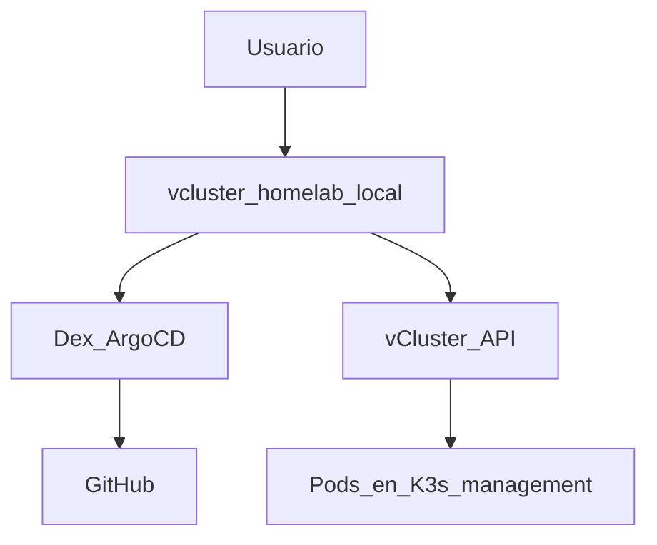

# Phase 5 — vCluster Platform (optional)

## Objective

Web UI for **virtual clusters** and **K3s management** (connected cluster),
with SSO (single sign-on) via Dex/GitHub and kubeconfig download from the browser.

## What You Learn

A **vCluster** exposes a Kubernetes API isolated without lifting Incus VMs;
[vCluster Platform](https://www.vcluster.com/docs/platform/) adds UI, SSO, and
kubeconfig download from the browser.

!!! abstract "Learn this phase"
    **In simple terms:** a vCluster is a department within a department: a virtual Kubernetes cluster,
    isolated, that lives inside another. Each team gets "its own cluster" without paying the cost of
    setting up a new one.

    **Key concepts**

    - **Virtual cluster:** an isolated Kubernetes API running as pods on the host cluster.
    - **Multi-tenancy:** sharing the same infrastructure among teams without them seeing each other.
    - **Kubeconfig:** the file that gives access to a cluster; the platform allows downloading it from the browser.
    - **SSO and OIDC (OpenID Connect):** logging in with GitHub through Dex, without another password.

    **Practical challenge (read-only):** read the login flow from Phase 4 and explain in your own words,
    in four steps, what happens when someone logs in with GitHub.

    ??? question "What advantage does a vCluster have over a full virtual machine?"
        It starts in seconds and uses fewer resources, because it shares the host's kernel and infrastructure.

    ??? question "What role does Dex play in login?"
        It acts as an intermediary: it receives the GitHub login and translates it to the applications (Argo CD, Platform, Incus).

    Questions? Use the **Learn with AI** button next to each title, or the page [Learn](../aprende.md).

## Stack for this phase



- **[vCluster Platform](https://www.vcluster.com/docs/platform/)** — UI + virtual control plane; Phase 5.
- **[Dex](https://dexidp.io/docs/)** — OIDC IdP (identity provider); configured in Phase 4.
- **[Gateway API](https://gateway-api.sigs.k8s.io/)** — Exposes Platform on LAN (local network) with a `HTTPRoute` over the Gateway `homelab`.

Further reading: [vCluster Platform](../vcluster/index.md)

**This decision in other environments**

=== "🏠 At home"

    vCluster Platform runs inside the same K3s management cluster: you create virtual clusters to test things without
    spinning up new VMs or using up the limited RAM. It is optional and its Sync is manual.

=== "🏢 In a company"

    - **Benefits:** each team or customer gets its own cluster (its API, its CRDs, its admin permissions) without
      the company maintaining a real cluster for each one; ephemeral environments for each PR are created in seconds and
      deleted when closed, and access is centralized in the corporate SSO.
    - **Isolation:** vClusters share nodes and kernel with the host cluster. For customers that do not trust each other,
      quotas, NetworkPolicies, and dedicated nodes are added, or separate clusters are maintained.
    - **Commercial support:** vCluster is open source and vCluster Platform has an
      [Enterprise plan](https://www.vcluster.com/pricing) with support, SLA, and security and compliance features.
    - **Permissions:** instead of manually assigning cluster access, corporate IdP groups are mapped to projects
      and roles, and reviewed in access audits.
    - **When it makes sense like in a HomeLab:** internal platforms with many small teams, test environments for PRs,
      and training labs, where a real cluster per team would be too costly.

=== "☁️ In the cloud"

    | Cloud | Equivalent service |
    |---|---|
    | GCP | [GKE](https://cloud.google.com/kubernetes-engine) with [fleet teams](https://cloud.google.com/kubernetes-engine/fleet-management/docs/team-management) |
    | AWS | [Amazon EKS](https://aws.amazon.com/eks/) ([tenant isolation](https://docs.aws.amazon.com/eks/latest/best-practices/tenant-isolation.html)) |
    | Azure | [AKS](https://azure.microsoft.com/en-us/products/kubernetes-service) ([cluster isolation](https://learn.microsoft.com/en-us/azure/aks/operator-best-practices-cluster-isolation)) |
    | Oracle Cloud (OCI) | [OCI Kubernetes Engine (OKE)](https://www.oracle.com/cloud/cloud-native/kubernetes-engine/) |

    In the cloud, the simple option is a cluster per team: strong isolation and SLA, but you pay for each control plane and
    multiply what needs to be updated. vCluster runs the same on any of them and reduces the number of real clusters,
    at the cost of weaker isolation and another piece to operate.

## Before You Start

- [ ] [Phase 4 — GitOps](fase-4-gitops.md) completed (Gateway, Dex, and OAuth secrets in 1Password).
- [ ] `vcluster.homelab.local` resolves (DNS from [section 4.8](fase-4-gitops.md#48-homelablocal-dns) or, if not, `/etc/hosts`).

## Run

```bash
kubectl apply -f gitops/argocd/apps/vcluster-platform.yaml
```

=== "🖱️ From the UI"

    Argo CD UI → Application `vcluster-platform` → **Sync**.

=== "⌨️ From the console"

    With the Argo CD CLI:

    ```bash
    argocd login argocd.homelab.local --grpc-web
    argocd app sync vcluster-platform
    ```

OAuth secrets (if not in 4.7): [`argocd/secrets/1password.md`](https://github.com/maceosoft/gitops/blob/main/argocd/secrets/1password.md).

After sync of `vcluster-platform`, apply `VCLUSTER_CLIENT_SECRET` in Helm:

```bash
cd ansible
ansible-playbook -i inventory.ini playbook-dex-oauth-secrets.yml \
  --tags vcluster -e dex_oauth.apply_vcluster=true
```

## Options

| Decision | Default HomeLab |
|---|---|
| Sync Argo CD | Manual (commented in `homelab-root`) |
| Admin login | `auth.password.disabled: false` until validating SSO GitHub |
| SSO user permissions | **Deny by default** — without Cluster Access / project assignment, no clusters or kubeconfig are visible |

<div class="card">
  <div class="card-kicker">Trade-off analysis</div>
  <div class="option-grid">
    <div class="card-col">
      <div class="card-title">Manual sync</div>
      <div class="text-muted">Avoids accidental deletion of Platform</div>
      <div class="text-muted">Extra step in Argo CD</div>
    </div>
    <div class="card-col">
      <div class="card-title">Admin password enabled</div>
      <div class="text-muted">Rescue access without GitHub</div>
      <div class="text-muted">Attack surface if not disabled after SSO</div>
    </div>
    <div class="card-col">
      <div class="card-title">GitHub SSO only</div>
      <div class="text-muted">Single IdP; aligned with Dex</div>
      <div class="text-muted">No login if Dex/GitHub are down</div>
    </div>
    <div class="card-col">
      <div class="card-title">Web kubeconfig (Platform)</div>
      <div class="text-muted">No <code>scp</code>; centralized permissions</div>
      <div class="text-muted">Requires explicit Cluster Access assignment</div>
    </div>
    <div class="card-col">
      <div class="card-title">CLI (<code>vcluster connect</code>)</div>
      <div class="text-muted">Automatable in scripts</div>
      <div class="text-muted">No SSO integrated in the flow</div>
    </div>
  </div>
</div>

## Permissions: deny by default

[vCluster Platform](https://www.vcluster.com/docs/platform/administer/users-permissions/overview)
does not grant access to connected clusters or vClusters just by logging in.
A new SSO user **does not see resources** until an admin assigns:

- **Cluster Access** — management K3s kubeconfig (connected cluster)
- **Project + role** — create/manage vClusters within a project
- **Management Role** — platform operations (only for admins)

Typical steps for the first operator (as Platform admin):

1. **Clusters** → **Cluster Access** → Create → user/team + ClusterRole
2. For vClusters: assign the user to a **Project** with the appropriate role
3. GitHub teams arrive as groups `loft-*` (OIDC)

## Verify

```bash
kubectl get pods -n vcluster-platform
curl -kI https://vcluster.homelab.local
```

1. Open [`https://vcluster.homelab.local`](https://vcluster.homelab.local)
2. Login with SSO (GitHub)
3. New Virtual Cluster → Download kubeconfig

## Management K3s kubeconfig

[vCluster Platform](https://www.vcluster.com/docs/platform/) automatically registers
the **host** cluster (the K3s where Platform runs) as a
**connected cluster**. From the same UI, you get the management
cluster's kubeconfig, not just the vClusters'.

1. SSO login in [`https://vcluster.homelab.local`](https://vcluster.homelab.local)
2. **Clusters** → select the host cluster (e.g., the K3s context name)
3. **Connect** / **Download kubeconfig**
4. `export KUBECONFIG=~/Downloads/kubeconfig.yaml && kubectl get nodes`

If you do not see the cluster or cannot download the kubeconfig, assign **Cluster Access**
to the user or team in Platform. Without this assignment, SSO login works but
**no clusters or kubeconfig are visible** (deny by default). GitHub OIDC groups
arrive with prefix `loft-` (see
[`platform.yaml`](https://github.com/maceosoft/gitops/blob/main/vcluster/values/platform.yaml)).

## HomeLab web access

| Resource | URL | What you get |
|---|---|---|
| Management K3s | [`https://vcluster.homelab.local`](https://vcluster.homelab.local) | Kubeconfig of the host K3s (connected cluster) |
| vClusters | [`https://vcluster.homelab.local`](https://vcluster.homelab.local) | Kubeconfig of each virtual cluster |
| Incus cluster | [`https://incus.homelab.local:8443`](https://incus.homelab.local:8443) | Incus admin UI (OIDC after Phase 4) |

Alternative CLI (command-line interface) for management K3s: [`fase-4-gitops.md` 4.1](fase-4-gitops.md#41-kubectl-access) (`ssh … sudo cat` or Ansible).

## If it fails

| Symptom | Check |
|---|---|
| SSO loops back to login | Dex secrets + `playbook-dex-oauth-secrets.yml --tags vcluster` |
| PVC pending | OpenEBS/Longhorn Healthy |

## Next

Optional: **[→ Phase 6 — CAPN (Cluster API Provider for Incus)](fase-6-capn.md)** ·
**[HomeLab Summary](resumen-homelab.md)**
