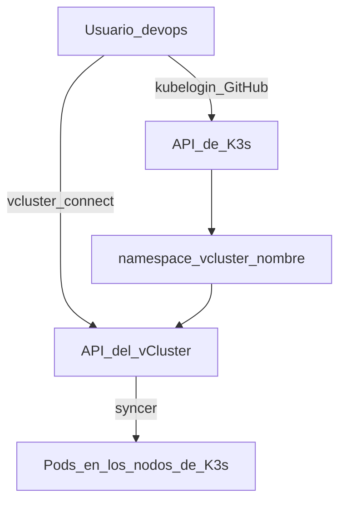

# Phase 5 — vCluster (optional)

## Objective

Create **virtual clusters** inside the HomeLab's K3s (lightweight Kubernetes distribution) using open-source
[vCluster](https://www.vcluster.com/docs): each gets its own Kubernetes API (Application Programming Interface), its namespaces, and its
admin permissions, without spinning up new machines. They are created with the CLI
(command-line interface) `vcluster` or with an Argo CD Application, and you access them with your GitHub account.

## What you learn

A **vCluster** is a Kubernetes control plane that runs as a pod inside a namespace of the host cluster.
What you create inside (Deployments, Services, namespaces) lives in its own database; only the pods and the bare
minimum to run them are copied to the host, where the regular scheduler places them.

!!! abstract "Learn this phase"
    **In short:** a vCluster is a department within the department: a virtual, isolated Kubernetes that lives
    inside another. Each team gets "their own cluster" without paying the cost of standing up a new one.

    **Key concepts**

    - **Virtual cluster:** an isolated Kubernetes API running as pods in the host cluster.
    - **Syncer:** the component that copies pods from the vCluster to the host and renames them
      (`web-…-x-default-x-<vcluster>`) to avoid collisions.
    - **Multi-tenancy:** sharing the same infrastructure across teams without them seeing each other.
    - **Kubeconfig:** the file that grants access to a cluster. The vCluster's is generated by `vcluster connect`.

    **Hands-on challenge:** create a vCluster, deploy a `nginx` inside it, and find its pod in the host with
    `kubectl get pods -n vcluster-<nombre>`. What name does it have and why?

    ??? question "What advantage does a vCluster have over a full virtual machine?"
        It starts in seconds and uses fewer resources, because it shares the host's nodes, kernel, and network.

    ??? question "Why not use vCluster Platform, the web UI?"
        It was tested in the HomeLab (Nov 18, 2026): its free plan does not include GitHub login (SSO), and without it
        nobody could get in. Open-source vCluster needs no license, and access is already solved by the GitHub login
        on the K3s API.

    Questions? Use the **Learn with AI** button next to each heading, or the [Learn](../aprende.md) page.

## Stack for this phase



- **[vCluster](https://www.vcluster.com/docs)** (open source, chart `vcluster` from `charts.loft.sh`) — one virtual
  cluster per namespace.
- **CLI `vcluster`** — creates, connects, pauses, and deletes vClusters.
- **GitHub login to the K3s API** — [Log in to Kubernetes with GitHub](../operacion/acceso-kubernetes.md); the team
  `devops` has `cluster-admin`, which is what's needed to create the vCluster's namespace and permissions.
- **Longhorn** — stores each vCluster's database in a volume.

Deep dive: [vCluster](../vcluster/index.md) · [Common operations](../operacion/vcluster.md)

**This decision in other environments**

=== "🏠 At home"

    vClusters run inside the same K3s: you create virtual clusters to try things out (another chart version,
    a CRD you don't want in the real cluster, a test Argo CD) without spinning up new VMs or burning the little RAM
    you have. They pause when not in use and delete without a trace.

=== "🏢 In a company"

    - **Benefits:** each team or client gets their own cluster (its API, its CRDs, its admin permissions) without the
      company maintaining a real cluster per team; ephemeral environments for each PR spin up in seconds and vanish
      when closed.
    - **Isolation:** vClusters share nodes and kernel with the host cluster. For clients who don't trust each other,
      you add quotas, NetworkPolicies, and dedicated nodes, or keep separate clusters.
    - **Commercial support:** vCluster is open source; [vCluster Platform](https://www.vcluster.com/pricing) adds a
      web UI, SSO, and support in its paid plans.
    - **When the same as HomeLab makes sense:** internal platforms with many small teams, per-PR test environments,
      and training labs, where a real cluster per team would cost too much.

=== "☁️ In the cloud"

    | Cloud | Equivalent service |
    |---|---|
    | GCP | [GKE](https://cloud.google.com/kubernetes-engine) with [fleet teams](https://cloud.google.com/kubernetes-engine/fleet-management/docs/team-management) |
    | AWS | [Amazon EKS](https://aws.amazon.com/eks/) ([tenant isolation](https://docs.aws.amazon.com/eks/latest/best-practices/tenant-isolation.html)) |
    | Azure | [AKS](https://azure.microsoft.com/en-us/products/kubernetes-service) ([cluster isolation](https://learn.microsoft.com/en-us/azure/aks/operator-best-practices-cluster-isolation)) |
    | Oracle Cloud (OCI) | [OCI Kubernetes Engine (OKE)](https://www.oracle.com/cloud/cloud-native/kubernetes-engine/) |

    In the cloud the simple option is a managed cluster per team: strong isolation and SLA, but you pay for each
    control plane and multiply what needs updating. vCluster runs the same on any of them and reduces the number of
    real clusters, trading weaker isolation and one more component to operate.

## Before you start

- [ ] [Phase 4 — GitOps](fase-4-gitops.md) completed (Argo CD, Dex, and Longhorn).
- [ ] You can access the API with your GitHub account:
      [Log in to Kubernetes with GitHub](../operacion/acceso-kubernetes.md) (kubeconfig `~/.kube/homelab-github.yaml`).
- [ ] The CLI `vcluster` installed, same version as the chart: `asdf plugin add vcluster`,
      `asdf install vcluster 0.38.0` and `asdf set -u vcluster 0.38.0` (or `brew install loft-sh/tap/vcluster`).

## Run

There are two ways to create a vCluster; both use the same chart and the same values.

=== "⌨️ With the CLI (for testing)"

    ```bash
    export KUBECONFIG=~/.kube/homelab-github.yaml
    VALUES=~/src/maceosoft/gitops/addons/cluster/vcluster/values/demo.yaml   # tu copia de gitops (el repo es privado)
    vcluster create prueba -n vcluster-prueba -f "$VALUES" --chart-version 0.38.0 --connect=false
    kubectl -n vcluster-prueba rollout status statefulset/prueba --timeout=300s
    ```

    The namespace name is arbitrary; the HomeLab convention is `vcluster-<nombre>`.

=== "🔁 With Argo CD (GitOps)"

    In the repo `gitops`, move `bootstrap/components/apagadas/vcluster-demo.yaml` to `bootstrap/components/` and merge into
    `main`. The ApplicationSet `homelab` creates the Application `vcluster-demo` with wave `manual` (no auto-sync): sync it manually from the Argo CD UI or with `argocd app sync vcluster-demo`. The vCluster is
    named `demo` and lives in the namespace `vcluster-demo`. Step by step (branch, PR, sync, verify):
    [Enable the GitOps vCluster](../operacion/vcluster.md#enable-the-gitops-vcluster-vcluster-demo).

    To have another vCluster managed by Argo CD, copy that file with a different `metadata.name`, `releaseName` and
    namespace.

The values ([`addons/cluster/vcluster/values/demo.yaml`](https://github.com/maceosoft/gitops/blob/main/addons/cluster/vcluster/values/demo.yaml))
only set the volume: `longhorn`, 5 Gi. The cluster has no default StorageClass and, without this, the vCluster's
volume ends up `Pending` and won't start.

## Verify

```bash
export KUBECONFIG=~/.kube/homelab-github.yaml
vcluster list
vcluster connect prueba -n vcluster-prueba -- kubectl get ns
```

`vcluster list` shows `Running`, and `kubectl get ns` inside the vCluster shows only `default`, `kube-node-lease`,
`kube-public` and `kube-system`: the host's namespaces are not visible. For a full test (deploy, reach the
service and see the pod on the host), follow [Common operations](../operacion/vcluster.md#verify-it-works).

## Options

| Decision | Default HomeLab |
|---|---|
| How it's created | CLI for testing; Argo CD (`vcluster-demo`, disabled) for what should persist |
| Control plane distribution | The chart's (Kubernetes with embedded database) |
| Storage | `longhorn`, 5 Gi |
| Access | `vcluster connect` (port-forward) with the GitHub kubeconfig; no URL or HTTPRoute |
| Who can create vClusters | The team `devops` (`cluster-admin` on the host) |

<div class="card">
  <div class="card-kicker">Trade-off analysis</div>

| | vCluster open source | vCluster Platform |
|---|---|---|
| License | Free, no registration | Free plan without SSO; SSO only on paid plans |
| Interface | CLI and Argo CD | Web |
| Login | K3s's (GitHub via Dex) | Own; with the free plan, only username and password |
| vCluster kubeconfig | `vcluster connect` | Download from the web |
| Extra components in the cluster | None outside the vCluster namespace | About 30 CRDs, webhooks and own APIServices |

</div>

## Security

- The kubeconfig generated by `vcluster connect --print` carries a **vCluster admin key** (not the
  host's). Treat it as a secret: don't commit it to git or share it, and delete it when you're done.
- Anyone with `cluster-admin` on the host can read the Secrets of any vCluster (they're in its namespace). vCluster
  isolation separates teams from each other, not from the host administrator.
- vCluster pods run on the same nodes as everything else: a privileged pod inside is a privileged pod
  on the node. For people you don't trust, add quotas, NetworkPolicies and Pod Security Admission to the namespace.

## If it fails

| Symptom | Check |
|---|---|
| `vcluster create` responds `Forbidden` | Your user isn't in the team `devops` or you're using another kubeconfig: `kubectl auth whoami` |
| The pod `<nombre>-0` ends up `Pending` | PVC without StorageClass: values must set `storageClass: longhorn` |
| `vcluster connect` doesn't connect | The vCluster pod isn't `Running` (`vcluster list`), or the local port is busy (`--local-port`) |
| When deleting the Argo CD Application the namespace remains | Expected: `CreateNamespace` doesn't delete the namespace; `kubectl delete ns vcluster-<nombre>` |

## Next

Optional: **[→ Phase 6 — CAPN (Cluster API Provider for Incus)](fase-6-capn.md)** ·
**[HomeLab Summary](resumen-homelab.md)**
