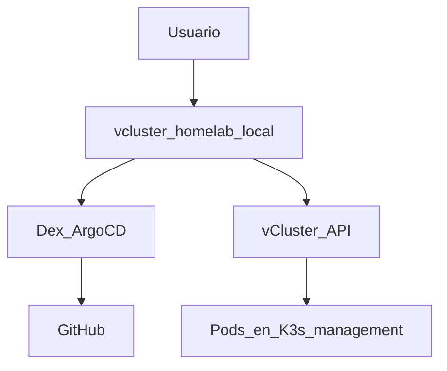

# Phase 5 — vCluster Platform (optional)

## Objective

Web UI for **virtual clusters** and the **K3s management (lightweight Kubernetes distribution)** (connected cluster),
with SSO (single sign-on) via Dex/GitHub and kubeconfig download from the browser.

## What You Learn

A **vCluster** exposes a Kubernetes API isolated without spinning up Incus VMs;
[vCluster Platform](https://www.vcluster.com/docs/platform/) adds UI, SSO, and
kubeconfig download from the browser.

!!! abstract "Learn This Phase"
    **In simple terms:** a vCluster is a department within a department: a virtual Kubernetes cluster,
    isolated, that lives inside another. Each team gets "its own cluster" without paying the cost of
    setting up a new one.

    **Key Concepts**

    - **Virtual cluster:** an isolated Kubernetes API running as pods on the host cluster.
    - **Multi-tenancy:** sharing the same infrastructure among teams without them seeing each other.
    - **Kubeconfig:** the file that gives access to a cluster; the platform allows downloading it from the browser.
    - **SSO and OIDC (OpenID Connect):** logging in with GitHub through Dex, without another password.

    **Practical Challenge (read-only):** read the login flow from Phase 4 and explain in your own words,
    in four steps, what happens when someone logs in with GitHub.

    ??? question "What advantage does a vCluster have over a full virtual machine?"
        It starts in seconds and uses fewer resources, because it shares the host's kernel and infrastructure.

    ??? question "What role does Dex play in login?"
        It acts as an intermediary: it receives the GitHub login and translates it to the applications (Argo CD, Platform, Incus).

    Questions? Use the **Learn with AI** button next to each title, or the page [Learn](../aprende.md).

## Stack for This Phase



- **[vCluster Platform](https://www.vcluster.com/docs/platform/)** — UI + virtual control plane; Phase 5.
- **[Dex](https://dexidp.io/docs/)** — OIDC IdP (identity provider); configured in Phase 4.
- **[Gateway API](https://gateway-api.sigs.k8s.io/)** — Exposes Platform on LAN (local network) with a `HTTPRoute` over the Gateway `homelab`.

Further reading: [vCluster Platform](../vcluster/index.md)

## Before You Start

- [ ] [Phase 4 — GitOps](fase-4-gitops.md) completed (Gateway, Dex, and OAuth secrets in 1Password).
- [ ] `vcluster.homelab.local` resolves (DNS from [section 4.8](fase-4-gitops.md#48-homelablocal-dns) or, if not, `/etc/hosts`).

## Run

```bash
kubectl apply -f gitops/argocd/apps/vcluster-platform.yaml
```

Argo CD UI → Application `vcluster-platform` → **Sync**.

OAuth secrets (if not in 4.7): [`argocd/secrets/1password.md`](https://github.com/maceosoft/gitops/blob/main/argocd/secrets/1password.md).

After syncing `vcluster-platform`, apply `VCLUSTER_CLIENT_SECRET` in Helm:

```bash
cd ansible
ansible-playbook -i inventory.ini playbook-dex-oauth-secrets.yml \
  --tags vcluster -e dex_oauth.apply_vcluster=true
```

## Options

| Decision | Default HomeLab |
|---|---|
| Sync Argo CD | Manual (commented in `homelab-root`) |
| Admin login | `auth.password.disabled: false` until SSO GitHub is validated |
| SSO user permissions | **Deny by default** — no cluster access or project assignment means no clusters or kubeconfig |

<div class="card">
  <div class="card-kicker">Trade-off analysis</div>
  <div class="option-grid">
    <div class="card-col">
      <div class="card-title">Manual sync</div>
      <div class="text-muted">Avoids accidental deletion of Platform</div>
      <div class="text-muted">Extra step in Argo CD</div>
    </div>
    <div class="card-col">
      <div class="card-title">Admin password enabled</div>
      <div class="text-muted">Rescue access without GitHub</div>
      <div class="text-muted">Attack surface if not disabled after SSO</div>
    </div>
    <div class="card-col">
      <div class="card-title">Only SSO GitHub</div>
      <div class="text-muted">Single IdP; aligned with Dex</div>
      <div class="text-muted">No login if Dex/GitHub are down</div>
    </div>
    <div class="card-col">
      <div class="card-title">Web kubeconfig (Platform)</div>
      <div class="text-muted">No <code>scp</code>; centralized permissions</div>
      <div class="text-muted">Requires explicit cluster access assignment</div>
    </div>
    <div class="card-col">
      <div class="card-title">CLI (<code>vcluster connect</code>)</div>
      <div class="text-muted">Automatable in scripts</div>
      <div class="text-muted">No SSO integrated in the flow</div>
    </div>
  </div>
</div>

## Permissions: deny by default

[vCluster Platform](https://www.vcluster.com/docs/platform/administer/users-permissions/overview)
does not grant access to connected clusters or vClusters just by logging in.
A new SSO user **does not see resources** until an admin assigns:

- **Cluster Access** — kubeconfig of the management K3s (connected cluster)
- **Project + role** — create/manage vClusters within a project
- **Management Role** — platform operations (only for admins)

Typical steps for the first operator (as Platform admin):

1. **Clusters** → **Cluster Access** → Create → user/team + ClusterRole
2. For vClusters: assign the user to a **Project** with the appropriate role
3. GitHub teams arrive as groups `loft-*` (OIDC)

## Verify

```bash
kubectl get pods -n vcluster-platform
curl -kI https://vcluster.homelab.local
```

1. Open [`https://vcluster.homelab.local`](https://vcluster.homelab.local)
2. Login with SSO (GitHub)
3. New Virtual Cluster → Download kubeconfig

## K3s Management Cluster Kubeconfig

[vCluster Platform](https://www.vcluster.com/docs/platform/) automatically
registers the **host** cluster (the K3s where Platform runs) as a **connected
cluster**. From the same UI, you get the kubeconfig of the management cluster,
not just the vClusters'.

1. SSO login to [`https://vcluster.homelab.local`](https://vcluster.homelab.local)
2. **Clusters** → select the host cluster (e.g., the K3s context name)
3. **Connect** / **Download kubeconfig**
4. `export KUBECONFIG=~/Downloads/kubeconfig.yaml && kubectl get nodes`

If you don't see the cluster or can't download the kubeconfig, assign **Cluster
Access** to the user or team in Platform. Without this assignment, SSO login
works but **no clusters or kubeconfig are visible** (default deny). GitHub OIDC
groups come with the prefix `loft-` (see
[`platform.yaml`](https://github.com/maceosoft/gitops/blob/main/vcluster/values/platform.yaml)).

## HomeLab Web Accesses

| Resource | URL | What You Get |
|---|---|---|
| Management K3s | [`https://vcluster.homelab.local`](https://vcluster.homelab.local) | Kubeconfig of the host K3s (connected cluster) |
| vClusters | [`https://vcluster.homelab.local`](https://vcluster.homelab.local) | Kubeconfig of each virtual cluster |
| Incus cluster | [`https://incus.homelab.local:8443`](https://incus.homelab.local:8443) | Incus management UI (OIDC after Phase 4) |

Alternative CLI (command-line interface) for the management K3s: [`fase-4-gitops.md` 4.1](fase-4-gitops.md#41-kubectl-access) (`ssh … sudo cat` or Ansible).

## Troubleshooting

| Symptom | Check |
|---|---|
| SSO loops back to login | Dex secrets + `playbook-dex-oauth-secrets.yml --tags vcluster` |
| PVC pending | OpenEBS/Longhorn Healthy |

## Next

Optional: **[→ Phase 6 — CAPN (Cluster API Provider for Incus)](fase-6-capn.md)** ·
**[HomeLab Summary](resumen-homelab.md)**
