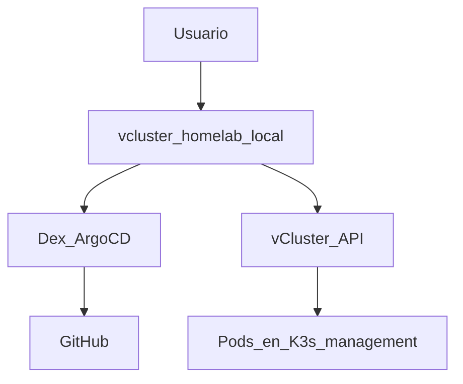

# Phase 5 — vCluster Platform (optional)

## Objective

Web UI for **virtual clusters** and the **management K3s (lightweight Kubernetes distribution)** (connected cluster),
with SSO (single sign-on) via Dex/GitHub and kubeconfig download from the browser.

## What you learn

A **vCluster** exposes an isolated Kubernetes API without spinning up Incus VMs;
[vCluster Platform](https://www.vcluster.com/docs/platform/) adds UI, SSO, and
browser-based kubeconfig download.

!!! abstract "Learn this phase"
    **In simple terms:** a vCluster is a department within a department: a virtual,
    isolated Kubernetes that lives inside another. Each team gets "their own cluster" without paying the cost
    of standing up a new one.

    **Key concepts**

    - **Virtual cluster:** an isolated Kubernetes API that runs as pods on the host cluster.
    - **Multi-tenancy:** sharing the same infrastructure across teams without them seeing each other.
    - **Kubeconfig:** the file that grants access to a cluster; the platform lets you download it from the browser.
    - **SSO (single sign-on) and OIDC (OpenID Connect):** sign in with GitHub via Dex, no extra password.

    **Practical challenge (read-only):** read the Phase 4 login flow and explain in your own words,
    in four steps, what happens when someone signs in with GitHub.

    ??? question "What advantage does a vCluster have over a full virtual machine?"
        It starts in seconds and uses fewer resources, because it shares the host's kernel and infrastructure.

    ??? question "What role does Dex play in login?"
        It acts as the intermediary: it receives the GitHub login and translates it for the applications (Argo CD, Platform, Incus).

    Questions? Use the **Learn with AI** button next to each heading, or the [Learn](../aprende.md) page.

## Stack for this phase



- **[vCluster Platform](https://www.vcluster.com/docs/platform/)** — UI + virtual control plane; Phase 5.
- **[Dex](https://dexidp.io/docs/)** — OIDC IdP (identity provider); configured in Phase 4.
- **[Gateway API](https://gateway-api.sigs.k8s.io/)** — Exposes Platform on LAN (local network) with a `HTTPRoute` over the `homelab` Gateway.

Deep dive: [vCluster Platform](../vcluster/index.md)

**This decision in other environments**

=== "🏠 At home"

    vCluster Platform runs inside the same management K3s: you create virtual clusters to test things without
    spinning up new VMs or burning the little RAM you have. It's optional and its Sync is manual.

=== "🏢 In a company"

    - **Benefits:** each team or client gets their own cluster (their API, their CRDs, their admin permissions) without
      the company maintaining a real cluster per team; ephemeral environments per PR are created in seconds and
      deleted when closed, and access is centralized in corporate SSO.
    - **Isolation:** vClusters share nodes and kernel with the host cluster. For clients that don't trust each other,
      quotas, NetworkPolicies, and dedicated nodes are added, or separate clusters are kept.
    - **Commercial support:** vCluster is open source and vCluster Platform has an
      [Enterprise plan](https://www.vcluster.com/pricing) with support, SLA, and security and compliance features.
    - **Permissions:** instead of assigning Cluster Access manually, corporate IdP groups are mapped to projects
      and roles, and reviewed in access audits.
    - **When the same as HomeLab makes sense:** internal platforms with many small teams, per-PR test environments,
      and training labs, where a real cluster per team would cost too much.

=== "☁️ In the cloud"

    | Cloud | Equivalent service |
    |---|---|
    | GCP | [GKE](https://cloud.google.com/kubernetes-engine) with [fleet teams](https://cloud.google.com/kubernetes-engine/fleet-management/docs/team-management) |
    | AWS | [Amazon EKS](https://aws.amazon.com/eks/) ([tenant isolation](https://docs.aws.amazon.com/eks/latest/best-practices/tenant-isolation.html)) |
    | Azure | [AKS](https://azure.microsoft.com/en-us/products/kubernetes-service) ([cluster isolation](https://learn.microsoft.com/en-us/azure/aks/operator-best-practices-cluster-isolation)) |
    | Oracle Cloud (OCI) | [OCI Kubernetes Engine (OKE)](https://www.oracle.com/cloud/cloud-native/kubernetes-engine/) |

    In the cloud the simple option is a managed cluster per team: strong isolation and SLA, but you pay for each
    control plane and multiply what needs updating. vCluster runs the same on any of them and reduces
    the number of real clusters, in exchange for weaker isolation and another piece to operate.

## Before you start

- [ ] [Phase 4 — GitOps](fase-4-gitops.md) completed (Gateway, Dex, and OAuth —Open Authorization— secrets in 1Password).
- [ ] `vcluster.homelab.local` resolves (DNS from [section 4.8](fase-4-gitops.md#48-homelablocal-dns) or, if not, `/etc/hosts`).

## Run

In the `gitops` repo, move `bootstrap/components/apagadas/vcluster-platform.yaml` to `bootstrap/components/` and merge into
`main`. The ApplicationSet `homelab` creates the Application with wave `manual` (no auto-sync): sync it manually.

=== "🖱️ From the UI"

    Argo CD UI → Application `vcluster-platform` → **Sync**.

=== "⌨️ From the console"

    With the Argo CD CLI:

    ```bash
    argocd login argocd.homelab.local --grpc-web
    argocd app sync vcluster-platform
    ```

OAuth secrets (if not in 4.7): [`addons/argocd/secrets/1password.md`](https://github.com/maceosoft/gitops/blob/main/addons/argocd/secrets/1password.md).

After `vcluster-platform` sync, apply `VCLUSTER_CLIENT_SECRET` in Helm:

```bash
cd ansible
ansible-playbook -i inventory.ini playbook-dex-oauth-secrets.yml \
  --tags vcluster -e dex_oauth.apply_vcluster=true
```

## Options

| Decision | Default HomeLab |
|---|---|
| Sync Argo CD | Manual (in `bootstrap/components/apagadas/` until enabled; or `manual`) |
| Admin login | `auth.password.disabled: false` until GitHub SSO validated |
| SSO user permissions | **Deny by default** — without Cluster Access / assigned project they see no clusters nor kubeconfig |

<div class="card">
  <div class="card-kicker">Trade-off analysis</div>
  <div class="option-grid">
    <div class="card-col">
      <div class="card-title">Manual sync</div>
      <div class="text-muted">Prevents accidental Platform deletion</div>
      <div class="text-muted">Extra step in Argo CD</div>
    </div>
    <div class="card-col">
      <div class="card-title">Admin password enabled</div>
      <div class="text-muted">Rescue access without GitHub</div>
      <div class="text-muted">Attack surface if not disabled after SSO</div>
    </div>
    <div class="card-col">
      <div class="card-title">GitHub SSO only</div>
      <div class="text-muted">Single IdP; aligned with Dex</div>
      <div class="text-muted">No login if Dex/GitHub go down</div>
    </div>
    <div class="card-col">
      <div class="card-title">Web kubeconfig (Platform)</div>
      <div class="text-muted">No <code>scp</code>; centralized permissions</div>
      <div class="text-muted">Requires explicit Cluster Access assignment</div>
    </div>
    <div class="card-col">
      <div class="card-title">CLI (<code>vcluster connect</code>)</div>
      <div class="text-muted">Scriptable</div>
      <div class="text-muted">No SSO integrated in the flow</div>
    </div>
  </div>
</div>

## Permissions: deny by default

[vCluster Platform](https://www.vcluster.com/docs/platform/administer/users-permissions/overview)
does not grant access to connected clusters or vClusters just by logging in.
A new SSO user **sees no resources** until an admin assigns them:

- **Cluster Access** — management K3s kubeconfig (connected cluster)
- **Project + role** — create/manage vClusters within a project
- **Management Role** — platform operations (admins only)

Typical steps for the first operator (as Platform admin):

1. **Clusters** → **Cluster Access** → Create → user/team + ClusterRole
2. For vClusters: assign user to a **Project** with appropriate role
3. GitHub teams arrive as `loft-*` groups (OIDC)

## Verify

```bash
kubectl get pods -n vcluster-platform
curl -kI https://vcluster.homelab.local
```

1. Open [`https://vcluster.homelab.local`](https://vcluster.homelab.local)
2. Login with SSO (GitHub)
3. New Virtual Cluster → Download kubeconfig

## Management K3s kubeconfig

[vCluster Platform](https://www.vcluster.com/docs/platform/) automatically registers the **host** cluster (the K3s where Platform runs) as a **connected cluster**. From the same UI you get the management cluster kubeconfig, not just vClusters'.

1. SSO login at [`https://vcluster.homelab.local`](https://vcluster.homelab.local)
2. **Clusters** → select the host cluster (e.g., the K3s context name)
3. **Connect** / **Download kubeconfig**
4. `export KUBECONFIG=~/Downloads/kubeconfig.yaml && kubectl get nodes`

If you don't see the cluster or can't download kubeconfig, assign **Cluster Access** to the user or team in Platform. Without that assignment, SSO login works but **no clusters or kubeconfigs are visible** (deny by default). GitHub OIDC groups arrive with prefix `loft-` (see [`platform.yaml`](https://github.com/maceosoft/gitops/blob/main/addons/cluster/vcluster/values/platform.yaml)).

## HomeLab web access

| Resource | URL | What you get |
|---|---|---|
| Management K3s | [`https://vcluster.homelab.local`](https://vcluster.homelab.local) | Host K3s kubeconfig (connected cluster) |
| vClusters | [`https://vcluster.homelab.local`](https://vcluster.homelab.local) | Each virtual cluster's kubeconfig |
| Incus cluster | [`https://incus.homelab.local:8443`](https://incus.homelab.local:8443) | Incus admin UI (OIDC after Phase 4) |

CLI (command-line interface) alternative for management K3s: [`fase-4-gitops.md` 4.1](fase-4-gitops.md#41-kubectl-access) (`ssh … sudo cat` or Ansible).

## If it fails

| Symptom | Check |
|---|---|
| SSO loops back to login repeatedly | Dex secrets + `playbook-dex-oauth-secrets.yml --tags vcluster` |
| PVC pending | OpenEBS/Longhorn Healthy |

## Next

Optional: **[→ Phase 6 — CAPN (Cluster API Provider for Incus)](fase-6-capn.md)** · **[HomeLab Summary](resumen-homelab.md)**
