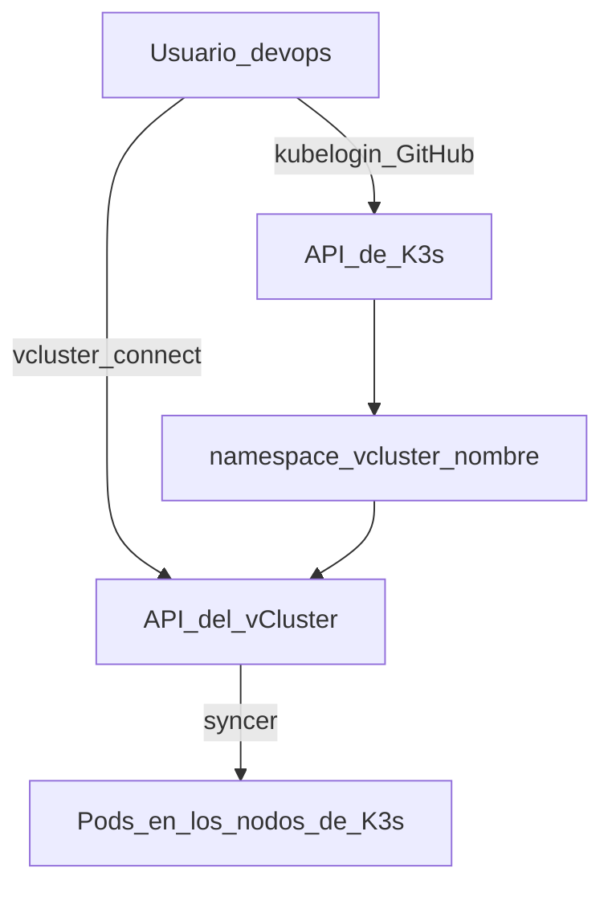

# Fase 5 — vCluster (opcional)

## Objetivo

Crear **clústeres virtuales** dentro del K3s (distribución ligera de Kubernetes) del HomeLab con
[vCluster](https://www.vcluster.com/docs) open source: cada uno tiene su propia API (Application Programming Interface)
de Kubernetes, sus namespaces y sus permisos de administrador, sin levantar máquinas nuevas. Se crean con el CLI
(interfaz de línea de comandos) `vcluster` o con una Application de Argo CD, y se entra con tu cuenta de GitHub.

## Qué aprendes

Un **vCluster** es un control plane de Kubernetes que corre como un pod dentro de un namespace del clúster anfitrión.
Lo que creas adentro (Deployments, Services, namespaces) vive en su propia base de datos; solo los pods y lo mínimo
para que corran se copian al anfitrión, donde los programa el scheduler de siempre.

!!! abstract "Aprende esta fase"
    **En simple:** un vCluster es un departamento dentro del departamento: un Kubernetes virtual, aislado, que vive
    dentro de otro. Cada equipo recibe "su propio clúster" sin pagar el costo de montar uno nuevo.

    **Conceptos clave**

    - **Clúster virtual:** una API de Kubernetes aislada que corre como pods en el clúster anfitrión.
    - **Sincronizador (syncer):** la pieza que copia los pods del vCluster al anfitrión y les cambia el nombre
      (`web-…-x-default-x-<vcluster>`) para que no choquen.
    - **Multi-tenancy (varios inquilinos):** compartir una misma infraestructura entre equipos sin que se vean entre sí.
    - **Kubeconfig:** el archivo que da acceso a un clúster. El del vCluster lo genera `vcluster connect`.

    **Reto práctico:** crea un vCluster, despliega un `nginx` adentro y busca su pod en el anfitrión con
    `kubectl get pods -n vcluster-<nombre>`. ¿Qué nombre tiene y por qué?

    ??? question "¿Qué ventaja tiene un vCluster frente a una máquina virtual completa?"
        Arranca en segundos y gasta menos recursos, porque comparte los nodos, el kernel y la red del anfitrión.

    ??? question "¿Por qué no se usa vCluster Platform, la interfaz web?"
        Se probó en el HomeLab (18 nov 2026): su plan gratis no incluye el inicio de sesión con GitHub (SSO), y sin él
        nadie podía entrar. El vCluster open source no necesita licencia, y el acceso ya lo resuelve el login con
        GitHub del API de K3s.

    ¿Dudas? Usa el botón **Aprende con IA** junto a cada título, o la página [Aprende](../aprende.md).

## Stack de esta fase



- **[vCluster](https://www.vcluster.com/docs)** (open source, chart `vcluster` de `charts.loft.sh`) — un clúster virtual
  por namespace.
- **CLI `vcluster`** — crea, conecta, pausa y borra vClusters.
- **Login con GitHub al API de K3s** — [Entrar a Kubernetes con GitHub](../operacion/acceso-kubernetes.md); el team
  `devops` tiene `cluster-admin`, que es lo que hace falta para crear el namespace y los permisos del vCluster.
- **Longhorn** — guarda la base de datos de cada vCluster en un volumen.

Profundización: [vCluster](../vcluster/index.md) · [Operaciones frecuentes](../operacion/vcluster.md)

**Esta decisión en otros entornos**

=== "🏠 En casa"

    Los vClusters corren dentro del mismo K3s: creas clústeres virtuales para probar cosas (otra versión de un chart,
    CRD que no quieres en el clúster real, un Argo CD de prueba) sin levantar VMs nuevas ni gastar la poca RAM que hay.
    Se pausan cuando no se usan y se borran sin dejar rastro.

=== "🏢 En la empresa"

    - **Beneficios:** cada equipo o cliente recibe su propio clúster (su API, sus CRD, sus permisos de admin) sin que
      la empresa mantenga un clúster real por cada uno; los entornos efímeros de cada PR se crean en segundos y se
      borran al cerrarlo.
    - **Aislamiento:** los vClusters comparten nodos y kernel con el clúster anfitrión. Para clientes que no se
      confían entre sí se suman cuotas, NetworkPolicies y nodos dedicados, o se mantienen clústeres separados.
    - **Soporte comercial:** vCluster es open source; [vCluster Platform](https://www.vcluster.com/pricing) agrega una
      interfaz web, SSO y soporte en sus planes de pago.
    - **Cuándo conviene lo mismo que el HomeLab:** plataformas internas con muchos equipos pequeños, entornos de
      prueba por PR y laboratorios de formación, donde un clúster real por equipo costaría demasiado.

=== "☁️ En la nube"

    | Nube | Servicio equivalente |
    |---|---|
    | GCP | [GKE](https://cloud.google.com/kubernetes-engine) con [equipos de flota](https://cloud.google.com/kubernetes-engine/fleet-management/docs/team-management) |
    | AWS | [Amazon EKS](https://aws.amazon.com/eks/) ([aislamiento de inquilinos](https://docs.aws.amazon.com/eks/latest/best-practices/tenant-isolation.html)) |
    | Azure | [AKS](https://azure.microsoft.com/en-us/products/kubernetes-service) ([aislamiento de clústeres](https://learn.microsoft.com/en-us/azure/aks/operator-best-practices-cluster-isolation)) |
    | Oracle Cloud (OCI) | [OCI Kubernetes Engine (OKE)](https://www.oracle.com/cloud/cloud-native/kubernetes-engine/) |

    En la nube la opción simple es un clúster administrado por equipo: aislamiento fuerte y SLA, pero pagas cada
    control plane y multiplicas lo que hay que actualizar. vCluster corre igual sobre cualquiera de ellos y reduce
    el número de clústeres reales, a cambio de un aislamiento más débil y otra pieza que operar.

## Antes de empezar

- [ ] [Fase 4 — GitOps](fase-4-gitops.md) completada (Argo CD, Dex y Longhorn).
- [ ] Puedes entrar al API con tu cuenta de GitHub:
      [Entrar a Kubernetes con GitHub](../operacion/acceso-kubernetes.md) (kubeconfig `~/.kube/homelab-github.yaml`).
- [ ] El CLI `vcluster` instalado, de la misma versión que el chart: `asdf plugin add vcluster`,
      `asdf install vcluster 0.38.0` y `asdf set -u vcluster 0.38.0` (o `brew install loft-sh/tap/vcluster`).

## Ejecutar

Hay dos formas de crear un vCluster; las dos usan el mismo chart y los mismos values.

=== "⌨️ Con el CLI (para probar)"

    ```bash
    export KUBECONFIG=~/.kube/homelab-github.yaml
    VALUES=~/src/maceosoft/gitops/addons/cluster/vcluster/values/demo.yaml   # tu copia de gitops (el repo es privado)
    vcluster create prueba -n vcluster-prueba -f "$VALUES" --chart-version 0.38.0 --connect=false
    kubectl -n vcluster-prueba rollout status statefulset/prueba --timeout=300s
    ```

    El nombre del namespace es libre; la convención del HomeLab es `vcluster-<nombre>`.

=== "🔁 Con Argo CD (GitOps)"

    En el repo `gitops`, mueve `bootstrap/components/apagadas/vcluster-demo.yaml` a `bootstrap/components/` y mergea en
    `main`. El ApplicationSet `homelab` crea la Application `vcluster-demo` con la ola `manual` (no tiene sync
    automático): sincronízala a mano desde la interfaz de Argo CD o con `argocd app sync vcluster-demo`. El vCluster se
    llama `demo` y vive en el namespace `vcluster-demo`. Paso a paso (rama, PR, sync, comprobar):
    [Activar el vCluster de GitOps](../operacion/vcluster.md#activar-el-vcluster-de-gitops-vcluster-demo).

    Para tener otro vCluster gestionado por Argo CD, copia ese archivo con otro `metadata.name`, `releaseName` y
    namespace.

Los values ([`addons/cluster/vcluster/values/demo.yaml`](https://github.com/maceosoft/gitops/blob/main/addons/cluster/vcluster/values/demo.yaml))
solo fijan el volumen: `longhorn`, 5 Gi. El clúster no tiene StorageClass por defecto y, sin esto, el volumen del
vCluster queda `Pending` y no arranca.

## Verificar

```bash
export KUBECONFIG=~/.kube/homelab-github.yaml
vcluster list
vcluster connect prueba -n vcluster-prueba -- kubectl get ns
```

`vcluster list` lo muestra `Running`, y `kubectl get ns` dentro del vCluster muestra solo `default`, `kube-node-lease`,
`kube-public` y `kube-system`: los namespaces del anfitrión no se ven. Para una prueba completa (desplegar, llegar al
servicio y ver el pod en el anfitrión), sigue [Operaciones frecuentes](../operacion/vcluster.md#probar-que-funciona).

## Opciones

| Decisión | Default HomeLab |
|---|---|
| Cómo se crea | CLI para probar; Argo CD (`vcluster-demo`, apagada) para lo que deba quedar |
| Distribución del control plane | La del chart (Kubernetes con base de datos embebida) |
| Almacenamiento | `longhorn`, 5 Gi |
| Acceso | `vcluster connect` (port-forward) con el kubeconfig de GitHub; sin URL ni HTTPRoute |
| Quién puede crear vClusters | El team `devops` (`cluster-admin` en el anfitrión) |

<div class="card">
  <div class="card-kicker">Análisis de trade-offs</div>

| | vCluster open source | vCluster Platform |
|---|---|---|
| Licencia | Gratis, sin registro | Plan gratis sin SSO; SSO solo en planes de pago |
| Interfaz | CLI y Argo CD | Web |
| Login | El de K3s (GitHub por Dex) | Propio; con el plan gratis, solo usuario y contraseña |
| Kubeconfig del vCluster | `vcluster connect` | Descarga desde la web |
| Piezas extra en el clúster | Ninguna fuera del namespace del vCluster | Unos 30 CRD, webhooks y APIServices propios |

</div>

## Seguridad

- El kubeconfig que genera `vcluster connect --print` lleva una **llave de administrador del vCluster** (no del
  anfitrión). Trátalo como un secreto: no lo subas a git ni lo compartas, y bórralo cuando no lo uses.
- Quien tenga `cluster-admin` en el anfitrión puede leer los Secrets de cualquier vCluster (están en su namespace). El
  aislamiento de vCluster separa a los equipos entre sí, no del administrador del anfitrión.
- Los pods del vCluster corren en los mismos nodos que el resto: un pod privilegiado adentro es un pod privilegiado
  en el nodo. Para gente en la que no confías, suma cuotas, NetworkPolicies y Pod Security Admission al namespace.

## Si falla

| Síntoma | Revisar |
|---|---|
| `vcluster create` responde `Forbidden` | Tu usuario no es del team `devops` o usas otro kubeconfig: `kubectl auth whoami` |
| El pod `<nombre>-0` queda `Pending` | PVC sin StorageClass: los values deben fijar `storageClass: longhorn` |
| `vcluster connect` no conecta | El pod del vCluster no está `Running` (`vcluster list`), o el puerto local está ocupado (`--local-port`) |
| Al borrar la Application de Argo CD queda el namespace | Esperado: `CreateNamespace` no borra el namespace; `kubectl delete ns vcluster-<nombre>` |

## Siguiente

Opcional: **[→ Fase 6 — CAPN (Cluster API Provider for Incus)](fase-6-capn.md)** ·
**[Resumen del HomeLab](resumen-homelab.md)**
