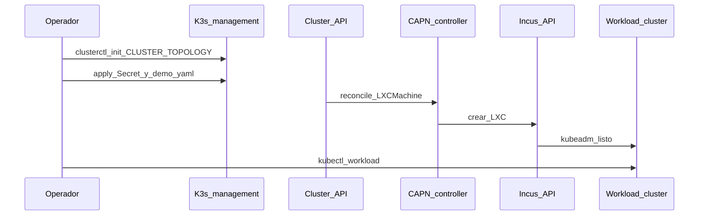

# Phase 6 — CAPN (optional)

## Objective

Provision **kubeadm workload clusters** on Incus instances via
[Cluster API](https://cluster-api.sigs.k8s.io/) and [CAPN (Cluster API Provider for Incus)](https://capn.linuxcontainers.org/).

## What you learn

CAPI (Cluster API) declares clusters as Kubernetes resources; CAPN translates `LXCMachine` into
Incus instances — ephemeral clusters without touching the management K3s (lightweight Kubernetes distribution).

!!! abstract "Learn this phase"
    **In short:** Cluster API is a 3D printer for clusters: instead of assembling each cluster by hand,
    you write a description and the system builds it. CAPN is the "attachment" that uses Incus as
    a factory: each node of the new cluster is an Incus instance.

    **Key concepts**

    - **Management cluster and workload cluster:** the former manages; the latter is the one created and used.
    - **Provider:** the plugin that knows how to create machines on a specific platform (here, Incus).
    - **Declarative resources:** a cluster is described as a Kubernetes object (for example `LXCMachine`).
    - **Ephemeral clusters:** created for a test and destroyed afterwards.

    **Hands-on challenge (safe):** generate a cluster description and read it, **without applying it**. You need
    `clusterctl` and the `clusterctl.yaml` of CAPN (section "Run"), but you don't need to install anything in the cluster:
    export the variables from [Generate a cluster](../capn/index.md#generar-un-cluster) and then:

    ```bash
    clusterctl generate cluster demo -i incus:v0.9.1 \
      --kubernetes-version v1.37.0 \
      --control-plane-machine-count 1 \
      --worker-machine-count 1 > /tmp/demo.yaml
    # solo lectura: no ejecutes kubectl apply
    less /tmp/demo.yaml
    ```

    ??? question "Why create clusters from a manifest instead of manually?"
        They repeat identically every time, live in Git, and can be destroyed and recreated effortlessly.

    ??? question "What is the difference between the management cluster and a workload cluster?"
        The management cluster creates and watches the others; workload clusters run the applications.

    Questions? Use the **Learn with AI** button next to each heading, or the [Learn](../aprende.md) page.

## Stack for this phase



- **[Cluster API](https://cluster-api.sigs.k8s.io/)** — Declarative API (Application Programming Interface); Phase 6.
- **[CAPN](https://capn.linuxcontainers.org/)** — Incus Provider; Phase 6.
- **[clusterctl](https://cluster-api.sigs.k8s.io/user/quick-start.html)** — Bootstrap CAPI on the management cluster.
- **[Incus](https://linuxcontainers.org/incus/docs/main/)** — Instance runtime; Phase 2.
- **[Sealed Secrets](https://github.com/bitnami-labs/sealed-secrets)** — Encrypted Incus credentials in Git.

Deep dive: [CAPN](../capn/index.md) · [Secrets](../secrets/index.md)

**This decision in other environments**

=== "🏠 At home"

    Cluster API with [CAPN](https://github.com/lxc/cluster-api-provider-incus) creates test kubeadm clusters as
    Incus instances, from a manifest in Git, and deletes them when you're done. It serves to learn the same model
    that large platforms use, without paying for cloud.

=== "🏢 In a company"

    - **Benefits:** clusters are declared as code: they are created identically every time, versioned and audited
      in Git, updated node by node with a version change, and replaced instead of repaired manually. With the
      same API you manage clusters in the datacenter and across multiple clouds.
    - **Fleet scale:** with dozens or hundreds of clusters you need inventory, policies, and centralized
      updates; a fleet console such as
      [SUSE Rancher Prime](https://www.suse.com/products/rancher/) or
      [Red Hat Advanced Cluster Management](https://www.redhat.com/en/technologies/management/advanced-cluster-management) is often added.
    - **The management cluster is critical:** if lost, clusters keep running but no one can update or scale
      them; in production it gets high availability and backup, and is moved with `clusterctl move`.
    - **Support:** CAPN is a community project of [Linux Containers](https://linuxcontainers.org/); major cloud
      providers have more users and vendor backing.
    - **When the same as HomeLab makes sense:** private cloud on Incus, edge sites, and test environments that
      are created and destroyed often, where a managed cloud cluster is not available or not desirable.

=== "☁️ In the cloud"

    | Cloud | Equivalent service |
    |---|---|
    | GCP | Provider [CAPG](https://github.com/kubernetes-sigs/cluster-api-provider-gcp); fleet with [GKE fleet management](https://cloud.google.com/kubernetes-engine/fleet-management/docs) |
    | AWS | Provider [CAPA](https://github.com/kubernetes-sigs/cluster-api-provider-aws); outside AWS, [EKS Anywhere](https://anywhere.eks.amazonaws.com/) or [EKS Hybrid Nodes](https://docs.aws.amazon.com/eks/latest/userguide/hybrid-nodes-overview.html) |
    | Azure | Provider [CAPZ](https://github.com/kubernetes-sigs/cluster-api-provider-azure); fleet with [Azure Arc-enabled Kubernetes](https://learn.microsoft.com/en-us/azure/azure-arc/kubernetes/overview) |
    | Oracle Cloud (OCI) | Provider [CAPOCI](https://github.com/oracle/cluster-api-provider-oci) |

    Swapping CAPN for a cloud provider gives you managed machines, networks, and load balancers, with SLA and near
    unlimited scale. You lose hardware control, pay for every running node, and manifests use cloud-specific
    resources, so they don't move as-is to another cloud.

## Status in the HomeLab

!!! success "Tested on 18 Nov 2026: works with `kube-vip`"
    Following the [CAPN page](../capn/index.md) exactly, with `kube-vip` on `192.168.20.12`: control plane on
    `eve` and a worker on `invincible`, both `Ready` in 2 min 15 s, Kubernetes v1.37.0 with flannel, CoreDNS and a
    Deployment behind a Service responding `HTTP 200`. Consumption: about 700 MiB for the control plane and 350 MiB for the
    worker, plus a kubeadm image of about 600 MB in Incus. Afterwards everything was deleted (cluster, CAPI/CAPN, certificate,
    image and kernel modules) and the cluster, Incus and the nodes were left with no differences.

Two HomeLab limitations, already resolved on the page:

1. **The `lxc` load balancer doesn't work on `br0`.** CAPN takes the first global IP of the load balancer
   container as the API address, and on `br0` the LAN IPv6 (`fd23:…`, via SLAAC) arrives before the DHCP IPv4. K3s pods
   only have IPv4, so the controllers can't reach the API (`connect: network is unreachable`; issue
   [#174 "IPv6 Support"](https://github.com/lxc/cluster-api-provider-incus/issues/174) of CAPN). With `kube-vip` the API
   ends up on a fixed LAN IPv4 (`192.168.20.12`, reserved in [Network](../networking/index.md)) and the load balancer
   container isn't needed either: it runs inside the control plane.
2. **`deborah` can't be a node.** Its Rockchip kernel lacks the `netlink_diag` module, which the CAPN
   kubeadm profile requires: the container won't start. Nodes go on `eve` and `invincible` (`oliver` has little RAM and an SSD with
   reallocated sectors).

The `capn-demo` Application of `gitops` remains off and is just a placeholder: today clusters are created with
`clusterctl` and `kubectl apply`.

## Before you start

- [ ] [Phase 2 — Incus](fase-2-incus.md) with a healthy cluster.
- [ ] [Phase 4 — GitOps](fase-4-gitops.md) with cert-manager and Sealed Secrets operational (CAPI reuses the
      cluster's cert-manager).
- [ ] An Incus certificate just for CAPN, in the Incus trust and in 1Password
      ([Incus Credential](../capn/index.md#incus-credential)).
- [ ] A free IPv4 for the control plane endpoint, outside the router's DHCP range and the MetalLB pools.
- [ ] `clusterctl` ≥ 1.13 (CAPI 1.10, the one in old guides, is no longer supported and doesn't admit K8s 1.37 as a management
      cluster): `brew install clusterctl`.

[Phase 5 — vCluster](fase-5-vcluster.md) is optional: not needed for this phase.

## Run

### Install Cluster API and CAPN on K3s

```bash
mkdir -p ~/.cluster-api
curl -fsSLo ~/.cluster-api/clusterctl.yaml https://capn.linuxcontainers.org/static/v0.1/clusterctl.yaml
export KUBECONFIG=~/.kube/homelab-github.yaml
export CLUSTER_TOPOLOGY=true    # la plantilla de CAPN usa ClusterClass: sin esto el apply responde "Forbidden"
clusterctl init -i incus:v0.9.1
```

Takes about 30 seconds. Installs CAPI (v1.14 with `clusterctl` 1.13) and CAPN v0.9.1 in the `capi-*` and
`capn-system` namespaces, and reuses the existing cert-manager.

!!! tip "If the `KubeadmControlPlane` webhook gives `x509: certificate signed by unknown authority`"
    In the test, the K3s API kept rejecting the webhook certificate even though the `caBundle` was correct; it
    got unstuck by re-annotating the `ValidatingWebhookConfiguration` (any new annotation forces it to reload).

### Generate and create a cluster

Step by step, tested as-is (create, view, kubeconfig, scale, upgrade version, enter a node, logs, delete):
[Common CAPN Operations](../operacion/capn.md). Credential and variables: [CAPN](../capn/index.md). The idea:

1. Apply the Secret with the Incus credential in the cluster's namespace.
2. `clusterctl generate cluster …` with the `eve`/`invincible` targets and the load balancer with IPv4.
3. `kubectl apply` of the manifest (or, when it works end-to-end, put it in `gitops` and enable `capn-demo`).

## Options

| Decision | HomeLab Default |
|---|---|
| CAPI/CAPN installation | `clusterctl init` manually (not in GitOps) |
| Node type | `container` (privileged LXC, CAPN kubeadm profile) |
| Targets | `eve` and `invincible`; never `deborah` (no `netlink_diag`) nor `oliver` |
| Control plane load balancer | `kube-vip` with the fixed IPv4 `192.168.20.12` (tested); `lxc` doesn't work on `br0` because of IPv6 |
| Kubernetes version | One with a published `kubeadm` image: `v1.37.0` or `v1.36.4` |

<div class="card">
  <div class="card-kicker">Trade-off analysis</div>
  <div class="option-grid">
    <div class="card-col">
      <div class="card-title">CAPN vs vCluster</div>
      <div class="text-muted">Real kubeadm clusters, with their own nodes</div>
      <div class="text-muted">About 1 GB RAM per cluster minimum (700 MiB control plane), vs a vCluster pod</div>
    </div>
    <div class="card-col">
      <div class="card-title">Privileged containers</div>
      <div class="text-muted">Start in seconds and use little</div>
      <div class="text-muted">In practice they are root on the Incus node, which also runs K3s</div>
    </div>
    <div class="card-col">
      <div class="card-title">Manual <code>clusterctl</code></div>
      <div class="text-muted">Simple for learning and deleting</div>
      <div class="text-muted">Not in Git; <code>clusterctl delete</code> can leave leftovers</div>
    </div>
  </div>
</div>

## Verify

The short names `clusters` and `kcp` clash with other cluster resources (CloudNativePG PostgreSQL and
KongClusterPlugin), so full names are used:

```bash
kubectl get clusters.cluster.x-k8s.io,machines.cluster.x-k8s.io -A
clusterctl describe cluster demo -n capn-demo
clusterctl get kubeconfig demo -n capn-demo > /tmp/demo.kubeconfig
KUBECONFIG=/tmp/demo.kubeconfig kubectl get nodes
```

## Security

- The CAPN kubeadm profile creates containers with `security.privileged=true`, AppArmor `unconfined`, without dropping
  capabilities and with `/dev/kmsg` of the host: whoever controls the created cluster controls, in practice, the Incus node.
- It also loads kernel modules on the node (`ip_vs*`, `ip6_tables`, `netlink_diag`, `xt_socket`), which remain
  loaded after deleting the cluster.
- The CAPN Incus credential has full access to the project: it goes in 1Password and in the cluster only as a
  SealedSecret, never in Git in clear.

## Uninstall

```bash
kubectl delete clusters.cluster.x-k8s.io demo -n capn-demo     # borra las instancias de Incus (~20 s)
kubectl delete namespace capn-demo
clusterctl delete --all --include-crd --include-namespace
```

`clusterctl delete` fails halfway through (`failed to list … KubeadmConfigTemplate`: deletes CAPI CRDs before finishing with CAPN; happened in both tests) and leaves CRDs, webhooks, ClusterRoles, and the `capi-*` and `capn-system` namespaces. Everything installed by `clusterctl` carries the `clusterctl.cluster.x-k8s.io` label, so it gets cleaned up by label. First the webhooks, so they don't block the rest; CAPI APIServices go away on their own with their CRDs:

```bash
kubectl delete validatingwebhookconfiguration,mutatingwebhookconfiguration -l clusterctl.cluster.x-k8s.io
kubectl delete namespace -l clusterctl.cluster.x-k8s.io
kubectl delete crd -l clusterctl.cluster.x-k8s.io
kubectl delete crd providers.clusterctl.cluster.x-k8s.io --ignore-not-found
kubectl delete clusterrole,clusterrolebinding -l clusterctl.cluster.x-k8s.io
kubectl get crd,ns -o name | grep -E 'x-k8s.io|capi|capn'     # vacío
```

To return nodes to their previous state, unload the kernel modules loaded by the CAPN profile (on each node that had machines; `modprobe -r` does not unload those in use) and remove the kubeadm image and the Incus certificate:

```bash
ssh amaceo@192.168.20.8 'sudo modprobe -r xt_socket ip_vs_rr ip_vs_sh ip_vs_wrr ip_vs netlink_diag ip6_tables nf_socket_ipv4 nf_socket_ipv6'
ssh amaceo@192.168.20.6 'sudo modprobe -r xt_socket ip_vs_rr ip_vs_sh ip_vs_wrr ip_vs netlink_diag ip6_tables nf_socket_ipv4 nf_socket_ipv6'
ssh amaceo@192.168.20.6 'sudo incus image list'     # la imagen kubeadm (~600 MB, sin alias): incus image delete <huella>
```

## If it fails

| Symptom | Cause |
|---|---|
| `Unable to identify version for the provider "incus"` | `generate` without `clusterctl init` first: use `-i incus:v0.9.1` |
| `yaml: found character that cannot start any token` | `@x86-nodes` without quotes on variables `*_MACHINE_TARGET` |
| `spec.topology: Forbidden … ClusterTopology` | Missing `CLUSTER_TOPOLOGY=true` in the `clusterctl init` |
| `server "" is not unix:// or https://` | The Secret lacks the CAPN keys (`server`, `server-crt`, `client-crt`, `client-key`, `project`) |
| `dial tcp [fd23:…]:6443: connect: network is unreachable` | Load balancer `lxc`: endpoint stuck on IPv6. Use `kube-vip` ([Status in the HomeLab](#status-in-the-homelab)) |
| `modprobe: FATAL: Module netlink_diag not found` | The machine landed in `deborah`: change the destination |
| `Image "kubeadm/v1.36.1" not found` | Don't pin `LXC_IMAGE_NAME`; use a version with a published image |

## Next

**[→ HomeLab Summary](resumen-homelab.md)** · [Tech Stack](stack-tecnologico.md)
