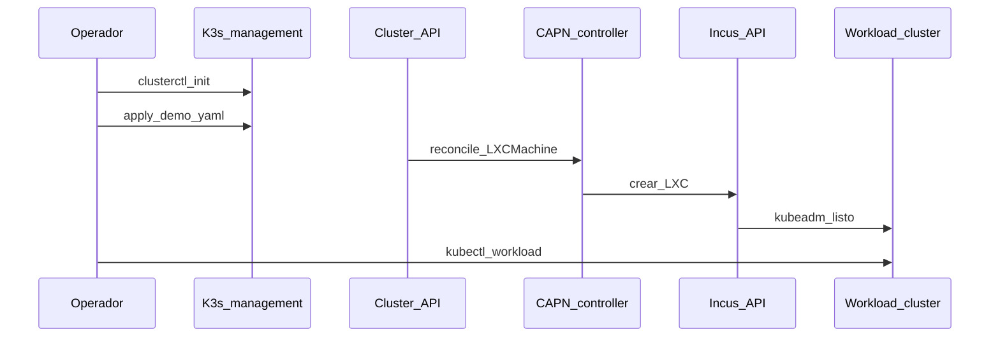

# Phase 6 — CAPN (optional)

## Objective

Provision **workload clusters** kubeadm on Incus instances via
[Cluster API](https://cluster-api.sigs.k8s.io/) and [CAPN (Cluster API Provider for Incus)](https://capn.linuxcontainers.org/).

## What You Learn

CAPI (Cluster API) declares clusters as Kubernetes resources; CAPN translates `LXCMachine` into
Incus instances — ephemeral clusters that do not touch the management K3s (lightweight Kubernetes distribution).

!!! abstract "Learn this phase"
    **In simple terms:** Cluster API is a 3D printer for clusters: instead of building each cluster by hand,
    you write a description and the system fabricates it. CAPN is the "accessory" that uses Incus as
    the factory: each node of the new cluster is an Incus instance.

    **Key concepts**

    - **Management cluster and workload cluster:** the former manages; the latter is the one that is created and used.
    - **Provider:** the plugin that knows how to create machines on a specific platform (here, Incus).
    - **Declarative resources:** a cluster is described as a Kubernetes object (for example `LXCMachine`).
    - **Ephemeral clusters:** created for a test and destroyed afterward.

    **Practical challenge (safe):** generate the description of a cluster and read it, **without applying it**. First export
    the variables that appear in the "Run" section of this phase; then:

    ```bash
    clusterctl generate cluster demo -i incus \
      --kubernetes-version v1.36.2 \
      --control-plane-machine-count 1 \
      --worker-machine-count 2 > /tmp/demo.yaml
    # solo lectura: no ejecutes kubectl apply
    less /tmp/demo.yaml
    ```

    ??? question "Why create clusters from a manifest and not by hand?"
        They repeat the same way every time, they stay in Git and can be destroyed and recreated without effort.

    ??? question "What is the difference between a management cluster and a workload cluster?"
        The management cluster creates and monitors the others; workload clusters run the applications.

    Questions? Use the **Learn with AI** button next to each title, or the page [Learn](../aprende.md).

## Stack for this phase



- **[Cluster API](https://cluster-api.sigs.k8s.io/)** — Declarative API; Phase 6.
- **[CAPN](https://capn.linuxcontainers.org/)** — Incus provider; Phase 6.
- **[clusterctl](https://cluster-api.sigs.k8s.io/user/quick-start.html)** — Bootstrap CAPI in the management cluster.
- **[Incus](https://linuxcontainers.org/incus/docs/main/)** — Instance runtime; Phase 2.
- **[Sealed Secrets](https://github.com/bitnami-labs/sealed-secrets)** — Encrypted Incus credentials in Git.

Further reading: [CAPN](../capn/index.md) · [Secrets](../secrets/index.md)

**This decision in other environments**

=== "🏠 At home"

    Cluster API with [CAPN](https://github.com/lxc/cluster-api-provider-incus) creates kubeadm test clusters as
    Incus instances from a manifest in Git, and deletes them when done. It serves to learn the same model
    that large platforms use, without paying for cloud.

=== "🏢 In a company"

    - **Benefits:** clusters are declared as code: they are created the same way every time, versioned and audited
      in Git, updated node by node with a version change, and replaced instead of being fixed by hand. With the
      same API, clusters are managed in the data center and across multiple clouds.
    - **Fleet scale:** with dozens or hundreds of clusters, inventory, policies, and centralized updates are needed;
      a fleet console is often added, such as
      [SUSE Rancher Prime](https://www.suse.com/products/rancher/) or
      [Red Hat Advanced Cluster Management](https://www.redhat.com/en/technologies/management/advanced-cluster-management).
    - **The management cluster is critical:** if it is lost, the clusters keep running but no one can update or scale them; in production, it is given high availability and backup, and it is moved with `clusterctl move`.
    - **Support:** CAPN is a community project of [Linux Containers](https://linuxcontainers.org/); cloud providers
      have more users and vendor support.
    - **When the same applies as in a HomeLab:** private cloud on Incus, edge sites, and test environments that are created and destroyed often, where a managed cloud cluster is not available or does not make sense.

=== "☁️ In the cloud"

    | Cloud | Equivalent service |
    |---|---|
    | GCP | Provider [CAPG](https://github.com/kubernetes-sigs/cluster-api-provider-gcp); fleet with [GKE fleet management](https://cloud.google.com/kubernetes-engine/fleet-management/docs) |
    | AWS | Provider [CAPA](https://github.com/kubernetes-sigs/cluster-api-provider-aws); outside AWS, [EKS Anywhere](https://anywhere.eks.amazonaws.com/) or [EKS Hybrid Nodes](https://docs.aws.amazon.com/eks/latest/userguide/hybrid-nodes-overview.html) |
    | Azure | Provider [CAPZ](https://github.com/kubernetes-sigs/cluster-api-provider-azure); fleet with [Azure Arc-enabled Kubernetes](https://learn.microsoft.com/en-us/azure/azure-arc/kubernetes/overview) |
    | Oracle Cloud (OCI) | Provider [CAPOCI](https://github.com/oracle/cluster-api-provider-oci) |

    Replacing CAPN with a cloud provider gives you managed machines, networks, and load balancers, with SLAs and near-unlimited scale. You lose control of the hardware, pay for every node that is running, and the manifests use cloud-specific resources, so they do not move as-is to another cloud.

## Before You Start

- [ ] [Phase 2 — Incus](fase-2-incus.md) with the healthy cluster.
- [ ] [Phase 4 — GitOps](fase-4-gitops.md) with Sealed Secrets operational.
- [ ] Sealed Incus credential (`lxc-secret`).

The [Phase 5 — vCluster](fase-5-vcluster.md) is optional: it is not required for this phase.

!!! note "Control plane load balancer"
    Each CAPN cluster creates its own load balancer for the API (`LOAD_BALANCER='lxc: {}'`, a container inside
    Incus). It is independent of the Incus network load balancers, which only exist in the OVN network `ovn-lan`: see
    [Load Balancing and OVN](../incus/cluster-setup.md#load-balancing-and-ovn).

## Run

### Install clusterctl and init CAPN

```bash
curl -L https://github.com/kubernetes-sigs/cluster-api/releases/download/v1.10.10/clusterctl-linux-amd64 -o clusterctl
chmod +x clusterctl && sudo mv clusterctl /usr/local/bin/
mkdir -p ~/.cluster-api
curl -o ~/.cluster-api/clusterctl.yaml https://capn.linuxcontainers.org/static/v0.1/clusterctl.yaml
clusterctl init -i incus
```

### Generate and apply demo cluster

See full commands in [CAPN — further reading](../capn/index.md).

```bash
kubectl apply -f gitops/argocd/apps/capn-demo.yaml
```

=== "🖱️ From the UI"

    Manual sync in ArgoCD (Application `capn-demo`).

=== "⌨️ From the console"

    With the Argo CD CLI:

    ```bash
    argocd login argocd.homelab.local --grpc-web
    argocd app sync capn-demo
    ```

## Options

| Decision | Default HomeLab |
|---|---|
| Sync Argo CD | Manual (ephemeral, avoids accidental deletions) |
| Target workers | `@arm64-nodes` (deborah) / CP `@x86-nodes` |

<div class="card">
  <div class="card-kicker">Trade-off analysis</div>
  <div class="option-grid">
    <div class="card-col">
      <div class="card-title">Manual sync</div>
      <div class="text-muted">Ephemeral clusters do not delete themselves</div>
      <div class="text-muted">Apply + Sync in UI each time</div>
    </div>
    <div class="card-col">
      <div class="card-title">Workers on <code>@arm64-nodes</code></div>
      <div class="text-muted">Leverages 31 GB of deborah</div>
      <div class="text-muted">Less margin if deborah is already a CP K3s</div>
    </div>
    <div class="card-col">
      <div class="card-title">CP on <code>@x86-nodes</code></div>
      <div class="text-muted">Separates CP workload / management</div>
      <div class="text-muted">More RAM on limited x86 nodes</div>
    </div>
    <div class="card-col">
      <div class="card-title">CAPN vs vCluster</div>
      <div class="text-muted">Real VMs/Incus; full kubeadm</div>
      <div class="text-muted">Much more RAM than vCluster in pods</div>
    </div>
  </div>
</div>

## Verify

```bash
kubectl get clusters
kubectl get machines
```

## If it fails

| Symptom | Check |
|---|---|
| The `Machine` does not advance | Secret Incus, Incus IP in `lxc-secret` |
| Image pull | [images.linuxcontainers.org](https://images.linuxcontainers.org/) |

## Next

**[→ HomeLab Summary](resumen-homelab.md)** · [Tech Stack](stack-tecnologico.md)
