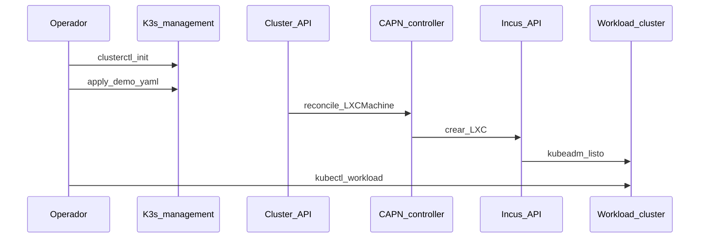

# Phase 6 — CAPN (optional)

## Objective

Provision **kubeadm workload clusters** on Incus instances via
[Cluster API](https://cluster-api.sigs.k8s.io/) and [CAPN (Cluster API Provider for Incus)](https://capn.linuxcontainers.org/).

## What you learn

CAPI (Cluster API) declares clusters as Kubernetes resources; CAPN translates `LXCMachine` into
Incus instances — ephemeral clusters without touching the management K3s (lightweight Kubernetes distribution).

!!! abstract "Learn this phase"
    **In short:** Cluster API is a 3D printer for clusters: instead of assembling each cluster by hand,
    you write a description and the system fabricates it. CAPN is the "attachment" that uses Incus as
    the factory: each node of the new cluster is an Incus instance.

    **Key concepts**

    - **Management cluster and workload cluster:** the former manages; the latter is the one created and used.
    - **Provider:** the plugin that knows how to create machines on a specific platform (here, Incus).
    - **Declarative resources:** a cluster is described as a Kubernetes object (for example `LXCMachine`).
    - **Ephemeral clusters:** created for a test and destroyed afterward.

    **Safe hands-on challenge:** generate a cluster description and read it, **without applying it**. First export
    the variables that appear in the "Run" section of this phase; then:

    ```bash
    clusterctl generate cluster demo -i incus \
      --kubernetes-version v1.36.2 \
      --control-plane-machine-count 1 \
      --worker-machine-count 2 > /tmp/demo.yaml
    # solo lectura: no ejecutes kubectl apply
    less /tmp/demo.yaml
    ```

    ??? question "Why create clusters from a manifest instead of manually?"
        They repeat identically every time, live in Git, and can be destroyed and recreated effortlessly.

    ??? question "What is the difference between the management cluster and a workload cluster?"
        The management cluster creates and watches the others; workload clusters run the applications.

    Questions? Use the **Learn with AI** button next to each heading, or the [Learn](../aprende.md) page.

## Stack for this phase



- **[Cluster API](https://cluster-api.sigs.k8s.io/)** — Declarative API (Application Programming Interface); Phase 6.
- **[CAPN](https://capn.linuxcontainers.org/)** — Incus Provider; Phase 6.
- **[clusterctl](https://cluster-api.sigs.k8s.io/user/quick-start.html)** — Bootstrap CAPI on the management cluster.
- **[Incus](https://linuxcontainers.org/incus/docs/main/)** — Instance runtime; Phase 2.
- **[Sealed Secrets](https://github.com/bitnami-labs/sealed-secrets)** — Encrypted Incus credentials in Git.

Deep dive: [CAPN](../capn/index.md) · [Secrets](../secrets/index.md)

**This decision in other environments**

=== "🏠 At home"

    Cluster API with [CAPN](https://github.com/lxc/cluster-api-provider-incus) creates test kubeadm clusters as
    Incus instances, from a manifest in Git, and deletes them when you're done. It serves to learn the same model
    that large platforms use, without paying for cloud.

=== "🏢 In a company"

    - **Benefits:** clusters are declared as code: they are created identically every time, versioned and audited
      in Git, updated node by node with a version change, and replaced instead of repaired manually. With the
      same API you manage clusters in the datacenter and across multiple clouds.
    - **Fleet scale:** with dozens or hundreds of clusters you need inventory, policies, and centralized
      updates; a fleet console such as
      [SUSE Rancher Prime](https://www.suse.com/products/rancher/) or
      [Red Hat Advanced Cluster Management](https://www.redhat.com/en/technologies/management/advanced-cluster-management) is often added.
    - **The management cluster is critical:** if lost, clusters keep running but no one can update or scale
      them; in production it gets high availability and backup, and is moved with `clusterctl move`.
    - **Support:** CAPN is a community project from [Linux Containers](https://linuxcontainers.org/); major cloud
      providers have more users and vendor backing.
    - **When the same as HomeLab makes sense:** private cloud on Incus, edge sites, and test environments that
      are created and destroyed often, where a managed cloud cluster isn't available or doesn't make sense.

=== "☁️ In the cloud"

    | Cloud | Equivalent service |
    |---|---|
    | GCP | Provider [CAPG](https://github.com/kubernetes-sigs/cluster-api-provider-gcp); fleet with [GKE fleet management](https://cloud.google.com/kubernetes-engine/fleet-management/docs) |
    | AWS | Provider [CAPA](https://github.com/kubernetes-sigs/cluster-api-provider-aws); outside AWS, [EKS Anywhere](https://anywhere.eks.amazonaws.com/) or [EKS Hybrid Nodes](https://docs.aws.amazon.com/eks/latest/userguide/hybrid-nodes-overview.html) |
    | Azure | Provider [CAPZ](https://github.com/kubernetes-sigs/cluster-api-provider-azure); fleet with [Azure Arc-enabled Kubernetes](https://learn.microsoft.com/en-us/azure/azure-arc/kubernetes/overview) |
    | Oracle Cloud (OCI) | Provider [CAPOCI](https://github.com/oracle/cluster-api-provider-oci) |

    Swapping CAPN for a cloud provider gives you managed machines, networks, and load balancers, with SLA and near
    unlimited scale. You lose hardware control, pay for every running node, and manifests use cloud-specific
    resources, so they don't move as-is to another cloud.

## Before you start

- [ ] [Phase 2 — Incus](fase-2-incus.md) with a healthy cluster.
- [ ] [Phase 4 — GitOps](fase-4-gitops.md) with Sealed Secrets operational.
- [ ] Sealed Incus credential (`lxc-secret`).

[Phase 5 — vCluster](fase-5-vcluster.md) is optional: not required for this phase.

!!! note "Control plane load balancer"
    Each CAPN cluster creates its own load balancer for the API (`LOAD_BALANCER='lxc: {}'`, a container inside
    Incus). It is independent of the Incus network load balancers, which only exist on the OVN network `ovn-lan`: see
    [Load Balancing and OVN](../incus/cluster-setup.md#load-balancing-and-ovn).

## Run

### Install clusterctl and init CAPN

```bash
curl -L https://github.com/kubernetes-sigs/cluster-api/releases/download/v1.10.10/clusterctl-linux-amd64 -o clusterctl
chmod +x clusterctl && sudo mv clusterctl /usr/local/bin/
mkdir -p ~/.cluster-api
curl -o ~/.cluster-api/clusterctl.yaml https://capn.linuxcontainers.org/static/v0.1/clusterctl.yaml
clusterctl init -i incus
```

### Generate and apply demo cluster

See full commands in [CAPN — deep dive](../capn/index.md).

In the repo `gitops`, move `bootstrap/components/apagadas/capn-demo.yaml` to `bootstrap/components/` and merge into `main`.
The ApplicationSet `homelab` creates the Application with wave `manual` (no auto-sync):

=== "🖱️ From the UI"

    Manual sync in ArgoCD (Application `capn-demo`).

=== "⌨️ From the console"

    With the Argo CD CLI:

    ```bash
    argocd login argocd.homelab.local --grpc-web
    argocd app sync capn-demo
    ```

## Options

| Decision | Default HomeLab |
|---|---|
| Sync Argo CD | Manual (ephemeral, avoids accidental deletions) |
| Target workers | `@arm64-nodes` (deborah) / CP `@x86-nodes` |

<div class="card">
  <div class="card-kicker">Trade-off analysis</div>
  <div class="option-grid">
    <div class="card-col">
      <div class="card-title">Manual sync</div>
      <div class="text-muted">Ephemeral clusters don't self-delete</div>
      <div class="text-muted">Apply + Sync in UI every time</div>
    </div>
    <div class="card-col">
      <div class="card-title">Workers on <code>@arm64-nodes</code></div>
      <div class="text-muted">Leverages 31 GB from deborah</div>
      <div class="text-muted">Less headroom if deborah is already K3s CP</div>
    </div>
    <div class="card-col">
      <div class="card-title">CP on <code>@x86-nodes</code></div>
      <div class="text-muted">Separation of CP workload / management</div>
      <div class="text-muted">More RAM on constrained x86 nodes</div>
    </div>
    <div class="card-col">
      <div class="card-title">CAPN vs vCluster</div>
      <div class="text-muted">Real VMs/Incus; full kubeadm</div>
      <div class="text-muted">Much more RAM than vCluster in pods</div>
    </div>
  </div>
</div>

## Verify

```bash
kubectl get clusters
kubectl get machines
```

## If it fails

| Symptom | Check |
|---|---|
| The `Machine` doesn't progress | Incus secret, Incus IP in `lxc-secret` |
| Image pull | [images.linuxcontainers.org](https://images.linuxcontainers.org/) |

## Next

**[→ HomeLab Summary](resumen-homelab.md)** · [Tech stack](stack-tecnologico.md)
