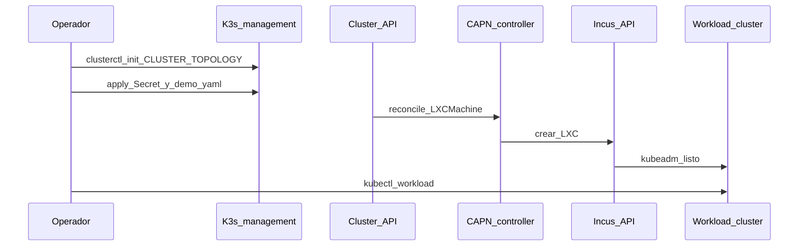

# Fase 6 — CAPN (opcional)

## Objetivo

Provisionar **workload clusters** kubeadm sobre instancias Incus vía
[Cluster API](https://cluster-api.sigs.k8s.io/) y [CAPN (Cluster API Provider for Incus)](https://capn.linuxcontainers.org/).

## Qué aprendes

CAPI (Cluster API) declara clusters como recursos Kubernetes; CAPN traduce `LXCMachine` en
instancias Incus — clusters efímeros sin tocar el management K3s (distribución ligera de Kubernetes).

!!! abstract "Aprende esta fase"
    **En simple:** Cluster API es una impresora 3D de clústeres: en vez de armar cada clúster a mano,
    escribes una descripción y el sistema lo fabrica. CAPN es el "accesorio" que usa Incus como
    fábrica: cada nodo del clúster nuevo es una instancia de Incus.

    **Conceptos clave**

    - **Management cluster y workload cluster:** el primero gestiona; el segundo es el que se crea y se usa.
    - **Provider (proveedor):** el plugin que sabe crear máquinas en una plataforma concreta (aquí, Incus).
    - **Recursos declarativos:** un clúster se describe como un objeto de Kubernetes (por ejemplo `LXCMachine`).
    - **Clústeres efímeros:** se crean para una prueba y se destruyen después.

    **Reto práctico (seguro):** genera la descripción de un clúster y léela, **sin aplicarla**. Necesitas
    `clusterctl` y el `clusterctl.yaml` de CAPN (sección «Ejecutar»), pero no hace falta instalar nada en el clúster:
    exporta las variables de [Generar un clúster](../capn/index.md#generar-un-cluster) y después:

    ```bash
    clusterctl generate cluster demo -i incus:v0.9.1 \
      --kubernetes-version v1.37.0 \
      --control-plane-machine-count 1 \
      --worker-machine-count 1 > /tmp/demo.yaml
    # solo lectura: no ejecutes kubectl apply
    less /tmp/demo.yaml
    ```

    ??? question "¿Por qué crear clústeres desde un manifiesto y no a mano?"
        Se repiten igual cada vez, quedan en Git y se pueden destruir y recrear sin esfuerzo.

    ??? question "¿Qué diferencia hay entre el management cluster y un workload cluster?"
        El management cluster crea y vigila a los demás; los workload clusters ejecutan las aplicaciones.

    ¿Dudas? Usa el botón **Aprende con IA** junto a cada título, o la página [Aprende](../aprende.md).

## Stack de esta fase



- **[Cluster API](https://cluster-api.sigs.k8s.io/)** — API (Application Programming Interface) declarativa; Fase 6.
- **[CAPN](https://capn.linuxcontainers.org/)** — Provider Incus; Fase 6.
- **[clusterctl](https://cluster-api.sigs.k8s.io/user/quick-start.html)** — Bootstrap CAPI en el management cluster.
- **[Incus](https://linuxcontainers.org/incus/docs/main/)** — Runtime de instancias; Fase 2.
- **[Sealed Secrets](https://github.com/bitnami-labs/sealed-secrets)** — Credenciales Incus cifradas en Git.

Profundización: [CAPN](../capn/index.md) · [Secretos](../secrets/index.md)

**Esta decisión en otros entornos**

=== "🏠 En casa"

    Cluster API con [CAPN](https://github.com/lxc/cluster-api-provider-incus) crea clústeres kubeadm de prueba como
    instancias de Incus, desde un manifiesto en Git, y los borra cuando terminas. Sirve para aprender el mismo modelo
    que usan las plataformas grandes, sin pagar nube.

=== "🏢 En la empresa"

    - **Beneficios:** los clústeres se declaran como código: se crean iguales cada vez, quedan versionados y auditados
      en Git, se actualizan nodo por nodo con un cambio de versión y se reemplazan en vez de repararse a mano. Con la
      misma API se manejan clústeres en el datacenter y en varias nubes.
    - **Escala de flota:** con decenas o cientos de clústeres hacen falta inventario, políticas y actualizaciones
      centralizadas; se suele sumar una consola de flota como
      [SUSE Rancher Prime](https://www.suse.com/products/rancher/) o
      [Red Hat Advanced Cluster Management](https://www.redhat.com/en/technologies/management/advanced-cluster-management).
    - **El management cluster es crítico:** si se pierde, los clústeres siguen corriendo pero nadie los puede
      actualizar ni escalar; en producción se le da alta disponibilidad y backup, y se mueve con `clusterctl move`.
    - **Soporte:** CAPN es un proyecto comunitario de [Linux Containers](https://linuxcontainers.org/); los proveedores
      de las nubes grandes tienen más usuarios y respaldo del proveedor.
    - **Cuándo conviene lo mismo que el HomeLab:** nube privada sobre Incus, sitios edge y entornos de prueba que se
      crean y destruyen a menudo, donde un clúster administrado de nube no está disponible o no conviene.

=== "☁️ En la nube"

    | Nube | Servicio equivalente |
    |---|---|
    | GCP | Proveedor [CAPG](https://github.com/kubernetes-sigs/cluster-api-provider-gcp); flota con [GKE fleet management](https://cloud.google.com/kubernetes-engine/fleet-management/docs) |
    | AWS | Proveedor [CAPA](https://github.com/kubernetes-sigs/cluster-api-provider-aws); fuera de AWS, [EKS Anywhere](https://anywhere.eks.amazonaws.com/) o [EKS Hybrid Nodes](https://docs.aws.amazon.com/eks/latest/userguide/hybrid-nodes-overview.html) |
    | Azure | Proveedor [CAPZ](https://github.com/kubernetes-sigs/cluster-api-provider-azure); flota con [Azure Arc-enabled Kubernetes](https://learn.microsoft.com/en-us/azure/azure-arc/kubernetes/overview) |
    | Oracle Cloud (OCI) | Proveedor [CAPOCI](https://github.com/oracle/cluster-api-provider-oci) |

    Cambiar CAPN por el proveedor de una nube te da máquinas, redes y balanceadores administrados, con SLA y escala
    casi sin límite. Pierdes control del hardware, pagas por cada nodo encendido y los manifiestos usan recursos
    propios de esa nube, así que no se mueven tal cual a otra.

## Estado en el HomeLab

!!! warning "Probado el 18 nov 2026: funciona, pero todavía no se puede usar tal cual"
    Una prueba de humo levantó un clúster kubeadm v1.37.0 sobre Incus (control plane y un worker `Ready`, flannel,
    CoreDNS y un Service respondiendo `HTTP 200`) en unos 90 segundos, y después se borró todo. Para lograrlo hubo que
    sortear dos problemas que siguen abiertos:

    1. **El control plane queda con una IP IPv6.** CAPN toma como dirección de la API la primera IP global de la
       instancia, y en `br0` la IPv6 de la LAN (`fd23:…`, por SLAAC) llega antes que la IPv4 del DHCP. Los pods de K3s
       solo tienen IPv4, así que los controladores no llegan a la API (`connect: network is unreachable`). Es el issue
       [#174 "IPv6 Support"](https://github.com/lxc/cluster-api-provider-incus/issues/174) de CAPN. La salida más
       simple es un balanceador `kube-vip` con una IPv4 fija (sin probar aquí).
    2. **`deborah` no puede ser nodo.** Su kernel Rockchip no trae el módulo `netlink_diag`, que el perfil kubeadm de
       CAPN exige: el contenedor no arranca. Los nodos van en `eve` e `invincible` (`oliver` tiene poca RAM y un SSD con
       sectores reasignados).

    Hasta resolver el punto 1, la Application `capn-demo` de `gitops` queda apagada: hoy solo crea un namespace.

## Antes de empezar

- [ ] [Fase 2 — Incus](fase-2-incus.md) con el clúster sano.
- [ ] [Fase 4 — GitOps](fase-4-gitops.md) con cert-manager y Sealed Secrets operativos (CAPI reutiliza el
      cert-manager del clúster).
- [ ] Un certificado de Incus solo para CAPN, en el trust de Incus y en 1Password
      ([Credencial de Incus](../capn/index.md#credencial-de-incus)).
- [ ] Una IPv4 libre para el endpoint del control plane, fuera del rango DHCP del router y de los pools de MetalLB.
- [ ] `clusterctl` ≥ 1.13 (CAPI 1.10, el de las guías viejas, ya no tiene soporte ni admite K8s 1.37 como management
      cluster): `brew install clusterctl`.

La [Fase 5 — vCluster](fase-5-vcluster.md) es opcional: no hace falta para esta fase.

## Ejecutar

### Instalar Cluster API y CAPN en el K3s

```bash
mkdir -p ~/.cluster-api
curl -fsSLo ~/.cluster-api/clusterctl.yaml https://capn.linuxcontainers.org/static/v0.1/clusterctl.yaml
export KUBECONFIG=~/.kube/homelab-github.yaml
export CLUSTER_TOPOLOGY=true    # la plantilla de CAPN usa ClusterClass: sin esto el apply responde "Forbidden"
clusterctl init -i incus:v0.9.1
```

Tarda unos 30 segundos. Instala CAPI (v1.14 con `clusterctl` 1.13) y CAPN v0.9.1 en los namespaces `capi-*` y
`capn-system`, y reutiliza el cert-manager que ya existe.

!!! tip "Si el webhook de `KubeadmControlPlane` da `x509: certificate signed by unknown authority`"
    En la prueba, el API de K3s siguió rechazando el certificado del webhook aunque el `caBundle` era correcto; se
    destrabó al volver a anotar el `ValidatingWebhookConfiguration` (cualquier anotación nueva lo fuerza a recargarlo).

### Generar y crear un clúster

Comandos completos (credencial, variables, destinos) en [CAPN](../capn/index.md#generar-un-cluster). La idea:

1. Aplicar el Secret con la credencial de Incus en el namespace del clúster.
2. `clusterctl generate cluster …` con los destinos `eve`/`invincible` y el balanceador con IPv4.
3. `kubectl apply` del manifiesto (o, cuando funcione de punta a punta, ponerlo en `gitops` y activar `capn-demo`).

## Opciones

| Decisión | Default HomeLab |
|---|---|
| Instalación de CAPI/CAPN | `clusterctl init` a mano (no está en GitOps) |
| Tipo de nodo | `container` (LXC privilegiado, perfil kubeadm de CAPN) |
| Destinos | `eve` e `invincible`; nunca `deborah` (sin `netlink_diag`) ni `oliver` |
| Balanceador del control plane | `kube-vip` con IPv4 fija (pendiente de probar); `lxc` no sirve en `br0` por la IPv6 |
| Versión de Kubernetes | Una con imagen `kubeadm` publicada: `v1.37.0` o `v1.36.4` |

<div class="card">
  <div class="card-kicker">Análisis de trade-offs</div>
  <div class="option-grid">
    <div class="card-col">
      <div class="card-title">CAPN vs vCluster</div>
      <div class="text-muted">Clústeres kubeadm reales, con sus propios nodos</div>
      <div class="text-muted">Unos 1 GB de RAM por clúster mínimo, contra un pod de vCluster</div>
    </div>
    <div class="card-col">
      <div class="card-title">Contenedores privilegiados</div>
      <div class="text-muted">Arrancan en segundos y gastan poco</div>
      <div class="text-muted">En la práctica son root en el nodo de Incus, que también corre K3s</div>
    </div>
    <div class="card-col">
      <div class="card-title"><code>clusterctl</code> a mano</div>
      <div class="text-muted">Simple para aprender y borrar</div>
      <div class="text-muted">No queda en Git; <code>clusterctl delete</code> puede dejar restos</div>
    </div>
  </div>
</div>

## Verificar

Los nombres cortos `clusters` y `kcp` chocan con otros recursos del clúster (PostgreSQL de CloudNativePG y
KongClusterPlugin), así que se usan los nombres completos:

```bash
kubectl get clusters.cluster.x-k8s.io,machines.cluster.x-k8s.io -A
clusterctl describe cluster demo -n capn-demo
clusterctl get kubeconfig demo -n capn-demo > /tmp/demo.kubeconfig
KUBECONFIG=/tmp/demo.kubeconfig kubectl get nodes
```

## Seguridad

- El perfil kubeadm de CAPN crea contenedores con `security.privileged=true`, AppArmor `unconfined`, sin quitar
  capacidades y con `/dev/kmsg` del host: quien controla el clúster creado controla, en la práctica, el nodo de Incus.
- Además carga módulos del kernel en el nodo (`ip_vs*`, `ip6_tables`, `netlink_diag`, `xt_socket`), que quedan
  cargados después de borrar el clúster.
- La credencial de Incus de CAPN tiene acceso total al proyecto: va en 1Password y en el clúster solo como
  SealedSecret, nunca en Git en claro.

## Desinstalar

```bash
kubectl delete clusters.cluster.x-k8s.io demo -n capn-demo     # borra las instancias de Incus (~20 s)
clusterctl delete --all --include-crd --include-namespace
```

En la prueba, `clusterctl delete` falló a mitad (`failed to list … MachineSet`: borró los CRD de CAPI antes de terminar
con CAPN) y quedaron `capn-system`, CRDs `*.cluster.x-k8s.io` y ClusterRoles de CAPN; hubo que borrarlos a mano tras
comprobar que no tenían finalizers. Revisa con `kubectl get crd | grep x-k8s.io` y `kubectl get ns | grep -E 'capi|capn'`.

## Si falla

| Síntoma | Causa |
|---|---|
| `Unable to identify version for the provider "incus"` | `generate` sin `clusterctl init` antes: usa `-i incus:v0.9.1` |
| `yaml: found character that cannot start any token` | `@x86-nodes` sin comillas en las variables `*_MACHINE_TARGET` |
| `spec.topology: Forbidden … ClusterTopology` | Falta `CLUSTER_TOPOLOGY=true` en el `clusterctl init` |
| `server "" is not unix:// or https://` | El Secret no tiene las claves de CAPN (`server`, `server-crt`, `client-crt`, `client-key`, `project`) |
| `dial tcp [fd23:…]:6443: connect: network is unreachable` | El endpoint quedó en IPv6: ver [Estado en el HomeLab](#estado-en-el-homelab) |
| `modprobe: FATAL: Module netlink_diag not found` | La máquina cayó en `deborah`: cambia el destino |
| `Image "kubeadm/v1.36.1" not found` | No fijes `LXC_IMAGE_NAME`; usa una versión con imagen publicada |

## Siguiente

**[→ Resumen del HomeLab](resumen-homelab.md)** · [Stack tecnológico](stack-tecnologico.md)
