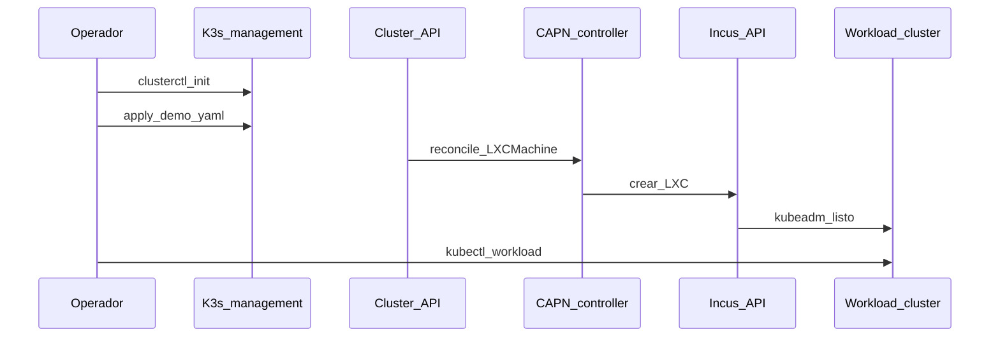

# Fase 6 — CAPN (opcional)

## Objetivo

Provisionar **workload clusters** kubeadm sobre instancias Incus vía
[Cluster API](https://cluster-api.sigs.k8s.io/) y [CAPN (Cluster API Provider for Incus)](https://capn.linuxcontainers.org/).

## Qué aprendes

CAPI (Cluster API) declara clusters como recursos Kubernetes; CAPN traduce `LXCMachine` en
instancias Incus — clusters efímeros sin tocar el management K3s (distribución ligera de Kubernetes).

!!! abstract "Aprende esta fase"
    **En simple:** Cluster API es una impresora 3D de clústeres: en vez de armar cada clúster a mano,
    escribes una descripción y el sistema lo fabrica. CAPN es el "accesorio" que usa Incus como
    fábrica: cada nodo del clúster nuevo es una instancia de Incus.

    **Conceptos clave**

    - **Management cluster y workload cluster:** el primero gestiona; el segundo es el que se crea y se usa.
    - **Provider (proveedor):** el plugin que sabe crear máquinas en una plataforma concreta (aquí, Incus).
    - **Recursos declarativos:** un clúster se describe como un objeto de Kubernetes (por ejemplo `LXCMachine`).
    - **Clústeres efímeros:** se crean para una prueba y se destruyen después.

    **Reto práctico (seguro):** genera la descripción de un clúster y léela, **sin aplicarla**. Primero exporta
    las variables que aparecen en la sección «Ejecutar» de esta fase; después:

    ```bash
    clusterctl generate cluster demo -i incus \
      --kubernetes-version v1.36.2 \
      --control-plane-machine-count 1 \
      --worker-machine-count 2 > /tmp/demo.yaml
    # solo lectura: no ejecutes kubectl apply
    less /tmp/demo.yaml
    ```

    ??? question "¿Por qué crear clústeres desde un manifiesto y no a mano?"
        Se repiten igual cada vez, quedan en Git y se pueden destruir y recrear sin esfuerzo.

    ??? question "¿Qué diferencia hay entre el management cluster y un workload cluster?"
        El management cluster crea y vigila a los demás; los workload clusters ejecutan las aplicaciones.

    ¿Dudas? Usa el botón **Aprende con IA** junto a cada título, o la página [Aprende](../aprende.md).

## Stack de esta fase



- **[Cluster API](https://cluster-api.sigs.k8s.io/)** — API (Application Programming Interface) declarativa; Fase 6.
- **[CAPN](https://capn.linuxcontainers.org/)** — Provider Incus; Fase 6.
- **[clusterctl](https://cluster-api.sigs.k8s.io/user/quick-start.html)** — Bootstrap CAPI en el management cluster.
- **[Incus](https://linuxcontainers.org/incus/docs/main/)** — Runtime de instancias; Fase 2.
- **[Sealed Secrets](https://github.com/bitnami-labs/sealed-secrets)** — Credenciales Incus cifradas en Git.

Profundización: [CAPN](../capn/index.md) · [Secretos](../secrets/index.md)

**Esta decisión en otros entornos**

=== "🏠 En casa"

    Cluster API con [CAPN](https://github.com/lxc/cluster-api-provider-incus) crea clústeres kubeadm de prueba como
    instancias de Incus, desde un manifiesto en Git, y los borra cuando terminas. Sirve para aprender el mismo modelo
    que usan las plataformas grandes, sin pagar nube.

=== "🏢 En la empresa"

    - **Beneficios:** los clústeres se declaran como código: se crean iguales cada vez, quedan versionados y auditados
      en Git, se actualizan nodo por nodo con un cambio de versión y se reemplazan en vez de repararse a mano. Con la
      misma API se manejan clústeres en el datacenter y en varias nubes.
    - **Escala de flota:** con decenas o cientos de clústeres hacen falta inventario, políticas y actualizaciones
      centralizadas; se suele sumar una consola de flota como
      [SUSE Rancher Prime](https://www.suse.com/products/rancher/) o
      [Red Hat Advanced Cluster Management](https://www.redhat.com/en/technologies/management/advanced-cluster-management).
    - **El management cluster es crítico:** si se pierde, los clústeres siguen corriendo pero nadie los puede
      actualizar ni escalar; en producción se le da alta disponibilidad y backup, y se mueve con `clusterctl move`.
    - **Soporte:** CAPN es un proyecto comunitario de [Linux Containers](https://linuxcontainers.org/); los proveedores
      de las nubes grandes tienen más usuarios y respaldo del proveedor.
    - **Cuándo conviene lo mismo que el HomeLab:** nube privada sobre Incus, sitios edge y entornos de prueba que se
      crean y destruyen a menudo, donde un clúster administrado de nube no está disponible o no conviene.

=== "☁️ En la nube"

    | Nube | Servicio equivalente |
    |---|---|
    | GCP | Proveedor [CAPG](https://github.com/kubernetes-sigs/cluster-api-provider-gcp); flota con [GKE fleet management](https://cloud.google.com/kubernetes-engine/fleet-management/docs) |
    | AWS | Proveedor [CAPA](https://github.com/kubernetes-sigs/cluster-api-provider-aws); fuera de AWS, [EKS Anywhere](https://anywhere.eks.amazonaws.com/) o [EKS Hybrid Nodes](https://docs.aws.amazon.com/eks/latest/userguide/hybrid-nodes-overview.html) |
    | Azure | Proveedor [CAPZ](https://github.com/kubernetes-sigs/cluster-api-provider-azure); flota con [Azure Arc-enabled Kubernetes](https://learn.microsoft.com/en-us/azure/azure-arc/kubernetes/overview) |
    | Oracle Cloud (OCI) | Proveedor [CAPOCI](https://github.com/oracle/cluster-api-provider-oci) |

    Cambiar CAPN por el proveedor de una nube te da máquinas, redes y balanceadores administrados, con SLA y escala
    casi sin límite. Pierdes control del hardware, pagas por cada nodo encendido y los manifiestos usan recursos
    propios de esa nube, así que no se mueven tal cual a otra.

## Antes de empezar

- [ ] [Fase 2 — Incus](fase-2-incus.md) con el clúster sano.
- [ ] [Fase 4 — GitOps](fase-4-gitops.md) con Sealed Secrets operativo.
- [ ] Credencial Incus sellada (`lxc-secret`).

La [Fase 5 — vCluster](fase-5-vcluster.md) es opcional: no hace falta para esta fase.

!!! note "Balanceador del control plane"
    Cada clúster de CAPN crea su propio balanceador para la API (`LOAD_BALANCER='lxc: {}'`, un contenedor dentro de
    Incus). Es independiente de los balanceadores de red de Incus, que solo existen en la red OVN `ovn-lan`: ver
    [Balanceo de carga y OVN](../incus/cluster-setup.md#balanceo-de-carga-y-ovn).

## Ejecutar

### Instalar clusterctl e init CAPN

```bash
curl -L https://github.com/kubernetes-sigs/cluster-api/releases/download/v1.10.10/clusterctl-linux-amd64 -o clusterctl
chmod +x clusterctl && sudo mv clusterctl /usr/local/bin/
mkdir -p ~/.cluster-api
curl -o ~/.cluster-api/clusterctl.yaml https://capn.linuxcontainers.org/static/v0.1/clusterctl.yaml
clusterctl init -i incus
```

### Generar y aplicar cluster demo

Ver comandos completos en [CAPN — profundización](../capn/index.md).

```bash
kubectl apply -f gitops/argocd/apps/capn-demo.yaml
```

=== "🖱️ Desde la interfaz"

    Sync manual en ArgoCD (Application `capn-demo`).

=== "⌨️ Desde la consola"

    Con la CLI de Argo CD:

    ```bash
    argocd login argocd.homelab.local --grpc-web
    argocd app sync capn-demo
    ```

## Opciones

| Decisión | Default HomeLab |
|---|---|
| Sync Argo CD | Manual (efímero, evita borrados accidentales) |
| Target workers | `@arm64-nodes` (deborah) / CP `@x86-nodes` |

<div class="card">
  <div class="card-kicker">Análisis de trade-offs</div>
  <div class="option-grid">
    <div class="card-col">
      <div class="card-title">Sync manual</div>
      <div class="text-muted">Los clústeres efímeros no se borran solos</div>
      <div class="text-muted">Apply + Sync en UI cada vez</div>
    </div>
    <div class="card-col">
      <div class="card-title">Workers en <code>@arm64-nodes</code></div>
      <div class="text-muted">Aprovecha 31 GB de deborah</div>
      <div class="text-muted">Menos margen si deborah ya es CP K3s</div>
    </div>
    <div class="card-col">
      <div class="card-title">CP en <code>@x86-nodes</code></div>
      <div class="text-muted">Separación CP workload / management</div>
      <div class="text-muted">Más RAM en nodos x86 limitados</div>
    </div>
    <div class="card-col">
      <div class="card-title">CAPN vs vCluster</div>
      <div class="text-muted">VMs/Incus reales; kubeadm completo</div>
      <div class="text-muted">Mucha más RAM que vCluster en pods</div>
    </div>
  </div>
</div>

## Verificar

```bash
kubectl get clusters
kubectl get machines
```

## Si falla

| Síntoma | Revisar |
|---|---|
| La `Machine` no avanza | Secret Incus, IP Incus en `lxc-secret` |
| Image pull | [images.linuxcontainers.org](https://images.linuxcontainers.org/) |

## Siguiente

**[→ Resumen del HomeLab](resumen-homelab.md)** · [Stack tecnológico](stack-tecnologico.md)
