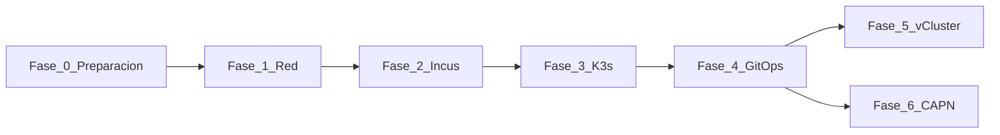

# Implementation — Step-by-Step Guide

This section is the **main journey** of the HomeLab: from bare-metal nodes to full GitOps. Each phase is executable, verifiable, and links to the [tech stack](stack-tecnologico.md) and pages for deeper dives.

!!! tip "How to use this guide"
    Follow the phases in order the first time. In subsequent deployments, you can skip to the phase you need if the prerequisites are already met. Where there are **multiple options**, each phase includes a brief **Trade-offs Analysis** (benefit vs cost/risk).

## Phase Timeline

  

    

      
0

      

    

    

      
<a href="fase-0-preparacion/">Preparation</a> Completed

      
Repo, Ansible, inventory, optional discovery.

      
<code>playbook-discovery.yml</code>

    

  

  

    

      
1

      

    

    

      
<a href="fase-1-red/">Network</a> Completed

      
Fixed IP on <code>br0</code> on the 3 nodes.

      
<code>playbook-set-static-ip.yml</code>

    

  

  

    

      
2

      

    

    

      
<a href="fase-2-incus/">Incus</a> Completed

      
HA Incus cluster + cluster groups + UI.

      
<code>playbook-bootstrap.yml</code> + <code>playbook-incus-cluster.yml</code>

    

  

  

    

      
3

      

    

    

      
<a href="fase-3-k3s/">K3s</a> Completed

      
Management cluster + Argo CD controller.

      
<code>playbook-k3s.yml</code>

    

  

  

    

      
4

      

    

    

      
<a href="fase-4-gitops/">GitOps</a> Completed

      
MetalLB, Gateway API, storage, Dex, waves.

      
Argo CD + <code>gitops</code>

    

  

  

    

      
5

      

    

    

      
<a href="fase-5-vcluster/">vCluster</a> Optional

      
Virtual clusters + web kubeconfig.

      
Application manual

    

  

  

    

      
6

    

    

      
<a href="fase-6-capn/">CAPN</a> Optional

      
Workload clusters on Incus.

      
<code>clusterctl</code> + Application manual

    

  

**End of guide:** **[HomeLab Summary](resumen-homelab.md)** — global checklist,
URLs, `/etc/hosts`, nodes, and verification.

## Two Repos, Two Responsibilities

| Repo | What it Installs | Tool |
|---|---|---|
| [`homelab`](https://github.com/maceosoft/homelab) | OS network, Incus, K3s, kube-vip, Argo CD controller | [Ansible](https://docs.ansible.com/) |
| [`gitops`](https://github.com/maceosoft/gitops) | MetalLB, Gateway API, storage, vCluster, CAPN, … | [Argo CD](https://argo-cd.readthedocs.io/) |

## Tech Stack

Layered diagram, list of products with official links and role in the HomeLab:

**[See full tech stack →](stack-tecnologico.md)**

Complementary architectural view: [C4 Architecture](../architecture/overview.md).

## Decision Map (forks)

| Decision | Option A (default HomeLab) | Option B |
|---|---|---|
| Stable K3s API | Name `k3s.homelab.local` to the control plane (today `deborah`, `192.168.20.5`; will move to `oliver`) | [kube-vip](https://kube-vip.io/) (`kube_vip.enabled: true` on `k3s_install.yml`) |
| Install K3s | `playbook-k3s.yml` | Manual curl ([reference](../k3s/index.md)) |
| **CNI** | [Calico](https://docs.tigera.io/calico/latest/about/) (`k3s_cni: calico`) | Embedded [Flannel](https://github.com/flannel-io/flannel) (`vxlan`), [Canal](https://docs.tigera.io/calico/latest/getting-started/kubernetes/flannel/flannel), [Cilium](https://docs.cilium.io/) |
| OAuth Secrets | [1Password SDK](https://github.com/1Password/onepassword-sdk-python) — personal account, vault `HomeLab` | Corporate account or other vault via env vars |
| vCluster / CAPN | Commented in `homelab-root` | Uncomment in `root-appset.yaml` when ready |
| HA Storage | [Longhorn](https://longhorn.io/docs/) on invincible+deborah | Only [OpenEBS](https://openebs.io/docs) |

  
Trade-off Analysis

  

    

      
Fixed IP vs kube-vip

      
Fixed IP: no extra components

      
kube-vip: stable VIP <code>192.168.20.4</code> if CP changes node

    

    

      
kube-vip

      
API on dedicated IP; agents do not depend on hostname

      
One more daemon; does not replace MetalLB

    

    

      
Ansible vs curl K3s

      
Idempotent, flags in <code>group_vars</code>

      
Manual only for occasional debugging

    

    

      
Flannel

      
Embedded in K3s; low consumption

      
No native NetworkPolicy

    

    

      
Calico selected · Canal / Cilium

      
Network policies (Canal/Calico) or eBPF (Cilium)

      
<code>--flannel-backend=none</code>; more RAM/CPU; choose <strong>before</strong> bootstrap

    

    

      
1Password SDK

      
Secrets out of Git; local DesktopAuth

      
Requires unlocked 1Password app on the station

    

    

      
env vars / <code>kubectl patch</code>

      
No 1Password

      
Secrets in shell/history; not idempotent

    

    

      
Manual sync vCluster/CAPN

      
Avoid accidental deletion of ephemeral clusters

      
Extra step in Argo CD UI

    

    

      
Longhorn

      
Replication x86↔arm64

      
Designed for 2 nodes; more pods than OpenEBS

    

    

      
Only OpenEBS

      
LocalPV on 3 nodes; simple

      
No HA between nodes

    

  

Details CNI (Container Network Interface): [Phase 3 — K3s](fase-3-k3s.md#options) · [playbook-options](../k3s/playbook-options.md#cni).

Details K3s flags (lightweight Kubernetes distribution): [Playbook options](../k3s/playbook-options.md).

Ansible role catalog: [Ansible — roles](../ansible/index.md).

## After the phases

With the platform running, add the **local AI assistant** (Ollama on several nodes behind a router, with
Open WebUI and Open Terminal), the **centralized logs** with weekly reports with AI, and the **security**
layers (host firewall, service tokens, stage-based NetworkPolicy). They are in
[Operation](../operacion/index.md): [Local AI assistant](../operacion/ia-ollama.md),
[Logs](../operacion/logs.md) and [Authentication model](../security/modelo-de-autenticacion.md). The move of the
control plane from `deborah` to `oliver` is documented in [Move the control plane](../operacion/mover-control-plane.md)
and has not yet been done.

## Start here

**[→ Phase 0 — Preparation](fase-0-preparacion.md)**

Appendix outside the normal path: [Uninstall K3s](apendice-desinstalar.md).
