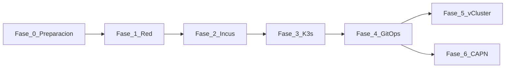

# Implementation — step-by-step guide

This section is the **main walkthrough** of the HomeLab: from bare-metal nodes to full GitOps. Each phase is executable, verifiable, and links to the [tech stack](stack-tecnologico.md) and deep-dive pages.

!!! tip "How to use this guide"
    Follow the phases in order the first time. In subsequent deployments you can jump to the phase you need if the prerequisites are already met. Where there is **more than one alternative**, each phase includes a brief **trade-off analysis** (benefit vs cost/risk).

## Phase timeline

  

    

      
0

      

    

    

      
<a href="fase-0-preparacion/">Preparation</a> Completed

      
Repo, Ansible, inventory, optional discovery.

      
<code>playbook-discovery.yml</code>

    

  

  

    

      
1

      

    

    

      
<a href="fase-1-red/">Network</a> Completed

      
Static IP on <code>br0</code> on all 4 nodes.

      
<code>playbook-set-static-ip.yml</code>

    

  

  

    

      
2

      

    

    

      
<a href="fase-2-incus/">Incus</a> Completed

      
HA Incus cluster + cluster groups + UI.

      
<code>playbook-bootstrap.yml</code> + <code>playbook-incus-cluster.yml</code>

    

  

  

    

      
3

      

    

    

      
<a href="fase-3-k3s/">K3s</a> Completed

      
Management cluster + Argo CD controller.

      
<code>playbook-k3s.yml</code>

    

  

  

    

      
4

      

    

    

      
<a href="fase-4-gitops/">GitOps</a> Completed

      
MetalLB, Gateway API, storage, Dex, waves.

      
Argo CD + <code>gitops</code>

    

  

  

    

      
5

      

    

    

      
<a href="fase-5-vcluster/">vCluster</a> Optional

      
Open-source virtual clusters with the <code>vcluster</code> CLI.

      
Manual Application

    

  

  

    

      
6

    

    

      
<a href="fase-6-capn/">CAPN</a> Optional

      
Workload clusters on Incus.

      
<code>clusterctl</code> + Manual Application

    

  

**End of guide:** **[HomeLab Summary](resumen-homelab.md)** — global checklist, URLs, `/etc/hosts`, nodes, and verification.

## Two repos, two responsibilities

| Repo | What it installs | Tool |
|---|---|---|
| [`homelab`](https://github.com/maceosoft/homelab) | OS networking, Incus, K3s, kube-vip, Argo CD controller | [Ansible](https://docs.ansible.com/) |
| [`gitops`](https://github.com/maceosoft/gitops) | MetalLB, Gateway API, storage, vCluster, CAPN, … | [Argo CD](https://argo-cd.readthedocs.io/) |

## Tech stack

Layered diagram, product list with official links and role in the HomeLab:

**[View full tech stack →](stack-tecnologico.md)**

Complementary architectural view: [C4 Architecture](../architecture/overview.md).

## Mapa de decisiones (forks)

| Decisión | Opción A (default HomeLab) | Opción B |
|---|---|---|
| API K3s estable | Nombre `k3s.homelab.local` hacia el control plane (`deborah`, `192.168.20.5`) | [kube-vip](https://kube-vip.io/) (`kube_vip.enabled: true` en `k3s_install.yml`) |
| Instalar K3s | `playbook-k3s.yml` | curl manual ([referencia](../k3s/index.md)) |
| **CNI** | [Calico](https://docs.tigera.io/calico/latest/about/) (`k3s_cni: calico`) | [Flannel](https://github.com/flannel-io/flannel) embebido (`vxlan`), [Canal](https://docs.tigera.io/calico/latest/getting-started/kubernetes/flannel/flannel), [Cilium](https://docs.cilium.io/) |
| Secretos OAuth | [1Password SDK](https://github.com/1Password/onepassword-sdk-python) — cuenta personal, bóveda `HomeLab` | Cuenta empresa u otra bóveda vía env vars |
| vCluster / CAPN | En `gitops/bootstrap/components/apagadas/` | Moverlas a `bootstrap/components/` cuando estés listo |
| Storage HA | [Longhorn](https://longhorn.io/docs/) en invincible+deborah | Solo [OpenEBS](https://openebs.io/docs) |

  
Análisis de trade-offs

  

    

      
IP fija vs kube-vip

      
IP fija: cero componentes extra

      
kube-vip: VIP <code>192.168.20.4</code> estable si el CP cambia de nodo

    

    

      
kube-vip

      
API en IP dedicada; agents no dependen de hostname

      
Un daemon más; no sustituye MetalLB

    

    

      
Ansible vs curl K3s

      
Idempotente, flags en <code>group_vars</code>

      
Manual solo para depuración puntual

    

    

      
Flannel

      
Embebido en K3s; bajo consumo

      
Sin NetworkPolicy nativa

    

    

      
Calico elegida · Canal / Cilium

      
Políticas de red (Canal/Calico) o eBPF (Cilium)

      
<code>--flannel-backend=none</code>; más RAM/CPU; elegir <strong>antes</strong> del bootstrap

    

    

      
1Password SDK

      
Secretos fuera de Git; DesktopAuth local

      
Requiere app 1Password desbloqueada en la estación

    

    

      
env vars / <code>kubectl patch</code>

      
Sin 1Password

      
Secretos en shell/historial; no idempotente

    

    

      
Sync manual vCluster/CAPN

      
Evita borrados accidentales de clústeres efímeros

      
Paso extra en Argo CD UI

    

    

      
Longhorn

      
Replicación x86↔arm64

      
Pensado para 2 nodos; más pods que OpenEBS

    

    

      
Solo OpenEBS

      
LocalPV en todos los nodos; simple

      
Sin HA entre nodos

    

  

Detalle CNI (Container Network Interface): [Fase 3 — K3s](fase-3-k3s.md#options) · [playbook-options](../k3s/playbook-options.md#cni).

Detalle de flags K3s (distribución ligera de Kubernetes): [Opciones del playbook](../k3s/playbook-options.md).

Catálogo de roles Ansible: [Ansible — roles](../ansible/index.md).

## Después de las fases

Con la plataforma en marcha se agregan el **asistente de IA local** (Ollama en varios nodos detrás de un router, con
Open WebUI y Open Terminal), los **logs centralizados** con reportes semanales con IA y las capas de **seguridad**
(firewall de host, tokens por servicio, NetworkPolicy por etapas). Están en
[Operación](../operacion/index.md): [Asistente de IA local](../operacion/ia-ollama.md),
[Logs](../operacion/logs.md) y [Modelo de autenticación](../security/modelo-de-autenticacion.md). Si algún día
hiciera falta cambiar el nodo del control plane, el procedimiento está en
[Mover el control plane](../operacion/mover-control-plane.md).

## Empieza aquí

**[→ Fase 0 — Preparación](fase-0-preparacion.md)**

Apéndice fuera del recorrido normal: [Desinstalar K3s](apendice-desinstalar.md).
