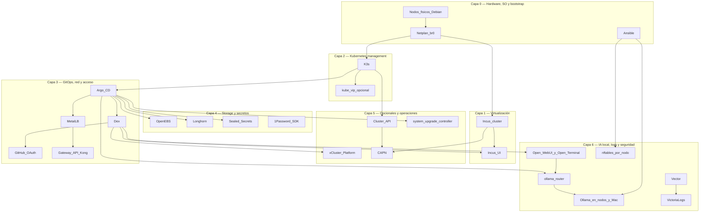

# Technology Stack

Inventory of HomeLab technologies: **layer diagram** + list with
official links in the name of each product.

Part of the [implementation guide](index.md). Complementary C4 (C4 model) view:
[Architecture](../architecture/overview.md) · [Level 3 — Components](../architecture/nivel-3-componentes.md) · [Level 4 — Deployment](../architecture/nivel-4-despliegue.md).

## Layer Diagram

## Layer 0 — Hardware, OS, and bootstrap

- **[Ansible](https://docs.ansible.com/)** — Idempotent OS, network, Incus, and K3s (lightweight Kubernetes distribution) automation; Phases 0–3.
- **[Netplan](https://netplan.io/)** — Static IP on `br0`; Phase 1; node identity for Incus/K3s/CAPN (Cluster API Provider for Incus).
- **[Debian](https://www.debian.org/)** — Base OS on the 3 nodes; global prerequisite.

## Layer 1 — Virtualization

- **[Incus](https://linuxcontainers.org/incus/docs/main/)** — LXC (Linux container) cluster/VM with quorum; Phase 2; substrate for CAPN and instances.
- **[Incus UI](https://linuxcontainers.org/incus/docs/main/howto/server_expose/#web-ui)** — Web management of the Incus cluster; Phase 2 (cert) + Phase 4 (OIDC —OpenID Connect— with Dex).
- **[Zabbly Incus stable](https://github.com/zabbly/incus)** — Package repo; Phase 2.

## Layer 2 — Kubernetes Management

- **[K3s](https://docs.k3s.io/)** — Bare-metal management cluster; Phase 3.
- **[kube-vip](https://kube-vip.io/)** — Optional API (Application Programming Interface) VIP (Virtual IP) `:6443`; Phase 3 (fork).
- **CNI (choose one; in this HomeLab, Calico)** — Phase 3:
  - **[Flannel](https://github.com/flannel-io/flannel)** — Default embedded in K3s (`vxlan` in `br0`)
  - **[Canal](https://docs.tigera.io/calico/latest/getting-started/kubernetes/flannel/flannel)** — Flannel + Calico policies
  - **[Calico](https://docs.tigera.io/calico/latest/about/)** — NetworkPolicy, optional BGP (Border Gateway Protocol)
  - **[Cilium](https://docs.cilium.io/)** — eBPF (extended Berkeley Packet Filter), Hubble, L3–L7 policies

  
CNI

  

    

      
Flannel

      
Zero extra steps in K3s

      
No native NetworkPolicy

    

    

      
Canal

      
Policies over known overlay

      
Legacy; two stacks

    

    

      
Calico

      
Maturity and BGP at L2

      
More pods/RAM

    

    

      
Cilium

      
eBPF observability

      
CPU/kernel; validate ARM64

    

  

## Layer 3 — GitOps, network, and access

- **[Argo CD](https://argo-cd.readthedocs.io/)** — Bootstrap ApplicationSet (`homelab-root`) from GitHub, by waves; Phase 4.
- **[Dex](https://dexidp.io/docs/)** — Embedded OIDC (OpenID Connect) IdP (identity provider) in Argo CD; SSO (single sign-on) for Argo CD, Grafana, Open WebUI, vCluster Platform, and Incus UI (user interface); Phase 4.
- **[GitHub](https://docs.github.com/en/apps/oauth-apps)** — OAuth (Open Authorization) connector + GitOps repos; Phase 4.
- **[MetalLB](https://metallb.universe.tf/)** — LoadBalancer in LAN (local network); Phase 4 wave 0–1.
- **[Gateway API](https://gateway-api.sigs.k8s.io/)** with **[Kong Ingress Controller](https://developer.konghq.com/kubernetes-ingress-controller/)** — HTTP(S) to Argo CD, Grafana, Open WebUI, Ollama router, and vCluster; Phase 4 wave 1 (alternatives: Traefik, NGINX Gateway Fabric).
- **[1Password Python SDK](https://github.com/1Password/onepassword-sdk-python)** — OAuth secrets from local app; Phase 4.
- **[VictoriaMetrics](https://docs.victoriametrics.com/)** (with **[Alertmanager](https://prometheus.io/docs/alerting/latest/alertmanager/)**) — Node and platform metrics and alerts, lighter than Prometheus; Phase 4 (4.13, optional).
- **[Grafana](https://grafana.com/docs/grafana/latest/)** — Temperature, memory, disk, logs, and Ollama panels in `grafana.homelab.local`; Phase 4 (4.13, optional).
- **[Discord](https://discord.com/developers/docs/resources/webhook)** and **[healthchecks.io](https://healthchecks.io/docs/)** — Alert destination (webhooks) and external watchdog (*dead man's switch*) that receives a ping from Alertmanager, in case the entire cluster goes down; Phase 4 (4.13, optional).

## Layer 4 — Storage and secrets

- **[OpenEBS](https://openebs.io/docs)** — Default LocalPV; Phase 4 wave 0.
- **[Longhorn](https://longhorn.io/docs/)** — Cross-arch replicated storage; Phase 4 wave 1.
- **[Sealed Secrets](https://github.com/bitnami-labs/sealed-secrets)** — Encrypted secrets in Git; Phase 4 and 6.
- **[SOPS (Secrets OPerationS)](https://github.com/getsops/sops)** — Pre-bootstrap encryption; deeper dive [Secrets](../secrets/index.md).

## Layer 5 — Optional and operations

- **[vCluster Platform](https://www.vcluster.com/docs/platform/)** — Virtual clusters + web kubeconfig (host K3s and vClusters); Phase 5.
- **[Cluster API](https://cluster-api.sigs.k8s.io/)** — Declarative cluster API; Phase 6.
- **[CAPN](https://capn.linuxcontainers.org/)** — Incus provider for CAPI (Cluster API); Phase 6.
- **[clusterctl](https://cluster-api.sigs.k8s.io/user/quick-start.html)** — CAPI bootstrap CLI (command-line interface); Phase 6.
- **[system-upgrade-controller](https://github.com/rancher/system-upgrade-controller)** — Staged K3s upgrades; Phase 4 wave 3.

## Layer 6 — Local AI, logs, and security

- **[Ollama](https://ollama.com/)** — Language models (LLM, *Large Language Model*) on CPU (central processing unit), on-demand in
  `deborah`, `invincible` and `oliver`, and on nodes that join as nodes. [Guide](../operacion/ia-ollama.md) · [add a node](../operacion/agregar-nodo-ollama.md).
- **Ollama Router** (`ollama-router`, custom) — Single entry point (`ollama.homelab.local`): automatic node registration,
  model selection, client tokens, and model and node metrics.
- **[Open WebUI](https://docs.openwebui.com/)** — Chat with the assistant, with Dex login; **[Open Terminal](https://docs.openwebui.com/features/open-terminal)**
  as a sandbox terminal for the assistant to run code.
- **K8sGPT** — Cluster analysis with Ollama; **staged** (its operator requests cluster-wide permissions).
- **[Vector](https://vector.dev/)** → **[VictoriaLogs](https://docs.victoriametrics.com/victorialogs/)** → Grafana —
  Centralized logs (30 days) and daily and weekly reports with AI in the `#ia` Discord channel ([guide](../operacion/logs.md)).
- **[nftables](https://wiki.nftables.org/)** — Host firewall on each node (role `host_firewall`), with automatic rollback.
- **NetworkPolicy** `default-deny` by namespace and **`oauth2-proxy`** — prepared and **to be activated** in stages
  ([Authentication Model](../security/modelo-de-autenticacion.md)).

## Each layer in the enterprise and in the cloud

The same stack, viewed through each lens. The details of each row (trade-offs, benefits, and official links) are in the
"Decision in other environments" block of the linked page.

=== "🏠 At home"

    Everything runs on three machines with free software: the stack of the upper layers. No licenses and full control;
    in exchange, the operation, updates, and backups are yours.

=== "🏢 In a company"

    | Layer | What changes in a company | Detail |
    |---|---|---|
    | Virtualization | Platform with support (vSphere, Proxmox VE, Nutanix, OpenStack) | [Phase 2](fase-2-incus.md) |
    | Kubernetes | 3 control planes with etcd and a supported distribution (RKE2, OpenShift) | [Phase 3](fase-3-k3s.md) |
    | GitOps | Argo CD with commercial support; every change audited in Git | [Phase 4](fase-4-gitops.md) |
    | Networking and ingress | Dedicated load balancers or MetalLB in BGP; gateway with support | [Networking](../networking/index.md) |
    | Storage | SAN/NAS or supported storage with backups outside the cluster | [Storage](../storage/index.md) |
    | Secrets | Central vault with rotation and auditing (Vault, 1Password Business) | [Secrets](../secrets/index.md) |
    | Identity | Corporate IdP with MFA (Entra ID, Okta, Google Workspace) | [Authentication](../security/modelo-de-autenticacion.md) |
    | Monitoring | Guards, scaling, and long-term retention | [Monitoring](../operacion/monitoreo.md) |
    | Logs | Compliance retention and SIEM | [Logs](../operacion/logs.md) |
    | AI | Local inference with GPU when data cannot leave | [Local AI](../operacion/ia-ollama.md) |
    | Multi-tenancy | A virtual cluster per team or customer | [Phase 5](fase-5-vcluster.md) |
    | Cluster fleet | Cluster API or the provider's fleet console | [Phase 6](fase-6-capn.md) |
    | Backups | 3-2-1 rule with tested RPO/RTO | [Backups](../operacion/backups-incus.md) |

=== "☁️ In the cloud"

    | Layer | GCP | AWS | Azure | Oracle Cloud (OCI) |
    |---|---|---|---|---|
    | Virtualization | Compute Engine | EC2 | Azure Virtual Machines | OCI Compute |
    | Kubernetes | GKE | EKS | AKS | OKE |
    | Networking and ingress | Cloud Load Balancing and GKE Gateway | ELB and AWS Load Balancer Controller | Application Gateway for Containers | OCI Load Balancer and Native Ingress (only Ingress) |
    | GitOps | Config Sync | EKS Capability for Argo CD | GitOps extensions (Flux and Argo CD) | Argo CD installed on OKE |
    | Storage | Persistent Disk, Hyperdisk, and Filestore | EBS and EFS | Azure Disk and Azure Files | Block Volume and File Storage |
    | Secrets | Secret Manager | Secrets Manager | Key Vault | OCI Vault |
    | Identity | Workforce Identity Federation | IAM Identity Center | Microsoft Entra ID | IAM Identity Domains |
    | Metrics | Managed Service for Prometheus | Managed Prometheus and Managed Grafana | Azure Monitor and Managed Grafana | OCI Monitoring |
    | Logs | Cloud Logging | CloudWatch Logs | Azure Monitor Logs | OCI Logging |
    | AI | Gemini Enterprise Agent Platform | Bedrock | Microsoft Foundry | OCI Generative AI |
    | Backups | Backup and DR and Backup for GKE | AWS Backup | Azure Backup | Block Volume Backups |

    Generally, you gain managed operations, SLAs, and scale; you lose control, pay for usage, and become more tied to each
    provider.
