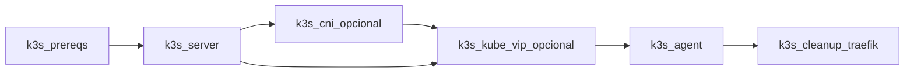
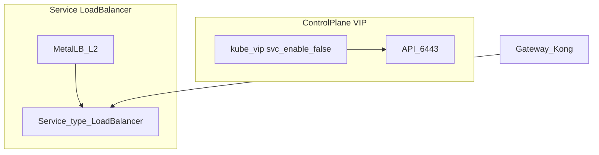

# K3s Playbook Options (bootstrap)

Appendix to **[Phase 3 — K3s](../implementacion/fase-3-k3s.md)**.

The playbook [`playbook-k3s.yml`](https://github.com/maceosoft/homelab/blob/main/ansible/playbook-k3s.yml) installs **only what Argo CD cannot do**: K3s binary (lightweight Kubernetes distribution), kube-vip CP (control plane), Argo CD controller, node labels, etc. Addons (MetalLB, Gateway, Longhorn, vCluster, …) live in the [`gitops`](https://github.com/maceosoft/gitops) repo.

Configuration: [`ansible/group_vars/incus_cluster/k3s_install.yml`](https://github.com/maceosoft/homelab/blob/main/ansible/group_vars/incus_cluster/k3s_install.yml)

Role catalog: [Ansible — roles](../ansible/index.md)

```bash
cd ansible
ansible-playbook -i inventory.ini playbook-k3s.yml
```

## Table A — Playbook Options

| Option | Variable | Tag | Default | When to enable |
|---|---|---|---|---|
| Core K3s | `k3s_install.core.*` | `core` | Current HomeLab | Always (server/agent) |
| kube-vip CP | `k3s_install.kube_vip.enabled` | `kube_vip` | `false` | Stable VIP on `:6443`; **no** Service LB |
| Argo CD controller | `k3s_install.gitops_argocd.enabled` | `argocd` | `false` | GitOps bootstrap; apps in gitops |
| Node labels | `k3s_install.node_labels.enabled` | `labels` | `false` | Longhorn/arch/tier labels via `host_vars` |
| Traefik cleanup | `k3s_install.traefik_cleanup.enabled` | `traefik` | `true` | After install with `--disable traefik` |
| Fetch kubeconfig | `k3s_install.fetch_kubeconfig.enabled` | `kubeconfig` | `false` | Copy kubeconfig to operator |
| OS hardening | `k3s_install.os_hardening.enabled` | `hardening` | `false` | Staggered `unattended-upgrades` |
| External CNI | `k3s_install.core.cni` | `cni` | `flannel` | Canal, Calico or Cilium (not embedded Flannel) |

<div class="card">
  <div class="card-kicker">Table A</div>
  <div class="option-grid">
    <div class="card-col">
      <div class="card-title">kube-vip</div>
      <div class="text-muted">API VIP without depending on CP node IP</div>
      <div class="text-muted">Does not replace MetalLB</div>
    </div>
    <div class="card-col">
      <div class="card-title">Argo CD in Ansible</div>
      <div class="text-muted">Controller ready before Phase 4</div>
      <div class="text-muted">More time in Phase 3</div>
    </div>
    <div class="card-col">
      <div class="card-title">Traefik cleanup</div>
      <div class="text-muted">Avoids conflict with Gateway controller</div>
      <div class="text-muted">Extra play after agents</div>
    </div>
    <div class="card-col">
      <div class="card-title">fetch_kubeconfig</div>
      <div class="text-muted">Kubeconfig on workstation</div>
      <div class="text-muted">Local file with credentials</div>
    </div>
    <div class="card-col">
      <div class="card-title">OS hardening</div>
      <div class="text-muted">Staggered automatic patches</div>
      <div class="text-muted">Scheduled reboots</div>
    </div>
    <div class="card-col">
      <div class="card-title">External CNI</div>
      <div class="text-muted">NetworkPolicy (Calico/Cilium) or Canal</div>
      <div class="text-muted">Requires <code>--flannel-backend=none</code>; <code>cni</code> play before agents</div>
    </div>
  </div>
</div>

### Core (`k3s_install.core`)

| Field | Default | Description |
|---|---|---|
| `version` | `v1.36.5+k3s1` | K3s version (stable channel) |
| `disable_components` | traefik, servicelb | `--disable` on server |
| `cluster_cidr` | `10.42.0.0/16` | Pod CIDR |
| `service_cidr` | `10.43.0.0/16` | Service CIDR |
| `cni` | `flannel` | `flannel`, `canal`, `calico`, `cilium` |
| `flannel_backend` | `vxlan` | Only if `cni: flannel`: `vxlan`, `host-gw`, `wireguard-native` |
| `embedded_registry` | `false` | Local image cache (`--embedded-registry`) |
| `tls_sans_extra` | `[]` | Additional SANs in API certificate |

## CNI

K3s ships with **embedded Flannel**. Canal, Calico and Cilium require
`--flannel-backend=none` and `--disable-network-policy` (role [`k3s_cni`](https://github.com/maceosoft/homelab/blob/main/ansible/roles/k3s_cni/README.md),
tag `cni`, **after** server and **before** agents).

| CNI | `k3s_install.core.cni` | Installation |
|---|---|---|
| [Flannel](https://github.com/flannel-io/flannel) | `flannel` (default) | Embedded; adjust `flannel_backend` |
| [Canal](https://docs.tigera.io/calico/latest/getting-started/kubernetes/flannel/flannel) | `canal` | Canal manifest (Ansible or Application `canal`) |
| [Calico](https://docs.tigera.io/calico/latest/about/) | `calico` | Tigera operator + custom resources |
| [Cilium](https://docs.cilium.io/) | `cilium` | Official Helm chart |

Enable it by editing [`group_vars/incus_cluster/k3s_install.yml`](https://github.com/maceosoft/homelab/blob/main/ansible/group_vars/incus_cluster/k3s_install.yml)
(`core.cni: calico`, `gitops_argocd.enabled: true`) and then:

```bash
ansible-playbook -i inventory.ini playbook-k3s.yml
```

!!! warning "`-e k3s_install.x.y=valor` does not work"
    Ansible does not merge dotted keys into an existing dict — it creates a
    separate new variable (literally named `"k3s_install.x.y"`) and
    `k3s_install` remains untouched: **the default CNI was installed silently**. A `-e` with
    JSON doesn't help either: it **replaces** the entire dict, so `core.version`,
    `cluster_cidr`, etc. are lost. The playbook now detects both cases and **fails** before touching the nodes.

To change a single option from the command line there are top-level variables:

| Variable | Values | Equivalent to |
|---|---|---|
| `k3s_cni` | `flannel`, `canal`, `calico`, `cilium` | `k3s_install.core.cni` |
| `k3s_gitops_argocd_enabled` | `true` / `false` | `k3s_install.gitops_argocd.enabled` |
| `k3s_node_labels_enabled` | `true` / `false` | `k3s_install.node_labels.enabled` |

```bash
ansible-playbook -i inventory.ini playbook-k3s.yml \
  -e k3s_cni=canal \
  -e k3s_gitops_argocd_enabled=true \
  -e k3s_node_labels_enabled=true
```

The CNI is chosen **before creating the cluster**: changing it later on a running cluster does not reinstall the network and can leave two CNIs fighting. If you already installed with another, the change is a migration, not a flag.

Calico is managed by Argo CD after bootstrap (Applications `calico-operator` + `calico-config`, manual sync; see
[Calico with Argo CD](../operacion/actualizar-calico.md)). GitOps alternatives (manual sync):
`canal` or `cilium` in [`gitops/argocd/apps/`](https://github.com/maceosoft/gitops/tree/main/argocd/apps) —
only if you installed K3s with `cni` different from `flannel` via Ansible **or** you apply the
manifest after `--flannel-backend=none`. **Do not** enable more than one CNI (Container Network Interface) app at a time.

### Trade-off Analysis — CNI

| CNI | Advantage | Cost / Risk |
|---|---|---|
| Flannel | Zero extra steps; low overhead | No native NetworkPolicy |
| Canal | Calico policies on Flannel | Legacy; two components |
| Calico | Mature NetworkPolicy; optional BGP | More pods/RAM |
| Cilium | eBPF; Hubble; L3–L7 policies | CPU/kernel; validate ARM64 |
| `vxlan` vs `host-gw` | `host-gw`: less encapsulation at L2 | `host-gw` requires direct L2 between nodes |
| Ansible `k3s_cni` vs GitOps app | Same play as K3s bootstrap | GitOps useful if you reinstall CNI without Ansible |

### Execution Order (playbook)



The `cni` play is skipped if `k3s_install.core.cni` is `flannel` (default).

### kube-vip

Control plane **VIP** (virtual IP) only (`cp_enable=true`, `svc_enable=false`). Does not
replace MetalLB or K3s ServiceLB.

| Field | Default | Description |
|---|---|---|
| `address` | `192.168.20.4` | Free IP on LAN |
| `interface` | `br0` | L2 interface |
| `mode` | `arp` | `arp` or `bgp` |

### Trade-off Analysis — kube-vip

| Alternative | Advantage | Cost / Risk |
|---|---|---|
| `arp` | Simple on HomeLab L2 LAN | Depends on router ARP response |
| `bgp` | Integration with router BGP | Requires configured router/peering |

With `kube_vip.enabled=true`, `k3s_api_url` points to the VIP and agents
join via it.

### Per-host (`host_vars/`)

```yaml
k3s_agent_kubelet_args:
  - max-pods=110
k3s_node_labels:
  workload-tier: light
  node.longhorn.io/create-default-disk: "false"
```

## Table B — gitops (not playbook)

Full catalog and step-by-step guide in [Phase 4 — GitOps](../implementacion/fase-4-gitops.md).

| Component | Application | Sync |
|---|---|---|
| Sealed Secrets | `sealed-secrets` | auto (wave 0) |
| OpenEBS | `openebs` | auto (wave 0) |
| StorageClasses | `homelab-storage` | auto (wave 0) |
| MetalLB | `metallb` + `metallb-config` | auto |
| Gateway API + cert-manager | `gateway-api`, `cert-manager`, `cert-manager-config` | auto (waves 0–1) |
| Gateway Controller | `kong` (or `traefik`, `nginx-gateway`) | auto (wave 1; only one) |
| Longhorn | `longhorn` | auto (wave 1) |
| Argo CD Dex/route | `argocd-route`, `argocd` | auto (wave 2) |
| K3s upgrades | `k3s-upgrade` | auto (wave 3) |
| vCluster Platform | `vcluster-platform` | manual |
| CAPN demo | `capn-demo` | manual |
| CNI Calico | `calico-operator`, `calico-config` | manual (enabled) |
| Alternative CNIs (optional) | `canal`, `cilium` | manual |

### Trade-off Analysis — kube-vip vs MetalLB

| Alternative | Advantage | Cost / Risk |
|---|---|---|
| kube-vip | Stable VIP for API only `:6443` | Does not expose Gateways or Services |
| MetalLB | LoadBalancer for Gateway and apps | Pool `192.168.23.200–.220` must be free (outside DHCP) |
| CNI via Ansible (`k3s_cni`) | Same play as K3s bootstrap | Changing CNI live is disruptive |
| CNI via GitOps (manual apps) | Reinstall without Ansible | Only if K3s already has `flannel-backend=none` |

## After the Ansible Playbook

Continue in [Phase 4 — GitOps](../implementacion/fase-4-gitops.md).

## Dex OAuth Playbook (Phase 4)

[`playbook-dex-oauth-secrets.yml`](https://github.com/maceosoft/homelab/blob/main/ansible/playbook-dex-oauth-secrets.yml) —
generates `VCLUSTER_CLIENT_SECRET` in 1Password if missing,
applies `argocd-secret` and configures Incus OIDC (OpenID Connect) on invincible. Requires
`KUBECONFIG` exported and the 1Password app unlocked.

| Tag | What it does |
|---|---|
| `ensure` | Generates the missing secret in 1Password (`VCLUSTER_CLIENT_SECRET`) |
| `argocd` | Applies `dex.*` keys in `argocd-secret` and restarts Dex |
| `incus` | Installs HomeLab CA on invincible, **restarts `incus`** (if CA changed) and configures `oidc.issuer` and `oidc.client.id` |
| `incus_ca` | Only installs HomeLab CA on invincible (and restarts `incus` if changed) |
| `vcluster` | Applies `VCLUSTER_CLIENT_SECRET` on vCluster Platform (requires `apply_vcluster: true`) |

```bash
cd ansible
ansible-playbook -i inventory.ini playbook-dex-oauth-secrets.yml --tags ensure,argocd,incus
ansible-playbook -i inventory.ini playbook-dex-oauth-secrets.yml --tags incus_ca
ansible-playbook -i inventory.ini playbook-dex-oauth-secrets.yml --tags vcluster \
  -e dex_oauth.apply_vcluster=true
```

`apply_incus` is in `true` by default on `group_vars`.

Variables: [`group_vars/dex_oauth_secrets.yml`](https://github.com/maceosoft/homelab/blob/main/ansible/group_vars/dex_oauth_secrets.yml).

## Examples

```bash
# Mínimo (con los defaults de group_vars/incus_cluster/k3s_install.yml)
ansible-playbook -i inventory.ini playbook-k3s.yml

# Solo un play puntual (ej. reintentar kube-vip), con las opciones ya
# habilitadas en group_vars/incus_cluster/k3s_install.yml:
ansible-playbook -i inventory.ini playbook-k3s.yml --tags kube_vip

# Post-install GitOps
kubectl apply -f gitops/bootstrap/root-appset.yaml
```

For VIP + Argo CD controller: enable `kube_vip.enabled: true` and
`gitops_argocd.enabled: true` in `group_vars/incus_cluster/k3s_install.yml`
before running the playbook (see the warning above about why `-e` does not
work for this).

## kube-vip vs MetalLB



kube-vip **must never** manage `LoadBalancer` Services (`svc_enable=false`).

## Incus Cluster Playbook (Phase 2)

[`playbook-incus-cluster.yml`](https://github.com/maceosoft/homelab/blob/main/ansible/playbook-incus-cluster.yml) — bootstrap,
join, cluster groups, manual scheduler and UI (user interface). Run after `playbook-bootstrap.yml`.

```bash
cd ansible
ansible-playbook -i inventory.ini playbook-incus-cluster.yml
```

| Tag | What it does |
|---|---|
| `bootstrap` | Preseed init on invincible |
| `join` | Tokens + join oliver/deborah (`serial: 1`) |
| `groups` | `x86-nodes`, `arm64-nodes`, assignments |
| `scheduler` | `oliver` → `scheduler.instance manual` |
| `ui` | `incus-ui-canonical` + `core.https_address` |

Variables: [`group_vars/incus_cluster/vars.yml`](https://github.com/maceosoft/homelab/blob/main/ansible/group_vars/incus_cluster/vars.yml).
Guide: [Phase 2 — Incus](../implementacion/fase-2-incus.md).
