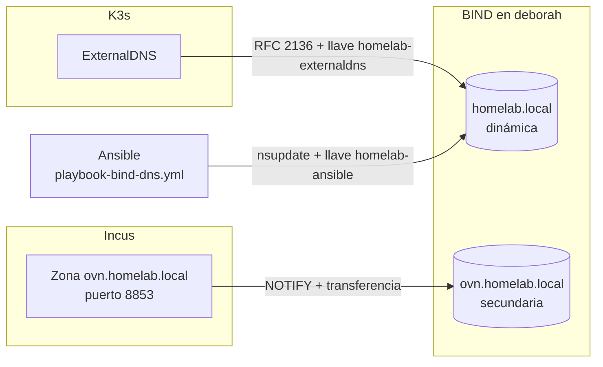

# Automatic DNS

Everything created in the HomeLab registers itself in DNS (BIND on `deborah`, `192.168.20.5`): an app published in Kubernetes, a new Incus instance, a new inventory node. No one edits records manually.

| What gets created | Who registers it | Name |
|---|---|---|
| App published on the Gateway (`HTTPRoute`) or Service `LoadBalancer` with annotation `external-dns.alpha.kubernetes.io/hostname` | **ExternalDNS** (Kubernetes) | `<app>.homelab.local` → Gateway IP (`192.168.23.200`) |
| Incus instance on the `ovn-lan` network | **Incus** (own zone) and BIND copies it | `<instancia>.ovn.homelab.local` → OVN internal IP |
| Inventory node, its WiFi, `k3s`, `incus`, `s3`, `ns` | **Ansible** (`playbook-bind-dns.yml`) | `<nodo>.homelab.local`, `<nodo>-wifi.homelab.local` |

!!! info "`ovn-lan` IPs are not reachable from the LAN"
    `ovn-lan` is isolated on purpose (NAT, no route from the router). Its names resolve from any machine, but point to internal IPs (`192.168.19.x`): they serve inside the OVN network and as inventory, not for connecting from the LAN.

## How it works



- **`homelab.local` is a dynamic zone**: accepts changes via RFC 2136 (the standard protocol for modifying a live DNS) signed with a TSIG key (Transaction SIGnature, a shared secret). There are two keys, both in the `bind-tsig` item in 1Password:
    - `homelab-ansible` writes the fixed names.
    - `homelab-externaldns` writes everything else, but BIND **forbids** it from touching fixed names (`update-policy`): if ExternalDNS tried to change `deborah.homelab.local`, BIND replies `REFUSED`.
- **ExternalDNS** watches `HTTPRoute` and Services every minute. Alongside each record it creates a TXT `externaldns-a-<nombre>` with its owner (`homelab-k3s`): it only modifies or deletes what carries that mark, and deletes the record when the app disappears (`policy: sync`).
- **Incus** generates the `ovn.homelab.local` zone with `ovn-lan` instances and serves it on port `8853` of each member. BIND copies it as a secondary; when it changes, Incus notifies it (NOTIFY) and the change arrives in about 30 seconds.
- `mco.local` and the reverse zone remain static (Ansible writes them in full).

Tested on 18 Nov 2026 on test zones (later deleted): a new `HTTPRoute` appears in DNS in ~30 s with TTL 300 and disappears when deleted; a record without the TXT mark survives several ExternalDNS cycles; the ExternalDNS key receives `REFUSED` on a fixed name; a new record in the Incus zone reaches BIND in ~30 s.

## Components

| Where | What |
|---|---|
| [`ansible/roles/bind_dns`](https://github.com/maceosoft/homelab/tree/main/ansible/roles/bind_dns) | TSIG keys, dynamic zone with `update-policy`, fixed records (`homelab-records.nsupdate`), Incus secondary zone |
| [`ansible/roles/incus_dns_zone`](https://github.com/maceosoft/homelab/tree/main/ansible/roles/incus_dns_zone) | `core.dns_address` on each member, the `ovn.homelab.local` zone and its association with `ovn-lan` |
| [`ansible/scripts/apply_platform_secrets.py`](https://github.com/maceosoft/homelab/blob/main/ansible/scripts/apply_platform_secrets.py) | Secret `external-dns/external-dns-tsig` with the ExternalDNS key |
| [`gitops/bootstrap/components/external-dns.yaml`](https://github.com/maceosoft/gitops/blob/main/bootstrap/components/external-dns.yaml) | ExternalDNS (chart 1.23.0), values in `addons/network/external-dns/values.yaml` |

## Bring it up (once)

1. **Keys in 1Password** (item `bind-tsig`, vault `HomeLab`, two fields with 32 random bytes in base64):

    ```bash
    op item create --vault HomeLab --category password --title bind-tsig \
      "ansible[password]=$(openssl rand -base64 32)" \
      "externaldns[password]=$(openssl rand -base64 32)"
    ```

2. **ExternalDNS Secret** (also creates the `external-dns` namespace):

    ```bash
    cd ansible
    export ONEPASSWORD_ACCOUNT_NAME="<nombre de tu cuenta en 1Password>"
    ansible-playbook -i inventory.ini playbook-platform-secrets.yml
    ```

3. **ExternalDNS in the cluster**: merge the `bootstrap/components/external-dns.yaml` file into `gitops`. Until step 4, BIND rejects its key and ExternalDNS reports it in its log; nothing breaks.

4. **BIND and Incus**: turn `homelab.local` dynamic, write the fixed names, remove those now published by ExternalDNS (`argocd`, `grafana`, `open-webui`, `ollama`, and those that no longer exist: `api`, `vcluster`) and enable the Incus zone:

    ```bash
    ansible-playbook -i inventory.ini playbook-bind-dns.yml --check --diff
    ansible-playbook -i inventory.ini playbook-bind-dns.yml
    ```

    Between this step and the next ExternalDNS cycle (one minute at most) those names won't resolve. Happens only once.

5. **Verify:**

    ```bash
    dig +short argocd.homelab.local @192.168.20.5                       # 192.168.23.200 (ExternalDNS)
    dig +short TXT externaldns-a-argocd.homelab.local @192.168.20.5     # "heritage=external-dns,...owner=homelab-k3s..."
    dig +short deborah.homelab.local @192.168.20.5                      # 192.168.20.5 (Ansible)
    dig +short web1.ovn.homelab.local @192.168.20.5                     # IP interna de OVN (Incus)
    KUBECONFIG=~/.kube/homelab-k3s.yaml kubectl -n external-dns logs deploy/external-dns --tail=20
    ```

## Day to day

- **Publish an app**: its `HTTPRoute` with `hostnames: [<app>.homelab.local]`. The name appears on its own; when the route is deleted, it goes away.
- **New Incus instance**: create it in `ovn-lan` (`incus launch … --network ovn-lan`) and it becomes `<instancia>.ovn.homelab.local`. Instances in `br0` take the router's DHCP IP and are not registered.
- **New node or new fixed IP**: add it to inventory and run `playbook-bind-dns.yml` again.
- **A fixed name someone deleted manually**:
  `ansible-playbook -i inventory.ini playbook-bind-dns.yml -e bind_dns_force_records=true`.
- **Don't edit `/var/lib/bind/db.homelab.local`**: it's a dynamic zone (BIND stores changes in its journal `.jnl`). To see the full zone: `dig @192.168.20.5 homelab.local AXFR -y hmac-sha256:homelab-ansible:<secreto>`.

## If it fails

| Symptom | Cause |
|---|---|
| ExternalDNS: `dns: bad authentication` or `REFUSED` | The Secret key doesn't match BIND's: same `externaldns` field of item `bind-tsig`; rerun steps 2 and 4 |
| ExternalDNS doesn't create an app's name | That name is in Ansible's fixed list (BIND forbids it) or the `HTTPRoute` isn't accepted by the Gateway |
| `nsupdate` from Ansible: `REFUSED` | The zone isn't dynamic yet (missing `named` restart) or the `homelab-ansible` key doesn't match 1Password |
| `ovn.homelab.local` doesn't respond | BIND couldn't copy the zone: `journalctl -u named | grep ovn.homelab.local` on deborah. `has no NS records`: missing `dns.nameservers` in the Incus zone |
| A new instance doesn't appear | It's not in `ovn-lan`, or Incus port `8853` is closed to deborah (host firewall: rule `incus-dns`) |
