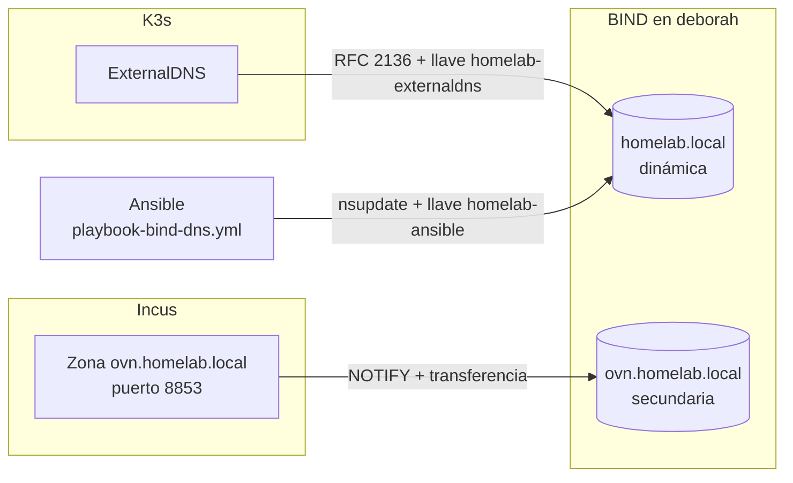

# DNS automático

Lo que se crea en el HomeLab se registra solo en el DNS (BIND en `deborah`, `192.168.20.5`): una app publicada en
Kubernetes, una instancia nueva de Incus, un nodo nuevo del inventario. Nadie edita registros a mano.

| Qué se crea | Quién lo registra | Nombre |
|---|---|---|
| App publicada en el Gateway (`HTTPRoute`) o Service `LoadBalancer` con la anotación `external-dns.alpha.kubernetes.io/hostname` | **ExternalDNS** (Kubernetes) | `<app>.homelab.local` → IP del Gateway (`192.168.23.200`) |
| Instancia de Incus en la red `ovn-lan` | **Incus** (zona propia) y BIND la copia | `<instancia>.ovn.homelab.local` → IP interna de OVN |
| Nodo del inventario, su WiFi, `k3s`, `incus`, `s3`, `ns` | **Ansible** (`playbook-bind-dns.yml`) | `<nodo>.homelab.local`, `<nodo>-wifi.homelab.local` |

!!! info "Las IPs de `ovn-lan` no se alcanzan desde la LAN"
    `ovn-lan` está aislada a propósito (NAT, sin ruta desde el router). Sus nombres se resuelven desde cualquier equipo,
    pero apuntan a IPs internas (`192.168.19.x`): sirven dentro de la red OVN y como inventario, no para conectarse
    desde la LAN.

## Cómo funciona



- **`homelab.local` es una zona dinámica**: acepta cambios por RFC 2136 (el protocolo estándar para modificar un DNS
  en vivo) firmados con una llave TSIG (Transaction SIGnature, un secreto compartido). Hay dos llaves, las dos en el
  item `bind-tsig` de 1Password:
    - `homelab-ansible` escribe los nombres fijos.
    - `homelab-externaldns` escribe todo lo demás, pero BIND **le prohíbe** los nombres fijos (`update-policy`): si
      ExternalDNS intentara cambiar `deborah.homelab.local`, BIND responde `REFUSED`.
- **ExternalDNS** mira los `HTTPRoute` y los Service cada minuto. Junto a cada registro crea un TXT
  `externaldns-a-<nombre>` con su dueño (`homelab-k3s`): solo modifica o borra lo que tiene esa marca, y borra el
  registro cuando desaparece la app (`policy: sync`).
- **Incus** genera la zona `ovn.homelab.local` con las instancias de `ovn-lan` y la sirve en el puerto `8853` de cada
  miembro. BIND la copia como secundario; cuando cambia, Incus le avisa (NOTIFY) y el cambio llega en unos 30 segundos.
- `mco.local` y la zona inversa siguen siendo estáticas (las escribe Ansible completas).

Probado el 18 nov 2026 en zonas de prueba (después borradas): un `HTTPRoute` nuevo aparece en el DNS en ~30 s con TTL
300 y desaparece al borrarlo; un registro sin la marca TXT sobrevive a varios ciclos de ExternalDNS; la llave de
ExternalDNS recibe `REFUSED` sobre un nombre fijo; un registro nuevo en la zona de Incus llega a BIND en ~30 s.

## Piezas

| Dónde | Qué |
|---|---|
| [`ansible/roles/bind_dns`](https://github.com/maceosoft/homelab/tree/main/ansible/roles/bind_dns) | Llaves TSIG, zona dinámica con `update-policy`, registros fijos (`homelab-records.nsupdate`), zona secundaria de Incus |
| [`ansible/roles/incus_dns_zone`](https://github.com/maceosoft/homelab/tree/main/ansible/roles/incus_dns_zone) | `core.dns_address` en cada miembro, la zona `ovn.homelab.local` y su asociación con `ovn-lan` |
| [`ansible/scripts/apply_platform_secrets.py`](https://github.com/maceosoft/homelab/blob/main/ansible/scripts/apply_platform_secrets.py) | Secret `external-dns/external-dns-tsig` con la llave de ExternalDNS |
| [`gitops/bootstrap/components/external-dns.yaml`](https://github.com/maceosoft/gitops/blob/main/bootstrap/components/external-dns.yaml) | ExternalDNS (chart 1.23.0), valores en `addons/network/external-dns/values.yaml` |

## Ponerlo en marcha (una vez)

1. **Las llaves en 1Password** (item `bind-tsig`, bóveda `HomeLab`, dos campos con 32 bytes al azar en base64):

    ```bash
    op item create --vault HomeLab --category password --title bind-tsig \
      "ansible[password]=$(openssl rand -base64 32)" \
      "externaldns[password]=$(openssl rand -base64 32)"
    ```

2. **El Secret de ExternalDNS** (crea también el namespace `external-dns`):

    ```bash
    cd ansible
    export ONEPASSWORD_ACCOUNT_NAME="<nombre de tu cuenta en 1Password>"
    ansible-playbook -i inventory.ini playbook-platform-secrets.yml
    ```

3. **ExternalDNS en el clúster**: mergear en `gitops` el archivo `bootstrap/components/external-dns.yaml`. Hasta el paso
   4, BIND rechaza su llave y ExternalDNS lo reporta en su log; no pasa nada.

4. **BIND e Incus**: convierte `homelab.local` en dinámica, escribe los nombres fijos, quita los que ahora publica
   ExternalDNS (`argocd`, `grafana`, `open-webui`, `ollama`, y los que ya no existen: `api`, `vcluster`) y activa la
   zona de Incus:

    ```bash
    ansible-playbook -i inventory.ini playbook-bind-dns.yml --check --diff
    ansible-playbook -i inventory.ini playbook-bind-dns.yml
    ```

    Entre este paso y el siguiente ciclo de ExternalDNS (un minuto como mucho) esos nombres no resuelven. Pasa una sola
    vez.

5. **Comprobar:**

    ```bash
    dig +short argocd.homelab.local @192.168.20.5                       # 192.168.23.200 (ExternalDNS)
    dig +short TXT externaldns-a-argocd.homelab.local @192.168.20.5     # "heritage=external-dns,...owner=homelab-k3s..."
    dig +short deborah.homelab.local @192.168.20.5                      # 192.168.20.5 (Ansible)
    dig +short web1.ovn.homelab.local @192.168.20.5                     # IP interna de OVN (Incus)
    KUBECONFIG=~/.kube/homelab-k3s.yaml kubectl -n external-dns logs deploy/external-dns --tail=20
    ```

## Día a día

- **Publicar una app**: su `HTTPRoute` con `hostnames: [<app>.homelab.local]`. El nombre aparece solo; al borrar la
  ruta, se va.
- **Instancia nueva de Incus**: créala en `ovn-lan` (`incus launch … -p default -p ovn-lan`, el perfil que además le
  fija el MTU: ver [Instancias en `ovn-lan`](../incus/cluster-setup.md#instancias-en-ovn-lan-el-perfil-y-el-mtu)) y queda
  como `<instancia>.ovn.homelab.local`. Las instancias en `br0` toman la IP del DHCP del router y no se registran.
- **Nodo nuevo o IP fija nueva**: agrégalo al inventario y vuelve a correr `playbook-bind-dns.yml`.
- **Un nombre fijo que alguien borró a mano**:
  `ansible-playbook -i inventory.ini playbook-bind-dns.yml -e bind_dns_force_records=true`.
- **No edites `/var/lib/bind/db.homelab.local`**: es una zona dinámica (BIND guarda los cambios en su diario `.jnl`).
  Para ver la zona completa: `dig @192.168.20.5 homelab.local AXFR -y hmac-sha256:homelab-ansible:<secreto>`.

## Si falla

| Síntoma | Causa |
|---|---|
| ExternalDNS: `dns: bad authentication` o `REFUSED` | La llave del Secret no coincide con la de BIND: mismo campo `externaldns` del item `bind-tsig`; vuelve a correr los pasos 2 y 4 |
| ExternalDNS no crea un nombre de una app | Ese nombre está en la lista de fijos de Ansible (BIND se lo prohíbe) o el `HTTPRoute` no está aceptado por el Gateway |
| `nsupdate` de Ansible: `REFUSED` | La zona todavía no es dinámica (falta reiniciar `named`) o la llave `homelab-ansible` no coincide con 1Password |
| `ovn.homelab.local` no responde | BIND no pudo copiar la zona: `journalctl -u named | grep ovn.homelab.local` en deborah. `has no NS records`: falta `dns.nameservers` en la zona de Incus |
| Una instancia nueva no aparece | No está en `ovn-lan`, o el puerto `8853` de Incus está cerrado para deborah (firewall de hosts: regla `incus-dns`) |
