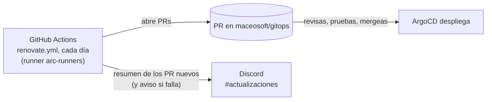

# New version notices (Renovate)

Every day, [Renovate](https://docs.renovatebot.com/) checks whether a new version of the products installed in the cluster has been released and opens a PR (pull request) in [`maceosoft/gitops`](https://github.com/maceosoft/gitops) for each one. At the end of each run, the workflow itself posts a summary in the `actualizaciones` Discord channel. **It does not update anything on its own**: you review the PR, test it, and merge it, and only then does Argo CD deploy.



!!! info "Menu names are in English"
    This guide uses the texts exactly as they appear in the English interface of GitHub and Discord (**Settings**, **Webhooks**…).
    These platforms change their UI from time to time: if a button doesn't match, look for the equivalent on that same screen.

## What it detects and what it doesn't

| Detects | Where it looks in `gitops` |
|---|---|
| Helm charts of Argo CD Applications (Kong, VictoriaMetrics, cert-manager, MetalLB, OpenEBS, Sealed Secrets, Longhorn, ARC…), including ranges like `0.95.x` or `v1.21.x` | `argocd/apps/*.yaml` |
| Calico (tigera-operator and CRDs) | `cni/calico-operator/kustomization.yaml` |
| Gateway API CRDs | `gateway-api/kustomization.yaml` |
| Images with fixed version (e.g. `busybox`) | `arc/values-scaleset.yaml` |
| GitHub Actions actions (`actions/checkout@v7`…) | `.github/workflows/` |

| Doesn't detect | Why |
|---|---|
| **Debian patches on nodes** | Already covered by OS automatic updates and monitoring alerts |
| **K3s** | Updated by SUC plans via the `stable` channel ([Update K3s](actualizar-k3s.md)); no version in Git |
| **Argo CD** | Follows the `stable` branch of the official manifest ([Update Argo CD](actualizar-argocd.md)) |
| **Images with `latest` tag** (the ARC runner) | No version to compare |
| Optional apps **not active** in `bootstrap/root-appset.yaml` (Traefik, NGINX Gateway, vCluster, Cilium, Canal) | Ignored to avoid noise. If you enable one, remove its path from the corresponding rule in `renovate.json5` |
| `homelab` (this repo) | Its Python dependencies are still watched by Dependabot (see [below](#and-dependabot-of-homelab)) |

### What stays as notice only

These components have their own procedure. Renovate **opens the PR as a draft** with the label
`procedimiento-manual` and **does not merge** until the guide is followed:

| Component | Procedure |
|---|---|
| Calico | [Calico (CNI) with Argo CD](actualizar-calico.md): manual sync, and only from one minor version to the next |
| Longhorn | From one minor version to the next, with healthy and backed-up volumes, reading the Longhorn release notes first |

Additionally, **every major version** arrives in a separate PR, as a draft and with the label `mayor`. No PR merges automatically (no automerge).

## The credential: a custom GitHub App

Renovate needs to write to `gitops`: create branches, open PRs, and touch `.github/workflows` files. There are two reasonable options:

| Option | Verdict |
|---|---|
| Reuse the ARC App (`maceosoft-arc-runners`) | **No.** It has organization permissions (*Administration*, *Self-hosted runners*: Read and write) that Renovate doesn't need, and its key lives in the cluster, not in GitHub Actions. Using it otherwise expands what anyone who reaches it can do |
| **A new `maceosoft-renovate` App**, installed only on `gitops` | **Chosen.** Minimal permissions, no organization permissions, revocable without touching anything else |

An App is used instead of a personal token (PAT, *Personal Access Token*) because it doesn't depend on a person, expires on its own (the installation token lasts 1 hour), and leaves PRs authored by the bot. Moreover, PRs opened by an App **do trigger** the `gitops` pipeline, so each one arrives with its validation and its Argo CD diff.

## Create the GitHub App

Do this with an **organization owner** account `maceosoft`.

[maceosoft → Settings → Developer settings → GitHub Apps → New GitHub App](https://github.com/organizations/maceosoft/settings/apps/new)

| Field | Value |
|---|---|
| GitHub App name | `maceosoft-renovate` |
| Homepage URL | `https://github.com/maceosoft` |
| Webhook → Active | unchecked |
| Where can this GitHub App be installed? | Only on this account |

The rest of the form is left blank or unchecked.

| Repository permission | Access | Purpose |
|---|---|---|
| Contents | Read and write | Create branches and commits for each update |
| Pull requests | Read and write | Open and maintain PRs |
| Workflows | Read and write | Update `.github/workflows` files (without it, GitHub rejects the push) |
| Issues | Read and write | The *Dependency Dashboard*: an issue listing what's detected and pending |
| Checks | Read and write | Publish and read branch check status |
| Commit statuses | Read and write | Publish and read commit statuses used by Renovate |
| Administration | Read-only | Read repo configuration (branch protection) |
| Metadata | Read-only | Required |

No organization permissions. All others remain *No access*. These are the ones
[Renovate documentation](https://docs.renovatebot.com/modules/platform/github/) requests for an App, without the
optional ones (*Dependabot alerts*, *Merge queues*, *Members*), which aren't used here.

After *Create GitHub App* (creating the App, generating its key, and installing it is done **only from the web**):

1. On the App page, under *Private keys* → **Generate a private key**. A file `.pem` downloads.
2. Left menu → **Install App** → *Install* next to `maceosoft` → **Only select repositories** → choose **`gitops`**
   → *Install*. Install it **only on `gitops`**.
3. Save the App in 1Password (vault `HomeLab`, Secure Note `maceosoft-renovate`, as in
   [maceosoft Platform — GitHub](../maceosoft/github.md#how-to-create-an-item-with-custom-fields)).
   The *Installation ID* isn't needed: the workflow resolves it automatically.

    === "🖱️ From the UI"

        | 1Password Field | Type | Data |
        |---|---|---|
        | `app_id` | Text | **App ID**, on the App's *General* tab |
        | `private_key` | Password | The full content of the `.pem`, including the `BEGIN` and `END` lines |

    === "⌨️ From the console"

        With 1Password unlocked (if you have more than one 1Password account, export `OP_ACCOUNT` first; `gh` needs
        `gh auth refresh -s admin:read:org` once). The `.pem` is read from the file:

        ```bash
        APP=maceosoft-renovate
        APP_ID=$(gh api orgs/maceosoft/installations --jq ".installations[] | select(.app_slug==\"$APP\") | .app_id")
        op item create --category "Secure Note" --vault HomeLab --title "$APP" \
          "app_id[text]=$APP_ID" "private_key[password]=$(cat ~/Downloads/$APP.*.private-key.pem)"
        ```

4. Create the **GitHub Actions secrets** in repo `gitops`, one per row:

    | Secret | Value |
    |---|---|
    | `RENOVATE_APP_ID` | The `app_id` |
    | `RENOVATE_APP_PRIVATE_KEY` | The full content of the `.pem` (multiple lines: GitHub accepts it as-is) |

    === "🖱️ From the UI"

        *Settings → Secrets and variables → Actions → New repository secret*, one per table row.

    === "⌨️ From the console"

        Read from the 1Password item via pipe:

        ```bash
        APP=maceosoft-renovate
        op read "op://HomeLab/$APP/app_id" | gh secret set RENOVATE_APP_ID --repo maceosoft/gitops
        op read "op://HomeLab/$APP/private_key" | gh secret set RENOVATE_APP_PRIVATE_KEY --repo maceosoft/gitops
        gh secret list --repo maceosoft/gitops
        ```

5. **Delete the `.pem`** from Downloads. Via console: `shred -u ~/Downloads/maceosoft-renovate.*.private-key.pem`
   (on macOS use `rm -P` instead of `shred -u`).

This doesn't go through `playbook-platform-secrets.yml`: it's not a cluster Secret, GitHub Actions reads it. To rotate the
key: generate another in the App, update `private_key` in 1Password and secret `RENOVATE_APP_PRIVATE_KEY`, and delete the
old one in GitHub.

## Create the Discord channel and webhook

There's no Discord bot: notifications arrive via a **webhook** (a URL the workflow uses to post messages to a
channel; it doesn't allow reading anything). You create the channel manually, once. You need to be a server admin (or
have the **Manage Webhooks** permission).

!!! warning "Inside the private category"
    Notifications include product names and infrastructure versions, and `gitops` is a private repo. Create the
    channel **inside the private category `🖥️ Infraestructura`**, the same one as `alertas-criticas` and `alertas-avisos`,
    visible only to the `devops` role. Don't put it in the server's public channels.

### 1. The channel

1. Hover over the `🖥️ Infraestructura` category, click **+** (**Create Channel**) and choose **Text**.
2. **Channel Name:** `actualizaciones`. Since it's in the private category it inherits its permissions: confirm in
   *Edit Channel → Permissions* that only the `devops` role sees it and that `@everyone` doesn't.
3. Right-click the channel → **Notification Settings** → **Only @mentions** (or muted): check it when you want.

### 2. The webhook

1. Next to the channel click the gear (**Edit Channel**) → **Integrations** → **Webhooks** → **New Webhook**.
2. Open it and change the **Name** to `GitHub gitops` and verify **Channel** is `actualizaciones`.
3. Click **Copy Webhook URL** and **Save Changes**.

The URL is `https://discord.com/api/webhooks/<id numérico>/<token>`. **Save it in 1Password**:

=== "🖱️ From the UI"

    Secure Note
    `discord-webhooks`, field `updates`, type Password; if the item already exists from monitoring, just add the field.

=== "⌨️ From the console"

    The URL is read without echo, so it doesn't stay in history. If the item already exists from monitoring, `op item edit`
    adds the field:

    ```bash
    # pega la URL del webhook y Enter
    read -rs DC_UPD; op item edit discord-webhooks --vault HomeLab "updates[password]=$DC_UPD"; unset DC_UPD
    ```

    If the item doesn't exist yet, create it with the field:
    `op item create --category "Secure Note" --vault HomeLab --title discord-webhooks "updates[password]=$DC_UPD"`
    (before the `unset`).

It's a secret: don't paste it in Git, chat, or a ticket.

### 3. Save it as an Actions secret

The workflow reads the URL from a repo secret, so it doesn't appear in Git or in the log:

=== "🖱️ From the UI"

    1. In GitHub, repo **`maceosoft/gitops`** → **Settings** → **Secrets and variables** → **Actions** → **New repository secret**.
    2. **Name:** `DISCORD_WEBHOOK_UPDATES`. **Secret:** the webhook URL, exactly as you copied it (**without** `/github` at the end).
    3. **Add secret**.

=== "⌨️ From the console"

    Using the GitHub CLI, reading the URL without echo:

    ```bash
    # pega la URL del webhook y Enter
    read -rs DC_UPD; printf '%s' "$DC_UPD" | gh secret set DISCORD_WEBHOOK_UPDATES --repo maceosoft/gitops; unset DC_UPD
    ```

Without this secret the workflow works the same, but it doesn't notify in Discord (the step notes it in its log and continues).

!!! note "Why `updates` doesn't go through the playbook"
    The webhook is used **from GitHub Actions**, not from the cluster, so there's no Kubernetes Secret to create and
    [`apply_platform_secrets.py`](https://github.com/maceosoft/homelab/blob/main/ansible/scripts/apply_platform_secrets.py)
    is not touched. The `updates` field in 1Password is just the webhook backup copy: that script doesn't read or
    validate it, and it doesn't interfere with monitoring.

## How notifications arrive

- **Discord, `actualizaciones`:** when the daily run finishes, **a single message** with the PRs Renovate created in
  the last 26 hours (linked title, and the *draft*, *major*, or *manual procedure* labels when
  applicable), plus the total of open update PRs. If there are no new PRs, **it sends nothing**. If the run
  fails (e.g., due to an expired token), a red message arrives with the link to the log. A simulation (*dry run*)
  notification is not sent.
- **GitHub:** the *Product Updates (Renovate)* issue (*Dependency Dashboard*) lists what was detected, what's
  waiting, and open PRs. From there you can request a PR that Renovate hasn't opened yet, due to the simultaneous PR
  limit (3).

## What to do when receiving an update PR

1. **Read the PR.** It brings the version notes (*Release notes*) and the version jump. If it's Calico or Longhorn (draft,
   `procedimiento-manual`), go to its guide first: [Calico](actualizar-calico.md).
2. **Check the pipeline.** It must be green, and in the `argocd-diff` job summary check which resources change
   ([GitOps pipeline](pipeline-gitops.md)).
3. **Decide when.** A storage or network update isn't done under load or on a Friday afternoon.
4. **Merge**. Argo CD syncs; Calico Applications don't, those
   are synced manually.

    === "🖱️ From the UI"

        If it's a draft, click **Ready for review** first; then the PR's merge button.

    === "⌨️ From the console"

        With the PR number (`gh pr list --repo maceosoft/gitops --search "head:renovate/"` lists them):

        ```bash
        # solo si es borrador
        gh pr ready <número> --repo maceosoft/gitops
        gh pr merge <número> --repo maceosoft/gitops --squash
        ```

5. **Verify** in Argo CD that the Application becomes `Synced` and `Healthy`, and that monitoring alerts don't
   fire. To roll back, revert the PR.

    === "🖱️ From the UI"

        In the Argo CD UI, the Application card shows the two states.

    === "⌨️ From the console"

        ```bash
        kubectl -n argocd get applications
        ```

        The `SYNC STATUS` and `HEALTH STATUS` columns must say `Synced` and `Healthy`.

6. **If you don't want it:** close the PR without merging. Renovate won't reopen that version (it will the next one). If you
   close it by mistake, mark it in the *Dependency Dashboard*. With the console:
   `gh pr close <número> --repo maceosoft/gitops`.

!!! tip "Ranges"
    Many Applications pin a range (`0.95.x`). A Renovate PR rewrites it to the new range (`0.96.x`) only when
    a version outside it is released; patches within the range are already picked up by Argo CD without a PR.

## Test without creating PRs

A simulation (*dry run*): Renovate goes through everything and only writes to the log what it would do.

=== "🖱️ From the UI"

    *Actions → renovate → Run workflow*, with **Simulation (dry run)** checked.

=== "⌨️ From the console"

    With the GitHub CLI (`gh workflow view renovate.yml --repo maceosoft/gitops` shows its inputs):

    ```bash
    gh workflow run renovate.yml --repo maceosoft/gitops --ref main -f dry_run=true
    gh run watch --repo maceosoft/gitops
    ```

    For the log level, add `-f log_level=debug`.

With `debug` in the log level, each detected dependency is shown.

If the workflow fails at the *GitHub App Token* step, one of the two secrets is missing or wrong, or the App isn't
installed in `gitops`.

## Change the configuration

The configuration is in
[`renovate.json5`](https://github.com/maceosoft/gitops/blob/main/renovate.json5) (which managers it uses, what only notifies,
limits, groupings) and the program in
[`.github/workflows/renovate.yml`](https://github.com/maceosoft/gitops/blob/main/.github/workflows/renovate.yml).
The Renovate version is pinned in the workflow: bump the version manually from time to time.

## Disable it

| What | How |
|---|---|
| Pause | `gitops` → *Actions → renovate* → **⋯** → **Disable workflow** (with the CLI: `gh workflow disable renovate.yml --repo maceosoft/gitops`) |
| Remove Discord notifications | Delete the secret `DISCORD_WEBHOOK_UPDATES` in `gitops` → **Settings → Secrets and variables → Actions** (or `gh secret delete DISCORD_WEBHOOK_UPDATES --repo maceosoft/gitops`), and the webhook in Discord (*Edit Channel → Integrations → Webhooks*) |
| Remove entirely | Delete `renovate.json5` and `.github/workflows/renovate.yml` in a PR, the two Actions secrets, the App (*maceosoft → Settings → Developer settings → GitHub Apps → Edit → Advanced → Delete GitHub App*) and the 1Password items |

Closing open Renovate PRs and deleting their branches `renovate/*` is manual (with the CLI: `gh pr list --repo maceosoft/gitops --search "head:renovate/" --json number --jq '.[].number'` to list them and `gh pr close <número> --delete-branch --repo maceosoft/gitops` to close each one).

## And Dependabot of `homelab`

`homelab` has Dependabot enabled on pip (PRs for `black` and `certifi`). Renovate here only watches `gitops`, so
**it doesn't replace it**: they coexist without stepping on each other. If later you prefer a single system, `homelab` can be added to Renovate
(install the App in that repo too and add it to `RENOVATE_REPOSITORIES`) and then remove Dependabot.
