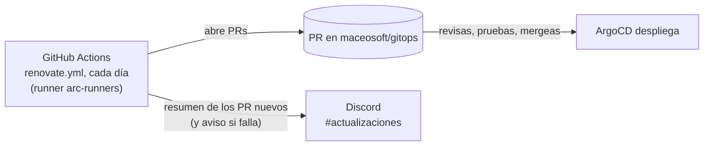

# Avisos de versiones nuevas (Renovate)

Cada día, [Renovate](https://docs.renovatebot.com/) revisa si salió una versión nueva de los productos que el clúster
tiene instalados y abre un PR (pull request) en [`maceosoft/gitops`](https://github.com/maceosoft/gitops) por cada una.
Al terminar cada corrida, el propio workflow publica un resumen en el canal `actualizaciones` de Discord. **No actualiza nada solo**: tú revisas el PR,
lo pruebas y lo mergeas, y recién entonces ArgoCD despliega.



!!! info "Los nombres de los menús están en inglés"
    Esta guía usa los textos tal como aparecen en la interfaz en inglés de GitHub y Discord (**Settings**, **Webhooks**…).
    Estas plataformas cambian su interfaz de vez en cuando: si algún botón no coincide, busca el equivalente en esa misma pantalla.

## Qué detecta y qué no

| Detecta | Dónde mira en `gitops` |
|---|---|
| Charts de Helm de las Applications de ArgoCD (Kong, VictoriaMetrics, cert-manager, MetalLB, OpenEBS, Sealed Secrets, Longhorn, ARC…), incluidos los rangos como `0.95.x` o `v1.21.x` | `argocd/apps/*.yaml` |
| Calico (tigera-operator y CRDs) | `cni/calico-operator/kustomization.yaml` |
| CRDs de Gateway API | `gateway-api/kustomization.yaml` |
| Imágenes con versión fija (p. ej. `busybox`) | `arc/values-scaleset.yaml` |
| Acciones de GitHub Actions (`actions/checkout@v7`…) | `.github/workflows/` |

| No detecta | Por qué |
|---|---|
| **Parches de Debian de los nodos** | Ya los cubren las actualizaciones automáticas del SO y las alertas del monitoreo |
| **K3s** | Lo actualizan los planes del SUC por el canal `stable` ([Actualizar K3s](actualizar-k3s.md)); no hay versión en git |
| **ArgoCD** | Sigue la rama `stable` del manifiesto oficial ([Actualizar ArgoCD](actualizar-argocd.md)) |
| **Imágenes con tag `latest`** (el runner de ARC) | No hay versión que comparar |
| Apps opcionales **no activas** en `bootstrap/root-appset.yaml` (Traefik, NGINX Gateway, vCluster, Cilium, Canal) | Se ignoran para no generar ruido. Si activas una, quita su ruta de la regla correspondiente en `renovate.json5` |
| `homelab` (este repo) | Sus dependencias de Python las sigue vigilando Dependabot (ver [más abajo](#y-dependabot-de-homelab)) |

### Qué queda solo en aviso

Estos componentes tienen procedimiento propio. Renovate **abre el PR en borrador** (*Draft*) con la etiqueta
`procedimiento-manual` y **no se mergea** hasta seguir la guía:

| Componente | Procedimiento |
|---|---|
| Calico | [Calico (CNI) con ArgoCD](actualizar-calico.md): sync manual, y solo de una versión menor a la siguiente |
| Longhorn | De una versión menor a la siguiente, con los volúmenes sanos y respaldados, leyendo antes las notas de la versión de Longhorn |

Además, **toda versión mayor** llega en un PR aparte, en borrador y con la etiqueta `mayor`. Ningún PR se mergea solo
(no hay automerge).

## La credencial: una GitHub App propia

Renovate necesita escribir en `gitops`: crear ramas, abrir PRs y tocar archivos de `.github/workflows`. Hay dos
opciones razonables:

| Opción | Veredicto |
|---|---|
| Reusar la App de ARC (`maceosoft-arc-runners`) | **No.** Tiene permisos de organización (*Administration*, *Self-hosted runners*: Read and write) que Renovate no necesita, y su llave vive en el clúster, no en GitHub Actions. Usarla de otra forma amplía lo que puede hacer quien la alcance |
| **Una App nueva `maceosoft-renovate`**, instalada solo en `gitops` | **Elegida.** Permisos mínimos, sin permisos de organización, revocable sin tocar nada más |

Se usa una App y no un token personal (PAT, *personal access token*) porque no depende de una persona, expira sola (el
token de instalación dura 1 hora) y deja a los PRs como autoría del bot. Además, los PRs que abre una App **sí
disparan** el pipeline de `gitops`, así que cada uno llega con su validación y su diff de ArgoCD.

## Crear la GitHub App

Hazlo con una cuenta **owner de la organización** `maceosoft`.

[maceosoft → Settings → Developer settings → GitHub Apps → New GitHub App](https://github.com/organizations/maceosoft/settings/apps/new)

| Campo | Valor |
|---|---|
| GitHub App name | `maceosoft-renovate` |
| Homepage URL | `https://github.com/maceosoft` |
| Webhook → Active | desmarcado |
| Where can this GitHub App be installed? | Only on this account |

El resto del formulario se deja vacío o sin marcar.

| Repository permission | Acceso | Para qué |
|---|---|---|
| Contents | Read and write | Crear las ramas y los commits de cada actualización |
| Pull requests | Read and write | Abrir y mantener los PRs |
| Workflows | Read and write | Actualizar archivos de `.github/workflows` (sin él, GitHub rechaza el push) |
| Issues | Read and write | El *Dependency Dashboard*: un issue que lista lo detectado y lo pendiente |
| Checks | Read and write | Publicar y leer el estado de las comprobaciones de la rama |
| Commit statuses | Read and write | Publicar y leer los estados de commit que usa Renovate |
| Administration | Read-only | Leer la configuración del repo (protección de ramas) |
| Metadata | Read-only | Obligatorio |

Sin permisos de organización. Todos los demás quedan en *No access*. Son los que
[la documentación de Renovate](https://docs.renovatebot.com/modules/platform/github/) pide para una App, sin los
opcionales (*Dependabot alerts*, *Merge queues*, *Members*), que aquí no se usan.

Después de *Create GitHub App*:

1. En la página de la App, abajo en *Private keys* → **Generate a private key**. Se descarga un archivo `.pem`.
2. Menú izquierdo → **Install App** → *Install* junto a `maceosoft` → **Only select repositories** → elige **`gitops`**
   → *Install*. Instálala **solo en `gitops`**.
3. Guarda la App en 1Password (bóveda `HomeLab`, Nota segura `maceosoft-renovate`, como en
   [Plataforma maceosoft — GitHub](../maceosoft/github.md#como-crear-un-item-con-campos-propios)):

    | Campo en 1Password | Tipo | Dato |
    |---|---|---|
    | `app_id` | Texto | **App ID**, en la pestaña *General* de la App |
    | `private_key` | Contraseña | El contenido completo del `.pem`, con las líneas `BEGIN` y `END` |

    No hace falta el *Installation ID*: el workflow lo resuelve solo.

4. Crea los **secretos de GitHub Actions** en el repo `gitops`: *Settings → Secrets and variables → Actions → New
   repository secret*, uno por cada fila:

    | Secret | Valor |
    |---|---|
    | `RENOVATE_APP_ID` | El `app_id` |
    | `RENOVATE_APP_PRIVATE_KEY` | El contenido completo del `.pem` (varias líneas: GitHub lo acepta tal cual) |

5. **Borra el `.pem`** de Descargas.

??? tip "Con la CLI (`gh` y `op`)"
    **Crear la App, generar su llave e instalarla se hace solo desde la web.** Lo demás se hace con comandos (1Password
    desbloqueado; si tienes más de una cuenta de 1Password, exporta `OP_ACCOUNT` antes; `gh` necesita
    `gh auth refresh -s admin:read:org` una vez):

    ```bash
    APP=maceosoft-renovate
    APP_ID=$(gh api orgs/maceosoft/installations --jq ".installations[] | select(.app_slug==\"$APP\") | .app_id")
    # guardar la App en 1Password (el .pem se lee del archivo)
    op item create --category "Secure Note" --vault HomeLab --title "$APP" \
      "app_id[text]=$APP_ID" "private_key[password]=$(cat ~/Downloads/$APP.*.private-key.pem)"
    # secretos de Actions de gitops, leídos del item por tubería
    op read "op://HomeLab/$APP/app_id" | gh secret set RENOVATE_APP_ID --repo maceosoft/gitops
    op read "op://HomeLab/$APP/private_key" | gh secret set RENOVATE_APP_PRIVATE_KEY --repo maceosoft/gitops
    gh secret list --repo maceosoft/gitops
    shred -u ~/Downloads/$APP.*.private-key.pem
    ```

    En macOS usa `rm -P` en lugar de `shred -u`.

Esto no pasa por `playbook-platform-secrets.yml`: no es un Secret del clúster, lo lee GitHub Actions. Para rotar la
llave: genera otra en la App, actualiza `private_key` en 1Password y el secreto `RENOVATE_APP_PRIVATE_KEY`, y borra la
vieja en GitHub.

## Crear el canal y el webhook de Discord

No hay un bot de Discord: los avisos llegan con un **webhook** (una URL con la que el workflow publica mensajes en un
canal; no permite leer nada). El canal lo creas tú a mano, una sola vez. Necesitas ser administrador del servidor (o
tener el permiso **Manage Webhooks**).

!!! warning "Dentro de la categoría privada"
    Los avisos incluyen nombres de productos y versiones de la infraestructura, y `gitops` es un repo privado. Crea el
    canal **dentro de la categoría privada `🖥️ Infraestructura`**, la misma de `alertas-criticas` y `alertas-avisos`,
    visible solo para el rol `devops`. No lo pongas en los canales públicos del servidor.

### 1. El canal

1. Pasa el ratón sobre la categoría `🖥️ Infraestructura`, pulsa el **+** (**Create Channel**) y elige **Text**.
2. **Channel Name:** `actualizaciones`. Al estar en la categoría privada hereda sus permisos: confirma en
   *Edit Channel → Permissions* que solo el rol `devops` lo ve y que `@everyone` no.
3. Clic derecho en el canal → **Notification Settings** → **Only @mentions** (o silenciado): se mira cuando quieras.

### 2. El webhook

1. Junto al canal pulsa el engranaje (**Edit Channel**) → **Integrations** → **Webhooks** → **New Webhook**.
2. Ábrelo y cambia el **Name** a `GitHub gitops` y comprueba que **Channel** es `actualizaciones`.
3. Pulsa **Copy Webhook URL** y **Save Changes**.

La URL es `https://discord.com/api/webhooks/<id numérico>/<token>`. **Guárdala en 1Password** (Nota segura
`discord-webhooks`, campo `updates`, tipo Contraseña; si el item ya existe por el monitoreo, solo añade el campo). Es
un secreto: no la pegues en git, en el chat ni en un ticket.

### 3. Guardarlo como secreto de Actions

El workflow lee la URL de un secreto del repo, así que no aparece en git ni en el log:

1. En GitHub, repo **`maceosoft/gitops`** → **Settings** → **Secrets and variables** → **Actions** → **New repository secret**.
2. **Name:** `DISCORD_WEBHOOK_UPDATES`. **Secret:** la URL del webhook, tal cual la copiaste (**sin** `/github` al final).
3. **Add secret**.

Con la CLI de GitHub, leyendo la URL sin eco:

```bash
# pega la URL del webhook y Enter
read -rs DC_UPD; printf '%s' "$DC_UPD" | gh secret set DISCORD_WEBHOOK_UPDATES --repo maceosoft/gitops; unset DC_UPD
```

Sin este secreto el workflow funciona igual, pero no avisa en Discord (el paso lo dice en su log y sigue).

!!! note "Por qué `updates` no pasa por el playbook"
    El webhook se usa **desde GitHub Actions**, no desde el clúster, así que no hay Secret de Kubernetes que crear y
    [`apply_platform_secrets.py`](https://github.com/maceosoft/homelab/blob/main/ansible/scripts/apply_platform_secrets.py)
    no se toca. El campo `updates` de 1Password es solo la copia de respaldo del webhook: ese script no lo lee ni lo
    valida, y no estorba al monitoreo.

## Cómo llegan los avisos

- **Discord, `actualizaciones`:** al terminar la corrida diaria, **un solo mensaje** con los PR que Renovate creó en
  las últimas 26 horas (título enlazado, y las marcas *borrador*, *mayor* o *procedimiento manual* cuando
  corresponda), más el total de PR de actualizaciones abiertos. Si no hay PR nuevos, **no manda nada**. Si la corrida
  falla (por ejemplo, por un token caducado), llega un mensaje rojo con el enlace al log. El aviso de una simulación
  (*dry run*) no se envía.
- **GitHub:** el issue *Actualizaciones de productos (Renovate)* (*Dependency Dashboard*) lista lo detectado, lo que
  está esperando y los PRs abiertos. Desde ahí se puede pedir un PR que Renovate aún no abrió, por el límite de PRs
  simultáneos (3).

## Qué hacer al recibir un PR de actualización

1. **Lee el PR.** Trae las notas de la versión (*Release notes*) y el salto de versión. Si es de Calico o Longhorn (borrador,
   `procedimiento-manual`), ve primero a su guía: [Calico](actualizar-calico.md).
2. **Mira el pipeline.** Debe estar en verde, y en el resumen del job `argocd-diff` revisa qué recursos cambian
   ([Pipeline de gitops](pipeline-gitops.md)).
3. **Decide cuándo.** Una actualización de storage o de red no se hace con carga encima ni un viernes por la tarde.
4. **Mergea** (si es borrador, pulsa antes **Ready for review**). ArgoCD sincroniza; las Applications de Calico no, esas
   se sincronizan a mano.
5. **Verifica** en ArgoCD que la Application quede `Synced` y `Healthy`, y que las alertas del monitoreo no se
   disparen. Para revertir, revierte el PR.
6. **Si no la quieres:** cierra el PR sin mergear. Renovate no vuelve a abrir esa versión (sí la siguiente). Si lo
   cierras por error, márcalo en el *Dependency Dashboard*.

!!! tip "Rangos"
    Muchas Applications fijan un rango (`0.95.x`). Un PR de Renovate lo reescribe al rango nuevo (`0.96.x`) solo cuando
    sale una versión fuera de él; los parches dentro del rango ya los toma ArgoCD sin PR.

## Probar sin crear PRs

*Actions → renovate → Run workflow*, con **Simulación (dry run)** marcado: Renovate recorre todo y solo escribe en el
log lo que haría. Con la CLI de GitHub: `gh workflow run renovate.yml --repo maceosoft/gitops --ref main` (mira
`gh workflow view renovate.yml --repo maceosoft/gitops` para ver sus inputs) y `gh run watch --repo maceosoft/gitops`. Con `debug` en el nivel de log se ve cada dependencia detectada.

Si el workflow falla en el paso *Token de la GitHub App*, falta o está mal alguno de los dos secretos, o la App no está
instalada en `gitops`.

## Cambiar la configuración

La configuración está en
[`renovate.json5`](https://github.com/maceosoft/gitops/blob/main/renovate.json5) (qué gestores usa, qué solo avisa,
límites, agrupaciones) y el programa en
[`.github/workflows/renovate.yml`](https://github.com/maceosoft/gitops/blob/main/.github/workflows/renovate.yml).
La versión de Renovate está fija en el workflow: sube la versión a mano de vez en cuando.

## Desactivarlo

| Qué | Cómo |
|---|---|
| Pausar | `gitops` → *Actions → renovate* → **⋯** → **Disable workflow** (con la CLI: `gh workflow disable renovate.yml --repo maceosoft/gitops`) |
| Quitar los avisos de Discord | Borra el secreto `DISCORD_WEBHOOK_UPDATES` en `gitops` → **Settings → Secrets and variables → Actions** (o `gh secret delete DISCORD_WEBHOOK_UPDATES --repo maceosoft/gitops`), y el webhook en Discord (*Edit Channel → Integrations → Webhooks*) |
| Quitar del todo | Borra `renovate.json5` y `.github/workflows/renovate.yml` en un PR, los dos secretos de Actions, la App (*maceosoft → Settings → Developer settings → GitHub Apps → Edit → Advanced → Delete GitHub App*) y los items de 1Password |

Cerrar los PRs abiertos de Renovate y borrar sus ramas `renovate/*` es manual (con la CLI: `gh pr list --repo maceosoft/gitops --search "head:renovate/" --json number --jq '.[].number'` para listarlos y `gh pr close <número> --delete-branch --repo maceosoft/gitops` para cerrar cada uno).

## Y Dependabot de `homelab`

`homelab` tiene Dependabot abierto en pip (PRs de `black` y `certifi`). Renovate aquí solo vigila `gitops`, así que
**no lo reemplaza**: conviven sin pisarse. Si más adelante prefieres un solo sistema, se puede sumar `homelab` a Renovate
(instalar la App también en ese repo y añadirlo a `RENOVATE_REPOSITORIES`) y entonces retirar Dependabot.
