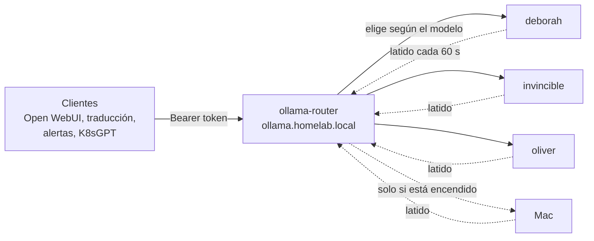

# Add a node to the Ollama cluster

How to add a machine (a Linux server, a Mac, another box) so it runs language models for the
[local AI assistant](ia-ollama.md). No central configuration changes needed: the new machine
**announces itself** and the router starts sending it the models it has.

## How it works (in 2 minutes)

An **Ollama node** is any machine running Ollama (the program that runs the model) and announcing
itself to the cluster. Clients (Open WebUI, this documentation's translation, alert summarization, K8sGPT)
don't talk to nodes: they talk to a single **router**.



- **Automatic registration.** Each node runs an agent (`ollama_node.py register`) that every 60 seconds sends
  the router a record with its name, address, OS, memory, priority, tags, and **the list of models it has downloaded**. The agent reads this from Ollama's model folders without waking it, so announcing costs no memory.
- **Expiry.** If the router doesn't hear from a node for 3 heartbeats (180 seconds), it marks it down and stops using it. When the node comes back, it reappears automatically. The router keeps the registry in memory: if it restarts, nodes re-register in under a minute.
- **Node selection.** The router looks at the `model` field of each request and picks among live nodes that have that model: first the one that used it last (to avoid reloading), then the highest priority, then the least busy. A model that only exists on the Mac goes to the Mac; common models prefer nodes that are always available.
- **No polling.** The router never "asks" a node if it's alive: it doesn't wake anyone up. If a node fails to connect, it avoids it for 30 seconds and tries another.

!!! info "Why a custom router"
    No existing project combined self-announcement registration, zero polls that wake machines, the native Ollama API, and model-aware selection. The router is a small standard Python program; it's described in [Local AI Assistant](ia-ollama.md).

## Registry rules

- **Who can register.** The router only accepts nodes whose IP is inside `ALLOWED_NODE_CIDRS`
  (`192.168.20.0/22`). If your node (e.g., the Mac) is **outside** that range, you must add its `/32` to that variable in the router Deployment and to `host_firewall_ollama_extra_cidrs`.
- **A live node isn't overwritten.** If an already-registered node tries to announce from **another IP**, the router replies `409` until it expires (180 seconds) or `DELETE` is done. If a node's IP changes, run `deregister`
  (`ollama_node.py deregister`, or `ollama-node off` on the Mac) **before** moving it.
- **Tokens.** By default all nodes use the shared `registry_token`. Optionally, the Secret
  `ai/ollama-router-secrets` can carry a `registry_token-<nombre-del-nodo>` key: if it exists, **only** that token
  can register (or delete) that node; if not, the shared one works. The router reloads tokens every 30 seconds.
  See [Rotate credentials](rotar-credenciales.md).
- **Limits.** Up to 64 nodes, 2000 models per node, priority 0–100, and model names in `^[A-Za-z0-9._:/@-]{1,128}$` format.

## What any node needs

| Requirement | Detail |
|---|---|
| Ollama installed | On Linux the Ansible role installs it; on Mac, `brew install ollama` |
| Listen on its own IP | Never on `0.0.0.0` if there's another option: Ollama's API has no built-in auth |
| Reach the router | Via HTTPS on `https://ollama.homelab.local` (the Kong ingress), trusting the HomeLab CA |
| The registration token | A token shared by nodes, stored in 1Password (item `ollama-router`, field `registry_token`) |
| K3s nodes can reach its port `11434` | The router runs in the cluster and is the only thing that talks to the node |

## Option A — A Linux server with Ansible (3 steps)

Works for `deborah`, `invincible`, `oliver` or any new Debian already in the Ansible inventory
(if it's not yet part of the HomeLab, first [add it as a node](agregar-nodo.md)).

1. **Inventory.** In [`ansible/inventory.ini`](https://github.com/maceosoft/homelab/blob/main/ansible/inventory.ini)
   add the machine name to the `[llm_nodes]` group.
2. **Node variables.** Create `ansible/host_vars/<nodo>.yml` with the models it should have, its priority
   and its tags. Variable names are in the
   [role README](https://github.com/maceosoft/homelab/blob/main/ansible/roles/ollama_ondemand/README.md);
   the main ones are:

    ```yaml
    ollama_ondemand_models:        # modelos que se descargan en este nodo
      - qwen2.5:7b-instruct
    ollama_ondemand_memory_max: 3500M   # tope de memoria de Ollama en este nodo
    ollama_node_priority: 40       # más alto = se prefiere
    ollama_node_tags: [x86, always-on]  # etiquetas libres, solo informativas
    ```

3. **Apply.** Prerequisites: 1Password unlocked (with app integration enabled), 1Password SDK
   installed (`pip install onepassword-sdk`) and `KUBECONFIG` exported toward the cluster. From `ansible/`:

    ```bash
    # ensayo
    ansible-playbook -i inventory.ini playbook-ollama.yml -l <nodo> --check --diff
    ansible-playbook -i inventory.ini playbook-ollama.yml -l <nodo>
    ```

The playbook applies two roles. `ollama_ondemand` downloads the Ollama version matching the machine's
architecture (ARM64 or x86_64, with its checksum) and creates the socket that wakes it only when a request arrives, listening on the node's IP. `ollama_node` installs the registration agent as a systemd service
(`ollama-node-register`). The registry token is read from 1Password at apply time
(`ansible/scripts/read_ollama_registry_token.py`) and ends up in `/etc/ollama-node/registry-token`; it never goes to Git.
To reapply only the agent: `--tags register`. A couple of minutes later the node should appear in the router (see
[Verify](#9-verificar-que-el-nodo-quedo-registrado)).

!!! tip "The first run takes a while"
    It downloads Ollama (1+ GB) and the models (several GB). To re-download only models:
    `-l <nodo> --tags models`.

## Option B — A Mac, step by step

The Mac is the "heavy" node: its unified memory allows large models that don't fit on the other machines.
It is turned on and off **manually** with a switch, and while it's off the cluster doesn't know it exists.

!!! info "How it works on macOS"
    `launchd` (the macOS service manager) is used to listen on the port and start Ollama only when
    a real request arrives. macOS prompts (Local Network permission, firewall) depend on the system
    version; menu texts may vary slightly.

### 1. Install Ollama with Homebrew

```bash
brew install ollama
```

Use the Homebrew **formula** and **not** the Ollama desktop app: the app starts automatically
on login and would occupy memory all the time. If you already have it installed, close it and remove it from
*System Settings → General → Login Items*.

Now download the large models you want to keep on the Mac:

```bash
# por ejemplo, uno de 30B o más
ollama pull <modelo>
ollama list
```

Models live in `~/.ollama/models`. If you prefer an external drive, define `OLLAMA_MODELS` pointing to
that folder and pass it to the installer with `--models-dir`.

### 2. Have the HomeLab token and CA handy

- **Registration token:** the `registry_token` field of the `ollama-router` item in 1Password (the same one
  the other nodes use; if it doesn't exist yet, generate it with `openssl rand -hex 32`, see
  [Rotate credentials](rotar-credenciales.md)).
- **HomeLab CA (certificate authority)**, so the Mac trusts the registry's HTTPS. Export it
  from a machine with `kubectl`:

    ```bash
    kubectl -n cert-manager get secret homelab-ca -o jsonpath='{.data.ca\.crt}' | base64 -d > homelab-ca.crt
    ```

- **A static IP for the Mac** (see step 6).

### 3. Install the node bundle

The bundle is in [`ollama-node/`](https://github.com/maceosoft/homelab/tree/main/ollama-node) of the
`homelab` repo. From that folder (with your Mac's IP instead of `192.168.20.X`):

```bash
./macos/install.sh --registry-url https://ollama.homelab.local --ca-file ./homelab-ca.crt \
  --url http://192.168.20.X:11434 --allowed-cidrs 192.168.20.5/32,192.168.20.6/32,192.168.20.7/32
```

It does not use `sudo`. The installer prompts for the token without echoing it on screen (or read it from a file with
`--token-file`, or store it in the macOS Keychain with `--keychain`). It does three things:

1. Copies the agent to `~/Library/Application Support/ollama-node/` and writes `config.json` there.
2. Installs the LaunchAgents (your user's `launchd` tasks) in `~/Library/LaunchAgents`, **without
   loading them**.
3. Leaves the `ollama-node` command (in `~/.local/bin`; make sure it's in your `PATH`).

With the 1Password CLI, the token is downloaded to a temp file only you can read and passed with `--token-file` (if you have more than
one 1Password account, export `OP_ACCOUNT` first); complete example:

```bash
umask 077
op read "op://HomeLab/ollama-router/registry_token" > "$HOME/ollama-registry-token"
./macos/install.sh --registry-url https://ollama.homelab.local --ca-file ./homelab-ca.crt \
  --url http://192.168.20.X:11434 --allowed-cidrs 192.168.20.5/32,192.168.20.6/32,192.168.20.7/32 \
  --token-file "$HOME/ollama-registry-token"
rm -P "$HOME/ollama-registry-token"
```

Useful options: `--name` (name in the registry, defaults to the Mac's short name), `--priority` (defaults
to 10, so always-on servers go first), `--tags` (defaults to `mac,gpu,large`),
`--models-dir` (models folder, if using an external drive) and `--uninstall`, which downloads the agents and deletes
the plists and the `ollama-node` command, but **keeps** the agent folder (with `config.json` and the token) and the
logs.

The `config.json` stores the name, node URL, registry URL, priority, labels and
`allowed_cidrs`, the list of networks allowed to use the proxy: **only put the K3s node IPs**
(`192.168.20.5`, `.6` and `.7`), because they are the ones running the router. The token **does not** go inside the
`config.json`: it stays in the `token` file in the agent folder (permissions `600`) or, with `--keychain`, in the macOS
Keychain.

!!! danger "The registry token is only for registration"
    With it you can announce a node to the router, nothing more. It does **not** grant inference access: clients use
    other tokens and the node itself is protected by the router and the firewall (see
    [Security](#security)). Even so, don't paste it in chats or Git. If you use a token file, it must
    have permissions `600`.

### 4. Trust the HomeLab CA (if needed)

The registry travels over HTTPS and the certificate is signed by the HomeLab CA (`homelab-ca`). The agent already uses it
(`--ca-file`); so that `curl` and the browser also trust it, install it in the keychain (once):

```bash
sudo security add-trusted-cert -d -r trustRoot -k /Library/Keychains/System.keychain homelab-ca.crt
```

Verify with:

```bash
curl -s -o /dev/null -w '%{http_code}\n' https://ollama.homelab.local/api/version
```

No certificate error, and with `401` (means it reached the router and asks for token).

### 5. Firewall and macOS "Local Network" permission

- **macOS Firewall.** If active (*Settings → Network → Firewall*), allow incoming connections for
  the `ollama` binary and for the Python that runs the agent. The first time, macOS asks only once.
- **Local Network.** macOS (Sequoia and later) asks permission for apps to talk to devices on
  your network. Accept the prompt when it appears, or enable it in *Settings → Privacy & Security → Local Network*
  for Terminal (or the program you run `ollama-node` from). This permission is granted **only from Settings**:
  macOS has no command to grant it.
- **Allowed subnets.** The `allowed_cidrs` list in the `config.json` makes the agent reject connections that don't come
  from the K3s nodes, even if the macOS firewall is open.

### 6. Reserve the Mac's IP

Also, the Mac must resolve `ollama.homelab.local` using the DNS (BIND) of `deborah`, and the router only has outbound permission
toward `192.168.20.0/22` on port `11434`: the Mac must be inside that network.

The router and nodes need to find the Mac always at the same address. In your home router, create
a **DHCP reservation** (*Dynamic Host Configuration Protocol*, the router service that hands out IPs; this way the Mac gets the same IP always, based on the Mac's MAC address) outside the assignable range, or
configure a static IP on the Mac itself. Put that IP in the installer's `--url` option (or in the `url` of `config.json`). If the Mac uses WiFi and Ethernet, reserve the
one for the interface you'll use for this.

### 7. Power and sleep

While the Mac sleeps, it stops beating: after 180 seconds the router considers it absent, and it reappears when it wakes (as long as the switch remains in `on`). For long jobs:

- Plug it into power.
- While there is activity, the agent keeps the Mac awake with `caffeinate` and releases it when done.
- If you want it to never sleep while plugged in, check `pmset -g` and adjust, for example, `sudo pmset -c sleep 0`. Optional: sleeping is fine, it just means the cluster won't use it.

### 8. The switch: `ollama-node on|off|status|logs`

| Command | What it does |
|---|---|
| `ollama-node on` | Loads the two LaunchAgents: the **socket** one (`launchd` listens on port `11434`) and the **registration** one (heartbeat every 60 seconds). From this moment the Mac appears in the cluster |
| `ollama-node off` | Removes both and sends a `DELETE` to the registry: the Mac leaves the list instantly and stops listening |
| `ollama-node status` | Tells whether it's on, whether Ollama is active, and whether the registry sees it |
| `ollama-node logs [socket\|register]` | Shows the agent logs (both, or just the socket or just the registration) |
| `ollama-node config [edit]` | Shows `config.json`; with `edit` opens it in your editor |

Right after installing, the state is `off`: no agents loaded, the Mac isn't listening and isn't registered.
With `on`, `launchd` opens the port **but doesn't start anything heavy**: only when a real request arrives does it launch the proxy, which starts `ollama serve` on `127.0.0.1:11435`, waits for it to respond, and forwards the traffic.
While there is activity it maintains `caffeinate`. After **5 minutes without traffic** it stops Ollama and exits, and unified memory becomes free again. The registration agent keeps beating (with the model list) until you turn it off with `off`.

### 9. Verify the node was registered

With the switch in `on`, from any machine on the LAN (local network) that can reach the Mac. First load the tokens into your terminal variables, without displaying them (with 1Password unlocked; if you have more than one account, export `OP_ACCOUNT` first):

```bash
REGISTRY_TOKEN=$(op read "op://HomeLab/ollama-router/registry_token")
TOKEN=$(op read "op://HomeLab/ollama-router/reports")
```

And now the tests:

```bash
# 1. El Mac responde y carga Ollama bajo demanda (la primera vez tarda unos segundos):
curl http://<ip-del-mac>:11434/api/version
```

If you're not a K3s node, your machine isn't on the allowlist and this may be rejected: that's expected (see [Security](#security)). Try from a K3s node, or skip to the next step.

```bash
# 2. El registro lo ve (el listado exige el token de REGISTRO, no el de un cliente):
curl -H "Authorization: Bearer $REGISTRY_TOKEN" https://ollama.homelab.local/_registry/nodes

# 3. Los modelos que ve el router (token de un cliente cualquiera, p. ej. el de `reports`):
curl -H "Authorization: Bearer $TOKEN" https://ollama.homelab.local/api/tags

# 4. Una conversación real, que debe llegar al Mac si el modelo solo está allí:
curl -H "Authorization: Bearer $TOKEN" https://ollama.homelab.local/api/chat \
  -d '{"model":"<modelo-solo-del-mac>","messages":[{"role":"user","content":"hola"}],"stream":false}'

# 5. Apagarlo y comprobar que sale del listado:
ollama-node off
curl -H "Authorization: Bearer $REGISTRY_TOKEN" https://ollama.homelab.local/_registry/nodes
```

### Remove the Mac entirely

```bash
ollama-node off
```

and, if you no longer want it as a node, run `./macos/install.sh --uninstall`, which unloads the agents and deletes the plists, the command, and the agent folder. Since the registration token is shared, there's no need to delete it; if you're concerned about it remaining on the Mac, rotate it ([Rotate credentials](rotar-credenciales.md)). The `~/.ollama` models stay on your disk; delete them yourself if you need the space.

## Option C — Another machine (another Linux without Ansible, Windows, etc.)

The contract is the same and doesn't depend on the system: the only thing the router needs is for someone to send it this notice every 60 seconds.

1. Install Ollama and make it listen only on the machine's IP.
2. Run the portable agent, which is a single standard Python program: [`ollama_node.py`](https://github.com/maceosoft/homelab/tree/main/ollama-node) with the command `register --loop` (periodic announcement; `deregister` to exit) and, if you want on-demand startup, `proxy` (designed for macOS).
3. Or do it yourself: a `PUT /_registry/nodes/<nombre>` with the header `Authorization: Bearer <token del registro>` and a JSON body with `name`, `url`, `os`, `arch`, `ram_gb`, `priority`, `tags`, `ollama_version`, `ts`, and the list `models`. To exit, `DELETE` on the same path.

## Security

- **The registry token is only for registration.** It doesn't grant access to inference. If it leaks, rotate it (and update it on every node).
- **Inference is protected by the router.** Every client needs its own Bearer token, and the router blocks verbs that manage models (`pull`, `create`, `delete`, `copy`, `push`): models are installed on each node, not over the network.
- **The firewall protects the node.** A node listens only on its IP and accepts traffic only from K3s nodes (where the router runs). No client talks directly to a node.
- **Documented exception.** The Ollama API has no built-in authentication; that's why its control is the network. It's in the [exception table](../security/modelo-de-autenticacion.md#network-controlled-exceptions).

## Troubleshooting

| Symptom | What to check |
|---|---|
| Node does not appear in `/_registry/nodes` | Incorrect token (401 in agent logs), node cannot reach router (DNS, firewall, CA), or registration service not running (`systemctl status` on Linux, `ollama-node status` on Mac) |
| Appears and disappears | Network or Mac goes to sleep: heartbeat lost for more than 180 seconds. Check power or WiFi |
| Appears, but router does not send it a model | Model not in its list (`ollama list` on node) or registry has stale list: wait for a heartbeat |
| `404` with a model suggestion | No live node has that model; `GET /api/tags` shows available ones |
| `401` from a client | Incorrect, expired, or unauthorized client token |
| `409` on registration | Node already registered with another IP: run `deregister` or wait 180 seconds |
| `400` «IP outside ALLOWED_NODE_CIDRS» | Node IP not in router's allowed range (see [Registration Rules](#registry-rules)) |
| `403` in `/api/pull` | Expected: models are managed on each node |
| Certificate error from Mac | Missing HomeLab CA install (step 4) |
| Mac does not respond on `11434` | Toggle in `off`, macOS firewall, missing Local Network permission, or IP different from reserved one |
| First response takes a long time | Cold start: Ollama starts up and loads the model. Expected once |
| Mac runs out of memory | Model too large for free memory; try a smaller one or close applications |

For logs: on Linux, `journalctl -u ollama-node-register`; on Mac, `ollama-node logs`; in cluster, router logs in [Centralized Logs](logs.md).

See also [Local AI Assistant](ia-ollama.md) and [Authentication Model](../security/modelo-de-autenticacion.md).
