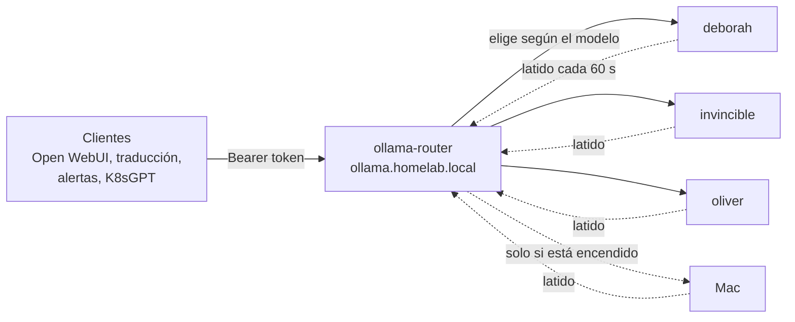

# Agregar un nodo al clúster de Ollama

Cómo sumar un equipo (un servidor Linux, un Mac, otra máquina) para que ejecute modelos de lenguaje del
[asistente de IA local](ia-ollama.md). No hace falta tocar ninguna configuración central: el equipo nuevo
**se anuncia solo** y el router empieza a mandarle los modelos que tenga.

## Cómo funciona (en 2 minutos)

Un **nodo de Ollama** es cualquier equipo que ejecuta Ollama (el programa que corre el modelo) y se avisa al
clúster. Los clientes (Open WebUI, la traducción de esta documentación, el resumen de alertas, K8sGPT) no
hablan con los nodos: hablan con un **router** único.



- **Registro automático.** Cada nodo ejecuta un agente (`ollama_node.py register`) que cada 60 segundos manda
  al router una ficha con su nombre, su dirección, su sistema, su memoria, su prioridad, sus etiquetas y **la
  lista de modelos que tiene descargados**. El agente la lee de las carpetas de modelos de Ollama sin
  despertarlo, así que anunciarse no gasta memoria.
- **Caducidad.** Si el router no oye a un nodo durante 3 latidos (180 segundos), lo da por apagado y deja de
  usarlo. Cuando el nodo vuelve, aparece de nuevo solo. El router guarda el registro en memoria: si él se
  reinicia, los nodos se vuelven a registrar en menos de un minuto.
- **Elección del nodo.** El router mira el campo `model` de cada petición y escoge entre los nodos vivos que
  tienen ese modelo: primero el último que lo usó (así evita recargarlo), luego el de mayor prioridad y luego
  el menos ocupado. Un modelo que solo existe en el Mac se manda al Mac; los modelos comunes prefieren los
  nodos que están siempre disponibles.
- **Sin sondeos.** El router nunca "pregunta" a un nodo si está vivo: no despierta a nadie. Si un nodo falla
  al conectar, lo evita 30 segundos y prueba con otro.

!!! info "Por qué un router propio"
    Ningún proyecto existente combinaba registro por aviso del propio nodo, cero sondeos que despierten
    equipos, la API nativa de Ollama y elección por modelo. El router es un programa pequeño en Python
    estándar; está descrito en [Asistente de IA local](ia-ollama.md).

## Reglas del registro

- **Quién puede registrarse.** El router solo acepta nodos cuya IP esté dentro de `ALLOWED_NODE_CIDRS`
  (`192.168.20.0/22`). Si tu nodo (por ejemplo el Mac) está **fuera** de ese rango, hay que agregar su `/32` a esa
  variable del Deployment del router y a `host_firewall_ollama_extra_cidrs`.
- **Un nodo vivo no se pisa.** Si un nodo ya registrado intenta anunciarse desde **otra IP**, el router responde
  `409` hasta que caduque (180 segundos) o se haga `DELETE`. Si cambia la IP de un nodo, ejecuta `deregister`
  (`ollama_node.py deregister`, o `ollama-node off` en el Mac) **antes** de moverlo.
- **Tokens.** Por defecto todos los nodos usan el `registry_token` compartido. Opcionalmente, el Secret
  `ai/ollama-router-secrets` puede llevar una clave `registry_token-<nombre-del-nodo>`: si existe, **solo** ese token
  puede registrar (o borrar) ese nodo; si no existe, vale el compartido. El router recarga los tokens cada 30 segundos.
  Ver [Rotar credenciales](rotar-credenciales.md).
- **Límites.** Hasta 64 nodos, 2000 modelos por nodo, prioridad de 0 a 100 y nombres de modelo con el formato
  `^[A-Za-z0-9._:/@-]{1,128}$`.

## Qué necesita cualquier nodo

| Requisito | Detalle |
|---|---|
| Ollama instalado | En Linux lo instala el rol de Ansible; en el Mac, `brew install ollama` |
| Escuchar en su propia IP | Nunca en `0.0.0.0` si hay otra opción: la API de Ollama no tiene autenticación propia |
| Alcanzar el router | Por HTTPS en `https://ollama.homelab.local` (la entrada por Kong), confiando en la CA del HomeLab |
| El token de registro | Un token compartido por los nodos, guardado en 1Password (item `ollama-router`, campo `registry_token`) |
| Que los nodos de K3s lleguen a su puerto `11434` | El router corre en el clúster y es el único que habla con el nodo |

## Opción A — Un servidor Linux con Ansible (3 pasos)

Sirve para `deborah`, `invincible`, `oliver` o cualquier Debian nuevo que ya esté en el inventario de Ansible
(si todavía no es parte del HomeLab, primero [agrégalo como nodo](agregar-nodo.md)).

1. **Inventario.** En [`ansible/inventory.ini`](https://github.com/maceosoft/homelab/blob/main/ansible/inventory.ini)
   agrega el nombre del equipo al grupo `[llm_nodes]`.
2. **Variables del nodo.** Crea `ansible/host_vars/<nodo>.yml` con los modelos que debe tener, su prioridad
   y sus etiquetas. Los nombres de las variables están en el
   [README del rol](https://github.com/maceosoft/homelab/blob/main/ansible/roles/ollama_ondemand/README.md);
   las principales son:

    ```yaml
    ollama_ondemand_models:        # modelos que se descargan en este nodo
      - qwen2.5:7b-instruct
    ollama_ondemand_memory_max: 3500M   # tope de memoria de Ollama en este nodo
    ollama_node_priority: 40       # más alto = se prefiere
    ollama_node_tags: [x86, always-on]  # etiquetas libres, solo informativas
    ```

3. **Aplicar.** Antes necesitas: 1Password desbloqueado (con la integración de apps activa), el SDK de 1Password
   instalado (`pip install onepassword-sdk`) y `KUBECONFIG` exportado hacia el clúster. Desde `ansible/`:

    ```bash
    # ensayo
    ansible-playbook -i inventory.ini playbook-ollama.yml -l <nodo> --check --diff
    ansible-playbook -i inventory.ini playbook-ollama.yml -l <nodo>
    ```

El playbook aplica dos roles. `ollama_ondemand` descarga la versión de Ollama que corresponde a la arquitectura
del equipo (ARM64 o x86_64, con su suma de verificación) y crea el socket que lo despierta solo cuando llega una
petición, escuchando en la IP del nodo. `ollama_node` instala el agente de registro como servicio de systemd
(`ollama-node-register`). El token del registro lo lee de 1Password en el momento de aplicar
(`ansible/scripts/read_ollama_registry_token.py`) y queda en `/etc/ollama-node/registry-token`; nunca va a Git.
Para reaplicar solo el agente: `--tags register`. Un par de minutos después el nodo debería aparecer en el router (ver
[Verificar](#9-verificar-que-el-nodo-quedo-registrado)).

!!! tip "La primera corrida tarda"
    Descarga Ollama (más de 1 GB) y los modelos (varios GB). Para volver a bajar solo los modelos:
    `-l <nodo> --tags models`.

## Opción B — Un Mac, paso a paso

El Mac es el nodo "pesado": su memoria unificada permite modelos grandes que no caben en los otros equipos.
Se enciende y se apaga **a mano** con un interruptor, y mientras está apagado el clúster no sabe que existe.

!!! info "Cómo funciona en macOS"
    Se usa `launchd` (el gestor de servicios de macOS) para escuchar en el puerto y arrancar Ollama solo cuando
    llega una petición real. Los avisos de macOS (permiso de "Red local", firewall) dependen de la versión del
    sistema; los textos de los menús pueden variar un poco.

### 1. Instalar Ollama con Homebrew

```bash
brew install ollama
```

Usa la **fórmula** de Homebrew y **no** la aplicación de escritorio de Ollama: la aplicación arranca sola
al iniciar sesión y ocuparía memoria todo el tiempo. Si ya la tienes instalada, ciérrala y quítala de
*Ajustes del Sistema → General → Items de inicio*.

Descarga ahora los modelos grandes que quieras tener en el Mac:

```bash
# por ejemplo, uno de 30B o más
ollama pull <modelo>
ollama list
```

Los modelos viven en `~/.ollama/models`. Si prefieres un disco externo, define `OLLAMA_MODELS` apuntando a
esa carpeta y pásala al instalador con `--models-dir`.

### 2. Tener a mano el token y la CA del HomeLab

- **Token de registro:** el campo `registry_token` del item `ollama-router` en 1Password (el mismo que usan los
  demás nodos; si aún no existe, se genera con `openssl rand -hex 32`, ver
  [Rotar credenciales](rotar-credenciales.md)).
- **CA (autoridad certificadora) del HomeLab**, para que el Mac confíe en el HTTPS del registro. Se exporta
  desde un equipo con `kubectl`:

    ```bash
    kubectl -n cert-manager get secret homelab-ca -o jsonpath='{.data.ca\.crt}' | base64 -d > homelab-ca.crt
    ```

- **Una IP fija para el Mac** (ver el paso 6).

### 3. Instalar el bundle del nodo

El bundle está en [`ollama-node/`](https://github.com/maceosoft/homelab/tree/main/ollama-node) del repo
`homelab`. Desde esa carpeta (con la IP de tu Mac en lugar de `192.168.20.X`):

```bash
./macos/install.sh --registry-url https://ollama.homelab.local --ca-file ./homelab-ca.crt \
  --url http://192.168.20.X:11434 --allowed-cidrs 192.168.20.5/32,192.168.20.6/32,192.168.20.7/32
```

No usa `sudo`. El instalador te pide el token sin mostrarlo en pantalla (o léelo de un archivo con
`--token-file`, o guárdalo en el Keychain de macOS con `--keychain`). Hace tres cosas:

1. Copia el agente a `~/Library/Application Support/ollama-node/` y escribe ahí `config.json`.
2. Instala los LaunchAgents (las tareas de `launchd` de tu usuario) en `~/Library/LaunchAgents`, **sin
   cargarlos**.
3. Deja el comando `ollama-node` (en `~/.local/bin`; asegúrate de que esté en tu `PATH`).

Con la CLI de 1Password, el token se baja a un archivo temporal que solo tú lees y se pasa con `--token-file` (si tienes más de
una cuenta de 1Password, exporta `OP_ACCOUNT` antes); ejemplo completo:

```bash
umask 077
op read "op://HomeLab/ollama-router/registry_token" > "$HOME/ollama-registry-token"
./macos/install.sh --registry-url https://ollama.homelab.local --ca-file ./homelab-ca.crt \
  --url http://192.168.20.X:11434 --allowed-cidrs 192.168.20.5/32,192.168.20.6/32,192.168.20.7/32 \
  --token-file "$HOME/ollama-registry-token"
rm -P "$HOME/ollama-registry-token"
```

Opciones útiles: `--name` (nombre en el registro, por defecto el nombre corto del Mac), `--priority` (por
defecto 10, para que los servidores siempre encendidos pasen primero), `--tags` (por defecto `mac,gpu,large`),
`--models-dir` (carpeta de modelos, si usas un disco externo) y `--uninstall`, que descarga los agentes y borra
los plists y el comando `ollama-node`, pero **conserva** la carpeta del agente (con `config.json` y el token) y los
registros.

El `config.json` guarda el nombre, la URL del nodo, la URL del registro, la prioridad, las etiquetas y
`allowed_cidrs`, la lista de redes que pueden usar el proxy: **pon solo las IP de los nodos de K3s**
(`192.168.20.5`, `.6` y `.7`), porque son los que ejecutan el router. El token **no** va dentro del
`config.json`: queda en el archivo `token` de la carpeta del agente (permisos `600`) o, con `--keychain`, en el Keychain
de macOS.

!!! danger "El token del registro solo sirve para registrarse"
    Con él se puede anunciar un nodo al router, nada más. **No** da acceso a la inferencia: los clientes usan
    otros tokens y el propio nodo está protegido por el router y por el firewall (ver
    [Seguridad](#seguridad)). Aun así, no lo pegues en chats ni en Git. Si usas un archivo de token, debe
    tener permisos `600`.

### 4. Confiar en la CA del HomeLab (si hace falta)

El registro viaja por HTTPS y el certificado lo firma la CA del HomeLab (`homelab-ca`). El agente ya la usa
(`--ca-file`); para que también confíen `curl` y el navegador, instálala en el llavero (una vez):

```bash
sudo security add-trusted-cert -d -r trustRoot -k /Library/Keychains/System.keychain homelab-ca.crt
```

Comprueba con:

```bash
curl -s -o /dev/null -w '%{http_code}\n' https://ollama.homelab.local/api/version
```

Sin error de certificado, y con `401` (significa que llegó al router y pide token).

### 5. Firewall y permiso de "Red local" de macOS

- **Firewall de macOS.** Si está activo (*Ajustes → Red → Firewall*), permite las conexiones entrantes para
  el binario de `ollama` y para el Python que ejecuta el agente. La primera vez, macOS pregunta solo.
- **Red local.** macOS (Sequoia y posteriores) pide permiso para que las aplicaciones hablen con equipos de
  tu red. Acepta el aviso cuando aparezca, o actívalo en *Ajustes → Privacidad y seguridad → Red local*
  para la Terminal (o el programa desde el que corres `ollama-node`). Este permiso se da **solo desde Ajustes**:
  macOS no tiene un comando para concederlo.
- **Subredes permitidas.** La lista `allowed_cidrs` del `config.json` hace que el agente rechace conexiones que no vengan
  de los nodos de K3s, aunque el firewall de macOS esté abierto.

### 6. Reservar la IP del Mac

Además, el Mac debe resolver `ollama.homelab.local` usando el DNS (BIND) de `deborah`, y el router solo tiene permiso de
salida hacia `192.168.20.0/22` en el puerto `11434`: el Mac tiene que estar dentro de esa red.

El router y los nodos necesitan encontrar al Mac siempre en la misma dirección. En el router de la casa, crea
una **reserva DHCP** (*Dynamic Host Configuration Protocol*, el servicio del router que reparte las IP; así el Mac recibe la misma IP siempre, a partir de la dirección MAC del Mac) fuera del rango asignable, o
configura una IP fija en el propio Mac. Pon esa IP en la opción `--url` del instalador (o en el `url` de `config.json`). Si el Mac usa WiFi y cable, reserva la
de la interfaz que uses para esto.

### 7. Energía y suspensión

Mientras el Mac duerme, deja de latir: tras 180 segundos el router lo da por ausente, y vuelve a aparecer
cuando despierte (siempre que el interruptor siga en `on`). Para trabajos largos:

- Conéctalo a la corriente.
- Mientras hay actividad, el agente mantiene el Mac despierto con `caffeinate` y lo suelta cuando termina.
- Si quieres que no se suspenda nunca mientras está conectado, revisa `pmset -g` y ajusta, por ejemplo,
  `sudo pmset -c sleep 0`. Es opcional: dormir está bien, solo significa que el clúster no lo usará.

### 8. El interruptor: `ollama-node on|off|status|logs`

| Comando | Qué hace |
|---|---|
| `ollama-node on` | Carga los dos LaunchAgents: el de **socket** (`launchd` escucha en el puerto `11434`) y el de **registro** (el latido cada 60 segundos). Desde este momento el Mac aparece en el clúster |
| `ollama-node off` | Quita ambos y manda un `DELETE` al registro: el Mac sale del listado al instante y deja de escuchar |
| `ollama-node status` | Dice si está encendido, si Ollama está activo y si el registro lo ve |
| `ollama-node logs [socket\|register]` | Muestra los registros del agente (los dos, o solo el del socket o el del registro) |
| `ollama-node config [edit]` | Muestra `config.json`; con `edit` lo abre en tu editor |

Justo después de instalar, el estado es `off`: ningún agente cargado, el Mac no escucha y no se registra.
Con `on`, `launchd` abre el puerto **pero no arranca nada pesado**: solo cuando llega una petición real lanza
el proxy, que arranca `ollama serve` en `127.0.0.1:11435`, espera a que responda y le reenvía el tráfico.
Mientras hay actividad mantiene `caffeinate`. Tras **5 minutos sin tráfico** detiene Ollama y termina, y la
memoria unificada vuelve a quedar libre. El agente de registro sigue latiendo (con la lista de modelos) hasta
que lo apagues con `off`.

### 9. Verificar que el nodo quedó registrado

Con el interruptor en `on`, desde cualquier equipo de la LAN (red local) que pueda llegar al Mac. Primero carga los tokens en
variables de tu terminal, sin mostrarlos (con 1Password desbloqueado; si tienes más de una cuenta, exporta `OP_ACCOUNT` antes):

```bash
REGISTRY_TOKEN=$(op read "op://HomeLab/ollama-router/registry_token")
TOKEN=$(op read "op://HomeLab/ollama-router/reports")
```

Y ahora las pruebas:

```bash
# 1. El Mac responde y carga Ollama bajo demanda (la primera vez tarda unos segundos):
curl http://<ip-del-mac>:11434/api/version
```

Si no eres un nodo K3s, tu equipo no está en la lista de permitidos y esto puede ser rechazado: es lo esperado
(ver [Seguridad](#seguridad)). Prueba desde un nodo K3s, o salta al paso siguiente.

```bash
# 2. El registro lo ve (el listado exige el token de REGISTRO, no el de un cliente):
curl -H "Authorization: Bearer $REGISTRY_TOKEN" https://ollama.homelab.local/_registry/nodes

# 3. Los modelos que ve el router (token de un cliente cualquiera, p. ej. el de `reports`):
curl -H "Authorization: Bearer $TOKEN" https://ollama.homelab.local/api/tags

# 4. Una conversación real, que debe llegar al Mac si el modelo solo está allí:
curl -H "Authorization: Bearer $TOKEN" https://ollama.homelab.local/api/chat \
  -d '{"model":"<modelo-solo-del-mac>","messages":[{"role":"user","content":"hola"}],"stream":false}'

# 5. Apagarlo y comprobar que sale del listado:
ollama-node off
curl -H "Authorization: Bearer $REGISTRY_TOKEN" https://ollama.homelab.local/_registry/nodes
```

### Quitar el Mac del todo

```bash
ollama-node off
```

y, si ya no lo quieres como nodo, ejecuta `./macos/install.sh --uninstall`, que descarga los agentes y borra los plists, el comando y la carpeta del agente. Como el token de registro es compartido, no hace falta borrarlo; si te preocupa que quede en el Mac, rótalo ([Rotar credenciales](rotar-credenciales.md)). Los modelos de
`~/.ollama` se quedan en tu disco; bórralos tú si necesitas el espacio.

## Opción C — Otra máquina (otro Linux sin Ansible, Windows, etc.)

El contrato es el mismo y no depende del sistema: lo único que necesita el router es que alguien le haga este
aviso cada 60 segundos.

1. Instala Ollama y haz que escuche solo en la IP del equipo.
2. Ejecuta el agente portable, que es un único programa de Python estándar:
   [`ollama_node.py`](https://github.com/maceosoft/homelab/tree/main/ollama-node) con la orden `register --loop`
   (anuncio periódico; `deregister` para salir) y, si quieres arranque bajo demanda, `proxy` (pensado para macOS).
3. O hazlo tú mismo: un `PUT /_registry/nodes/<nombre>` con la cabecera `Authorization: Bearer <token del registro>` y un cuerpo JSON con `name`, `url`, `os`, `arch`, `ram_gb`, `priority`, `tags`,
   `ollama_version`, `ts` y la lista `models`. Para salir, `DELETE` sobre la misma ruta.

## Seguridad

- **El token del registro solo sirve para el registro.** No da acceso a la inferencia. Si se filtra, se rota
  (y hay que actualizarlo en cada nodo).
- **La inferencia la protege el router.** Todo cliente necesita su propio token Bearer, y el router bloquea
  los verbos que gestionan modelos (`pull`, `create`, `delete`, `copy`, `push`): los modelos se instalan en
  cada nodo, no por la red.
- **El firewall protege al nodo.** Un nodo escucha solo en su IP y acepta tráfico únicamente de los nodos de
  K3s (donde corre el router). Ningún cliente habla directo con un nodo.
- **Excepción documentada.** La API de Ollama no tiene autenticación propia; por eso su control es la red.
  Está en la [tabla de excepciones](../security/modelo-de-autenticacion.md#excepciones-controladas-por-red).

## Solución de problemas

| Síntoma | Qué mirar |
|---|---|
| El nodo no aparece en `/_registry/nodes` | Token incorrecto (401 en los registros del agente), el nodo no llega al router (DNS, firewall, CA) o el servicio de registro no está activo (`systemctl status` en Linux, `ollama-node status` en el Mac) |
| Aparece y desaparece | La red o el Mac se suspenden: el latido se pierde más de 180 segundos. Revisa la energía o el WiFi |
| Aparece, pero el router no le manda un modelo | El modelo no figura en su lista (`ollama list` en el nodo) o la ficha lleva una lista vieja: espera un latido |
| `404` con una sugerencia de modelo | Ningún nodo vivo tiene ese modelo; `GET /api/tags` muestra los disponibles |
| `401` de un cliente | Token del cliente incorrecto, caducado o sin permiso |
| `409` al registrar | El nodo ya figura con otra IP: haz `deregister` o espera 180 segundos |
| `400` «IP fuera de ALLOWED_NODE_CIDRS» | La IP del nodo no está en el rango permitido del router (ver [Reglas del registro](#reglas-del-registro)) |
| `403` en `/api/pull` | Es lo esperado: los modelos se gestionan en cada nodo |
| Error de certificado desde el Mac | Falta instalar la CA del HomeLab (paso 4) |
| El Mac no responde en `11434` | Interruptor en `off`, firewall de macOS, falta del permiso de Red local o IP distinta a la reservada |
| La primera respuesta tarda mucho | Arranque en frío: Ollama se enciende y carga el modelo. Se espera una vez |
| El Mac se queda sin memoria | El modelo es demasiado grande para la memoria libre; prueba uno más chico o cierra aplicaciones |

Para los registros: en Linux, `journalctl -u ollama-node-register`; en el Mac, `ollama-node logs`; en el clúster, los logs del router en
[Logs centralizados](logs.md).

Ver también [Asistente de IA local](ia-ollama.md) y [Modelo de autenticación](../security/modelo-de-autenticacion.md).
