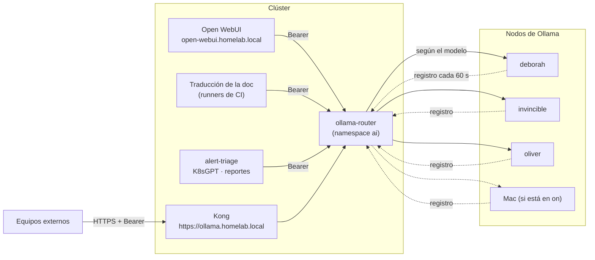

# Local AI Assistant (Ollama + Open WebUI)

The HomeLab has its own artificial intelligence, free and without leaving the house: language models (LLM,
*Large Language Model*) that run on the home machines and are used from a web page (Open WebUI) to
ask about the HomeLab, and from the pipeline that translates this documentation to English. Nothing is sent to
paid services or the internet.

There are **several machines running models** (called *Ollama nodes*) and **a single entry point**: a
router that knows which models each node has and sends each request to the corresponding one. Nodes announce themselves,
so adding one is easy ([guide](agregar-nodo-ollama.md)). And nodes only turn on when someone writes to them:
the rest of the time Ollama (the program that runs the model) is off and uses no memory.

**This decision in other environments**

=== "🏠 At home"

    Local AI with Ollama on multiple nodes that turn on on demand, a custom router (`ollama-router`) as the only
    gateway and Open WebUI as chat. It's free, leverages machines already in the house, and no data leaves for the internet.

=== "🏢 In a company"

    - **Benefits:** prompts and documents never leave your network, you don't pay per query, and a router
      with a token per client tells you who uses the AI and lets you cut one off without affecting the rest.
    - **Why a company also chooses local AI:** sensitive data (clients, code, contracts), regulation or
      data sovereignty that doesn't allow sending prompts to third parties, disconnected sites, and predictable cost
      when usage volume is very high.
    - **Dedicated GPUs** instead of machines that turn on and off: models stay loaded all the time
      to respond quickly to many users at once.
    - **Supported inference servers** instead of Ollama: [vLLM](https://docs.vllm.ai/) (open source),
      [NVIDIA NIM](https://developer.nvidia.com/nim) or [Red Hat AI Inference](https://www.redhat.com/en/products/ai/inference)
      (based on vLLM), with high availability and support contract.
    - **Access control and auditing:** entry with corporate identity (SSO), permissions by team, and logging
      of who asked what, for compliance.
    - **Model and license evaluation:** before using a model, its quality is measured and its license is reviewed
      to allow commercial use. And someone has to operate all this: it's personnel cost.

=== "☁️ In the cloud"

    | Cloud | Equivalent Service |
    |---|---|
    | GCP | [Gemini Enterprise Agent Platform](https://cloud.google.com/products/gemini-enterprise-agent-platform) (formerly Vertex AI) |
    | AWS | [Amazon Bedrock](https://aws.amazon.com/bedrock/) |
    | Azure | [Microsoft Foundry](https://azure.microsoft.com/en-us/products/ai-foundry) (formerly Azure AI Foundry) |
    | Oracle Cloud (OCI) | [OCI Generative AI](https://docs.oracle.com/en-us/iaas/Content/generative-ai/home.htm) |

    You gain managed models, no GPUs to buy or maintain, with SLA and immediate scale. You lose control: prompts
    and data travel to the provider, you pay per use (expensive at high volume), and you depend on their models and their prices.

## What each piece does

| Piece | What it does | Where it lives |
|---|---|---|
| **Ollama** | Runs the language models | On each node (`deborah`, `invincible`, `oliver` and, when turned on, the Mac), outside Kubernetes |
| **Socket and proxy** | Listen on port `11434` of the node and wake Ollama only when a request arrives | Each node (systemd on Linux, `launchd` on the Mac) |
| **Registration agent** | Every 60 seconds tells the router the node is alive and which models it has | Each node |
| **Ollama Router** (`ollama-router`) | Single entry point: validates token, chooses node by model, and publishes metrics | Cluster, namespace `ai` |
| **Kong** | Receives external traffic on `https://ollama.homelab.local` and forwards to the router | Cluster |
| **Open WebUI** | Chat page; login with Dex (GitHub) | Cluster, namespace `ai`, at `open-webui.homelab.local` |
| **Open Terminal** | Terminal with code execution that the assistant uses as a tool; isolated and admin-only | Cluster, namespace `ai-sandbox` |
| **Read-only tools** | Let the assistant query cluster state and metrics | Cluster, namespace `ai` |
| **Alert summary and K8sGPT** | Explain cluster alerts and issues in plain language | Cluster, namespace `ai` |

## Architecture



- **Single entry point.** Clients inside the cluster use the internal Service
  `http://ollama-router.ai.svc`; external ones use `https://ollama.homelab.local` (HTTPS, via Kong). There is no
  Service per node nor `/api/tags` cache in Kong: the router responds `/api/tags` from its registry, without
  waking anyone.
- **Mandatory authentication.** Each client has its own token (`Authorization: Bearer ...`). Without a token, the
  router responds `401`. See [Security](#security-and-firewall).
- **Node selection.** The router looks at the `model` of the request and picks among live nodes that have it:
  the one that last used it (to avoid reloading), then the highest priority, then the least busy. A model that
  is only on the Mac goes to the Mac. If a node fails to connect, it avoids it for 30 seconds.
- **How nodes announce themselves.** See [Add a node to the Ollama cluster](agregar-nodo-ollama.md): the agent reads
  models from Ollama folders (without waking it), sends them to the router, and the router expires them if it stops
  hearing from the node for 180 seconds (3 heartbeats).

How the "sleep and wake" of each node works:

1. A **socket** (systemd on Linux, `launchd` on the Mac) always listens on `11434`. It costs almost nothing.
2. When a real request arrives, a **proxy** starts, which turns on Ollama and forwards traffic to it on
   `127.0.0.1:11435`.
3. After 5 minutes without traffic, the proxy exits on its own and Ollama stops: the machine recovers its memory.

## Create the Open WebUI key (once only)

Open WebUI signs its users' sessions with a secret key, `WEBUI_SECRET_KEY`. Without it the pod will not start.
Like the rest of the platform secrets, it lives in 1Password and does **not** go through Git (`homelab` is public and `gitops`, although private, does not store secrets):

1. Generate the key. It must be random, 64 hexadecimal characters:

    ```bash
    openssl rand -hex 32
    ```

2. Create the item in 1Password (vault `HomeLab`, type *Secure Note*, named `open-webui`, with the field `WEBUI_SECRET_KEY`):

    === "🖱️ From the UI"

        From the 1Password app: the item name and field name must be exact and the field must not be inside
        a section.

    === "⌨️ From the console"

        With the `op` CLI and 1Password unlocked, a single command generates the key and creates the item:

        ```bash
        op item create --category "Secure Note" --vault HomeLab --title open-webui "WEBUI_SECRET_KEY[password]=$(openssl rand -hex 32)"
        ```

        With `op` step 1 is not needed: the command already generates the value.

3. Verify the item without showing the value: `python3 ansible/scripts/apply_platform_secrets.py --check` must show
   `✓ WEBUI_SECRET_KEY` under `open-webui`.
4. Apply it (create the namespace `ai` and the Secret `ai/open-webui-secret`):

    ```bash
    cd ansible
    ansible-playbook -i inventory.ini playbook-platform-secrets.yml
    ```

Do this before Argo CD syncs the Application `open-webui`. To rotate the key, repeat steps 1, 2, and 4 and restart the
Open WebUI pod; users will have to log in again. More on the flow in
[Secret management](../secrets/index.md) and [Rotate credentials](rotar-credenciales.md).

## Models per node

Each node declares its models; the router joins them in `/api/tags` and uses them to choose. The initial
assignment is (adjusted by measuring tokens per second and memory on each node):

| Node | Models | Purpose |
|---|---|---|
| `deborah` | `qwen2.5:7b-instruct` as fallback (and an optional 14B) | Default model when `invincible` does not respond: chat with the assistant and documentation translation |
| `invincible` | `qwen2.5-coder:7b` and `qwen2.5:7b-instruct` (preferred node for the 7B, priority 80 vs 60 of `deborah`) | Code help (Ansible, YAML, and Kubernetes manifests) and the default model |
| `oliver` | `nomic-embed-text` and models up to 3B | *Embeddings* (turn text into numbers to search the documentation) and lightweight tasks |
| Mac | Large models | Heavy tasks, only while the switch is on `on` |

Each node handles **one request at a time** (`OLLAMA_NUM_PARALLEL=1`) and the router keeps a semaphore per node. The
list of models on a Linux node is the variable `ollama_ondemand_models` of its `host_vars` and is applied with the tag
`models` (see [Ansible](../ansible/index.md)); on the Mac they are managed with `ollama pull`. Model management
is **not** done over the network: the router blocks `pull`, `create`, `delete`, `copy` and `push`.

## Metrics per model and node

Ollama does not publish metrics or annotate the model of each request, and Kong does not see it either (it goes in the body). That is why the router publishes them in `/metrics` (Prometheus format): requests by model, node, and code; duration; tokens (from the `prompt_eval_count` and `eval_count` of each response); in-flight requests; whether each node is alive and when it was last heard from. VictoriaMetrics scrapes them with a `VMServiceScrape` and they are visible in the **HomeLab / Ollama** dashboard in Grafana (nodes with heartbeat, in-flight requests, 5xx errors, tokens and latency by model and node). Two alerts fire if the service fails: `OllamaRouterCaido` and `OllamaRouterSinNodos`. They serve to know **which models are used and on which nodes**, without reading logs. The router also writes a JSON log per request that goes to [VictoriaLogs](logs.md).

## Cold start

Waking Ollama and loading the model into memory is not instantaneous: the first response after a period of
inactivity takes longer (and even more if the model is large or the machine is slow).

- On each node, the service waits for Ollama to listen before considering the startup ready.
- In Kong, the router route has long timeouts and **no retries** (a retry would repeat a prompt that is already running).
- Clients tolerate the wait: the documentation translation retries the connection for up to about 5 minutes.

If the first message fails or is cut off, wait a minute and try again.

## What wakes a node and what does not

A **real message** to the model wakes a node (a chat, a translation, an embedding). Nothing "decorative" should wake it: the router responds `/api/tags` and `/api/version` from its registry, it does not probe the nodes, there are no active health checks, `ollama.homelab.local` is excluded from monitoring probes and Open WebUI has automatic titles, tags, and autocomplete disabled.

## Check the router

```bash
# Con el token de un cliente, leído de 1Password sin mostrarlo (si tienes más de una cuenta, exporta OP_ACCOUNT antes)
TOKEN=$(op read "op://HomeLab/ollama-router/reports")

# Nodos vivos y sus modelos
curl -s -H "Authorization: Bearer $TOKEN" https://ollama.homelab.local/api/tags

# Sin token debe dar 401; la gestión de modelos, 403
curl -s -o /dev/null -w '%{http_code}\n' https://ollama.homelab.local/api/tags
curl -s -o /dev/null -w '%{http_code}\n' -X POST -H "Authorization: Bearer $TOKEN" https://ollama.homelab.local/api/pull
```

And that a node sleeps and wakes (by SSH to the node, see [SSH access](acceso-ssh.md)):

```bash
# inactive en reposo
systemctl is-active ollama
# tras un chat real por el router:
# active
systemctl is-active ollama
# unos 5 minutos después:
# inactive otra vez
systemctl is-active ollama
```

## Open WebUI with Dex

Open WebUI has no accounts of its own: you sign in with **SSO** (Single Sign-On) (via GitHub) through Dex, just like in Grafana.

- Only the `devops` team of the `maceosoft` organization can sign in; Open WebUI administrators are the
  members of that same team (the role arrives in the `groups` claim).
- No one can register or sign in with a password: there is no local form (`ENABLE_LOGIN_FORM=False`), registration
  is closed (`ENABLE_SIGNUP=False`) and the API rejects password login (`ENABLE_PASSWORD_AUTH=False`). Not even the first administrator is created manually: it is the first person from the team who signs in via SSO.
- The Dex client is public and uses PKCE (*Proof Key for Code Exchange*, a protection for clients without a secret).
- Open WebUI runs unprivileged (non-root user) and with a read-only filesystem.
- MCP tools (*Model Context Protocol*, a standard for giving tools to a model) are only visible to administrators.
- The pod trusts the HomeLab CA (certificate authority), which is the one that signs the Dex certificate.

## Ask the Assistant about the HomeLab (RAG)

RAG (*Retrieval-Augmented Generation*) means giving the model your own documents so it answers with them instead of making things up. This site already publishes a file with all the documentation in plain text, `llms-full.txt`
(at the site root), designed exactly for this. Loading it is **a manual step in the UI**:

1. Download `llms-full.txt` from the published site.
2. In Open WebUI go to **Workspace → Knowledge**, create a collection and upload the file (and, if you want, the runbooks from [Operations](index.md)).
3. In a chat, type `#` and pick that collection so the assistant queries it.

Open WebUI uses `nomic-embed-text` as the embeddings model, so indexing the documentation also goes through Ollama (and can wake a node). When the documentation changes you have to re-upload the file.

## Read-only tools and the "propose only" policy

The assistant can **inspect** the HomeLab via MCP tools (*Model Context Protocol*, a standard for giving tools to a model), exposed to Open WebUI as tool servers:

- **Kubernetes**: read-only cluster state, using a service account with minimal permissions (no access to `secrets` and no write permissions at all) and a network policy that limits who can call it.
- **VictoriaMetrics and Alertmanager**: queries for metrics, active alerts, and rules.

Querying metrics or Kubernetes does not wake any node; only the message to the model does.

!!! danger "The assistant never applies changes"
    Its policy is **propose only**. If you ask for a change, it returns the diff or a draft pull request for the repo [`maceosoft/gitops`](https://github.com/maceosoft/gitops); **you review and approve it**. Even if it could write, Argo CD (with `selfHeal`) would revert any manual change.

To verify the service account permissions for the tools:

```bash
# sin verbos de escritura
kubectl auth can-i --list --as=system:serviceaccount:ai:<cuenta>
```

## Alert summary to Discord

Alertmanager has an extra receiver that sends each alert to a service in the `ai` namespace (with a Bearer token); this asks Ollama via the router for a plain-language summary and posts it to Discord.

!!! warning "The summary does NOT replace real alerts"
    The original alert still goes out through its usual channels (Discord and healthchecks.io), **without passing through the AI and even if nodes are asleep**. The summary arrives later and is an extra: if Ollama doesn't respond, nothing happens. To avoid waking a node unnecessarily, the service groups and deduplicates alerts and rate-limits calls.

## K8sGPT

[K8sGPT](https://github.com/k8sgpt-ai/k8sgpt) scans the cluster for problems and explains them with help from Ollama.

!!! warning "K8sGPT is staged: the decision is yours"
    Its line is commented out in `root-appset.yaml`. The operator chart ships a ClusterRole with `*/*/*` permissions (effectively, cluster admin) and offers no option to remove it; plus dynamic RBAC reads Secrets across the whole cluster. To enable it there are three paths, described in [`security/k8sgpt-rbac/`](https://github.com/maceosoft/gitops/tree/main/security/k8sgpt-rbac): accept the risk and uncomment the line; use the scoped role proposed there (untested); and enable the namespace NetworkPolicy together with the app. Until activated, the rest of this section describes how it works. It runs as an operator, with scheduled and infrequent analysis, and leaves its results as cluster objects:

```bash
kubectl get results.core.k8sgpt.ai
```

All analysis is local: nothing leaves the house.

## Open Terminal: terminal for the assistant

Open Terminal is a code-execution terminal that Open WebUI uses as an **agent tool**: the assistant can write and run scripts, process files, and return the result inside the chat. It runs in its own namespace, `ai-sandbox`, with the image `ghcr.io/open-webui/open-terminal` (`slim` variant), and is deployed from [`ai/open-terminal/`](https://github.com/maceosoft/gitops/tree/main/ai/open-terminal).

**What it's for:** running code (Python, shell), converting or analyzing files, testing a script before taking it to Ansible or a manifest. **What it doesn't do:** it doesn't manage the HomeLab; it has no cluster access.

### How to use it

1. Log in to Open WebUI via SSO (GitHub) and open a chat.
2. Enable the **Open Terminal** integration in the chat (only visible to admins and the `maceosoft:devops` group).
3. Ask for something that requires running code, e.g., "calculate the average of this CSV (comma-separated data file)". The assistant runs the command in the terminal and shows you the output.

### How it connects (admins)

In Open WebUI: *Admin Settings → Integrations → **Open Terminal*** (not in "External Tools" or "Tool Servers").
Enter the internal URL of the Open Terminal Service, the key, and the authentication type **Bearer**. The variable
`ENABLE_TOOL_SERVERS=true` must be enabled in Open WebUI. Access is restricted to admins and the `maceosoft:devops` group.

This connection is configured **only from the Open WebUI UI**: there is no command to do it.

### Open Terminal limits

- **Scoped sandbox:** max 1 CPU (central processing unit) and 2 GB RAM (memory).
- **No cluster or internal network access.** A NetworkPolicy only allows ingress from Open WebUI, and egress is limited to internet on ports 80 and 443.
- **Small persistent volume:** 2 GB on Longhorn; files survive a restart, but space is limited.

### Risks

!!! danger "Runs arbitrary code"
    Everything the assistant (or whoever uses the chat) decides to run executes for real. **It is not a security boundary between users**: whoever uses it shares the same terminal and the same files. That's why it's for admins only, and **`docker.sock` must never be mounted** nor given credentials, kubeconfig, or Secrets.

### API key: generate and rotate

The key protects the Open Terminal API (Bearer). It is created and rotated the same way as the others:

1. Generate the key and store it in 1Password:

    === "🖱️ From the UI"

        1. `openssl rand -hex 32`
        2. In 1Password, vault `HomeLab`, item **`open-terminal`**, field **`api_key`**.

    === "⌨️ From the console"

        The value is generated inside the command, so you never see or copy it. If the item already exists (when rotating):

        ```bash
        op item edit open-terminal "api_key[password]=$(openssl rand -hex 32)"
        ```

        The first time, if the item does not exist yet:

        ```bash
        op item create --category "Secure Note" --vault HomeLab --title open-terminal "api_key[password]=$(openssl rand -hex 32)"
        ```

2. `cd ansible && ansible-playbook -i inventory.ini playbook-platform-secrets.yml` creates the Secrets
   `ai-sandbox/open-terminal-api-key` and `ai/open-terminal-api-key`.
3. Restart the Open Terminal and Open WebUI pods so they read the new value, and update the key in
   *Admin Settings → Integrations → Open Terminal* if needed (this last step is only from the UI).

The key is mounted in the pod as a **file** (`OPEN_TERMINAL_API_KEY_FILE`, permissions `0440`), not as an environment
variable. The `ai-sandbox` NetworkPolicy travels with the pod (`ai/open-terminal/networkpolicy.yaml`, in the order
Namespace → NetworkPolicy → pod). If you deploy the app **before** creating the Secret, Open WebUI starts fine but the
connection to Open Terminal responds `401` until you create the Secret and restart the pod.

See [Rotate credentials](rotar-credenciales.md).

## Limits

- **CPU only (central processing unit).** Linux nodes have no graphics card (GPU), only processor; a 7-billion-parameter model responds slowly (words per second, not instant). Translating all documentation for the first time takes hours. The Mac, with unified memory, is the exception for large models.
- **One request per node at a time.** For more parallelism you need more nodes.
- **The router is a single point.** It runs in a single replica and keeps the registry in memory: if it goes down, AI goes down (nodes re-register automatically in under a minute when it comes back). Real alerts do not depend on it.
- **A loaded model takes memory** away from other workloads on the node while it lasts.
- **The K3s control plane** is on `deborah`, the same node that loads models. That is why Ollama runs on demand: it only uses memory while responding.

## Security and firewall

- **Clients with token.** The router requires `Authorization: Bearer <token>` on `/api/*` and `/v1/*`. There is one token per client (`open-webui`, `k8sgpt`, `translate`, `reports`, `alert-triage`), all in the `ollama-router` item of
  1Password; each is rotated separately ([Rotate credentials](rotar-credenciales.md)). Open WebUI and K8sGPT (when active)
  send their key this way; scripts read `OLLAMA_TOKEN`.
- **Registration with a different token.** `/_registry` uses a token distinct from the client tokens (field `registry_token` of
  the same item). With it you cannot use inference.
- **Node Ollama does not authenticate.** Each node listens only on its IP and its firewall (`nftables`) allows port
  `11434` from K3s nodes **and from pods** (the router may be on the same node as the Ollama it uses).
  The real inference protection is the router Bearer token plus the `ai` namespace NetworkPolicy; clients do not talk to a node. It is a documented exception: see
  [Authentication model](../security/modelo-de-autenticacion.md).
- **HTTPS only via Kong.** There is no HTTP listener for `ollama.homelab.local`. Inside the cluster, the internal
  Service `ollama-router.ai.svc` only allows ingress from allowed namespaces and labels when the `ai` namespace NetworkPolicy
  is active (it is enabled in stages; see [What is active](../security/modelo-de-autenticacion.md#que-esta-activo-y-que-esta-por-activar)).
- **Router limits.** Registers up to 64 nodes with 2000 models each, priorities 0–100, and model names with the format `^[A-Za-z0-9._:/@-]{1,128}$`; the `HEAD`, `OPTIONS`, and `PATCH` methods respond `405`; timeouts are 900 seconds. Only accepts node registrations from within `ALLOWED_NODE_CIDRS` (`192.168.20.0/22`), and a live node cannot be overwritten from another IP (responds `409` until it expires or `DELETE` is done). Kong only exposes
  `/api`, `/v1`, and `/_registry`: neither `/metrics` nor `/healthz` go out that way.
- **Model management blocked** (`pull`, `create`, `delete`, `copy`, `push`, and `blobs`).
- Open WebUI is exposed only via HTTPS and its internal key (`WEBUI_SECRET_KEY`) travels as an encrypted secret.

## Where everything is

| What | Where |
|---|---|
| Ansible role `ollama_ondemand` (Linux nodes) | [`ansible/roles/ollama_ondemand`](https://github.com/maceosoft/homelab/tree/main/ansible/roles/ollama_ondemand) |
| Playbook | [`ansible/playbook-ollama.yml`](https://github.com/maceosoft/homelab/blob/main/ansible/playbook-ollama.yml) (group `llm_nodes`) |
| Node agent and macOS bundle | [`ollama-node/`](https://github.com/maceosoft/homelab/tree/main/ollama-node) |
| Router | [`ai/ollama-router/`](https://github.com/maceosoft/gitops/tree/main/ai/ollama-router) |
| Argo CD Applications | `ollama-router`, `open-webui`, `open-terminal`, `ai-tools`, and `k8sgpt` in [`argocd/apps/`](https://github.com/maceosoft/gitops/tree/main/argocd/apps) |
| Manifests | Folder [`ai/`](https://github.com/maceosoft/gitops/tree/main/ai) (`ollama-router`, `open-webui`, `open-terminal`, `tools`, `alert-triage`, `k8sgpt`, and `log-report`) |

See also [Add a node to the Ollama cluster](agregar-nodo-ollama.md), [Logs](logs.md),
[Ansible](../ansible/index.md), [GitOps](../gitops/index.md), [Network](../networking/index.md), and
[URLs and access](urls-y-accesos.md).
