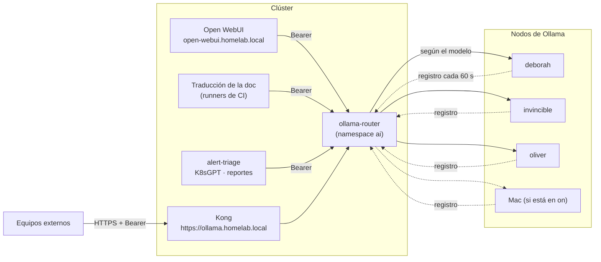

# Asistente de IA local (Ollama + Open WebUI)

El HomeLab tiene su propia inteligencia artificial, gratis y sin salir de la casa: modelos de lenguaje (LLM,
*Large Language Model*) que corren en los equipos de la casa y se usan desde una página web (Open WebUI) para
preguntarle por el HomeLab, y desde el pipeline que traduce esta documentación al inglés. Nada se envía a
servicios de pago ni a internet.

Hay **varios equipos que ejecutan modelos** (se llaman *nodos de Ollama*) y **una sola puerta de entrada**: un
router que sabe qué modelos tiene cada nodo y manda cada petición al que corresponde. Los nodos se anuncian solos,
así que sumar uno es fácil ([guía](agregar-nodo-ollama.md)). Y los nodos solo se encienden cuando alguien les
escribe: el resto del tiempo Ollama (el programa que ejecuta el modelo) está apagado y no ocupa memoria.

## Qué es cada pieza

| Pieza | Qué hace | Dónde vive |
|---|---|---|
| **Ollama** | Ejecuta los modelos de lenguaje | En cada nodo (`deborah`, `invincible`, `oliver` y, cuando se enciende, el Mac), fuera de Kubernetes |
| **Socket y proxy** | Escuchan en el puerto `11434` del nodo y despiertan a Ollama solo cuando llega una petición | Cada nodo (systemd en Linux, `launchd` en el Mac) |
| **Agente de registro** | Cada 60 segundos avisa al router que el nodo está vivo y qué modelos tiene | Cada nodo |
| **Router de Ollama** (`ollama-router`) | Única puerta de entrada: valida el token, elige el nodo según el modelo y publica métricas | Clúster, namespace `ai` |
| **Kong** | Recibe el tráfico externo en `https://ollama.homelab.local` y lo reenvía al router | Clúster |
| **Open WebUI** | Página de chat; entra con Dex (GitHub) | Clúster, namespace `ai`, en `open-webui.homelab.local` |
| **Open Terminal** | Terminal con ejecución de código que el asistente usa como herramienta; aislado y solo para administradores | Clúster, namespace `ai-sandbox` |
| **Herramientas de solo lectura** | Dejan que el asistente consulte el estado del clúster y las métricas | Clúster, namespace `ai` |
| **Resumen de alertas y K8sGPT** | Explican alertas y problemas del clúster en lenguaje claro | Clúster, namespace `ai` |

## Arquitectura



- **Un solo punto de entrada.** Los clientes dentro del clúster usan el Service interno
  `http://ollama-router.ai.svc`; los de fuera, `https://ollama.homelab.local` (HTTPS, por Kong). Ya no hay un
  Service por nodo ni la caché de `/api/tags` en Kong: el router responde `/api/tags` desde su registro, sin
  despertar a nadie.
- **Autenticación obligatoria.** Cada cliente tiene su propio token (`Authorization: Bearer ...`). Sin token, el
  router responde `401`. Ver [Seguridad](#seguridad-y-firewall).
- **Elección del nodo.** El router mira el `model` de la petición y escoge entre los nodos vivos que lo tienen:
  el último que lo usó (para no recargar), luego el de mayor prioridad, luego el menos ocupado. Un modelo que
  solo está en el Mac va al Mac. Si un nodo falla al conectar, lo evita 30 segundos.
- **Cómo se anuncian los nodos.** Ver [Agregar un nodo al clúster de Ollama](agregar-nodo-ollama.md): el agente lee
  los modelos de las carpetas de Ollama (sin despertarlo), los manda al router y el router los caduca si deja de
  oír al nodo durante 180 segundos (3 latidos).

Cómo funciona el "dormir y despertar" de cada nodo:

1. Un **socket** (systemd en Linux, `launchd` en el Mac) escucha siempre en `11434`. Cuesta casi nada.
2. Cuando llega una petición real, arranca un **proxy**, que enciende Ollama y le reenvía el tráfico en
   `127.0.0.1:11435`.
3. Tras 5 minutos sin tráfico, el proxy termina solo y Ollama se detiene: el equipo recupera su memoria.

## Crear la clave de Open WebUI (una sola vez)

Open WebUI firma las sesiones de sus usuarios con una clave secreta, `WEBUI_SECRET_KEY`. Sin ella el pod no arranca.
Como el resto de los secretos de la plataforma, vive en 1Password y **no** pasa por git (`homelab` es público y `gitops`, aunque es privado, no guarda secretos):

1. Genera la clave. Tiene que ser aleatoria, de 64 caracteres hexadecimales:

    ```bash
    openssl rand -hex 32
    ```

2. En 1Password, en la bóveda `HomeLab`, crea un item (tipo *Nota segura*) llamado `open-webui` con un campo de texto
   `WEBUI_SECRET_KEY` y pega ahí el valor. El nombre del item y del campo tienen que ser exactos y el campo no debe ir dentro
   de una sección.
3. Comprueba el item sin mostrar el valor: `python3 ansible/scripts/apply_platform_secrets.py --check` debe mostrar
   `✓ WEBUI_SECRET_KEY` bajo `open-webui`.
4. Aplícalo (crea el namespace `ai` y el Secret `ai/open-webui-secret`):

    ```bash
    cd ansible
    ansible-playbook -i inventory.ini playbook-platform-secrets.yml
    ```

Hazlo antes de que ArgoCD sincronice la Application `open-webui`. Para rotar la clave, repite los pasos 1, 2 y 4 y reinicia el
pod de Open WebUI; los usuarios tendrán que iniciar sesión de nuevo. Más sobre el flujo en
[Gestión de secretos](../secrets/index.md) y [Rotar credenciales](rotar-credenciales.md).

## Modelos por nodo

Cada nodo declara sus modelos; el router los junta en `/api/tags` y los usa para elegir. La asignación inicial
es (se ajusta midiendo tokens por segundo y memoria en cada nodo):

| Nodo | Modelos | Para qué |
|---|---|---|
| `deborah` | `qwen2.5:7b-instruct` (y un 14B opcional); la réplica del 7B en `invincible` está comentada en su `host_vars` y es una decisión pendiente | Modelo por defecto: chat con el asistente y traducción de la documentación |
| `invincible` | `qwen2.5-coder:7b` | Ayuda con código: Ansible, YAML y manifiestos de Kubernetes |
| `oliver` | `nomic-embed-text` y modelos de hasta 3B | *Embeddings* (convertir textos en números para buscar en la documentación) y tareas livianas |
| Mac | Modelos grandes | Tareas pesadas, solo mientras el interruptor esté en `on` |

Cada nodo atiende **una petición a la vez** (`OLLAMA_NUM_PARALLEL=1`) y el router lleva un semáforo por nodo. La
lista de modelos de un nodo Linux es la variable `ollama_ondemand_models` de su `host_vars` y se aplica con el tag
`models` (ver [Ansible](../ansible/index.md)); en el Mac se gestionan con `ollama pull`. La gestión de modelos
**no** se hace por la red: el router bloquea `pull`, `create`, `delete`, `copy` y `push`.

## Métricas por modelo y nodo

Ollama no publica métricas ni anota el modelo de cada petición, y Kong tampoco lo ve (va en el cuerpo). Por eso las
publica el router en `/metrics` (formato Prometheus): peticiones por modelo, nodo y código; duración; tokens
(del `prompt_eval_count` y `eval_count` de cada respuesta); peticiones en curso; si cada nodo está vivo y cuándo
se le oyó por última vez. VictoriaMetrics las recoge con un `VMServiceScrape` y se ven en el dashboard **HomeLab / Ollama** de Grafana (nodos con latido, peticiones en curso, errores 5xx, tokens y latencia por modelo y nodo). Dos alertas avisan si el servicio falla: `OllamaRouterCaido` y `OllamaRouterSinNodos`. Sirven para
saber **qué modelos se usan y en qué nodos**, sin leer logs. El router además escribe un log JSON por petición
que va a [VictoriaLogs](logs.md).

## Arranque en frío

Despertar a Ollama y cargar el modelo en memoria no es instantáneo: la primera respuesta tras un rato de
inactividad tarda más (y más si el modelo es grande o el equipo es lento).

- En cada nodo, el servicio espera a que Ollama escuche antes de dar por listo el arranque.
- En Kong, la ruta del router tiene tiempos de espera largos y **sin reintentos** (un reintento repetiría un
  prompt que ya está corriendo).
- Los clientes toleran la espera: la traducción de la documentación reintenta la conexión hasta unos 5 minutos.

Si el primer mensaje falla o se corta, espera un minuto y vuelve a intentarlo.

## Qué despierta un nodo y qué no

Despierta un nodo **un mensaje real** al modelo (un chat, una traducción, un embedding). No debe despertarlo nada
"de adorno": el router responde `/api/tags` y `/api/version` desde su registro, no sondea a los nodos, no hay
comprobaciones activas de salud, `ollama.homelab.local` está excluido de las sondas de monitoreo y Open WebUI
tiene desactivados los títulos, etiquetas y autocompletado automáticos.

## Comprobar el router

```bash
# Con el token de un cliente (guárdalo en una variable, no lo pegues en comandos que queden en el historial)
TOKEN=...

# Nodos vivos y sus modelos
curl -s -H "Authorization: Bearer $TOKEN" https://ollama.homelab.local/api/tags

# Sin token debe dar 401; la gestión de modelos, 403
curl -s -o /dev/null -w '%{http_code}\n' https://ollama.homelab.local/api/tags
curl -s -o /dev/null -w '%{http_code}\n' -X POST -H "Authorization: Bearer $TOKEN" https://ollama.homelab.local/api/pull
```

Y que un nodo duerme y despierta (por SSH al nodo, ver [Entrar por SSH](acceso-ssh.md)):

```bash
systemctl is-active ollama                   # inactive en reposo
# tras un chat real por el router:
systemctl is-active ollama                   # active
# unos 5 minutos después:
systemctl is-active ollama                   # inactive otra vez
```

## Open WebUI con Dex

Open WebUI no tiene cuentas propias: se entra con **SSO** (*Single Sign-On*, inicio de sesión único, con GitHub) a través de Dex, como en Grafana.

- Solo puede entrar el team `devops` de la organización `maceosoft`; los administradores de Open WebUI son los
  de ese mismo team (el rol llega en el claim `groups`).
- El registro abierto está desactivado (`ENABLE_SIGNUP=False`); un usuario nuevo sin rol queda pendiente.
- El cliente de Dex es público y usa PKCE (*Proof Key for Code Exchange*, una protección para clientes sin secreto).
- Se conserva el formulario local como acceso de emergencia (igual que el administrador local de Grafana).
- Open WebUI corre sin privilegios (usuario no root) y con el sistema de archivos de solo lectura.
- Las herramientas MCP (*Model Context Protocol*, un estándar para darle herramientas a un modelo) solo las ven los administradores.
- El pod confía en la CA (autoridad certificadora) del HomeLab, que es la que firma el certificado de Dex.

## Preguntarle al asistente por el HomeLab (RAG)

RAG (*Retrieval-Augmented Generation*) es darle al modelo documentos propios para que responda con ellos en
lugar de inventar. Este sitio ya publica un archivo con toda la documentación en texto plano, `llms-full.txt`
(en la raíz del sitio), pensado justo para esto. La carga es **un paso manual en la interfaz**:

1. Descarga `llms-full.txt` desde el sitio publicado.
2. En Open WebUI entra a **Workspace → Knowledge**, crea una colección y sube el archivo (y, si quieres, los
   runbooks de [Operación](index.md)).
3. En un chat, escribe `#` y elige esa colección para que el asistente la consulte.

Open WebUI usa `nomic-embed-text` como modelo de embeddings, así que indexar la documentación también pasa por
Ollama (y puede despertar un nodo). Al cambiar la documentación hay que volver a subir el archivo.

## Herramientas de solo lectura y la política "solo proponer"

El asistente puede **mirar** el HomeLab mediante herramientas MCP (*Model Context Protocol*, un estándar para
darle herramientas a un modelo), expuestas a Open WebUI como servidores de herramientas:

- **Kubernetes**: lectura del estado del clúster, con una cuenta de servicio de permisos mínimos (sin acceso
  a `secrets` y sin ningún permiso de escritura) y una política de red que limita quién puede llamarla.
- **VictoriaMetrics y Alertmanager**: consultas de métricas, alertas activas y reglas.

Consultar métricas o Kubernetes no despierta ningún nodo; solo lo despierta el mensaje al modelo.

!!! danger "El asistente nunca aplica cambios"
    Su política es **solo proponer**. Si le pides un cambio, te devuelve el diff o el borrador de un pull
    request para el repo [`maceosoft/gitops`](https://github.com/maceosoft/gitops); **tú lo revisas y lo
    apruebas**. Aunque pudiera escribir, ArgoCD (con `selfHeal`) revertiría cualquier cambio manual.

Para verificar los permisos de la cuenta de servicio de las herramientas:

```bash
kubectl auth can-i --list --as=system:serviceaccount:ai:<cuenta>   # sin verbos de escritura
```

## Resumen de alertas a Discord

Alertmanager tiene un receptor adicional que manda cada alerta a un servicio del namespace `ai` (con un token Bearer); este le pide
a Ollama vía el router un resumen en lenguaje claro y lo publica en Discord.

!!! warning "El resumen NO reemplaza las alertas reales"
    La alerta original sigue saliendo por sus canales de siempre (Discord y healthchecks.io), **sin pasar por
    la IA y aunque los nodos estén dormidos**. El resumen llega después y es un extra: si Ollama no responde, no pasa
    nada. Para no despertar un nodo sin necesidad, el servicio agrupa y deduplica alertas y limita el ritmo de
    llamadas.

## K8sGPT

[K8sGPT](https://github.com/k8sgpt-ai/k8sgpt) revisa el clúster en busca de problemas y los explica con ayuda
de Ollama.

!!! warning "K8sGPT está etapado: la decisión es tuya"
    Su línea está comentada en `root-appset.yaml`. El chart del operador trae un ClusterRole con permisos `*/*/*`
    (en la práctica, administrador de todo el clúster) y no ofrece una opción para quitarlo; además el RBAC dinámico
    lee los Secrets de todo el clúster. Para activarlo hay tres caminos, descritos en
    [`security/k8sgpt-rbac/`](https://github.com/maceosoft/gitops/tree/main/security/k8sgpt-rbac): aceptar el riesgo y
    descomentar la línea; usar el rol acotado que ahí se propone (no está probado); y activar la NetworkPolicy del
    namespace junto con la app. Mientras no se active, el resto de este apartado describe cómo funciona. Corre como operador, con análisis programado y poco frecuente, y deja sus resultados como objetos
del clúster:

```bash
kubectl get results.core.k8sgpt.ai
```

Todo el análisis es local: no se envía nada fuera de la casa.

## Open Terminal: terminal para el asistente

Open Terminal es un terminal con ejecución de código que Open WebUI usa como **herramienta del agente**: el
asistente puede escribir y ejecutar scripts, procesar archivos y devolverte el resultado dentro del chat. Corre en
su propio namespace, `ai-sandbox`, con la imagen `ghcr.io/open-webui/open-terminal` (variante `slim`), y se
despliega desde [`ai/open-terminal/`](https://github.com/maceosoft/gitops/tree/main/ai/open-terminal).

**Para qué sirve:** ejecutar código (Python, shell), convertir o analizar archivos, probar un script antes de
llevarlo a Ansible o a un manifiesto. **Qué no hace:** no administra el HomeLab; no tiene acceso al clúster.

### Cómo se usa

1. Entra a Open WebUI con SSO (GitHub) y abre un chat.
2. Activa la integración **Open Terminal** del chat (solo la ven los administradores y el grupo `maceosoft:devops`).
3. Pídele algo que requiera ejecutar código, por ejemplo "calcula el promedio de este CSV (archivo de datos separado por comas)". El asistente corre el
   comando en el terminal y te muestra la salida.

### Cómo se conecta (administradores)

En Open WebUI: *Admin Settings → Integrations → **Open Terminal*** (no en "External Tools" ni "Tool Servers").
Se indica la URL interna del Service de Open Terminal, la clave y el tipo de autenticación **Bearer**. La variable
`ENABLE_TOOL_SERVERS=true` debe estar activa en Open WebUI. El acceso se restringe a administradores y al grupo
`maceosoft:devops`.

### Límites de Open Terminal

- **Sandbox acotado:** 1 CPU (unidad central de procesamiento) y 2 GB de RAM (memoria) como máximo.
- **Sin acceso al clúster ni a la red interna.** Una NetworkPolicy solo deja entrar a Open WebUI, y la salida
  se limita a internet por los puertos 80 y 443.
- **Volumen persistente pequeño:** 2 GB en Longhorn; los archivos sobreviven a un reinicio, pero el espacio es poco.

### Riesgos

!!! danger "Ejecuta código arbitrario"
    Todo lo que el asistente (o quien use el chat) decida ejecutar corre de verdad. **No es un límite de seguridad
    entre usuarios**: quien lo use comparte el mismo terminal y los mismos archivos. Por eso es solo para
    administradores, y **nunca se debe montar `docker.sock`** ni darle credenciales, kubeconfig o Secrets.

### Clave de API: generar y rotar

La clave protege la API de Open Terminal (Bearer). Se crea y rota igual que las demás:

1. `openssl rand -hex 32`
2. En 1Password, bóveda `HomeLab`, item **`open-terminal`**, campo **`api_key`**.
3. `cd ansible && ansible-playbook -i inventory.ini playbook-platform-secrets.yml` crea los Secrets
   `ai-sandbox/open-terminal-api-key` y `ai/open-terminal-api-key`.
4. Reinicia los pods de Open Terminal y de Open WebUI para que lean el valor nuevo, y actualiza la clave en
   *Admin Settings → Integrations → Open Terminal* si hace falta.

La clave se monta en el pod como un **archivo** (`OPEN_TERMINAL_API_KEY_FILE`, permisos `0440`), no como variable de
entorno. La NetworkPolicy de `ai-sandbox` viaja junto al pod (`ai/open-terminal/networkpolicy.yaml`, con el orden
Namespace → NetworkPolicy → pod). Si despliegas la app **antes** de crear el Secret, Open WebUI arranca igual pero la
conexión a Open Terminal responde `401` hasta que crees el Secret y reinicies el pod.

Ver [Rotar credenciales](rotar-credenciales.md).

## Límites

- **Solo CPU (unidad central de procesamiento).** Los nodos Linux no tienen tarjeta gráfica (GPU), solo procesador; un modelo
  de 7 mil millones de parámetros responde lento (palabras por segundo, no instantáneo). Traducir toda la
  documentación por primera vez toma horas. El Mac, con memoria unificada, es la excepción para modelos grandes.
- **Una petición por nodo a la vez.** Para más paralelismo hace falta más nodos.
- **El router es un punto único.** Corre en una réplica y guarda el registro en memoria: si cae, la IA cae (los
  nodos se re-registran solos en menos de un minuto cuando vuelve). Las alertas reales no dependen de él.
- **Un modelo cargado quita memoria** al resto de cargas del nodo mientras dura.
- **El control plane de K3s** está en `deborah` hoy y se muda a `oliver`
  ([Mover el control plane](mover-control-plane.md)); con ello `deborah` queda libre para los modelos.

## Seguridad y firewall

- **Clientes con token.** El router exige `Authorization: Bearer <token>` en `/api/*` y `/v1/*`. Hay un token por
  cliente (`open-webui`, `k8sgpt`, `translate`, `reports`, `alert-triage`), todos en el item `ollama-router` de
  1Password; cada uno se rota por separado ([Rotar credenciales](rotar-credenciales.md)). Open WebUI y K8sGPT ya
  mandan su clave así; los scripts leen `OLLAMA_TOKEN`.
- **Registro con otro token.** `/_registry` usa un token distinto del de los clientes (campo `registry_token` del
  mismo item). Con él no se puede usar la inferencia.
- **Ollama del nodo no autentica.** Cada nodo escucha solo en su IP y su firewall (`nftables`) admite el puerto
  `11434` desde los nodos de K3s **y desde los pods** (el router puede estar en el mismo nodo que el Ollama que usa).
  La protección real de la inferencia es el token Bearer del router más las NetworkPolicy del namespace `ai`; los
  clientes no hablan con un nodo. Es una excepción documentada: ver
  [Modelo de autenticación](../security/modelo-de-autenticacion.md).
- **Solo HTTPS por Kong.** No hay listener HTTP para `ollama.homelab.local`. Dentro del clúster, el Service interno
  `ollama-router.ai.svc` solo admite ingreso desde los namespaces y etiquetas permitidos cuando la NetworkPolicy del
  namespace `ai` está activa (se activa por etapas; ver [Qué está activo](../security/modelo-de-autenticacion.md#que-esta-activo-y-que-esta-por-activar)).
- **Límites del router.** Registra hasta 64 nodos con 2000 modelos cada uno, prioridades de 0 a 100 y nombres de modelo
  con el formato `^[A-Za-z0-9._:/@-]{1,128}$`; los métodos `HEAD`, `OPTIONS` y `PATCH` responden `405`; los tiempos de
  espera son de 900 segundos. Solo acepta registros de nodos dentro de `ALLOWED_NODE_CIDRS` (`192.168.20.0/22`), y un
  nodo vivo no se puede pisar desde otra IP (responde `409` hasta que caduque o se haga `DELETE`). Kong solo publica
  `/api`, `/v1` y `/_registry`: ni `/metrics` ni `/healthz` salen por ahí.
- **Gestión de modelos bloqueada** (`pull`, `create`, `delete`, `copy`, `push` y `blobs`).
- Open WebUI se expone solo por HTTPS y su clave interna (`WEBUI_SECRET_KEY`) viaja como secreto cifrado.

## Dónde está cada cosa

| Qué | Dónde |
|---|---|
| Rol de Ansible `ollama_ondemand` (nodos Linux) | [`ansible/roles/ollama_ondemand`](https://github.com/maceosoft/homelab/tree/main/ansible/roles/ollama_ondemand) |
| Playbook | [`ansible/playbook-ollama.yml`](https://github.com/maceosoft/homelab/blob/main/ansible/playbook-ollama.yml) (grupo `llm_nodes`) |
| Agente de nodo y bundle de macOS | [`ollama-node/`](https://github.com/maceosoft/homelab/tree/main/ollama-node) |
| Router | [`ai/ollama-router/`](https://github.com/maceosoft/gitops/tree/main/ai/ollama-router) |
| Applications de ArgoCD | `ollama-router`, `open-webui`, `open-terminal`, `ai-tools` y `k8sgpt` en [`argocd/apps/`](https://github.com/maceosoft/gitops/tree/main/argocd/apps) |
| Manifiestos | Carpeta [`ai/`](https://github.com/maceosoft/gitops/tree/main/ai) (`ollama-router`, `open-webui`, `open-terminal`, `tools`, `alert-triage`, `k8sgpt` y `log-report`) |

Ver también [Agregar un nodo al clúster de Ollama](agregar-nodo-ollama.md), [Logs](logs.md),
[Ansible](../ansible/index.md), [GitOps](../gitops/index.md), [Red](../networking/index.md) y
[URLs y accesos](urls-y-accesos.md).
