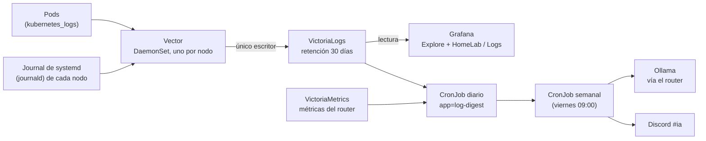

# Centralized logs and AI reports

Logs from all nodes and all pods are collected in a single place and read from Grafana.
On top of those logs run two automatic reports: a **daily** one summarizing what happened and a **weekly**
one with improvement suggestions, published in the Discord channel `#ia`.

## How a log travels



- **Vector** is the collector: it runs on every node as a DaemonSet (one pod per node) and reads two sources: Kubernetes container logs and the node's own systemd journal (`ssh`, `k3s`, `ollama`, the firewall...).
  It adds labels (`node`, `unit`, `namespace`, `pod` and the level) and forwards them.
- **VictoriaLogs** is the log database. It stores **30 days** on a Longhorn volume and is only accessible
  inside the cluster: Vector is the only writer; Grafana, the daily and weekly reports (`log-report`) and the log VMAlert read from it.
- **Grafana** queries VictoriaLogs via a pre-provisioned datasource.

!!! info "The `deborah` journal is volatile"
    In `deborah`, `/var/log` is a 200 MB in-memory tmpfs partition: its journal is lost when the node reboots.
    That is why the important thing is for Vector to export it to VictoriaLogs while the node is up; what reached
    VictoriaLogs is kept for the 30-day retention even if `deborah` reboots.

**This decision in other environments**

=== "🏠 At home"

    Vector collects logs, VictoriaLogs keeps them for 30 days and Grafana displays them; on top, a daily and a weekly
    AI report summarize what happened. It uses few resources and is enough to investigate a failure from the last few weeks.

=== "🏢 In a company"

    - **Benefits:** with all logs in one place you investigate an incident in minutes, without logging into server
      after server, and you have the evidence of **who did what and when** that audits require.
    - **Compliance retention:** regulations and contracts may require keeping certain logs for months or years, with
      no one able to delete or alter them. Hot (queryable) storage is usually separated from archived (cheap) storage.
    - **SIEM:** security logs go to a SIEM (system that correlates events to detect attacks), such as
      [Splunk Enterprise Security](https://www.splunk.com/en_us/products/enterprise-security.html),
      [Elastic Security](https://www.elastic.co/security) or
      [Microsoft Sentinel](https://learn.microsoft.com/en-us/azure/sentinel/overview), monitored by a
      security team.
    - **Access and privacy:** who can read which logs is controlled via corporate identity, and personal data
      is masked before storage.
    - **When the HomeLab approach makes sense:** when log volume makes a per-GB billed service expensive, or data
      cannot leave your infrastructure.

=== "☁️ In the cloud"

    | Cloud | Equivalent service |
    |---|---|
    | GCP | [Cloud Logging](https://cloud.google.com/logging) |
    | AWS | [Amazon CloudWatch Logs](https://docs.aws.amazon.com/AmazonCloudWatch/latest/logs/WhatIsCloudWatchLogs.html) |
    | Azure | [Azure Monitor Logs (Log Analytics)](https://learn.microsoft.com/en-us/azure/azure-monitor/logs/data-platform-logs) |
    | Oracle Cloud (OCI) | [OCI Logging](https://docs.oracle.com/en-us/iaas/Content/Logging/home.htm) |

    You gain integrated collection with that cloud's services, configurable retention and scale without managing disks.
    You lose control over format and queries, pay per GB ingested and stored, and become more locked into that provider.

## What is collected

| Source | Content | Main labels |
|---|---|---|
| Pods (`kubernetes_logs`) | stdout and stderr of each container, including the per-request JSON log from the Ollama router | `namespace`, `pod`, `container`, `node` |
| Journal (`journald`) | Services on each node: `k3s`, `ollama`, `ssh`, firewall, `auditd` | `node`, `unit` |
| Reports | The summary left by the daily CronJob (`app=log-digest`) | `app` |

The level (error, warning, info) is inferred from the message when the log record provides it.

## Query logs in Grafana

1. Open Grafana ([URLs and access](urls-y-accesos.md)) → **Explore**.
2. Select the VictoriaLogs datasource.
3. Write a query in **LogsQL** (VictoriaLogs query language). Filters can be combined with `AND` and `OR` and operations chained with `|`.

Examples:

```text
# Todo lo que dice "error" en el namespace ai, en la última hora
_time:1h namespace:ai error

# Logs de Ollama en un nodo
_time:6h node:deborah unit:ollama.service

# Reinicios por falta de memoria en cualquier nodo
_time:24h "Out of memory" OR "oom-kill"

# Los 10 mensajes que más se repiten, con los números colapsados
_time:24h error | collapse_nums | stats by (_msg) count() as total | sort by (total) desc | limit 10

# El resumen de ayer
app:log-digest _time:2d
```

Exact field names can be seen in Explore, in the field list of any log record.
The full language reference is in the
[LogsQL documentation](https://docs.victoriametrics.com/victorialogs/logsql/).

## Dashboards

Grafana has 12 HomeLab dashboards; the logs one is called **HomeLab / Logs** and shows volume by level, errors by service and
by node, and restarts. It is defined as code in the repo
[`gitops`](https://github.com/maceosoft/gitops/tree/main/addons/monitoring/config/dashboards), not edited manually.

The Ollama router also publishes metrics by **model and node** (requests, tokens, latency, live nodes), visible in the **HomeLab / Ollama** dashboard (and queryable in Explore on `ollama_router_*`). See [Local AI Assistant](ia-ollama.md#metricas-por-modelo-y-nodo).

## Retention and space

- Retention is **30 days**. After that, VictoriaLogs deletes the oldest data.
- Logs occupy the VictoriaLogs Longhorn volume; if it grows more than expected, lower retention or
  filter noisy sources in Vector. Vector memory limits are kept small on purpose.

## Log alerts

A second VMAlert (of type `vlogs`) evaluates rules written in LogsQL and sends its alerts via Alertmanager,
just like metric alerts ([Monitoring and alerts](monitoreo.md)).

## Daily and weekly reports in `#ia`

Both are CronJobs in the `monitoring` namespace (the `log-report` Application). The daily analysis **does not use AI** and does not wake any Ollama node.

| Report | When | What it does |
|---|---|---|
| **Daily** | Every day, 06:30 | Queries VictoriaLogs (errors by level and service, repeated patterns, restarts, out-of-memory, `ollama` starts and stops) and VictoriaMetrics (requests, tokens and latency by model and node, live nodes, Kong, alerts). Saves the summary as a structured log (`app=log-digest`) |
| **Weekly** | Friday 09:00 (`America/Santiago`), `schedule: "0 9 * * 5"` | Reads the daily summaries from the last 7 days, calculates **rule-based suggestions** and asks Ollama for a summary in Spanish. If Ollama fails, it still publishes the rule-based report |

Rule-based suggestions include, for example: a model unused for several days, frequent cold starts (raise `KEEP_ALIVE`), a node with memory pressure (lower its `MemoryMax`), new errors, recurring alerts, and disk.
The AI text is marked as **AI suggestion, verify**: it never applies changes.

The CronJobs are named `log-digest-daily` (daily, 06:30) and `log-report-weekly`. To run one manually:

```bash
kubectl -n monitoring create job --from=cronjob/log-digest-daily prueba-manual
kubectl -n monitoring logs job/prueba-manual
```

The manifests are in [`gitops/addons/ai/log-report`](https://github.com/maceosoft/gitops/tree/main/addons/ai/log-report).
To change the day or time of the weekly job, edit its `schedule` field in the repo.

### Create the `#ia` channel and its webhook (once only)

Reports are published via a Discord webhook, just like alerts. The Discord steps are the same as in [Discord and healthchecks.io](../maceosoft/discord-healthchecks.md):

1. In the private category `🖥️ Infraestructura`, create the text channel **`ia`**.
2. *Server Settings → Integrations → Webhooks → New Webhook*; name it `Reportes IA` and select the `ia` channel.
3. **Copy Webhook URL** and save it in 1Password:

    === "🖱️ From the UI"

        Paste it into the `discord-webhooks` item in 1Password, in a new field called **`ai`**
        (next to `critical` and `warnings`).

    === "⌨️ From the console"

        The URL is read without echo, so it doesn't remain in history (if it doesn't exist, `op item edit` creates the field):

        ```bash
        # pega la URL del webhook y Enter
        read -rs DC_AI; op item edit discord-webhooks --vault HomeLab "ai[password]=$DC_AI"; unset DC_AI
        ```

4. Validate and apply:

    ```bash
    cd ansible
    ../.venv/bin/python scripts/apply_platform_secrets.py --check
    ansible-playbook -i inventory.ini playbook-platform-secrets.yml
    ```

The script checks that the URL has the `https://discord.com/api/webhooks/<id>/<token>` format and adds it to the `monitoring/discord-webhooks` Secret. To rotate it, delete the webhook in Discord, create a new one, and repeat from step 2.

See also [Rotate credentials](rotar-credenciales.md) and [Secrets management](../secrets/index.md).

## Troubleshooting

| Symptom | What to check |
|---|---|
| No logs from a node | That node's Vector pod (`kubectl -n monitoring get pods -o wide`) and its logs; the node's journal |
| Missing old `deborah` logs | Its journal is volatile: only what Vector managed to export before the reboot is kept |
| Grafana doesn't see the datasource | The VictoriaLogs plugin in Grafana and the VictoriaLogs Service address |
| Weekly report arrives without AI text | Ollama didn't respond: this is normal, the rule-based report is published anyway |
| Nothing arrives at `#ia` | `ai` field of `discord-webhooks` missing or invalid format; check the CronJob with `kubectl -n monitoring logs` |
