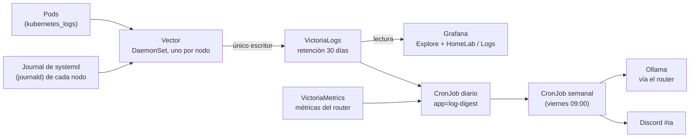

# Centralized Logs and AI Reports

The logs from the three nodes and all the pods are collected in one place and read from Grafana.
Additionally, two automatic reports run on these logs: a **daily** summary of what happened and a **weekly**
report with improvement suggestions, published in the `#ia` Discord channel.

## How a Log Travels



- **Vector** is the collector: it runs on each node as a DaemonSet (one pod per node) and reads two sources: the logs
  of the Kubernetes containers and the journal of systemd on the node itself (`ssh`, `k3s`, `ollama`, the firewall...).
  It adds labels (`node`, `unit`, `namespace`, `pod` and the level) and sends them.
- **VictoriaLogs** is the log database. It stores **30 days** in a Longhorn volume and is only accessible
  inside the cluster: Vector is the only one that writes; Grafana, the daily and weekly reports (`log-report`), and the VMAlert for logs read from it.
- **Grafana** queries VictoriaLogs with a pre-provisioned data source.

!!! info "The journal of `deborah` is volatile"
    In `deborah`, `/var/log` is a temporary partition of 200 MB in memory: its journal is lost on node restart.
    That's why it's important for Vector to export it to VictoriaLogs while the node is running; what reaches VictoriaLogs is kept for the 30 days of retention even if `deborah` restarts.

**This decision in other environments**

=== "🏠 At home"

    Vector collects the logs, VictoriaLogs stores them for 30 days, and Grafana displays them; on top of that, daily and weekly reports with AI summarize what happened. It's low-cost and sufficient to investigate a failure from the last few weeks.

=== "🏢 In a company"

    - **Benefits:** with all logs in one place, you can investigate an incident in minutes without entering server by server, and you have the evidence of **who did what and when** that audits require.
    - **Retention for compliance:** regulations and contracts may require storing certain logs for months or years, without anyone being able to delete or change them. It's common to separate the hot (queryable) data from the archived (cheap) data.
    - **SIEM:** security logs go to a SIEM (system that correlates events to detect attacks), such as
      [Splunk Enterprise Security](https://www.splunk.com/en_us/products/enterprise-security.html),
      [Elastic Security](https://www.elastic.co/security) or
      [Microsoft Sentinel](https://learn.microsoft.com/en-us/azure/sentinel/overview), monitored by a security team.
    - **Access and privacy:** who can read what logs is controlled by corporate identity, and personal data is masked before storing.
    - **When the HomeLab setup is useful:** when the volume of logs makes a service that charges by GB expensive, or the data cannot leave your infrastructure.

=== "☁️ In the cloud"

    | Cloud | Equivalent service |
    |---|---|
    | GCP | [Cloud Logging](https://cloud.google.com/logging) |
    | AWS | [Amazon CloudWatch Logs](https://docs.aws.amazon.com/AmazonCloudWatch/latest/logs/WhatIsCloudWatchLogs.html) |
    | Azure | [Azure Monitor Logs (Log Analytics)](https://learn.microsoft.com/en-us/azure/azure-monitor/logs/data-platform-logs) |
    | Oracle Cloud (OCI) | [OCI Logging](https://docs.oracle.com/en-us/iaas/Content/Logging/home.htm) |

    You gain integrated collection with that cloud's services, configurable retention, and scale without worrying about disks.
    You lose control over the format and queries, pay by GB ingested and stored, and become more tied to that provider.

## What is Collected

| Source | Content | Main Labels |
|---|---|---|
| Pods (`kubernetes_logs`) | stdout and stderr of each container, including the log JSON requested by the Ollama router | `namespace`, `pod`, `container`, `node` |
| Journal (`journald`) | Services on each node: `k3s`, `ollama`, `ssh`, firewall, `auditd` | `node`, `unit` |
| Reports | The summary left by the daily CronJob (`app=log-digest`) | `app` |

The level (error, warning, informational) is inferred from the message when the log does not carry it.

## Querying Logs in Grafana

1. Open Grafana ([URLs and access](urls-y-accesos.md)) → **Explore**.
2. Choose the VictoriaLogs data source.
3. Write a query in **LogsQL** (VictoriaLogs' query language). You can combine filters with `AND` and `OR` and chain operations with `|`.

Examples:

```text
# Todo lo que dice "error" en el namespace ai, en la última hora
_time:1h namespace:ai error

# Logs de Ollama en un nodo
_time:6h node:deborah unit:ollama.service

# Reinicios por falta de memoria en cualquier nodo
_time:24h "Out of memory" OR "oom-kill"

# Los 10 mensajes que más se repiten, con los números colapsados
_time:24h error | collapse_nums | stats by (_msg) count() as total | sort by (total) desc | limit 10

# El resumen de ayer
app:log-digest _time:2d
```

The exact names of the fields can be seen in Explore, in the list of fields of any log entry.
The full language reference is in the
[LogsQL documentation](https://docs.victoriametrics.com/victorialogs/logsql/).

## Dashboards

In Grafana, there are 12 HomeLab dashboards; the one for logs is called **HomeLab / Logs** and shows volume by level, errors by service and node, and restarts. It is defined as code in the repo
[`gitops`](https://github.com/maceosoft/gitops/tree/main/monitoring/config/dashboards), not edited manually.

The Ollama router also publishes metrics by **model and node** (requests, tokens, latency, live nodes), visible in the **HomeLab / Ollama** dashboard (and queryable in Explore on `ollama_router_*`). See [Local AI Assistant](ia-ollama.md#metrics-per-model-and-node).

## Retention and Space

- The retention is **30 days**. After that, VictoriaLogs deletes the oldest data.
- The logs occupy the Longhorn volume of VictoriaLogs; if it grows more than expected, lower the retention or filter noisy data in Vector. The memory limits of Vector are intentionally small.

## Alerts on Logs

A second VMAlert (of type `vlogs`) evaluates rules written in LogsQL and sends its alerts through Alertmanager,
just like metric alerts ([Monitoring and alerts](monitoreo.md)).

## Daily and Weekly Reports in `#ia`

Both are CronJobs in the namespace `monitoring` (the Application `log-report`). The daily analysis **does not use AI** and does not wake up any Ollama node.

| Report | When | What It Does |
|---|---|---|
| **Daily** | Every day at 06:30 | Queries VictoriaLogs (errors by level and service, repeated patterns, restarts, lack of memory, starts and stops of `ollama`) and VictoriaMetrics (requests, tokens and latency by model and node, live nodes, Kong, alerts). Saves the summary as a structured log (`app=log-digest`) |
| **Weekly** | Friday at 09:00 (`America/Santiago`), `schedule: "0 9 * * 5"` | Reads the daily summaries of the last 7 days, calculates **rule-based suggestions** and asks Ollama for a summary in Spanish. If Ollama fails, publishes the report based on rules anyway |

The rule-based suggestions are, for example: a model unused for several days, frequent cold starts (raise
`KEEP_ALIVE`), a node with memory shortage (lower its `MemoryMax`), new errors, recurring alerts and disk issues.
The AI text is marked as **AI suggestion, verify**: never apply changes.

The CronJobs are named `log-digest-daily` (daily, 06:30) and `log-report-weekly`. To run one manually:

```bash
kubectl -n monitoring create job --from=cronjob/log-digest-daily prueba-manual
kubectl -n monitoring logs job/prueba-manual
```

The manifests are in [`gitops/ai/log-report`](https://github.com/maceosoft/gitops/tree/main/ai/log-report).
To change the day or time of the weekly report, edit its `schedule` field in the repo.

### Create the `#ia` Channel and Its Webhook (Once)

The reports are published via a Discord webhook, just like the alerts. The Discord steps are the same as in [Discord and healthchecks.io](../maceosoft/discord-healthchecks.md):

1. In the private category `🖥️ Infraestructura`, create the text channel **`ia`**.
2. *Server Settings → Integrations → Webhooks → New Webhook*; name it `Reportes IA` and choose the channel `ia`.
3. **Copy Webhook URL** and save it in 1Password:

    === "🖱️ From the UI"

        Paste it in the item `discord-webhooks` of 1Password, in a new field called **`ai`**
        (next to `critical` and `warnings`).

    === "⌨️ From the console"

        The URL is read without echo, so it does not stay in the history (if it does not exist, `op item edit` creates the field):

        ```bash
        # pega la URL del webhook y Enter
        read -rs DC_AI; op item edit discord-webhooks --vault HomeLab "ai[password]=$DC_AI"; unset DC_AI
        ```

4. Validate and apply:

    ```bash
    cd ansible
    ../.venv/bin/python scripts/apply_platform_secrets.py --check
    ansible-playbook -i inventory.ini playbook-platform-secrets.yml
    ```

The script checks that the URL has the format `https://discord.com/api/webhooks/<id>/<token>` and adds it to the
Secret `monitoring/discord-webhooks`. To rotate it, delete the webhook in Discord, create a new one and repeat from step 2.

See also [Rotate Credentials](rotar-credenciales.md) and [Secrets Management](../secrets/index.md).

## Troubleshooting

| Symptom | What to Check |
|---|---|
| No logs from a node appear | The Vector pod of that node (`kubectl -n monitoring get pods -o wide`) and its logs; the node's journal |
| Missing old logs of `deborah` | Its journal is volatile: only what Vector managed to export before the restart is kept |
| Grafana does not see the data source | The VictoriaLogs plugin in Grafana and the address of the VictoriaLogs Service |
| The weekly report arrives without AI text | Ollama did not respond: it's normal, the report based on rules is published anyway |
| Nothing arrives at `#ia` | Missing or invalid `ai` field of `discord-webhooks`; check the CronJob with `kubectl -n monitoring logs` |
