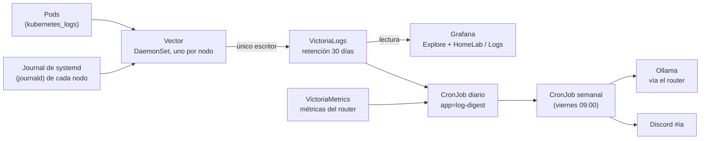

# Centralized Logs and AI Reports

The logs from the three nodes and all the pods are collected in one place and read from Grafana.
In addition, two automatic reports run on these logs: a **daily** summary of what happened and a **weekly**
report with improvement suggestions, published in the `#ia` channel on Discord.

## How a Log Travels



- **Vector** is the collector: it runs on each node as a DaemonSet (one pod per node) and reads two sources: the logs
  of Kubernetes containers and the journal of systemd on the node itself (`ssh`, `k3s`, `ollama`, the firewall...).
  It adds labels (`node`, `unit`, `namespace`, `pod` and the level) and sends them.
- **VictoriaLogs** is the log database. It stores **30 days** in a Longhorn volume and is only accessible
  within the cluster: Vector is the only one that writes; Grafana, the daily and weekly report (`log-report`), and the VMAlert for logs read from it.
- **Grafana** queries VictoriaLogs with a pre-provisioned data source.

!!! info "The journal of `deborah` is volatile"
    On `deborah`, `/var/log` is a temporary partition of 200 MB in memory: its journal is lost on node restart.
    That's why it's important that Vector exports it to VictoriaLogs while the node is powered on; what
    reaches VictoriaLogs is retained for 30 days even if `deborah` restarts.

## What is Collected

| Source | Content | Main Labels |
|---|---|---|
| Pods (`kubernetes_logs`) | stdout and stderr of each container, including the log JSON requested by the Ollama router | `namespace`, `pod`, `container`, `node` |
| Journal (`journald`) | Services on each node: `k3s`, `ollama`, `ssh`, firewall, `auditd` | `node`, `unit` |
| Reports | The summary left by the daily CronJob (`app=log-digest`) | `app` |

The level (error, warning, informational) is inferred from the message when the log does not carry it.

## Query Logs in Grafana

1. Open Grafana ([URLs and access](urls-y-accesos.md)) → **Explore**.
2. Choose the VictoriaLogs data source.
3. Write a query in **LogsQL** (the VictoriaLogs query language). Filters can be combined with `AND` and `OR` and operations chained with `|`.

Examples:

```text
# Todo lo que dice "error" en el namespace ai, en la última hora
_time:1h namespace:ai error

# Logs de Ollama en un nodo
_time:6h node:deborah unit:ollama.service

# Reinicios por falta de memoria en cualquier nodo
_time:24h "Out of memory" OR "oom-kill"

# Los 10 mensajes que más se repiten, con los números colapsados
_time:24h error | collapse_nums | stats by (_msg) count() as total | sort by (total) desc | limit 10

# El resumen de ayer
app:log-digest _time:2d
```

The exact field names can be seen in Explore, in the list of fields of any log entry.
The full language reference is in the
[LogsQL documentation](https://docs.victoriametrics.com/victorialogs/logsql/).

## Dashboards

There are 12 dashboards in Grafana for the HomeLab; the one for logs is called **HomeLab / Logs** and shows volume by level, errors by service and node, and restarts. It is defined as code in the repo
[`gitops`](https://github.com/maceosoft/gitops/tree/main/monitoring/config/dashboards), not edited manually.

The Ollama router also publishes metrics by **model and node** (requests, tokens, latency, live nodes), which are
seen in the **HomeLab / Ollama** dashboard (and can be queried in Explore over `ollama_router_*`). See [Local AI Assistant](ia-ollama.md#metrics-per-model-and-node).

## Retention and Space

- The retention is **30 days**. After that time, VictoriaLogs deletes the oldest logs.
- Logs occupy the Longhorn volume of VictoriaLogs; if it grows more than expected, lower the retention or
  filter out noisy logs in Vector. Vector's memory limits are intentionally small.

## Alerts on Logs

A second VMAlert (type `vlogs`) evaluates rules written in LogsQL and sends its alerts through Alertmanager,
just like metric alerts ([Monitoring and Alerts](monitoreo.md)).

## Daily and Weekly Reports in `#ia`

Both are CronJobs in the `monitoring` namespace (the Application `log-report`). The daily analysis **does not use AI** and does not wake up any Ollama node.

| Report | When | What It Does |
|---|---|---|
| **Daily** | Every day at 06:30 | Queries VictoriaLogs (errors by level and service, repeated patterns, restarts, memory shortage, starts and stops of `ollama`) and VictoriaMetrics (requests, tokens, and latency by model and node, live nodes, Kong, alerts). Saves the summary as a structured log (`app=log-digest`) |
| **Weekly** | Friday at 09:00 (`America/Santiago`), `schedule: "0 9 * * 5"` | Reads the daily summaries of the last 7 days, calculates **suggestions by rules** and asks Ollama for a summary in Spanish. If Ollama fails, publishes the report by rules anyway |

The suggestions by rules are, for example: a model unused for several days, frequent cold loads (raise
`KEEP_ALIVE`), a node with memory shortage (lower its `MemoryMax`), new errors, recurring alerts, and disk issues.
The AI text is marked as **AI suggestion, verify**: never apply changes.

The CronJobs are called `log-digest-daily` (daily, 06:30) and `log-report-weekly`. To run one manually:

```bash
kubectl -n monitoring create job --from=cronjob/log-digest-daily prueba-manual
kubectl -n monitoring logs job/prueba-manual
```

The manifests are in [`gitops/ai/log-report`](https://github.com/maceosoft/gitops/tree/main/ai/log-report).
To change the day or time of the weekly report, edit its `schedule` field in the repo.

### Create the `#ia` Channel and Its Webhook (Once)

The reports are published through a Discord webhook, just like alerts. The Discord steps are the same as in [Discord and healthchecks.io](../maceosoft/discord-healthchecks.md):

1. In the private category `🖥️ Infraestructura`, create the text channel **`ia`**.
2. *Server Settings → Integrations → Webhooks → New Webhook*; name it `Reportes IA` and choose the channel `ia`.
3. **Copy Webhook URL** and paste it in the item `discord-webhooks` in 1Password, in a new field called **`ai`**
   (along with `critical` and `warnings`).
4. Validate and apply:

    ```bash
    cd ansible
    ../.venv/bin/python scripts/apply_platform_secrets.py --check
    ansible-playbook -i inventory.ini playbook-platform-secrets.yml
    ```

The script checks that the URL has the format `https://discord.com/api/webhooks/<id>/<token>` and adds it to the
Secret `monitoring/discord-webhooks`. To rotate it, delete the webhook in Discord, create a new one, and repeat from step 2.

See also [Rotate Credentials](rotar-credenciales.md) and [Secrets Management](../secrets/index.md).

## Troubleshooting

| Symptom | What to Check |
|---|---|
| No logs from a node appear | The Vector pod of that node (`kubectl -n monitoring get pods -o wide`) and its logs; the node's journal |
| Missing old logs of `deborah` | Its journal is volatile: only what Vector managed to export before the restart is kept |
| Grafana does not see the datasource | The VictoriaLogs plugin in Grafana and the address of the VictoriaLogs Service |
| The weekly report arrives without AI text | Ollama did not respond: it's normal, the report by rules is published anyway |
| Nothing arrives at `#ia` | Missing or invalid `ai` field in `discord-webhooks`; check the CronJob with `kubectl -n monitoring logs` |
