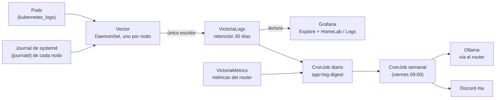

# Logs centralizados y reportes con IA

Los registros (logs) de los tres nodos y de todos los pods se juntan en un solo lugar y se leen desde Grafana.
Sobre esos registros corren además dos reportes automáticos: uno **diario** que resume lo ocurrido y uno **semanal**
con sugerencias de mejora, publicados en el canal `#ia` de Discord.

## Cómo viaja un log



- **Vector** es el recolector: corre en cada nodo como DaemonSet (un pod por nodo) y lee dos fuentes: los logs de
  los contenedores de Kubernetes y el journal de systemd del propio nodo (`ssh`, `k3s`, `ollama`, el firewall...).
  Les pone etiquetas (`node`, `unit`, `namespace`, `pod` y el nivel) y los envía.
- **VictoriaLogs** es la base de datos de logs. Guarda **30 días** en un volumen de Longhorn y solo es accesible
  dentro del clúster: Vector es el único que escribe; leen Grafana, el reporte diario y semanal (`log-report`) y el VMAlert de logs.
- **Grafana** consulta VictoriaLogs con un datasource (fuente de datos) ya provisionado.

!!! info "El journal de `deborah` es volátil"
    En `deborah`, `/var/log` es una partición temporal de 200 MB en memoria: su journal se pierde al reiniciar el
    nodo. Por eso lo importante es que Vector lo exporte a VictoriaLogs mientras el nodo está encendido; lo que
    llegó a VictoriaLogs se conserva los 30 días de retención aunque `deborah` se reinicie.

## Qué se recoge

| Fuente | Contenido | Etiquetas principales |
|---|---|---|
| Pods (`kubernetes_logs`) | stdout y stderr de cada contenedor, incluido el log JSON por petición del router de Ollama | `namespace`, `pod`, `container`, `node` |
| Journal (`journald`) | Servicios de cada nodo: `k3s`, `ollama`, `ssh`, firewall, `auditd` | `node`, `unit` |
| Reportes | El resumen que deja el CronJob diario (`app=log-digest`) | `app` |

El nivel (error, aviso, informativo) se deduce del mensaje cuando el registro lo trae.

## Consultar los logs en Grafana

1. Abre Grafana ([URLs y accesos](urls-y-accesos.md)) → **Explore**.
2. Elige el datasource de VictoriaLogs.
3. Escribe una consulta en **LogsQL** (el lenguaje de consultas de VictoriaLogs). Se pueden combinar filtros
   con `AND` y `OR` y encadenar operaciones con `|`.

Ejemplos:

```text
# Todo lo que dice "error" en el namespace ai, en la última hora
_time:1h namespace:ai error

# Logs de Ollama en un nodo
_time:6h node:deborah unit:ollama.service

# Reinicios por falta de memoria en cualquier nodo
_time:24h "Out of memory" OR "oom-kill"

# Los 10 mensajes que más se repiten, con los números colapsados
_time:24h error | collapse_nums | stats by (_msg) count() as total | sort by (total) desc | limit 10

# El resumen de ayer
app:log-digest _time:2d
```

Los nombres exactos de los campos se pueden ver en Explore, en la lista de campos de cualquier registro.
La referencia completa del lenguaje está en la
[documentación de LogsQL](https://docs.victoriametrics.com/victorialogs/logsql/).

## Dashboards

En Grafana hay 12 dashboards del HomeLab; el de logs se llama **HomeLab / Logs** y muestra volumen por nivel, errores por servicio y
por nodo, y reinicios. Está definido como código en el repo
[`gitops`](https://github.com/maceosoft/gitops/tree/main/monitoring/config/dashboards), no se edita a mano.

El router de Ollama también publica métricas por **modelo y nodo** (peticiones, tokens, latencia, nodos vivos), que se
ven en el dashboard **HomeLab / Ollama** (y se pueden consultar en Explore sobre `ollama_router_*`). Ver [Asistente de IA local](ia-ollama.md#metricas-por-modelo-y-nodo).

## Retención y espacio

- La retención es de **30 días**. Pasado ese tiempo VictoriaLogs borra lo más viejo.
- Los logs ocupan el volumen de Longhorn de VictoriaLogs; si crece más de lo esperado, baja la retención o
  filtra en Vector lo ruidoso. Los límites de memoria de Vector son pequeños a propósito.

## Alertas sobre logs

Un segundo VMAlert (de tipo `vlogs`) evalúa reglas escritas en LogsQL y manda sus alertas por Alertmanager,
igual que las alertas de métricas ([Monitoreo y alertas](monitoreo.md)).

## Reportes diario y semanal en `#ia`

Los dos son CronJobs del namespace `monitoring` (la Application `log-report`). El análisis diario **no usa IA** y no despierta ningún nodo de
Ollama.

| Reporte | Cuándo | Qué hace |
|---|---|---|
| **Diario** | Todos los días, 06:30 | Consulta VictoriaLogs (errores por nivel y servicio, patrones repetidos, reinicios, falta de memoria, arranques y paradas de `ollama`) y VictoriaMetrics (peticiones, tokens y latencia por modelo y nodo, nodos vivos, Kong, alertas). Guarda el resumen como log estructurado (`app=log-digest`) |
| **Semanal** | Viernes 09:00 (`America/Santiago`), `schedule: "0 9 * * 5"` | Lee los resúmenes diarios de los últimos 7 días, calcula **sugerencias por reglas** y le pide a Ollama un resumen en español. Si Ollama falla, publica igual el reporte por reglas |

Las sugerencias por reglas son, por ejemplo: un modelo sin uso en varios días, cargas en frío frecuentes (subir
`KEEP_ALIVE`), un nodo con falta de memoria (bajar su `MemoryMax`), errores nuevos, alertas recurrentes y disco.
El texto de la IA va marcado como **sugerencia de IA, verifica**: nunca aplica cambios.

Los CronJobs se llaman `log-digest-daily` (diario, 06:30) y `log-report-weekly`. Para correr uno a mano:

```bash
kubectl -n monitoring create job --from=cronjob/log-digest-daily prueba-manual
kubectl -n monitoring logs job/prueba-manual
```

Los manifiestos están en [`gitops/ai/log-report`](https://github.com/maceosoft/gitops/tree/main/ai/log-report).
Para cambiar el día o la hora del semanal, edita su campo `schedule` en el repo.

### Crear el canal `#ia` y su webhook (una sola vez)

Los reportes se publican por un webhook de Discord, igual que las alertas. Los pasos de Discord son los mismos
que en [Discord y healthchecks.io](../maceosoft/discord-healthchecks.md):

1. En la categoría privada `🖥️ Infraestructura`, crea el canal de texto **`ia`**.
2. *Server Settings → Integrations → Webhooks → New Webhook*; ponle el nombre `Reportes IA` y elige el canal `ia`.
3. **Copy Webhook URL** y pégala en el item `discord-webhooks` de 1Password, en un campo nuevo llamado **`ai`**
   (junto a `critical` y `warnings`).
4. Valida y aplica:

    ```bash
    cd ansible
    ../.venv/bin/python scripts/apply_platform_secrets.py --check
    ansible-playbook -i inventory.ini playbook-platform-secrets.yml
    ```

El script comprueba que la URL tenga el formato `https://discord.com/api/webhooks/<id>/<token>` y la agrega al
Secret `monitoring/discord-webhooks`. Para rotarla, borra el webhook en Discord, crea otro y repite desde el paso 2.

Ver también [Rotar credenciales](rotar-credenciales.md) y [Gestión de secretos](../secrets/index.md).

## Solución de problemas

| Síntoma | Qué mirar |
|---|---|
| No aparecen logs de un nodo | El pod de Vector de ese nodo (`kubectl -n monitoring get pods -o wide`) y sus logs; el journal del nodo |
| Faltan logs antiguos de `deborah` | Su journal es volátil: solo se conserva lo que Vector alcanzó a exportar antes del reinicio |
| Grafana no ve el datasource | El plugin de VictoriaLogs en Grafana y la dirección del Service de VictoriaLogs |
| El reporte semanal llega sin texto de IA | Ollama no respondió: es normal, el reporte por reglas se publica igual |
| No llega nada a `#ia` | Campo `ai` de `discord-webhooks` ausente o con formato inválido; revisa el CronJob con `kubectl -n monitoring logs` |
