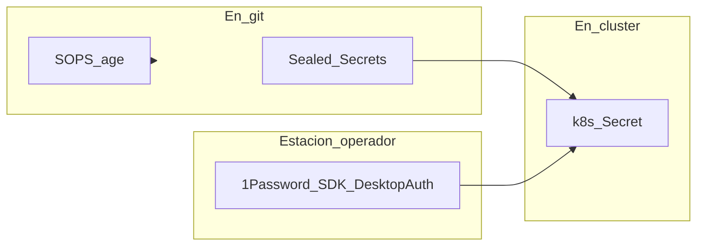

# Secret Management

!!! info "Part of the implementation guide"
    - **[Sealed Secrets](https://github.com/bitnami-labs/sealed-secrets)** — Phase 4 wave 0; CAPN (Cluster API Provider for Incus) Phase 6.
    - **OAuth (Open Authorization) Dex** — [Phase 4 step 4.7](../implementacion/fase-4-gitops.md#47-oauth-secrets-github-vcluster-incus-ui).
    - **maceosoft platform** (Argo CD Apps, ARC —Actions Runner Controller— and OpenTofu, FTP) — [1Password → cluster](../maceosoft/github.md#paso-3-cluster-y-secretos-de-plataforma).

## Diagram — three secret pathways



## Sealed Secrets (default in cluster)

[Sealed Secrets](https://github.com/bitnami-labs/sealed-secrets) — a controller
(~20–30 MB RAM), no external account.

```bash
kubeseal --format yaml < secret-plano.yaml > secret-sellado.yaml
kubectl apply -f secret-sellado.yaml
rm secret-plano.yaml
```

!!! warning "The encryption key lives in 1Password"
    By default the controller generates its key pair inside the cluster (and
    rotates it every 30 days): if you reinstall K3s, it's lost and the `SealedSecret`
    in Git can no longer be decrypted. Here the pair is generated **once**, stored
    in 1Password (item `sealed-secrets`) and
    `playbook-platform-secrets.yml` carries it to the cluster; automatic
    rotation is disabled (`keyrenewperiod: "0"`). How to generate it:
    [maceosoft platform — Step 2](../maceosoft/github.md#step-2-repos-argocd-app-and-ftp-manual).

    Since the certificate (the public key) is also in 1Password, you can
    seal without cluster access (`op read "op://HomeLab/sealed-secrets/certificate" > tls.crt` pulls it down):
    `kubeseal --cert tls.crt --format yaml < secret-plano.yaml > secret-sellado.yaml`.

## SOPS + age (complement, zero pods)

[SOPS (Secrets OPerationS)](https://github.com/getsops/sops) — pre-bootstrap config (Incus tokens, etc.).

```bash
age-keygen -o key.txt
sops --encrypt --age <public-key> secrets.yaml > secrets.enc.yaml
```

## OAuth Dex (GitHub + vCluster + Incus UI) — 1Password local SDK

**GitHub OAuth App** credentials and Dex clients **vCluster Platform** and
**Incus UI** do not go in Git.

| Source | Fields |
|---|---|
| **GitHub** (OAuth App from org `maceosoft`) | `GITHUB_CLIENT_ID`, `GITHUB_CLIENT_SECRET` |
| **Ansible** (`playbook-dex-oauth-secrets.yml`) | `VCLUSTER_CLIENT_SECRET` (generates in 1Password if missing; applies to Dex and Helm) |

`VCLUSTER_CLIENT_SECRET` is **not** created in GitHub: Ansible generates it in 1Password if missing.
Incus doesn't use a secret (it's a public OIDC —OpenID Connect— client in Dex).

They're read with the **[1Password Python SDK](https://github.com/1Password/onepassword-sdk-python)**
and **DesktopAuth** on the workstation where the 1Password app is unlocked.

Defaults: **personal account** (`ONEPASSWORD_ACCOUNT_NAME=Personal`), vault
**`HomeLab`**, one item with fields `GITHUB_CLIENT_ID`, `GITHUB_CLIENT_SECRET`,
`VCLUSTER_CLIENT_SECRET`. Test: `ansible/scripts/check_1password.py`.

Homepage `https://argocd.homelab.local` (informational); Redirect URIs
`https://argocd.homelab.local/api/dex/callback` (critical).

With the CLI: the OAuth App and its client secret are created **only from the web**; saving the item with `op item create` is in
[maceosoft platform — GitHub](../maceosoft/github.md#oauth-app-maceosoft-dex). To read a field without displaying it:
`op read "op://HomeLab/maceosoft-dex/GITHUB_CLIENT_ID" | wc -c`.

Details: [Phase 4 — 4.7](../implementacion/fase-4-gitops.md#47-oauth-secrets-github-vcluster-incus-ui)
· [`1password.md`](https://github.com/maceosoft/gitops/blob/main/argocd/secrets/1password.md)

## Monitoring: Discord webhooks, healthchecks.io ping, and Grafana (1Password → cluster Secrets)

Optional ([Phase 4 — 4.13](../implementacion/fase-4-gitops.md#413-monitoring-and-alerts-optional)). How to create credentials:
[Discord and healthchecks.io](../maceosoft/discord-healthchecks.md). `playbook-platform-secrets.yml` creates,
in the `monitoring` namespace, three Secrets from 1Password; their values never pass through Git: `homelab` is public and `gitops`, though private, doesn't store secrets.

| 1Password Item | Fields | Secret in cluster |
|---|---|---|
| `discord-webhooks` | `critical`, `warnings` | `monitoring/discord-webhooks` |
| `discord-webhooks` | `deployments` *(optional)* | keys `discord-despliegues-url` and `discord-avisos-url` in `argocd/argocd-notifications-secret` (Argo CD notifications, [4.14](../implementacion/fase-4-gitops.md#414-argocd-notifications-to-discord-optional)) |
| `healthchecks-ping` | `url` | `monitoring/healthchecks-ping` |
| `grafana-admin` | `password` (and `username`, optional) | `monitoring/grafana-admin` |
| `discord-webhooks` | `ai` *(optional)* | key `ai` in `monitoring/discord-webhooks` (channel `#ia` for [AI reports](../operacion/logs.md#daily-and-weekly-reports-in-ia)) |
| `open-webui` *(AI assistant, optional)* | `WEBUI_SECRET_KEY` | `ai/open-webui-secret` ([how to generate](../operacion/ia-ollama.md#create-the-open-webui-key-once-only)) |
| `ollama-router` *(AI assistant, optional)* | `registry_token`, `open-webui`, `k8sgpt`, `reports`, `alert-triage`, `translate` | `ai/ollama-router-secrets` (all fields) and a Secret `ollama-token-<cliente>` with key `token` in each client's namespace ([rotation](../operacion/rotar-credenciales.md#ollama-and-internal-services-tokens)) |
| `open-terminal` *(optional)* | `api_key` | `ai-sandbox/open-terminal-api-key` (mounted as file in pod) and `ai/open-terminal-api-key` ([guide](../operacion/ia-ollama.md#open-terminal-terminal-for-the-assistant)) |
| `alert-triage-webhook` *(optional)* | `token` | `monitoring/alert-triage-webhook` |
| `mcp-api-key` *(optional)* | `key` | `ai/mcp-api-key` |

Tokens are generated with `openssl rand -hex 32` (the script requires at least 32 characters and no spaces). The `translate` field
doesn't create any Secret in the cluster: it's the value of the `OLLAMA_TOKEN` GitHub Actions secret. If the Dex client for Open WebUI
turns out to be confidential (because it doesn't support PKCE —Proof Key for Code Exchange—), its secret is generated with `playbook-dex-oauth-secrets.yml`, like `VCLUSTER_CLIENT_SECRET`.

The playbook applies Secrets with `--server-side` and works with Python 3.9 or later. All AI items are
optional (Open Terminal, the `#ia` channel, the tokens): if one is missing, only what depends on it is skipped. The `ai` and `ai-sandbox` namespaces
are created without Pod Security Admission labels and with the `Prune=false,Delete=false`
Argo CD annotations, so Argo CD doesn't delete them on sync.

Alertmanager reads URLs as mounted files (`webhook_url_file`), so they don't even appear in its config. The script
requires both Discord URLs to have the format `https://discord.com/api/webhooks/<id>/<token>`. To rotate a webhook, delete it and
create a new one in Discord, update the item, and run the playbook again.

## Local AI: create tokens with `op`

Local AI (Ollama router, Open WebUI, Open Terminal, reports) uses random tokens that live in 1Password, vault `HomeLab`,
and that `playbook-platform-secrets.yml` brings to the cluster. With the 1Password CLI (`op`) and the app unlocked, each item is created with a
command; each field receives a distinct `openssl rand -hex 32` value (64 hex characters):

| Item | Fields | Purpose |
|---|---|---|
| `ollama-router` | `registry_token`, `open-webui`, `k8sgpt`, `reports`, `alert-triage`, `translate` | One token per router client and one for node registration |
| `alert-triage-webhook` | `token` | Alertmanager sends it to `alert-triage` |
| `mcp-api-key` | `key` | Key for Open WebUI MCP tools |
| `open-terminal` | `api_key` | Key for Open Terminal sandbox |
| `open-webui` | `WEBUI_SECRET_KEY` | Key with which Open WebUI signs sessions |

```bash
op item create --category "Secure Note" --vault HomeLab --title ollama-router \
  "registry_token[password]=$(openssl rand -hex 32)" \
  "open-webui[password]=$(openssl rand -hex 32)" \
  "k8sgpt[password]=$(openssl rand -hex 32)" \
  "reports[password]=$(openssl rand -hex 32)" \
  "alert-triage[password]=$(openssl rand -hex 32)" \
  "translate[password]=$(openssl rand -hex 32)"

op item create --category "Secure Note" --vault HomeLab --title alert-triage-webhook "token[password]=$(openssl rand -hex 32)"

op item create --category "Secure Note" --vault HomeLab --title mcp-api-key "key[password]=$(openssl rand -hex 32)"

op item create --category "Secure Note" --vault HomeLab --title open-terminal "api_key[password]=$(openssl rand -hex 32)"

op item create --category "Secure Note" --vault HomeLab --title open-webui "WEBUI_SECRET_KEY[password]=$(openssl rand -hex 32)"
```

- If you have more than one 1Password account, export `OP_ACCOUNT` with yours first (it's the standard `op` variable): the items
  must end up in the account that `apply_platform_secrets.py` reads.
- `op` creates each field loose (no section) and with the exact name, as the playbook requires. Note: values passed as command
  arguments are visible for a moment in `ps` on your own machine; it's a minor risk on a personal workstation, but don't use
  these commands on a shared machine.
- To see what `op` would do without creating anything, add `--dry-run` to each command.

Then verify the fields, without showing values, and apply them:

```bash
python3 ansible/scripts/apply_platform_secrets.py --check
cd ansible && ansible-playbook -i inventory.ini playbook-platform-secrets.yml
```

The `#ia` channel is separate: its webhook is added manually to the `ai` field of the `discord-webhooks` item (see
[Discord and healthchecks.io](../maceosoft/discord-healthchecks.md)).

### GitHub secret for translation

Automated translation (`translate.yml`) needs the GitHub Actions secret `OLLAMA_TOKEN`, with the value of the `translate` field.
The value travels through a pipe, without being printed or remaining in terminal history:

```bash
op read "op://HomeLab/ollama-router/translate" | gh secret set OLLAMA_TOKEN --repo maceosoft/homelab
# debe aparecer OLLAMA_TOKEN
gh secret list --repo maceosoft/homelab
```

### Rotate a token

Edit the field in the 1Password app (use the password generator) or create a new value with `op`:

```bash
op item edit ollama-router "reports[password]=$(openssl rand -hex 32)"
```

Then run `playbook-platform-secrets.yml` again and restart the pods that use it (see
[Rotate credentials](../operacion/rotar-credenciales.md)). If you change `translate`, repeat the `gh secret set` command.

## Root password rotation (local 1Password SDK)

[`playbook-rotate-root-passwords.yml`](https://github.com/maceosoft/homelab/blob/main/ansible/playbook-rotate-root-passwords.yml)
generates a new password per node (not idempotent on purpose — each
run rotates), applies it in the local `root` of each host (`become` +
`ansible.builtin.user`, hashed with `password_hash('sha512')`) and stores it
in the **`HomeLab`** vault, one item per host (`root@invincible`,
`root@oliver`, `root@deborah`, field `password`). It doesn't touch SSH — `root` login
via SSH is already disabled by `host_hardening`
(`PermitRootLogin no`); this is defense in depth for console/`su -`.

```bash
cd ansible
ansible-playbook -i inventory.ini playbook-rotate-root-passwords.yml
ansible-playbook -i inventory.ini playbook-rotate-root-passwords.yml \
  --limit deborah
```

To read a password when you need it (for example, via console), with the 1Password CLI and without leaving it in history:
`op read "op://HomeLab/root@deborah/password" | pbcopy` (on Linux, `xclip -selection clipboard` or `wl-copy`). If you have more than one
1Password account, export `OP_ACCOUNT` first.

<div class="card">
  <div class="card-kicker">Trade-off analysis</div>
  <div class="option-grid">
    <div class="card-col">
      <div class="card-title">Sealed Secrets</div>
      <div class="text-muted">Encrypted in Git; lightweight controller (~30 MB)</div>
      <div class="text-muted">Cluster-only; doesn't work pre-bootstrap</div>
    </div>
    <div class="card-col">
      <div class="card-title">SOPS + age</div>
      <div class="text-muted">Zero pods; encrypted files in repo</div>
      <div class="text-muted">Age key on workstation; manual workflow</div>
    </div>
    <div class="card-col">
      <div class="card-title">1Password SDK</div>
      <div class="text-muted">OAuth outside Git; DesktopAuth</div>
      <div class="text-muted">App unlocked; not for SealedSecret in CAPN</div>
    </div>
    <div class="card-col">
      <div class="card-title">Vault / ESO <span class="tag tag-neutral">discarded</span></div>
      <div class="text-muted">Enterprise-grade</div>
      <div class="text-muted">Excessive RAM and complexity for HomeLab</div>
    </div>
  </div>
</div>

## Discarded

- **HashiCorp Vault** — too heavy for the M700.
- **1Password + ESO (External Secrets Operator) in cluster** — requires Business plan; we use **local Python SDK (Software Development Kit)** (DesktopAuth) from the workstation.
- **RustyVault** — young project, no confirmed ARM64 (64-bit ARM architecture).

**This decision in other environments**

=== "🏠 At home"

    Secrets live in 1Password and reach the cluster via a playbook; what goes to Git is encrypted with Sealed Secrets
    or SOPS + age, never in plaintext. No need to maintain a secrets server, and for a single person it's enough.

=== "🏢 In a company"

    - **Benefits:** the same pattern (a central manager, nothing in plaintext in Git, one secret per client) gives a single place
      to see who has what, and revoke or rotate a credential without touching code.
    - **Central manager with auditing:** uses [HashiCorp Vault](https://developer.hashicorp.com/vault),
      [1Password Business](https://1password.com/business-security) or
      [CyberArk](https://www.paloaltonetworks.com/idira/machine/secrets-management) (now part of Palo Alto Networks),
      with a log of every read and per-team permissions.
    - **Automatic synchronization:** instead of running a playbook from a workstation, the cluster reads secrets with
      [External Secrets Operator](https://external-secrets.io/) and keeps them up to date automatically.
    - **Rotation and auditing:** credentials expire and rotate by policy, and compliance (SOC 2, ISO 27001)
      requires proving who read what and when.
    - **When the HomeLab approach makes sense:** on small teams or isolated sites, Sealed Secrets or SOPS + age
      work without another server to keep available.

=== "☁️ In the cloud"

    | Cloud | Equivalent Service |
    |---|---|
    | GCP | [Secret Manager](https://cloud.google.com/security/products/secret-manager) |
    | AWS | [AWS Secrets Manager](https://aws.amazon.com/secrets-manager/) |
    | Azure | [Azure Key Vault](https://azure.microsoft.com/en-us/products/key-vault) |
    | Oracle Cloud (OCI) | [OCI Vault](https://www.oracle.com/security/cloud-security/key-management/) |

    Additionally, each cloud's KMS can encrypt Secrets inside etcd:
    [GKE](https://cloud.google.com/kubernetes-engine/docs/how-to/encrypting-secrets),
    [EKS](https://docs.aws.amazon.com/eks/latest/userguide/envelope-encryption.html),
    [AKS](https://learn.microsoft.com/en-us/azure/aks/use-kms-etcd-encryption) and
    [OKE](https://docs.oracle.com/en-us/iaas/Content/ContEng/Tasks/contengencryptingdata.htm).
    You gain a managed service, with rotation, auditing, and IAM permissions included. You lose portability: each
    cloud has its own API, and you pay per secret and per read.

Full stack: **[Tech Stack](../implementacion/stack-tecnologico.md)**.
