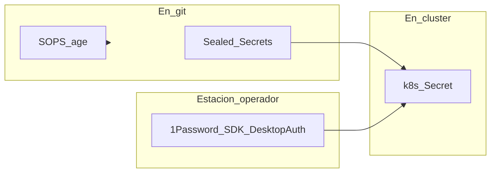

# Gestión de Secretos

!!! info "Parte de la guía de implementación"
    - **[Sealed Secrets](https://github.com/bitnami-labs/sealed-secrets)** — Fase 4 wave 0; CAPN (Cluster API Provider for Incus) Fase 6.
    - **OAuth Dex** — [Fase 4 paso 4.7](../implementacion/fase-4-gitops.md#47-secretos-oauth-github-vcluster-incus-ui).
    - **Plataforma maceosoft** (Apps de ArgoCD, ARC y OpenTofu, FTP) — [1Password → clúster](../maceosoft/github.md#paso-3-cluster-y-secretos-de-plataforma).

## Diagrama — tres vías de secretos



## Sealed Secrets (default en clúster)

[Sealed Secrets](https://github.com/bitnami-labs/sealed-secrets) — un controller
(~20–30 MB RAM), sin cuenta externa.

```bash
kubeseal --format yaml < secret-plano.yaml > secret-sellado.yaml
kubectl apply -f secret-sellado.yaml
rm secret-plano.yaml
```

!!! warning "La llave de cifrado vive en 1Password"
    Por defecto el controller genera su par de llaves dentro del clúster (y lo
    renueva cada 30 días): si reinstalas K3s, se pierde y los `SealedSecret`
    de git ya no se pueden descifrar. Aquí el par se genera **una vez**, se
    guarda en 1Password (item `sealed-secrets`) y
    `playbook-platform-secrets.yml` lo lleva al clúster; la renovación
    automática está desactivada (`keyrenewperiod: "0"`). Cómo generarlo:
    [Plataforma maceosoft — Paso 2](../maceosoft/github.md#paso-2-repos-app-de-argocd-y-ftp-manual).

    Como el certificado (la llave pública) también está en 1Password, puedes
    sellar sin tener acceso al clúster (`op read "op://HomeLab/sealed-secrets/certificate" > tls.crt` lo baja):
    `kubeseal --cert tls.crt --format yaml < secret-plano.yaml > secret-sellado.yaml`.

## SOPS + age (complemento, cero pods)

[SOPS](https://github.com/getsops/sops) — config pre-bootstrap (tokens Incus, etc.).

```bash
age-keygen -o key.txt
sops --encrypt --age <public-key> secrets.yaml > secrets.enc.yaml
```

## OAuth Dex (GitHub + vCluster + Incus UI) — 1Password SDK local

Credenciales de **GitHub OAuth App** y clientes Dex **vCluster Platform** e
**Incus UI (interfaz de usuario)** no van en git.

| Origen | Campos |
|---|---|
| **GitHub** (OAuth App de la org `maceosoft`) | `GITHUB_CLIENT_ID`, `GITHUB_CLIENT_SECRET` |
| **Ansible** (`playbook-dex-oauth-secrets.yml`) | `VCLUSTER_CLIENT_SECRET` (genera en 1Password si falta; aplica en Dex y Helm) |

`VCLUSTER_CLIENT_SECRET` **no** se crea en GitHub: Ansible lo genera en 1Password si falta.
Incus no usa secreto (es un cliente OIDC público en Dex).

Se leen con el **[1Password Python SDK](https://github.com/1Password/onepassword-sdk-python)**
y **DesktopAuth** en la estación donde la app 1Password está desbloqueada.

Por defecto: **cuenta personal** (`ONEPASSWORD_ACCOUNT_NAME=Personal`), bóveda
**`HomeLab`**, un ítem con campos `GITHUB_CLIENT_ID`, `GITHUB_CLIENT_SECRET`,
`VCLUSTER_CLIENT_SECRET`. Probar: `ansible/scripts/test-1password.py`.

Homepage `https://argocd.homelab.local` (informativa); Redirect URIs
`https://argocd.homelab.local/api/dex/callback` (crítico).

Con la CLI: la OAuth App y su client secret se crean **solo desde la web**; guardar el item con `op item create` está en
[Plataforma maceosoft — GitHub](../maceosoft/github.md#oauth-app-maceosoft-dex). Para leer un campo sin mostrarlo:
`op read "op://HomeLab/maceosoft-dex/GITHUB_CLIENT_ID" | wc -c`.

Detalle: [Fase 4 — 4.7](../implementacion/fase-4-gitops.md#47-secretos-oauth-github-vcluster-incus-ui)
· [`1password.md`](https://github.com/maceosoft/gitops/blob/main/argocd/secrets/1password.md)

## Monitoreo: webhooks de Discord, ping de healthchecks.io y Grafana (1Password → Secrets del clúster)

Opcional ([Fase 4 — 4.13](../implementacion/fase-4-gitops.md#413-monitoreo-y-alertas-opcional)). Cómo crear las credenciales:
[Discord y healthchecks.io](../maceosoft/discord-healthchecks.md). `playbook-platform-secrets.yml` crea,
en el namespace `monitoring`, tres Secrets desde 1Password; sus valores nunca pasan por git: `homelab` es público y `gitops`, aunque es privado, no guarda secretos.

| Item de 1Password | Campos | Secret en el clúster |
|---|---|---|
| `discord-webhooks` | `critical`, `warnings` | `monitoring/discord-webhooks` |
| `discord-webhooks` | `deployments` *(opcional)* | claves `discord-despliegues-url` y `discord-avisos-url` en `argocd/argocd-notifications-secret` (notificaciones de ArgoCD, [4.14](../implementacion/fase-4-gitops.md#414-notificaciones-de-argocd-a-discord-opcional)) |
| `healthchecks-ping` | `url` | `monitoring/healthchecks-ping` |
| `grafana-admin` | `password` (y `username`, opcional) | `monitoring/grafana-admin` |
| `discord-webhooks` | `ai` *(opcional)* | clave `ai` en `monitoring/discord-webhooks` (canal `#ia` de los [reportes con IA](../operacion/logs.md#reportes-diario-y-semanal-en-ia)) |
| `open-webui` *(asistente de IA, opcional)* | `WEBUI_SECRET_KEY` | `ai/open-webui-secret` ([cómo generarla](../operacion/ia-ollama.md#crear-la-clave-de-open-webui-una-sola-vez)) |
| `ollama-router` *(asistente de IA, opcional)* | `registry_token`, `open-webui`, `k8sgpt`, `reports`, `alert-triage`, `translate` | `ai/ollama-router-secrets` (todos los campos) y un Secret `ollama-token-<cliente>` con la clave `token` en el namespace de cada cliente ([rotación](../operacion/rotar-credenciales.md#tokens-de-ollama-y-de-servicios-internos)) |
| `open-terminal` *(opcional)* | `api_key` | `ai-sandbox/open-terminal-api-key` (montada como archivo en el pod) y `ai/open-terminal-api-key` ([guía](../operacion/ia-ollama.md#open-terminal-terminal-para-el-asistente)) |
| `alert-triage-webhook` *(opcional)* | `token` | `monitoring/alert-triage-webhook` |
| `mcp-api-key` *(opcional)* | `key` | `ai/mcp-api-key` |

Los tokens se generan con `openssl rand -hex 32` (el script exige al menos 32 caracteres y sin espacios). El campo `translate` no
crea ningún Secret en el clúster: es el valor del secreto `OLLAMA_TOKEN` de GitHub Actions. Si el cliente de Dex de Open WebUI
resulta ser confidencial (porque no admita PKCE), su secreto se genera con `playbook-dex-oauth-secrets.yml`, como `VCLUSTER_CLIENT_SECRET`.

El playbook aplica los Secrets con `--server-side` y funciona con Python 3.9 o posterior. Todos los items de IA son
opcionales (Open Terminal, el canal `#ia`, los tokens): si falta uno, solo se omite lo que depende de él. Los namespaces
`ai` y `ai-sandbox` se crean sin etiquetas de Pod Security Admission y con las anotaciones `Prune=false,Delete=false` de
ArgoCD, para que ArgoCD no los borre al sincronizar.

Alertmanager lee las URL como archivos montados (`webhook_url_file`), así que ni siquiera aparecen en su configuración. El script
exige que las dos URL de Discord tengan el formato `https://discord.com/api/webhooks/<id>/<token>`. Para rotar un webhook, bórralo y
créalo de nuevo en Discord, actualiza el item y vuelve a correr el playbook.

## IA local: crear los tokens con `op`

La IA local (router de Ollama, Open WebUI, Open Terminal, reportes) usa tokens aleatorios que viven en 1Password, bóveda `HomeLab`,
y que `playbook-platform-secrets.yml` lleva al clúster. Con el CLI de 1Password (`op`) y la app desbloqueada, cada item se crea con un
comando; cada campo recibe un valor distinto de `openssl rand -hex 32` (64 caracteres hexadecimales):

| Item | Campos | Para qué |
|---|---|---|
| `ollama-router` | `registry_token`, `open-webui`, `k8sgpt`, `reports`, `alert-triage`, `translate` | Un token por cliente del router y otro para el registro de nodos |
| `alert-triage-webhook` | `token` | Alertmanager lo envía a `alert-triage` |
| `mcp-api-key` | `key` | Clave de las herramientas MCP de Open WebUI |
| `open-terminal` | `api_key` | Clave del sandbox de Open Terminal |
| `open-webui` | `WEBUI_SECRET_KEY` | Clave con la que Open WebUI firma las sesiones |

```bash
op item create --category "Secure Note" --vault HomeLab --title ollama-router \
  "registry_token[password]=$(openssl rand -hex 32)" \
  "open-webui[password]=$(openssl rand -hex 32)" \
  "k8sgpt[password]=$(openssl rand -hex 32)" \
  "reports[password]=$(openssl rand -hex 32)" \
  "alert-triage[password]=$(openssl rand -hex 32)" \
  "translate[password]=$(openssl rand -hex 32)"

op item create --category "Secure Note" --vault HomeLab --title alert-triage-webhook "token[password]=$(openssl rand -hex 32)"

op item create --category "Secure Note" --vault HomeLab --title mcp-api-key "key[password]=$(openssl rand -hex 32)"

op item create --category "Secure Note" --vault HomeLab --title open-terminal "api_key[password]=$(openssl rand -hex 32)"

op item create --category "Secure Note" --vault HomeLab --title open-webui "WEBUI_SECRET_KEY[password]=$(openssl rand -hex 32)"
```

- Si tienes más de una cuenta de 1Password, exporta `OP_ACCOUNT` con la tuya antes (es la variable estándar de `op`): los items tienen
  que quedar en la cuenta que lee `apply_platform_secrets.py`.
- `op` crea cada campo suelto (sin sección) y con el nombre exacto, como exige el playbook. Ojo: los valores pasados como argumento
  del comando se ven un instante en `ps` dentro de tu propio equipo; es un riesgo menor en una estación personal, pero no uses
  estos comandos en un equipo compartido.
- Para ver qué hará `op` sin crear nada, añade `--dry-run` a cada comando.

Después comprueba los campos, sin mostrar valores, y aplícalos:

```bash
python3 ansible/scripts/apply_platform_secrets.py --check
cd ansible && ansible-playbook -i inventory.ini playbook-platform-secrets.yml
```

El canal `#ia` es aparte: su webhook se agrega a mano al campo `ai` del item `discord-webhooks` (ver
[Discord y healthchecks.io](../maceosoft/discord-healthchecks.md)).

### Secreto de GitHub para la traducción

La traducción automática (`translate.yml`) necesita el secreto de GitHub Actions `OLLAMA_TOKEN`, con el valor del campo `translate`.
El valor viaja por una tubería, sin imprimirse ni quedar en el historial de la terminal:

```bash
op read "op://HomeLab/ollama-router/translate" | gh secret set OLLAMA_TOKEN --repo maceosoft/homelab
# debe aparecer OLLAMA_TOKEN
gh secret list --repo maceosoft/homelab
```

### Rotar un token

Edita el campo en la app de 1Password (usa el generador de contraseñas) o crea un valor nuevo con `op`:

```bash
op item edit ollama-router "reports[password]=$(openssl rand -hex 32)"
```

Después vuelve a correr `playbook-platform-secrets.yml` y reinicia los pods que lo usan (ver
[Rotar credenciales](../operacion/rotar-credenciales.md)). Si cambias `translate`, repite el comando de `gh secret set`.

## Rotación de password de root (1Password SDK local)

[`playbook-rotate-root-passwords.yml`](https://github.com/maceosoft/homelab/blob/main/ansible/playbook-rotate-root-passwords.yml)
genera una password nueva por nodo (no idempotente a propósito — cada
corrida rota), la aplica en el `root` local de cada host (`become` +
`ansible.builtin.user`, hasheada con `password_hash('sha512')`) y la guarda
en la bóveda **`HomeLab`**, un ítem por host (`root@invincible`,
`root@oliver`, `root@deborah`, campo `password`). No toca SSH (Secure Shell) — el login de
`root` por SSH ya está deshabilitado por `host_hardening`
(`PermitRootLogin no`); esto es defensa en profundidad para consola/`su -`.

```bash
cd ansible
ansible-playbook -i inventory.ini playbook-rotate-root-passwords.yml
ansible-playbook -i inventory.ini playbook-rotate-root-passwords.yml \
  --limit deborah
```

Para leer una contraseña cuando la necesites (por ejemplo, por consola), con el CLI de 1Password y sin dejarla en el historial:
`op read "op://HomeLab/root@deborah/password" | pbcopy` (en Linux, `xclip -selection clipboard` o `wl-copy`). Si tienes más de una
cuenta de 1Password, exporta `OP_ACCOUNT` antes.

<div class="card">
  <div class="card-kicker">Análisis de trade-offs</div>
  <div class="option-grid">
    <div class="card-col">
      <div class="card-title">Sealed Secrets</div>
      <div class="text-muted">Cifrado en git; controller ligero (~30 MB)</div>
      <div class="text-muted">Solo en clúster; no sirve pre-bootstrap</div>
    </div>
    <div class="card-col">
      <div class="card-title">SOPS + age</div>
      <div class="text-muted">Cero pods; archivos cifrados en repo</div>
      <div class="text-muted">Clave age en la estación; flujo manual</div>
    </div>
    <div class="card-col">
      <div class="card-title">1Password SDK</div>
      <div class="text-muted">OAuth fuera de git; DesktopAuth</div>
      <div class="text-muted">App desbloqueada; no para SealedSecret en CAPN</div>
    </div>
    <div class="card-col">
      <div class="card-title">Vault / ESO <span class="tag tag-neutral">descartado</span></div>
      <div class="text-muted">Enterprise-grade</div>
      <div class="text-muted">RAM y complejidad excesivas en HomeLab</div>
    </div>
  </div>
</div>

## Descartados

- **HashiCorp Vault** — demasiado pesado para el M700.
- **1Password + ESO (External Secrets Operator) en clúster** — requiere plan Business; usamos **SDK (Software Development Kit) Python local** (DesktopAuth) desde la estación.
- **RustyVault** — proyecto joven, sin ARM64 (arquitectura ARM de 64 bits) confirmado.

Stack completo: **[Stack tecnológico](../implementacion/stack-tecnologico.md)**.
