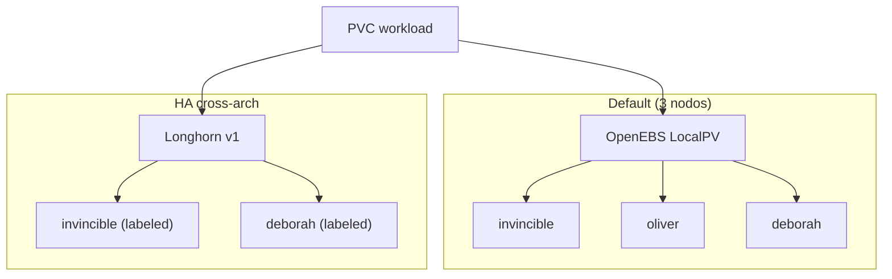

# Storage

!!! info "Part of the implementation guide"
    Deployed in **[Phase 4 — GitOps](../implementacion/fase-4-gitops.md)** (waves 0–1).
    Longhorn labels: **[Phase 3 — K3s](../implementacion/fase-3-k3s.md)**.

Hybrid x86_64 + ARM64 (64-bit ARM architecture) — GitOps manifests at [`gitops/storage/`](https://github.com/maceosoft/gitops/tree/main/storage).

## Diagram — storage tiers



- **[OpenEBS](https://openebs.io/docs)** — LocalPV default; 3 nodes; no replication.
- **[Longhorn](https://longhorn.io/docs/)** — Replicated x86↔arm64; designed for invincible + deborah (see [Longhorn v1](#longhorn-v1-selective-ha-cross-arch)).

## OpenEBS LocalPV (default)

DaemonSet on all 3 nodes. Default StorageClass for almost everything.

Deployed via Argo CD Application `openebs` (Helm).

## Longhorn v1 (selective HA, cross-arch)

**Always use the v1 engine (default), never v2/SPDK** (Storage Performance Development Kit): v2 has a documented bug
of blocked I/O on ARM64 with NVMe (SSD over PCIe) + 2 cores.

Its UI has no login screen and is not published by the Gateway: it opens with
`kubectl -n longhorn-system port-forward svc/longhorn-frontend 8080:80` and [`http://127.0.0.1:8080`](http://127.0.0.1:8080). The dashboard summarizes volumes,
space, and nodes:

??? note "View screenshot: Longhorn dashboard"
    { loading=lazy }

```bash
kubectl label node invincible node.longhorn.io/create-default-disk=true
kubectl label node deborah node.longhorn.io/create-default-disk=true
kubectl label node oliver node.longhorn.io/create-default-disk=false
```

With `numberOfReplicas: "2"` and 2 eligible nodes (x86 + arm64), each volume
is replicated across architectures.

<div class="card">
  <div class="card-kicker">Trade-off analysis</div>
  <div class="option-grid">
    <div class="card-col">
      <div class="card-title">OpenEBS LocalPV <span class="tag tag-accent">chosen</span></div>
      <div class="text-muted">Simple on 3 nodes; default for almost everything</div>
      <div class="text-muted">No HA if the pod's node fails</div>
    </div>
    <div class="card-col">
      <div class="card-title">Longhorn v1</div>
      <div class="text-muted">Replica x86↔arm64; volume UI</div>
      <div class="text-muted">Only 2 eligible nodes; more RAM/pods</div>
    </div>
    <div class="card-col">
      <div class="card-title">OpenEBS only</div>
      <div class="text-muted">Smaller operational surface</div>
      <div class="text-muted">Critical PVCs without cross-node replica</div>
    </div>
    <div class="card-col">
      <div class="card-title">Mayastor <span class="tag tag-neutral">discarded</span></div>
      <div class="text-muted">High NVMe performance</div>
      <div class="text-muted">≥2 GiB hugepages — unfeasible on M700</div>
    </div>
  </div>
</div>

## Cluster StorageClasses

A StorageClass tells Kubernetes **how** to create a PVC's (PersistentVolumeClaim, storage request) volume. These are the ones that exist today
(`kubectl get storageclass`); those from `gitops/storage/` are created by Application
`homelab-storage`, the rest come from charts or K3s.

| StorageClass | Created by | Provisioner | Replicas | Binding | Expandable | Default? |
|---|---|---|---|---|---|---|
| `openebs-hostpath` | [`gitops/storage/openebs-local.yaml`](https://github.com/maceosoft/gitops/blob/main/storage/openebs-local.yaml) | OpenEBS LocalPV (`openebs.io/local`) | 1 (node disk) | `WaitForFirstConsumer` | No | **Yes** |
| `local-path` | K3s (addon `local-storage`) | `rancher.io/local-path` | 1 (node disk) | `WaitForFirstConsumer` | No | **Yes** (see warning) |
| `longhorn` | Longhorn chart | Longhorn (`driver.longhorn.io`) | `defaultClassReplicaCount` (2 in [`longhorn.yaml`](https://github.com/maceosoft/gitops/blob/main/argocd/apps/longhorn.yaml)) | `Immediate` | Yes | No |
| `longhorn-mixto` | [`gitops/storage/storageclasses.yaml`](https://github.com/maceosoft/gitops/blob/main/storage/storageclasses.yaml) | Longhorn | 2 fixed | `Immediate` | Yes | No |
| `longhorn-static` | Longhorn chart | Longhorn | — (no parameters) | `Immediate` | Yes | No |

All have `reclaimPolicy: Delete`: **deleting the PVC deletes the volume and its data**.

!!! warning "Two default StorageClasses exist today"
    `openebs-hostpath` and `local-path` carry the annotation `is-default-class`. With two
    defaults, a PVC without `storageClassName` is ambiguous: Kubernetes uses the one created most recently and the result depends on the
    order in which each was installed.
    The recommended approach is to keep only one. In Ansible, `local-storage` is already in
    `k3s_install.core.disable_components` (alongside `traefik` and `servicelb`), but it only affects new
    installations: this cluster retains `local-path` until K3s is reinstalled. Meanwhile,
    always request the class explicitly in PVCs.

### `openebs-hostpath` — local, fast, node-bound

Creates a folder on the disk of the node where the pod runs.

| Pros | Cons |
|---|---|
| Fastest: local disk, no network or replicas | **No replication**: if the node goes down, data is unavailable until it returns |
| Near-zero RAM/CPU overhead; works the same on x86_64 and ARM64 | The pod is **bound to the node** where the volume was created: cannot be rescheduled elsewhere |
| Works on all 3 nodes, no disk prep or packages needed | Cannot be expanded, no snapshots or quotas (the pod can fill the node's disk) |
| With `WaitForFirstConsumer` the volume is born where the scheduler places the pod | Only `ReadWriteOnce` (single node at a time) |

**Use for:** caches, rebuildable data, test databases, anything that can be lost painlessly.

### `local-path` — the K3s one

Same model as `openebs-hostpath` (local folder, no replicas, node-bound), but
comes with K3s. Today it duplicates the previous one: see the warning above. Do not use it in
new manifests.

### `longhorn` and `longhorn-mixto` — replicated

Longhorn stores each volume as a replicated block across multiple nodes, with snapshots,
backups, and a UI.

| Pros | Cons |
|---|---|
| **Survives node failure**: replicas live on different nodes (x86_64 and ARM64) | Writes are slower: every write is acknowledged on all replicas **over the network** |
| Can be expanded online (`allowVolumeExpansion`), with snapshots and backups | Consumes extra **RAM and CPU** on each node (managers, instance managers) and space: with 2 replicas, 2× the size |
| `ReadWriteMany` (multiple pods at once) via an NFS server per volume | Requires `open-iscsi` and `nfs-common` on nodes (role `k3s_prereqs`) |
| UI to view each volume's status | With `Immediate` replicas are scheduled **without knowing** where the pod will run, so it may read over the network |

**Which of the two:**

- `longhorn`: its replicas come from the chart value (`defaultClassReplicaCount`). If
  someone changes the chart, the behavior of **new** PVCs changes. This is the one
  `arc-cache` uses today (the [runners' cache](../operacion/cache-arc.md)).
- `longhorn-mixto`: **2 fixed replicas**, `dataLocality: disabled` (the replica doesn't stick
  to the pod's node: more fault-tolerant, more network traffic) and `staleReplicaTimeout: 30`
  (minutes until a stale replica is discarded). Use it when you want a replica count
  that doesn't depend on the chart.

**Use them for:** data that matters (databases, application state) and shared
volumes.

!!! note "StorageClass parameters cannot be edited"
    Kubernetes does not allow changing the `parameters` of an existing StorageClass. To
    change replicas you must **delete and recreate the class** (existing PVCs do
    not change). Today `kubectl get storageclass longhorn` may show `numberOfReplicas: "3"`
    even though `longhorn.yaml` asks for 2, if the class was created before the change; with 3 replicas and
    few eligible nodes volumes become degraded.

!!! note "On how many nodes does Longhorn live?"
    The `node.longhorn.io/create-default-disk` labels above are only honored if the
    setting `createDefaultDiskLabeledNodes` is set to `true`. Today it is set to `false` (verified
    with `kubectl -n longhorn-system get settings.longhorn.io`), so **all three nodes**
    contribute disk, `oliver` included. To limit it to `invincible` and `deborah`, enable that
    setting in `defaultSettings` of `longhorn.yaml` and disable `oliver`'s disk in the UI.

### `longhorn-static` — only for already-created volumes

Class with no parameters that the chart creates to **manually bind** a volume that already
exists in Longhorn (static provisioning). It does not create new volumes on its own: do not use it in a
normal PVC.

### Binding: `WaitForFirstConsumer` or `Immediate`

| Mode | What it does | Trade-off |
|---|---|---|
| `WaitForFirstConsumer` (both local) | Waits for the pod to be scheduled and creates the volume **on that node** | The volume always ends up alongside the pod; afterward it stays bound to that node |
| `Immediate` (Longhorn's) | Creates the volume as soon as the PVC exists | Works without a pod, but replicas are chosen without knowing the pod's node |

### Which one do I choose?

| I need… | Use |
|---|---|
| Data I **cannot** lose, or the pod may move nodes | `longhorn-mixto` |
| Fastest possible and data is rebuildable | `openebs-hostpath` |
| A volume used by multiple pods at once (`ReadWriteMany`) | `longhorn` or `longhorn-mixto` |
| Grow a volume without recreating it | `longhorn` or `longhorn-mixto` |
| Deleting the PVC **not** to delete the data | None: all are `Delete`; create a class with `reclaimPolicy: Retain` |

To request a class, put it in the PVC:

```yaml
spec:
  storageClassName: longhorn-mixto
  accessModes: [ReadWriteOnce]
  resources:
    requests:
      storage: 10Gi
```

## Upgrade and reinstall Longhorn

Longhorn only supports upgrading **one minor version at a time** (1.6 → 1.7 → … → 1.13). If the chart skips versions, the
`longhorn-pre-upgrade` Job fails on purpose and, if you disable it, the new `longhorn-manager` crash with
`upgrading from vX to vY for minor version is not supported`. **During an upgrade do not disable that Job.** In a
clean install with Argo CD you do have to disable it (`preUpgradeChecker.jobEnabled: false`): it runs before its
ServiceAccount, cannot create the pod, and the sync waits for it forever.

If what Longhorn stores can be lost (in the HomeLab, the ARC cache —Actions Runner Controller—), it's faster to **reinstall from scratch**
on the new version than to step through every intermediate version. Use
[`playbook-reset-longhorn.yml`](https://github.com/maceosoft/homelab/blob/main/ansible/playbook-reset-longhorn.yml),
which is **destructive** (deletes PVCs, volumes, CRDs, the namespace, and `/var/lib/longhorn` on each node) and safe
by default: without `-e longhorn_reset_confirm=true` it only shows what would be lost.

1. In `gitops/bootstrap/root-appset.yaml`, comment out `longhorn` and `arc-runners` and push. This way Argo CD doesn't recreate what
   gets deleted (the Applications disappear, their resources remain in the cluster).
2. Run `ansible-playbook -i inventory.ini playbook-reset-longhorn.yml` (preflight) and then with `-e longhorn_reset_confirm=true`.
3. Uncomment `longhorn` and `arc-runners`, push: Argo CD installs the `targetRevision` version from scratch.

## Why not Mayastor

Mayastor requires ≥2 GiB of fixed hugepages — ruled out for the M700.

Runnable guide: **[Phase 4 — GitOps](../implementacion/fase-4-gitops.md)**.
