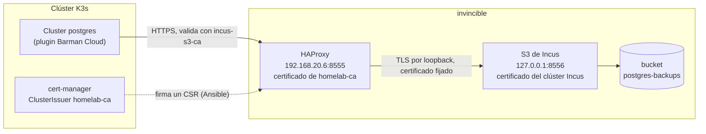

# Platform PostgreSQL and Backups in Incus

The HomeLab has a shared PostgreSQL for platform applications (the first is `homelab-agent`). It is managed by CloudNativePG, a Kubernetes operator, and its backups (the WAL, Write-Ahead Log: the PostgreSQL change log, and a daily base copy) go to an Incus bucket via S3 (Simple Storage Service, Amazon's object storage protocol), encrypted with TLS (Transport Layer Security) and with a certificate signed by the HomeLab CA (Certificate Authority).

The cluster manifests live in the `gitops` repo ([`addons/storage/postgres/`](https://github.com/maceosoft/gitops/tree/main/addons/storage/postgres)); what is outside Kubernetes (Incus S3, its certificate, and Secrets coming from 1Password) belongs to this repo.

## What's There

| Piece | Where | What It Does |
|---|---|---|
| Cluster `postgres` | namespace `postgres` (gitops) | A PostgreSQL 18 instance with a Longhorn volume; service `postgres-rw.postgres.svc:5432` |
| Role and DB `homelab_agent` | gitops (`DatabaseRole` and `Database`) | `homelab-agent` database, with its own user |
| Backups | Barman Cloud plugin (gitops, component `backups/`) | Continuously archived WAL and a daily base backup, with 30-day retention |
| Bucket `postgres-backups` | Incus, pool `local`, member `invincible` | Stores the backups. Created manually |
| Endpoint `https://192.168.20.6:8555` | HAProxy on `invincible` ([role `incus_s3`](https://github.com/maceosoft/homelab/blob/main/ansible/roles/incus_s3/README.md)) | Exposes Incus S3 with a certificate from `homelab-ca` |

Secrets created by [`playbook-platform-secrets.yml`](https://github.com/maceosoft/homelab/blob/main/ansible/playbook-platform-secrets.yml) from 1Password (vault `HomeLab`):

| Secret | Content | Source |
|---|---|---|
| `postgres/postgres-homelab-agent` | `kubernetes.io/basic-auth`: `username=homelab_agent`, `password`; label `cnpg.io/reload: "true"` | Item `postgres-homelab-agent`, field `password`. **If missing, the playbook generates it** (64 hex characters) and stores it in 1Password |
| `ai/homelab-agent-postgres` | `DATABASE_URL=postgresql://homelab_agent:<password>@postgres-rw.postgres.svc:5432/homelab_agent?sslmode=require` | The same password |
| `postgres/postgres-s3` | `ACCESS_KEY_ID`, `ACCESS_SECRET_KEY`; label `cnpg.io/reload: "true"` | Item `postgres-s3`, fields `access_key` and `secret_key` (created by the operator) |
| `postgres/incus-s3-ca` | `ca.crt`: the HomeLab CA, public certificate only | `ca.crt` from `cert-manager/homelab-ca` (the script never reads the CA key) |

## How Backups Reach Incus



HAProxy operates in TCP (Transmission Control Protocol) mode (no HTTP interpretation): it terminates TLS and re-encrypts toward Incus without touching the request, so the signature of each S3 request arrives intact. The bucket lives only on `invincible` (Incus does not replicate buckets of a `dir` pool): if that node is lost, the backups are lost. For a second copy, see [Incus Backups](../operacion/backups-incus.md).

## The S3 Endpoint Certificate

### What Incus Serves Today

Incus uses **a single certificate for all its listeners**: the API (programming interface) and UI (web interface) on `8443`, inter-member communication, metrics, and buckets. It is the cluster certificate (`/var/lib/incus/cluster.crt`, identical on all four members). Today's is self-signed (`CN=root@invincible`), expires in 2036, and its SANs (Subject Alternative Names, the names it accepts) are only `invincible`, `127.0.0.1`, and `::1`. **It does not include `192.168.20.6`**: even if CloudNativePG trusted that certificate, the hostname verification would fail when connecting to `https://192.168.20.6:8555`.

The Incus code confirms this: network, cluster, metrics, and bucket listeners are created with the same daemon certificate ([`endpoints.go`](https://github.com/lxc/incus/blob/main/internal/server/endpoints/endpoints.go)); there is no option to give `core.storage_buckets_address` a different certificate.

### Options

| | A. Change the Incus Cluster Certificate | B. TLS Proxy in Front of S3 (Chosen) |
|---|---|---|
| How | `incus cluster update-certificate` with a certificate from `homelab-ca` (SANs of the four members and `incus.homelab.local`) | Incus exposes S3 only on loopback and HAProxy exposes `:8555` with a certificate from `homelab-ca` |
| What It Touches | The API, UI, inter-member communication, and all API clients | Only port `8555` |
| If Certificate Expires | Incus API, UI, and cluster communication go down | Backups fail (CloudNativePG marks it in Cluster status); Incus keeps running |
| Renewal | A `homelab-ca` certificate lasts much less than the current self-signed one (2036): periodic renewals of the HomeLab's most critical certificate | Annual renewal of a certificate used only by S3 |
| Cost | No new component | One package (HAProxy) on `invincible` |

**B is chosen.** The Incus cluster certificate is the one holding up the most things in the HomeLab; changing it for one that must be renewed turns a missed renewal into a full virtualization outage. The proxy keeps the change limited to backups. Exposing S3 through Kong (the cluster Gateway) was also discarded: to restore after losing the K3s cluster (the HomeLab's lightweight Kubernetes distribution) you would have to bring up the Gateway first, and HAProxy on the node does not depend on Kubernetes.

**How It Is Issued.** The [role `incus_s3`](https://github.com/maceosoft/homelab/blob/main/ansible/roles/incus_s3/README.md) generates the key on `invincible` and a CSR (Certificate Signing Request: the signing request, public data only); creates a `CertificateRequest` for the ClusterIssuer `homelab-ca`, waits for the signature, and deletes the request. The certificate key never leaves the node and the CA key never leaves the cluster. HAProxy, in turn, verifies Incus S3 against the pinned Incus cluster certificate (it does not trust just any certificate).

### Who uses the Incus API

With option B none of these clients change. The table remains as a reference in case the cluster certificate is ever changed (option A):

| Client | How it trusts the Incus certificate today | What would be needed after a certificate change |
|---|---|---|
| Cluster members among themselves | Shared `cluster.crt` | Nothing: `incus cluster update-certificate` changes it on all |
| CLI `incus` with remotes on the operator's workstation | Saves the server certificate when adding the remote (`servercerts/<remoto>.crt`) | `incus remote remove <remoto>` and `incus remote add <remoto> https://incus.homelab.local:8443` (or replace that file). Today the workstation has no HomeLab remotes |
| Browser UI (`incus.homelab.local:8443`) | Manually accepted exception (self-signed certificate) | Remove the exception; if the browser trusts `homelab-ca`, there is no longer a warning |
| OIDC (OpenID Connect) with Dex | It is Incus that calls Dex (`oidc.issuer`); the return goes through the browser | Nothing |
| `vmagent` (metrics, [metrics certificate](../operacion/certificado-metricas-incus.md)) | `insecureSkipVerify: true` and client certificate | Nothing (and could switch to validating with `homelab-ca`) |
| OpenTofu (provider `lxc/incus`, remote `homelab`) | Client configuration `incus` of whoever runs it | Same as a CLI remote |
| CAPN (Cluster API Provider for Incus) | Not deployed; the example `lxc-secret` validates TLS | Give it the CA or the new certificate when creating its Secret |
| Ansible Roles | Use `incus` via the node's local socket | Nothing |
| S3 HAProxy (role `incus_s3`) | Pins `cluster.crt` as sole trust toward Incus | Re-run `playbook-incus-s3.yml` with `-e incus_s3_confirm=true` |

### Renewal

- **Who:** the operator, with `playbook-incus-s3.yml -e incus_s3_confirm=true`. cert-manager cannot renew a certificate whose key lives outside the cluster on its own.
- **When:** the certificate lasts 1 year. Each time it runs, the playbook renews it if it expires in less than 30 days, if it was not signed by the current `homelab-ca`, or if its SANs changed; otherwise it does nothing.
- **Notice:** the preflight shows the expiration date. If forgotten, CloudNativePG stops archiving WAL and the `ContinuousArchiving` condition of the Cluster goes to `False`.
- **If the K3s cluster is rebuilt**, cert-manager creates a new `homelab-ca`: the playbook detects that the certificate was signed by another CA and re-issues it, and `playbook-platform-secrets.yml` brings the new CA to `incus-s3-ca`.

## Getting started

From `ansible/`, with the HomeLab kubeconfig and the 1Password app unlocked:

```bash
export KUBECONFIG=~/.kube/homelab-k3s.yaml
export ONEPASSWORD_ACCOUNT_NAME="Mi Cuenta"   # tu cuenta
export ONEPASSWORD_VAULT=HomeLab
```

1. **Preflight (changes nothing).** Shows the current value of `core.storage_buckets_address`, whether the bucket exists, and the certificate status:

    ```bash
    ansible-playbook -i inventory.ini playbook-incus-s3.yml
    ```

2. **Create the bucket** in `invincible`. `-q` prevents Incus from printing the `admin` key it creates alongside the bucket; it is deleted immediately because CloudNativePG will have its own key:

    ```bash
    ssh invincible 'sudo incus storage bucket create local postgres-backups --target invincible -q --description "Respaldos de PostgreSQL (CloudNativePG)"'
    ssh invincible 'sudo incus storage bucket key delete local postgres-backups admin'
    ssh invincible 'sudo incus storage bucket list local; sudo incus storage bucket key list local postgres-backups'
    ```

    `postgres-backups` must appear in `invincible`, without keys.

3. **Generate the key in 1Password**, without seeing it:

    ```bash
    op item create --category "Secure Note" --vault HomeLab --title postgres-s3 \
      "access_key[password]=$(openssl rand -hex 16)" \
      "secret_key[password]=$(openssl rand -hex 32)" >/dev/null
    ../.venv/bin/python scripts/apply_platform_secrets.py --check
    ```

    In the `--check`, `postgres-s3` must show `✓ access_key` and `✓ secret_key`.

4. **Register that key in the bucket.** Values travel through a pipe (they don't remain on the node's command line or on screen); `--role admin` is necessary because the default option (`read-only`) overwrites the YAML (configuration text format) coming from stdin:

    ```bash
    AK=$(op read "op://HomeLab/postgres-s3/access_key") && SK=$(op read "op://HomeLab/postgres-s3/secret_key") \
      && test -n "$AK" && test -n "$SK" \
      && printf 'description: CloudNativePG (postgres)\naccess-key: %s\nsecret-key: %s\n' "$AK" "$SK" \
      | ssh invincible 'sudo incus storage bucket key create local postgres-backups cnpg --role admin >/dev/null'
    unset AK SK
    ssh invincible 'sudo incus storage bucket key list local postgres-backups'
    ```

    The key `cnpg` with role `admin` must appear.

5. **Review changes** without applying them:

    ```bash
    ansible-playbook -i inventory.ini playbook-incus-s3.yml -C --diff
    ```

    Shows the change from `core.storage_buckets_address` to `127.0.0.1:8556`, the HAProxy installation, the certificate that would be issued, and the `haproxy.cfg`.

6. **Apply:**

    ```bash
    ansible-playbook -i inventory.ini playbook-incus-s3.yml -e incus_s3_confirm=true
    ```

    At the end it must say `Verify return code: 0 (ok)` and `HTTP 403` (web response code: Incus S3 rejects a request without credentials).

7. **Open the port in the node's firewall** (service `incus-s3`: nodes, pods, and operator), first in dry-run:

    ```bash
    ansible-playbook -i inventory.ini playbook-firewall.yml -l invincible --check --diff
    ansible-playbook -i inventory.ini playbook-firewall.yml -l invincible
    ```

    The playbook asks to type `SI` and rolls back only if not confirmed (see [`host_firewall`](https://github.com/maceosoft/homelab/blob/main/ansible/roles/host_firewall/README.md)).

8. **Test from the workstation**, with new connections, as CloudNativePG will do:

    ```bash
    kubectl -n cert-manager get secret homelab-ca -o jsonpath='{.data.ca\.crt}' | base64 -d > ~/homelab-ca.crt
    openssl s_client -connect 192.168.20.6:8555 -CAfile ~/homelab-ca.crt -verify_ip 192.168.20.6 \
      -verify_return_error </dev/null 2>/dev/null | grep 'Verify return code'
    AWS_ACCESS_KEY_ID=$(op read "op://HomeLab/postgres-s3/access_key") \
    AWS_SECRET_ACCESS_KEY=$(op read "op://HomeLab/postgres-s3/secret_key") \
    AWS_CA_BUNDLE=~/homelab-ca.crt \
      aws s3 ls s3://postgres-backups --endpoint-url https://192.168.20.6:8555 --region us-east-1; echo "exit=$?"
    ```

    Expected: `Verify return code: 0 (ok)` and `exit=0` (the empty bucket lists nothing).

9. **Create the Secrets** (first in dry-run: with `-C` the password is neither generated nor saved):

    ```bash
    ansible-playbook -i inventory.ini playbook-platform-secrets.yml -C
    ansible-playbook -i inventory.ini playbook-platform-secrets.yml
    kubectl -n postgres get secret postgres-homelab-agent postgres-s3 incus-s3-ca
    kubectl -n ai get secret homelab-agent-postgres
    ```

10. **Enable backups in `gitops`** (another repo and another PR): follow [`backups/kustomization.yaml`](https://github.com/maceosoft/gitops/blob/main/addons/storage/postgres/cluster/backups/kustomization.yaml).
    When finished, `kubectl -n postgres get cluster postgres -o jsonpath='{.status.conditions}'` must show `ContinuousArchiving` in `True` and `kubectl -n postgres get backups` a `completed` backup.

## Rotate credentials

- **`homelab_agent` password:** change the `password` field of the `postgres-homelab-agent` item and run `playbook-platform-secrets.yml` again. CloudNativePG applies it instantly (label `cnpg.io/reload`); then restart `homelab-agent` so it picks up the new `DATABASE_URL`.
- **Bucket key:** create a new key in Incus and in 1Password, apply the Secrets, verify that the WAL archive still works, and delete the old one. Steps in [Rotate credentials](../operacion/rotar-credenciales.md#platform-postgresql).

## Restore

Procedure (detailed when real backups exist to test):

1. Verify backups exist: `kubectl -n postgres get backups` and, in the bucket, the prefix `postgres/`.
2. Create a **new** Cluster with a different name (for example `postgres-restore`) that starts from the ObjectStore. Never
   restore onto the Cluster that is still archiving: it would write to the same bucket folder.

    ```yaml
    spec:
      bootstrap:
        recovery:
          source: origen
          # opcional: volver a un momento exacto
          # recoveryTarget:
          #   targetTime: "2026-11-20 10:00:00+00"
      externalClusters:
        - name: origen
          plugin:
            name: barman-cloud.cloudnative-pg.io
            parameters:
              barmanObjectName: postgres-s3
              serverName: postgres
    ```

3. Inspect the data, point applications to the new Cluster (or rename) and reactivate its own WAL archive with a distinct `serverName`.
4. If the entire K3s cluster was lost: reinstall, let cert-manager create the new `homelab-ca`, run `playbook-incus-s3.yml -e incus_s3_confirm=true` again (issues a certificate from the new CA) and
   `playbook-platform-secrets.yml`, then restore. Bucket data does not depend on the CA.

Official documentation: [CloudNativePG recovery](https://cloudnative-pg.io/documentation/current/recovery/) and
[Barman Cloud plugin](https://cloudnative-pg.io/plugin-barman-cloud/).

## Common issues

| Symptom | Probable cause | Action |
|---|---|---|
| `ContinuousArchiving` in `False` | Endpoint not responding, invalid key, or expired certificate | Step 8 of the setup; the playbook preflight shows the expiration |
| `certificate verify failed` in the plugin sidecar | `incus-s3-ca` is not the CA that signed the certificate (e.g., after reinstalling K3s) | Run `playbook-incus-s3.yml` and `playbook-platform-secrets.yml` again |
| HAProxy responds but backend fails | Incus cluster certificate changed | Run `playbook-incus-s3.yml -e incus_s3_confirm=true` again (copies the new `cluster.crt`) |
| `XAmzContentSHA256Mismatch` or checksum errors | Recent S3 clients send checksums that some S3-compatible services do not accept | Uncomment the `AWS_*_CHECKSUM_*` variables in `objectstore.yaml` (gitops) |
