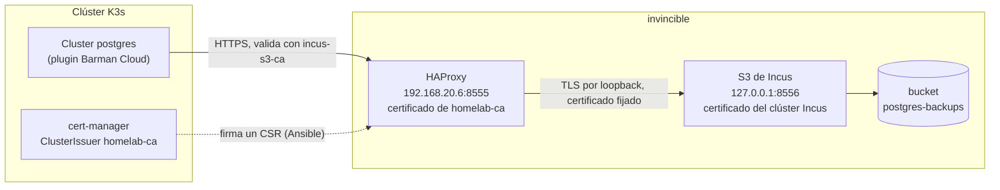

# PostgreSQL de la plataforma y respaldos en Incus

El HomeLab tiene un PostgreSQL compartido para las aplicaciones de la plataforma (la primera es `homelab-agent`). Lo
administra CloudNativePG, un operador de Kubernetes, y sus respaldos (el WAL, Write-Ahead Log: el registro de cambios
de PostgreSQL, y una copia base semanal) van a un bucket de Incus por S3 (Simple Storage
Service, el protocolo de almacenamiento de objetos de Amazon), cifrado con TLS (Transport Layer Security) y con un
certificado firmado por la CA (autoridad certificadora) del HomeLab.

Los manifiestos del clúster viven en el repo `gitops`
([`addons/storage/postgres/`](https://github.com/maceosoft/gitops/tree/main/addons/storage/postgres)); lo que está
fuera de Kubernetes (el S3 de Incus, su certificado y los Secrets que vienen de 1Password) es de este repo.

## Qué hay

| Pieza | Dónde | Qué hace |
|---|---|---|
| Cluster `postgres` | namespace `postgres` (gitops) | Una instancia de PostgreSQL 18 con un volumen de Longhorn; servicio `postgres-rw.postgres.svc:5432` |
| Rol y base `homelab_agent` | gitops (`DatabaseRole` y `Database`) | Base de `homelab-agent`, con su propio usuario |
| Respaldos | plugin Barman Cloud (gitops, componente `backups/`) | WAL archivado de forma continua y un respaldo base semanal (domingo 03:00 UTC), con 3 semanas de retención: se puede volver a cualquier momento de las últimas 3 semanas |
| Bucket `postgres-backups` | Incus, pool `local`, miembro `invincible` | Guarda los respaldos. Lo crea una persona |
| Endpoint `https://s3.homelab.local:8555` (`192.168.20.6`) | HAProxy en `invincible` ([rol `incus_s3`](https://github.com/maceosoft/homelab/blob/main/ansible/roles/incus_s3/README.md)) | Publica el S3 de Incus con un certificado de `homelab-ca` |

Secrets que crea [`playbook-platform-secrets.yml`](https://github.com/maceosoft/homelab/blob/main/ansible/playbook-platform-secrets.yml)
desde 1Password (bóveda `HomeLab`):

| Secret | Contenido | Origen |
|---|---|---|
| `postgres/postgres-homelab-agent` | `kubernetes.io/basic-auth`: `username=homelab_agent`, `password`; etiqueta `cnpg.io/reload: "true"` | Item `postgres-homelab-agent`, campo `password`. **Si falta, el playbook lo genera** (64 caracteres hexadecimales) y lo guarda en 1Password |
| `ai/homelab-agent-postgres` | `DATABASE_URL=postgresql://homelab_agent:<password>@postgres-rw.postgres.svc:5432/homelab_agent?sslmode=require` | La misma contraseña |
| `postgres/postgres-s3` | `ACCESS_KEY_ID`, `ACCESS_SECRET_KEY`; etiqueta `cnpg.io/reload: "true"` | Item `postgres-s3`, campos `access_key` y `secret_key` (los crea el operador) |
| `postgres/incus-s3-ca` | `ca.crt`: la CA del HomeLab, solo el certificado público | `ca.crt` de `cert-manager/homelab-ca` (el script nunca lee la llave de la CA) |

## Cómo llegan los respaldos a Incus



HAProxy trabaja en modo TCP (Transmission Control Protocol, sin interpretar HTTP): termina TLS y vuelve a cifrar hacia Incus sin tocar la petición, así la firma de cada
pedido S3 llega intacta. El bucket vive solo en `invincible` (Incus no replica los buckets de un pool `dir`): si ese nodo
se pierde, se pierden los respaldos. Para una segunda copia, ver [Backups de Incus](../operacion/backups-incus.md).

## El certificado del endpoint S3

### Qué sirve Incus hoy

Incus usa **un solo certificado para todos sus listeners**: la API (interfaz de programación) y la UI (interfaz web)
en `8443`, la comunicación entre miembros,
las métricas y los buckets. Es el certificado del clúster (`/var/lib/incus/cluster.crt`, igual en los cuatro miembros).
El de hoy es autofirmado (`CN=root@invincible`), vence en 2036 y sus SAN (Subject Alternative Names, los nombres que
acepta) son solo `invincible`, `127.0.0.1` y `::1`. **No incluye `192.168.20.6`**: aunque CloudNativePG confiara en ese
certificado, la comprobación del nombre fallaría al conectarse a `https://192.168.20.6:8555`.

El código de Incus lo confirma: los listeners de red, clúster, métricas y buckets se crean con el mismo certificado del
daemon ([`endpoints.go`](https://github.com/lxc/incus/blob/main/internal/server/endpoints/endpoints.go)); no hay una
opción para darle otro certificado a `core.storage_buckets_address`.

### Opciones

| | A. Cambiar el certificado del clúster Incus | B. Proxy TLS delante del S3 (elegida) |
|---|---|---|
| Cómo | `incus cluster update-certificate` con un certificado de `homelab-ca` (SAN de los cuatro miembros e `incus.homelab.local`) | Incus publica S3 solo en loopback y HAProxy publica `:8555` con un certificado de `homelab-ca` |
| Qué toca | La API, la UI, la comunicación entre miembros y todos los clientes de la API | Solo el puerto `8555` |
| Si el certificado vence | Se cae la API de Incus, la UI y la comunicación del clúster | Fallan los respaldos (CloudNativePG lo marca en el estado del Cluster); Incus sigue igual |
| Renovación | Un certificado de `homelab-ca` dura mucho menos que el autofirmado actual (2036): renovaciones periódicas del certificado más crítico del HomeLab | Renovación anual de un certificado que solo usa el S3 |
| Costo | Ningún componente nuevo | Un paquete (HAProxy) en `invincible` |

**Se elige B.** El certificado del clúster Incus es el que más cosas sostiene en el HomeLab; cambiarlo por uno que hay
que renovar convierte un olvido en una caída de toda la virtualización. El proxy deja el cambio limitado a los
respaldos. Se descartó también publicar el S3 a través de Kong (el Gateway del clúster): para restaurar después de
perder el clúster K3s (la distribución ligera de Kubernetes del HomeLab) habría que levantar primero el Gateway, y HAProxy en el nodo no depende de Kubernetes.

**Cómo se emite.** El [rol `incus_s3`](https://github.com/maceosoft/homelab/blob/main/ansible/roles/incus_s3/README.md)
genera la llave en `invincible` y un CSR (Certificate Signing Request: el pedido de firma, solo con datos públicos);
crea un `CertificateRequest` para el ClusterIssuer `homelab-ca`, espera la firma y borra el pedido. La llave del
certificado nunca sale del nodo y la de la CA nunca sale del clúster. HAProxy, a su vez, verifica el S3 de Incus contra
el certificado del clúster Incus fijado (no confía en cualquier certificado).

### Quién usa la API de Incus

Con la opción B ninguno de estos clientes cambia. La tabla queda como referencia por si algún día se cambia el
certificado del clúster (opción A):

| Cliente | Cómo confía en el certificado de Incus hoy | Qué haría falta tras un cambio de certificado |
|---|---|---|
| Miembros del clúster entre sí | `cluster.crt` compartido | Nada: `incus cluster update-certificate` lo cambia en todos |
| CLI `incus` con remotos en la estación del operador | Guarda el certificado del servidor al agregar el remoto (`servercerts/<remoto>.crt`) | `incus remote remove <remoto>` y `incus remote add <remoto> https://incus.homelab.local:8443` (o reemplazar ese archivo). Hoy la estación no tiene remotos del HomeLab |
| UI en el navegador (`incus.homelab.local:8443`) | Excepción aceptada a mano (certificado autofirmado) | Borrar la excepción; si el navegador confía en `homelab-ca`, ya no hay aviso |
| OIDC (OpenID Connect) con Dex | Es Incus quien llama a Dex (`oidc.issuer`); el retorno pasa por el navegador | Nada |
| `vmagent` (métricas, [certificado de métricas](../operacion/certificado-metricas-incus.md)) | `insecureSkipVerify: true` y certificado cliente | Nada (y se podría pasar a validar con `homelab-ca`) |
| OpenTofu (provider `lxc/incus`, remoto `homelab`) | Configuración del cliente `incus` de quien lo corre | Lo mismo que un remoto del CLI |
| CAPN (Cluster API Provider for Incus) | No desplegado; el ejemplo `lxc-secret` valida TLS | Darle la CA o el certificado nuevo al crear su Secret |
| Roles de Ansible | Usan `incus` por el socket local del nodo | Nada |
| HAProxy del S3 (rol `incus_s3`) | Fija `cluster.crt` como única confianza hacia Incus | Volver a correr `playbook-incus-s3.yml` con `-e incus_s3_confirm=true` |

### Renovación

- **Quién:** el operador, con `playbook-incus-s3.yml -e incus_s3_confirm=true`. cert-manager no puede renovar solo un
  certificado cuya llave vive fuera del clúster.
- **Cuándo:** el certificado dura 1 año. Cada vez que se corre, el playbook lo renueva si vence en menos de 30 días, si
  no lo firmó la `homelab-ca` actual o si cambiaron sus SAN; si no, no hace nada.
- **Aviso:** el preflight muestra la fecha de vencimiento. Si se olvida, CloudNativePG deja de archivar el WAL y la
  condición `ContinuousArchiving` del Cluster pasa a `False`.
- **Si se reconstruye el clúster K3s**, cert-manager crea una `homelab-ca` nueva: el playbook detecta que el certificado
  lo firmó otra CA y lo vuelve a emitir, y `playbook-platform-secrets.yml` lleva la CA nueva a `incus-s3-ca`.

## Puesta en marcha

Desde `ansible/`, con el kubeconfig del HomeLab y la app de 1Password desbloqueada:

```bash
export KUBECONFIG=~/.kube/homelab-k3s.yaml
export ONEPASSWORD_ACCOUNT_NAME="Mi Cuenta"   # tu cuenta
export ONEPASSWORD_VAULT=HomeLab
```

1. **Preflight (no cambia nada).** Muestra el valor actual de `core.storage_buckets_address`, si existe el bucket y el
   estado del certificado:

    ```bash
    ansible-playbook -i inventory.ini playbook-incus-s3.yml
    ```

2. **Crear el bucket** en `invincible`. `-q` evita que Incus imprima la llave `admin` que crea junto con el bucket; se
   borra enseguida porque CloudNativePG tendrá su propia llave:

    ```bash
    ssh invincible 'sudo incus storage bucket create local postgres-backups --target invincible -q --description "Respaldos de PostgreSQL (CloudNativePG)"'
    ssh invincible 'sudo incus storage bucket key delete local postgres-backups admin'
    ssh invincible 'sudo incus storage bucket list local; sudo incus storage bucket key list local postgres-backups'
    ```

    Debe aparecer `postgres-backups` en `invincible`, sin llaves.

3. **Generar la llave en 1Password**, sin verla:

    ```bash
    op item create --category "Secure Note" --vault HomeLab --title postgres-s3 \
      "access_key[password]=$(openssl rand -hex 16)" \
      "secret_key[password]=$(openssl rand -hex 32)" >/dev/null
    ../.venv/bin/python scripts/apply_platform_secrets.py --check
    ```

    En el `--check`, `postgres-s3` tiene que mostrar `✓ access_key` y `✓ secret_key`.

4. **Registrar esa llave en el bucket.** Los valores viajan por una tubería (no quedan en la línea de comandos del nodo
   ni en pantalla); `--role admin` es necesario porque la opción por defecto (`read-only`) pisa el YAML (formato de texto de
   configuración) que llega por la entrada:

    ```bash
    AK=$(op read "op://HomeLab/postgres-s3/access_key") && SK=$(op read "op://HomeLab/postgres-s3/secret_key") \
      && test -n "$AK" && test -n "$SK" \
      && printf 'description: CloudNativePG (postgres)\naccess-key: %s\nsecret-key: %s\n' "$AK" "$SK" \
      | ssh invincible 'sudo incus storage bucket key create local postgres-backups cnpg --role admin >/dev/null'
    unset AK SK
    ssh invincible 'sudo incus storage bucket key list local postgres-backups'
    ```

    Debe aparecer la llave `cnpg` con rol `admin`.

5. **Revisar los cambios** sin aplicarlos:

    ```bash
    ansible-playbook -i inventory.ini playbook-incus-s3.yml -C --diff
    ```

    Muestra el cambio de `core.storage_buckets_address` a `127.0.0.1:8556`, la instalación de HAProxy, el certificado
    que se emitiría y el `haproxy.cfg`.

6. **Aplicar:**

    ```bash
    ansible-playbook -i inventory.ini playbook-incus-s3.yml -e incus_s3_confirm=true
    ```

    Al final tiene que decir `Verify return code: 0 (ok)` y `HTTP 403` (código de respuesta web: el S3 de Incus rechaza un pedido sin
    credenciales).

7. **Abrir el puerto en el firewall del nodo** (servicio `incus-s3`: nodos, pods y operador), primero en seco:

    ```bash
    ansible-playbook -i inventory.ini playbook-firewall.yml -l invincible --check --diff
    ansible-playbook -i inventory.ini playbook-firewall.yml -l invincible
    ```

    El playbook pide escribir `SI` y revierte solo si no se confirma (ver
    [`host_firewall`](https://github.com/maceosoft/homelab/blob/main/ansible/roles/host_firewall/README.md)).

8. **Probar desde la estación**, con conexiones nuevas, como lo hará CloudNativePG:

    ```bash
    kubectl -n cert-manager get secret homelab-ca -o jsonpath='{.data.ca\.crt}' | base64 -d > ~/homelab-ca.crt
    openssl s_client -connect s3.homelab.local:8555 -CAfile ~/homelab-ca.crt -verify_hostname s3.homelab.local \
      -verify_return_error </dev/null 2>/dev/null | grep 'Verify return code'
    AWS_ACCESS_KEY_ID=$(op read "op://HomeLab/postgres-s3/access_key") \
    AWS_SECRET_ACCESS_KEY=$(op read "op://HomeLab/postgres-s3/secret_key") \
    AWS_CA_BUNDLE=~/homelab-ca.crt \
      aws s3 ls s3://postgres-backups --endpoint-url https://s3.homelab.local:8555 --region us-east-1; echo "exit=$?"
    ```

    Esperado: `Verify return code: 0 (ok)` y `exit=0` (el bucket vacío no lista nada).

9. **Crear los Secrets** (primero en seco: con `-C` no se genera ni se guarda la contraseña):

    ```bash
    ansible-playbook -i inventory.ini playbook-platform-secrets.yml -C
    ansible-playbook -i inventory.ini playbook-platform-secrets.yml
    kubectl -n postgres get secret postgres-homelab-agent postgres-s3 incus-s3-ca
    kubectl -n ai get secret homelab-agent-postgres
    ```

10. **Encender los respaldos en `gitops`** (otro repo y otro PR): seguir
    [`backups/kustomization.yaml`](https://github.com/maceosoft/gitops/blob/main/addons/storage/postgres/cluster/backups/kustomization.yaml).
    Al terminar, `kubectl -n postgres get cluster postgres -o jsonpath='{.status.conditions}'` tiene que mostrar
    `ContinuousArchiving` en `True` y `kubectl -n postgres get backups.postgresql.cnpg.io` un respaldo `completed`
    (con el nombre completo: Longhorn también tiene un recurso `backups` y `kubectl get backups` muestra el suyo).

## El nombre del endpoint

CloudNativePG llega al S3 por `https://s3.homelab.local:8555`. El registro `s3` de la zona `homelab.local`
([`bind_dns`](https://github.com/maceosoft/homelab/blob/main/ansible/roles/bind_dns/README.md)) apunta al nodo que
tiene los buckets (`incus_s3_host` en `group_vars/all.yml`, hoy `invincible`), no a `incus.homelab.local`, que sigue al
líder del clúster Incus y puede cambiar. Los pods resuelven `homelab.local` con el BIND gracias a `coredns-custom`.

El certificado del proxy incluye ese nombre, `invincible`, `invincible.homelab.local` y la IP. Si el S3 se muda a otro
nodo o cambia la IP, el orden es:

1. Cambiar `incus_s3_host` (y el `hosts:` de `playbook-incus-s3.yml`) y correr `playbook-bind-dns.yml`.
2. Correr `playbook-incus-s3.yml` en el nodo nuevo: emite un certificado con los nombres nuevos y verifica la IP y
   `s3.homelab.local`.
3. Recién entonces, en `gitops`, actualizar la IP de la NetworkPolicy `networkpolicy-s3.yaml` (Kubernetes no admite
   reglas por nombre). El `endpointURL` no cambia.

## Rotar credenciales

- **Contraseña de `homelab_agent`:** cambiar el campo `password` del item `postgres-homelab-agent` y volver a correr
  `playbook-platform-secrets.yml`. CloudNativePG la aplica al instante (etiqueta `cnpg.io/reload`); después reiniciar
  `homelab-agent` para que tome la `DATABASE_URL` nueva.
- **Llave del bucket:** crear una llave nueva en Incus y en 1Password, aplicar los Secrets, comprobar que el archivo
  del WAL sigue funcionando y borrar la vieja. Pasos en [Rotar credenciales](../operacion/rotar-credenciales.md#postgresql-de-la-plataforma).

## Restaurar

Esquema (se detalla cuando haya respaldos reales que probar):

1. Comprobar que hay respaldos: `kubectl -n postgres get backups.postgresql.cnpg.io` y, en el bucket, el prefijo
   `postgres/`.
2. Crear un Cluster **nuevo** con otro nombre (por ejemplo `postgres-restore`) que arranque desde el ObjectStore. Nunca
   restaurar sobre el Cluster que sigue archivando: escribiría en la misma carpeta del bucket.

    ```yaml
    spec:
      bootstrap:
        recovery:
          source: origen
          # opcional: volver a un momento exacto
          # recoveryTarget:
          #   targetTime: "2026-11-20 10:00:00+00"
      externalClusters:
        - name: origen
          plugin:
            name: barman-cloud.cloudnative-pg.io
            parameters:
              barmanObjectName: postgres-s3
              serverName: postgres
    ```

3. Revisar los datos, apuntar las aplicaciones al Cluster nuevo (o renombrar) y volver a activar su propio archivo de
   WAL con un `serverName` distinto.
4. Si se perdió el clúster K3s completo: reinstalar, dejar que cert-manager cree la `homelab-ca` nueva, volver a correr
   `playbook-incus-s3.yml -e incus_s3_confirm=true` (emite un certificado de la CA nueva) y
   `playbook-platform-secrets.yml`, y después restaurar. Los datos del bucket no dependen de la CA.

Documentación oficial: [recuperación en CloudNativePG](https://cloudnative-pg.io/documentation/current/recovery/) y
[plugin Barman Cloud](https://cloudnative-pg.io/plugin-barman-cloud/).

## Problemas frecuentes

| Síntoma | Causa probable | Qué hacer |
|---|---|---|
| `ContinuousArchiving` en `False` | El endpoint no responde, la llave no vale o el certificado venció | Paso 8 de la puesta en marcha; el preflight del playbook muestra el vencimiento |
| `certificate verify failed` en el sidecar del plugin | `incus-s3-ca` no es la CA que firmó el certificado (p. ej. tras reinstalar K3s) | Volver a correr `playbook-incus-s3.yml` y `playbook-platform-secrets.yml` |
| HAProxy responde pero el backend falla | Cambió el certificado del clúster Incus | Volver a correr `playbook-incus-s3.yml -e incus_s3_confirm=true` (copia el `cluster.crt` nuevo) |
| `XAmzContentSHA256Mismatch` o errores de checksum | Clientes S3 recientes envían checksums que algunos S3 compatibles no aceptan | Descomentar las variables `AWS_*_CHECKSUM_*` en `objectstore.yaml` (gitops) |
