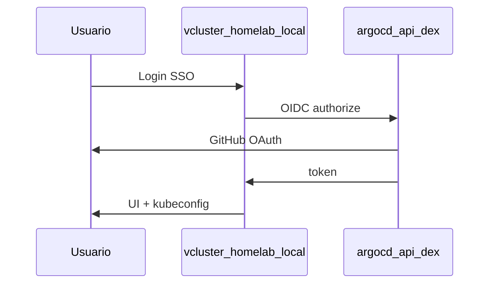

# vCluster Platform

!!! info "Part of the implementation guide"
    **[Phase 5 — vCluster](../implementacion/fase-5-vcluster.md)** — actionable steps.
    Requires **[Phase 4 — GitOps](../implementacion/fase-4-gitops.md)** (Dex, Gateway).

Deep-dive supplement. vCluster Platform provides **web UI**, **SSO (single sign-on) via
Argo CD Dex**, and **kubeconfig download** for the management K3s (connected
cluster) and vClusters, without relying solely on CLI (command-line interface).

## What it's for

| Capability | Description |
|---|---|
| Virtual clusters | Isolated Kubernetes API inside management K3s, without spinning up Incus VMs |
| Web UI | Create/delete vClusters, view status, connect from browser |
| SSO | OIDC login via **Dex** → **GitHub** (team `devops` of org `maceosoft`); credentials in 1Password |
| Kubeconfig | **Download kubeconfig** / **Connect** for the **host K3s** (connected cluster) and for each **vCluster** |

Manual sync — Application `vcluster-platform` (commented out in ApplicationSet `homelab-root`: enabled manually).

## Components involved

| Resource | Purpose |
|---|---|
| [`vcluster-platform.yaml`](https://github.com/maceosoft/gitops/blob/main/argocd/apps/vcluster-platform.yaml) | Helm Application that installs Loft Platform in `vcluster-platform` |
| [`vcluster/values/platform.yaml`](https://github.com/maceosoft/gitops/blob/main/vcluster/values/platform.yaml) | HTTPRoute `vcluster.homelab.local` (`vcluster/route`), OIDC issuer → Argo CD Dex |
| [`argocd/config/dex.config`](https://github.com/maceosoft/gitops/blob/main/argocd/config/dex.config) | GitHub Connector + OAuth client `vcluster-platform` |
| [`argocd/secrets/1password.md`](https://github.com/maceosoft/gitops/blob/main/argocd/secrets/1password.md) | 1Password Items → `argocd-secret` |
| **`argocd-route`** | Exposes Argo CD/Dex at `argocd.homelab.local` (see [GitOps](../gitops/index.md)) |

## Authentication flow



| URL | Role |
|---|---|
| [`https://argocd.homelab.local`](https://argocd.homelab.local) | Argo CD UI; Dex issuer at `/api/dex` |
| [`https://vcluster.homelab.local`](https://vcluster.homelab.local) | vCluster Platform UI |

## Implementation (summary)

Follow **[Phase 4 — GitOps](../implementacion/fase-4-gitops.md)** until
Dex OAuth and Gateway are complete. Then:

### 1. OAuth Secrets (step 4.7 of GitOps guide)

Ansible generates and applies local secrets; in 1Password you only need to
manually create `GITHUB_CLIENT_ID` and `GITHUB_CLIENT_SECRET`:

```bash
cd ansible
ansible-playbook -i inventory.ini playbook-dex-oauth-secrets.yml
# Tras desplegar Platform (paso 2):
ansible-playbook -i inventory.ini playbook-dex-oauth-secrets.yml \
  --tags vcluster -e dex_oauth.apply_vcluster=true
```

### 2. Deploy Platform

```bash
kubectl apply -f gitops/argocd/apps/vcluster-platform.yaml
```

Argo CD UI → `vcluster-platform` → **Sync**.

### 3. Validate GitHub SSO

After `argocd` sync, login in Argo CD or Platform should offer **GitHub**.
If it fails, check the OAuth App Redirect URIs and team `maceosoft/devops` in
[`dex.config`](https://github.com/maceosoft/gitops/blob/main/argocd/config/dex.config).

With stable SSO, put `auth.password.disabled: true` in `platform.yaml`.

### 4. DNS

`vcluster.homelab.local` and `argocd.homelab.local` are resolved by LAN DNS
(BIND on `deborah`) to the Gateway's fixed IP, `192.168.23.200`
([Phase 4 — 4.8](../implementacion/fase-4-gitops.md#48-homelablocal-dns)). Use
`192.168.20.5` as DNS; if you can't, the fallback is `/etc/hosts`:

```
192.168.23.200  argocd.homelab.local vcluster.homelab.local
192.168.20.6    incus.homelab.local
```

## Daily use

1. Open [`https://vcluster.homelab.local`](https://vcluster.homelab.local)
2. **Login with SSO** (GitHub) or local admin until password is disabled
3. **New Virtual Cluster** → name → **Create**
4. In the vcluster: **Connect** / **Download kubeconfig**
5. `export KUBECONFIG=~/Downloads/kubeconfig.yaml` and `kubectl get nodes`

### Management K3s kubeconfig (connected cluster)

The host cluster where Platform runs appears in **Clusters** as a connected
cluster. Same SSO flow → **Connect** / **Download kubeconfig**. Without **Cluster
Access** explicitly granted, the authenticated user **does not see the cluster** (deny by
default). Assign permissions to user/team `loft-*` in Platform UI.

Non-web alternative: [`fase-4-gitops.md` 4.1](../implementacion/fase-4-gitops.md#41-kubectl-access).

Alternative CLI:

```bash
vcluster connect <nombre> -n <namespace>
```

## vCluster vs CAPN

| | vCluster Platform | CAPN |
|---|---|---|
| Auth | Argo CD Dex + UI kubeconfig | Sealed Incus secret |
| Runtime | Pods in management K3s | Incus instances |
| RAM | Moderate (1 vcluster) | High per kubeadm node |
| Argo CD Sync | manual | manual |

<div class="card">
  <div class="card-kicker">vCluster vs CAPN</div>
  <div class="option-grid">
    <div class="card-col">
      <div class="card-title">vCluster Platform</div>
      <div class="text-muted">Pods in K3s; web kubeconfig; Dex SSO</div>
      <div class="text-muted">Overhead per vcluster; Platform permissions</div>
    </div>
    <div class="card-col">
      <div class="card-title">CAPN</div>
      <div class="text-muted">Real kubeadm clusters in Incus</div>
      <div class="text-muted">Lots of RAM per node; sealed Incus secret</div>
    </div>
    <div class="card-col">
      <div class="card-title">Web kubeconfig (Platform)</div>
      <div class="text-muted">No <code>scp</code>; centralized audit</div>
      <div class="text-muted">Requires explicit Cluster Access</div>
    </div>
    <div class="card-col">
      <div class="card-title"><code>scp</code> / CLI</div>
      <div class="text-muted">Works before Phase 5</div>
      <div class="text-muted">Local file; no SSO in flow</div>
    </div>
  </div>
</div>

## Dependencies

Must be **Healthy** before syncing Platform:

- `openebs`, `homelab-storage` (PVCs)
- `metallb`, `metallb-config`, `cert-manager-config` and the Gateway controller (`kong`) (HTTPS URLs)
- `argocd-route`, `argocd` (Dex + staticClient)
