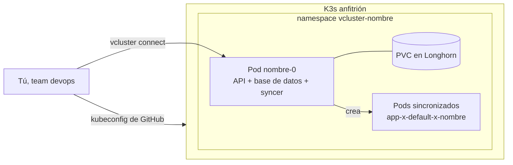

# vCluster

Open source [vCluster](https://www.vcluster.com/docs) creates **virtual Kubernetes clusters** inside the HomeLab's K3s. Each one has its own API (Application Programming Interface), its own namespaces, its own CRDs, and its own admin permissions, but runs as pods in a namespace on the host (`vcluster-<nombre>`). The step-by-step guide is in
[Phase 5](../implementacion/fase-5-vcluster.md), and day-to-day tasks are in [Common operations](../operacion/vcluster.md).

## How it works here

1. **The control plane** of the vCluster is a pod (`<nombre>-0`, a StatefulSet) with its own Kubernetes API, an embedded
   database, and the **syncer**. It stores its state on a Longhorn volume.
2. **What you create inside** (Deployments, ConfigMaps, namespaces…) lives only in that database.
3. **The syncer** copies to the host the minimum needed for workloads to run: the pods, their Services, mounted Secrets and ConfigMaps,
   and the PVCs. On the host they have names like `web-7fbc…-x-default-x-<nombre>` and are scheduled by the
   K3s scheduler on the usual nodes.
4. **To get in**, you use your GitHub kubeconfig against the host ([Access Kubernetes with
   GitHub](../operacion/acceso-kubernetes.md)), and `vcluster connect` opens a port-forward to the vCluster pod and gives you
   an admin kubeconfig **for that vCluster**.

## Pieces in the `gitops` repo

| File | Purpose |
|---|---|
| [`bootstrap/components/apagadas/vcluster-demo.yaml`](https://github.com/maceosoft/gitops/blob/main/bootstrap/components/apagadas/vcluster-demo.yaml) | Example Application: the `vcluster` 0.38.x chart as vCluster `demo` in `vcluster-demo`. Turned off; manual sync when you enable it |
| [`addons/cluster/vcluster/values/demo.yaml`](https://github.com/maceosoft/gitops/blob/main/addons/cluster/vcluster/values/demo.yaml) | Values: volume on `longhorn`, 5 Gi |

vClusters created with the CLI are not kept in git: they are for testing and get deleted. One that needs to stay is declared as an
Application, by copying `vcluster-demo.yaml`.

## Requirements

- **GitHub login to the K3s API** and the `devops` team with `cluster-admin` (creating a vCluster creates a namespace, Role,
  ServiceAccount, and StatefulSet).
- A healthy **Longhorn**: the control plane volume goes there.
- **`vcluster` CLI** of the same version as the chart (0.38.0), for `connect`, `pause`, and `list`.

No DNS, certificate, HTTPRoute, or Dex client is needed: nothing is published on the Gateway.

## Tested in the HomeLab

On Nov 18, 2026, with chart 0.38.0 and the GitHub user (`oidc:…`, team `devops`):

| Test | Result |
|---|---|
| `vcluster create` with the values from `demo.yaml` | Control plane ready in ~60 s, 5 Gi PVC in `longhorn` |
| `vcluster connect -- kubectl get ns` | Only the vCluster's namespaces |
| Deployment `nginx` + Service inside, `curl` from another pod | `HTTP 200`; the pod shows up on the host as `web-…-x-default-x-prueba` |
| `vcluster pause` / `vcluster resume` | Paused: 0 pods on the host. On resume, the Deployment is still there |
| The same config as an Argo CD Application | `Synced` and `Healthy` within 60 s, no differences after a forced refresh |
| `vcluster delete --delete-namespace` and deleting the Application | No leftovers in the cluster (CRDs, webhooks, ClusterRoles, volumes) |

## vCluster vs CAPN

| | vCluster | CAPN |
|---|---|---|
| What it creates | A control plane as a pod in K3s | Full kubeadm clusters on Incus instances |
| Nodes | K3s's own nodes (shares the kernel) | Dedicated (Incus VMs or containers) |
| RAM | Low (one pod per vCluster) | High per node |
| Isolation | By namespace | Machine-level |
| Access | GitHub login + `vcluster connect` | Kubeconfig of the created cluster |

See [Phase 6 — CAPN](../implementacion/fase-6-capn.md).

## vCluster Platform (discarded)

[vCluster Platform](https://www.vcluster.com/docs/platform/) adds a web interface, projects, and kubeconfig download. It was tested in the HomeLab on Nov 17, 2026: it started with the "vCluster Free" license, in which the single sign-on (SSO) feature is not enabled, so the GitHub login via Dex doesn't appear and, with password login disabled, nobody can get in. It also installs about 30 CRDs, webhooks, and APIServices of its own on the host. It was replaced by the open source vCluster.
