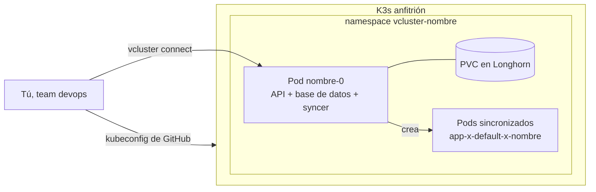

# vCluster

[vCluster](https://www.vcluster.com/docs) open source crea **clústeres de Kubernetes virtuales** dentro del K3s del
HomeLab. Cada uno tiene su propia API (Application Programming Interface), sus namespaces, sus CRD y sus permisos de
administrador, pero corre como pods en un namespace del anfitrión (`vcluster-<nombre>`). La guía paso a paso está en la
[Fase 5](../implementacion/fase-5-vcluster.md), y el día a día en [Operaciones frecuentes](../operacion/vcluster.md).

## Cómo funciona aquí

1. **El control plane** del vCluster es un pod (`<nombre>-0`, un StatefulSet) con su API de Kubernetes, su base de
   datos embebida y el **syncer**. Guarda el estado en un volumen de Longhorn.
2. **Lo que creas adentro** (Deployments, ConfigMaps, namespaces…) vive solo en esa base de datos.
3. **El syncer** copia al anfitrión lo mínimo para que las cargas corran: los pods, sus Services, Secrets y ConfigMaps
   montados, y los PVC. En el anfitrión llevan nombres como `web-7fbc…-x-default-x-<nombre>` y los programa el
   scheduler de K3s en los nodos de siempre.
4. **Para entrar** usas tu kubeconfig de GitHub contra el anfitrión ([Entrar a Kubernetes con
   GitHub](../operacion/acceso-kubernetes.md)), y `vcluster connect` abre un port-forward al pod del vCluster y te da
   un kubeconfig de administrador **de ese vCluster**.

## Piezas en el repo `gitops`

| Archivo | Para qué |
|---|---|
| [`bootstrap/components/apagadas/vcluster-demo.yaml`](https://github.com/maceosoft/gitops/blob/main/bootstrap/components/apagadas/vcluster-demo.yaml) | Application de ejemplo: el chart `vcluster` 0.38.x como vCluster `demo` en `vcluster-demo`. Apagada; sync manual al activarla |
| [`addons/cluster/vcluster/values/demo.yaml`](https://github.com/maceosoft/gitops/blob/main/addons/cluster/vcluster/values/demo.yaml) | Values: volumen en `longhorn`, 5 Gi |

Los vClusters creados con el CLI no quedan en git: son para probar y se borran. Uno que deba quedar se declara como
Application, copiando `vcluster-demo.yaml`.

## Requisitos

- **Login con GitHub al API de K3s** y el team `devops` con `cluster-admin` (crear un vCluster crea namespace, Role,
  ServiceAccount y StatefulSet).
- **Longhorn** sano: el volumen del control plane va ahí.
- **CLI `vcluster`** de la misma versión que el chart (0.38.0), para `connect`, `pause` y `list`.

No hace falta DNS, certificado, HTTPRoute ni cliente de Dex: no hay nada publicado en el Gateway.

## Probado en el HomeLab

El 18 nov 2026, con el chart 0.38.0 y el usuario de GitHub (`oidc:…`, team `devops`):

| Prueba | Resultado |
|---|---|
| `vcluster create` con los values de `demo.yaml` | Control plane listo en ~60 s, PVC de 5 Gi en `longhorn` |
| `vcluster connect -- kubectl get ns` | Solo los namespaces del vCluster |
| Deployment `nginx` + Service adentro, `curl` desde otro pod | `HTTP 200`; el pod aparece en el anfitrión como `web-…-x-default-x-prueba` |
| `vcluster pause` / `vcluster resume` | Pausado: 0 pods en el anfitrión. Al reanudar, el Deployment sigue ahí |
| La misma config como Application de Argo CD | `Synced` y `Healthy` en 60 s, sin diferencias tras un refresh forzado |
| `vcluster delete --delete-namespace` y borrar la Application | Sin restos en el clúster (CRD, webhooks, ClusterRoles, volúmenes) |

## vCluster vs CAPN

| | vCluster | CAPN |
|---|---|---|
| Qué crea | Un control plane como pod en K3s | Clústeres kubeadm completos en instancias de Incus |
| Nodos | Los de K3s (comparte kernel) | Propios (VMs o contenedores de Incus) |
| RAM | Baja (un pod por vCluster) | Alta por nodo |
| Aislamiento | Por namespace | De máquina |
| Acceso | Login con GitHub + `vcluster connect` | Kubeconfig del clúster creado |

Ver [Fase 6 — CAPN](../implementacion/fase-6-capn.md).

## vCluster Platform (descartado)

[vCluster Platform](https://www.vcluster.com/docs/platform/) agrega una interfaz web, proyectos y descarga de
kubeconfig. Se probó en el HomeLab el 17 nov 2026: arrancó con la licencia "vCluster Free", en la que la función de
inicio de sesión único (SSO) no está activa, así que el login con GitHub por Dex no aparece y, con la contraseña
desactivada, nadie puede entrar. Además instala unos 30 CRD, webhooks y APIServices propios en el anfitrión. Se
reemplazó por el vCluster open source.
